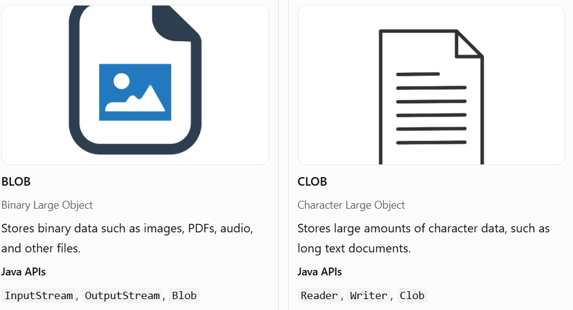

# Topic 10 — Reading and Writing LOBs in JDBC

## Learning objectives

By the end, you'll understand:

- What LOBs are and why we use them.
- The difference between `BLOB` and `CLOB`.
- How to write and read binary files using JDBC.
- How PostgreSQL handles large text and binary data.
- How to use `PreparedStatement` and `ResultSet` for LOB operations.

## 1. What is a LOB?

LOB stands for Large Object. It refers to data that may be too large or awkward to handle as an ordinary small database value.

Imagine you're building a student management system. You already store a student's name, age, course, and marks. But what if you also want to store their profile photo or a PDF certificate?

| Data        | Example                   | JDBC/SQL type                                        |
| ----------- | ------------------------- | ---------------------------------------------------- |
| Small text  | Student name              | `VARCHAR`                                            |
| Large text  | Long document or report   | `CLOB` concept; PostgreSQL `TEXT` is often suitable  |
| Binary data | Photo, PDF, or audio file | `BLOB` concept; PostgreSQL `BYTEA` is often suitable |

A LOB allows an application to work with large content rather than only short values such as names or marks.

## 2. BLOB vs CLOB



Important PostgreSQL distinction: PostgreSQL does not provide SQL types named `BLOB` and `CLOB` in the same way some other databases do. Common choices are:

- `BYTEA` for binary values, such as images or PDFs.
- `TEXT` for large text values.
- PostgreSQL's separate Large Object facility for very large binary data that needs stream-based access.

We'll first practise the simpler `BYTEA` approach, which is suitable for many small-to-medium files.

## 3. Creating a table for binary files

Let's create a `documents` table to store PDF certificates or other files.

```
CREATE TABLE documents (
    id INTEGER GENERATED ALWAYS AS IDENTITY PRIMARY KEY,
    file_name VARCHAR(255) NOT NULL,
    file_data BYTEA NOT NULL
);
```

- `id`: Unique identifier.
- `file_name`: Original filename.
- `file_data`: Actual file bytes stored in PostgreSQL.

The pgJDBC documentation recommends `setBinaryStream()`, `getBinaryStream()`, `setBytes()`, or `getBytes()` when working with `BYTEA`. For very large files, consider PostgreSQL's Large Object facility or storing the file outside the database.


## 4. Writing a file to PostgreSQL

We'll use `PreparedStatement.setBinaryStream()` to send a file into the database.

### Complete Java program: `WriteDocument.java`

```

import java.io.InputStream;
import java.nio.file.Files;
import java.nio.file.Path;
import java.sql.Connection;
import java.sql.DriverManager;
import java.sql.PreparedStatement;
import java.sql.SQLException;

public class WriteDocument {

    public static void main(String[] args) {
        String url = "jdbc:postgresql://localhost:5432/studentdb";
        String username = System.getenv("DB_USERNAME");
        String password = System.getenv("DB_PASSWORD");

        // Example: java WriteDocument certificate.pdf
        if (args.length != 1) {
            System.out.println("Usage: java WriteDocument <file-path>");
            return;
        }

        if (username == null || password == null) {
            System.out.println("Set DB_USERNAME and DB_PASSWORD first.");
            return;
        }

        Path file = Path.of(args[0]);

        if (!Files.isRegularFile(file)) {
            System.out.println("File not found: " + file);
            return;
        }

        String sql =
            "INSERT INTO documents (file_name, file_data) VALUES (?, ?)";

        try (Connection con =
                 DriverManager.getConnection(url, username, password);
             InputStream input = Files.newInputStream(file);
             PreparedStatement ps = con.prepareStatement(sql)) {

            ps.setString(1, file.getFileName().toString());
            ps.setBinaryStream(2, input, Files.size(file));

            int rows = ps.executeUpdate();

            System.out.println(rows == 1
                ? "Document saved successfully."
                : "Document was not saved.");

        } catch (SQLException | java.io.IOException e) {
            System.out.println("Could not save the document.");
            e.printStackTrace();
        }
    }
}

```

How it works:

1. `Files.newInputStream(file)` opens the source file.
2. `setString(1, ...)` supplies the filename.
3. `setBinaryStream(2, input, Files.size(file))` streams the file bytes into the second SQL parameter.
4. `executeUpdate()` inserts the document.

The stream is closed automatically through try-with-resources. The JDBC driver reads the stream while executing the statement, so keep it open until that operation finishes.


## 5. Reading a file from PostgreSQL

Now we'll retrieve the stored file and write it back to your computer.

### Complete Java program: `ReadDocument.java`

```

import java.io.InputStream;
import java.io.OutputStream;
import java.nio.file.Files;
import java.nio.file.Path;
import java.sql.Connection;
import java.sql.DriverManager;
import java.sql.PreparedStatement;
import java.sql.ResultSet;
import java.sql.SQLException;

public class ReadDocument {

    public static void main(String[] args) {
        String url = "jdbc:postgresql://localhost:5432/studentdb";
        String username = System.getenv("DB_USERNAME");
        String password = System.getenv("DB_PASSWORD");

        // Example: java ReadDocument 1 restored.pdf
        if (args.length != 2) {
            System.out.println(
                "Usage: java ReadDocument <document-id> <output-path>");
            return;
        }

        if (username == null || password == null) {
            System.out.println("Set DB_USERNAME and DB_PASSWORD first.");
            return;
        }

        int documentId;
        try {
            documentId = Integer.parseInt(args[0]);
        } catch (NumberFormatException e) {
            System.out.println("Document ID must be an integer.");
            return;
        }

        Path output = Path.of(args[1]);
        String sql =
            "SELECT file_data FROM documents WHERE id = ?";

        try (Connection con =
                 DriverManager.getConnection(url, username, password);
             PreparedStatement ps = con.prepareStatement(sql)) {

            ps.setInt(1, documentId);

            try (ResultSet rs = ps.executeQuery()) {
                if (!rs.next()) {
                    System.out.println("Document not found.");
                    return;
                }

                try (InputStream input = rs.getBinaryStream("file_data");
                     OutputStream out = Files.newOutputStream(output)) {

                    input.transferTo(out);
                }
            }

            System.out.println("Document restored to: " + output);

        } catch (SQLException | java.io.IOException e) {
            System.out.println("Could not read the document.");
            e.printStackTrace();
        }
    }
}

```

Example commands, after compiling the files with your JDBC driver on the classpath:

```
java WriteDocument certificate.pdf
java ReadDocument 1 restored.pdf
```

The first command stores the PDF in PostgreSQL. The second retrieves document ID `1` and saves it as `restored.pdf`.

Key distinction: `getBinaryStream()` reads the file progressively, whereas `getBytes()` loads the complete value into a byte array. Streams are often more suitable when you want to avoid loading the entire file into memory.


## 6. Reading and writing large text data

For large text such as reports, essays, or long descriptions, PostgreSQL's `TEXT` type is usually the simplest choice. You do not need a special PostgreSQL `CLOB` column.

```
CREATE TABLE student_reports (
    id INTEGER GENERATED ALWAYS AS IDENTITY PRIMARY KEY,
    report_text TEXT NOT NULL
);
```

For a text file, JDBC provides character-stream methods such as `setCharacterStream()` and `getCharacterStream()`.


Here's a small, complete example that inserts text from a file:

```

import java.io.Reader;
import java.nio.file.Files;
import java.nio.file.Path;
import java.sql.Connection;
import java.sql.DriverManager;
import java.sql.PreparedStatement;

public class WriteTextReport {

    public static void main(String[] args) {
        String url = "jdbc:postgresql://localhost:5432/studentdb";
        String username = System.getenv("DB_USERNAME");
        String password = System.getenv("DB_PASSWORD");

        if (username == null || password == null) {
            System.out.println("Set DB_USERNAME and DB_PASSWORD first.");
            return;
        }

        Path file = Path.of("report.txt");
        String sql = "INSERT INTO student_reports (report_text) VALUES (?)";

        try (Connection con =
                 DriverManager.getConnection(url, username, password);
             Reader reader = Files.newBufferedReader(file);
             PreparedStatement ps = con.prepareStatement(sql)) {

            ps.setCharacterStream(1, reader);
            ps.executeUpdate();

            System.out.println("Text report saved successfully.");

        } catch (Exception e) {
            System.out.println("Could not save text report.");
            e.printStackTrace();
        }
    }
}

```

Create a `report.txt` file in your program's working directory before running this example.

## 7. `BYTEA` vs PostgreSQL Large Objects

These approaches are related, but they are not interchangeable.

| Feature               | `BYTEA`                                                       | PostgreSQL Large Objects                              |
| --------------------- | ------------------------------------------------------------- | ----------------------------------------------------- |
| Storage               | Binary data in a table column                                 | Separate database-managed object referenced by an OID |
| Good for              | Many ordinary file-storage cases                              | Very large binary data needing stream/random access   |
| JDBC approach         | `setBinaryStream()`, `getBinaryStream()`                      | pgJDBC Large Object API                               |
| Transaction required? | Ordinary usage doesn't inherently require manual transactions | Yes, access must be inside a transaction              |
| Cleanup               | Delete the row/value normally                                 | Large Object cleanup must also be handled             |

For your current learning exercises, use `BYTEA` and `TEXT`. Later, if you need to work with PostgreSQL's dedicated Large Object API, remember the requirement to disable auto-commit and manage the transaction.


### Remember these distinctions for your exam and practical work:
- BLOB describes binary large-object data; PostgreSQL commonly uses BYTEA for binary data.
- CLOB describes character large-object data; PostgreSQL's TEXT type is often suitable for large text.
- setBinaryStream() sends binary data to the database.
- getBinaryStream() reads binary data from the database.
- Streams can help avoid loading an entire file into memory at once.
