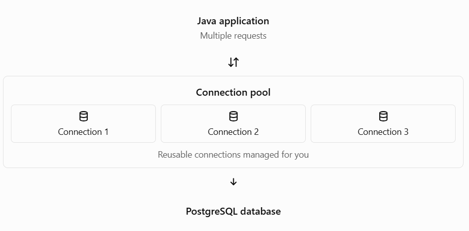

# Topic 11 — Connection Pools in Java JDBC

## Learning objectives

By the end of this topic, you should be able to:

- Explain connection pooling and why it is needed.
- Understand how a connection pool works.
- Use JDBC with HikariCP, a popular connection-pooling library.
- Configure and close a connection pool safely.
- Explain how connection pooling differs from `DriverManager`.

## 1. What is a database connection?

A database connection is a communication link between your Java program and PostgreSQL.

For example, your Java program might connect using:

```
Connection con = DriverManager.getConnection(
    "jdbc:postgresql://localhost:5432/studentdb",
    username,
    password
);
```

Creating a connection has a cost: the application and database need to establish communication, authenticate, and allocate resources.

Imagine that 100 students access your student-management application at the same time. If each request creates a new connection and closes it afterward, the application repeatedly pays that setup cost.

## 2. What is connection pooling?

Connection pooling means keeping a managed collection of database connections available for reuse.

Instead of creating a new physical connection for every database operation, the application borrows an available connection from the pool and returns it when finished.



### How it works

1. The pool creates a limited number of database connections.
2. Your code requests a connection from the pool.
3. The pool provides an available connection, or waits until one becomes available.
4. Your code executes SQL queries.
5. When you call `Connection.close()` on a pooled connection, it normally returns the connection to the pool instead of physically closing the database connection.
6. Another request can reuse it.

Important: Always close borrowed connections. With a pool, closing the connection is how you return it for reuse.

## 3. Why use a connection pool?

| Without pooling                                   | With pooling                                |
| ------------------------------------------------- | ------------------------------------------- |
| Frequently creates new database connections       | Reuses existing connections                 |
| Repeated connection setup can add overhead        | Reduces repeated setup overhead             |
| Each request can create extra connection pressure | Pool limits concurrent database connections |
| Harder to manage connection reuse centrally       | Central configuration and monitoring        |

Connection pooling doesn't make every query faster automatically. Its main benefit is reducing connection-creation overhead and controlling how many connections the application uses.


## 4. Important JDBC concepts: `DataSource` and HikariCP

Two terms you should know:

- `DataSource` — A standard JDBC interface used to obtain connections. It provides a common way for application code to request connections.
- HikariCP — A widely used connection-pooling library that provides a pooled `DataSource`.

For a new application, HikariCP is a good choice to learn. PostgreSQL's driver documentation also recommends using a full-featured pool for production applications rather than relying on its minimal built-in pool.


## 5. Practical: Configure HikariCP in Java

We'll use your existing PostgreSQL database, `studentdb`, and query its name.

### Step 1 — Add the Maven dependency

In your `pom.xml`, add HikariCP alongside your existing PostgreSQL JDBC driver dependency:

```

<dependency>
    <groupId>com.zaxxer</groupId>
    <artifactId>HikariCP</artifactId>
    <version>6.3.0</version>
</dependency>

```

If your project is not a Maven project yet, create a Maven Java project in VS Code first. Keep your existing pgJDBC dependency.

### Step 2 — Create `ConnectionPoolDemo.java`

This is a complete runnable example. It creates a pool, borrows a connection, runs a query, and then closes the pool.

```

import com.zaxxer.hikari.HikariConfig;
import com.zaxxer.hikari.HikariDataSource;

import java.sql.Connection;
import java.sql.ResultSet;
import java.sql.Statement;

public class ConnectionPoolDemo {

    public static void main(String[] args) {
        String username = System.getenv("DB_USERNAME");
        String password = System.getenv("DB_PASSWORD");

        if (username == null || password == null) {
            System.out.println("Set DB_USERNAME and DB_PASSWORD first.");
            return;
        }

        HikariConfig config = new HikariConfig();

        config.setJdbcUrl(
            "jdbc:postgresql://localhost:5432/studentdb"
        );
        config.setUsername(username);
        config.setPassword(password);

        // Pool configuration
        config.setMaximumPoolSize(5);
        config.setMinimumIdle(2);
        config.setConnectionTimeout(30000);

        try (HikariDataSource dataSource =
                 new HikariDataSource(config)) {

            // Borrow a connection from the pool.
            try (Connection con = dataSource.getConnection();
                 Statement st = con.createStatement();
                 ResultSet rs = st.executeQuery(
                     "SELECT current_database()")) {

                if (rs.next()) {
                    System.out.println(
                        "Connected to: " + rs.getString(1)
                    );
                }
            }

        } catch (Exception e) {
            System.out.println("Database operation failed.");
            e.printStackTrace();
        }
    }
}

```

Expected output when the connection succeeds:

```
Connected to: studentdb
```

### Step 3 — Understand the important settings

| Setting                       | Meaning                                                                      |
| ----------------------------- | ---------------------------------------------------------------------------- |
| `setMaximumPoolSize(5)`       | The pool can use at most five connections.                                   |
| `setMinimumIdle(2)`           | The pool tries to maintain two idle connections.                             |
| `setConnectionTimeout(30000)` | A caller can wait up to 30 seconds to obtain a connection before timing out. |
| `dataSource.getConnection()`  | Borrows a connection from the pool.                                          |
| `con.close()`                 | Returns the borrowed connection to the pool.                                 |
| `dataSource.close()`          | Shuts down the pool and releases its resources.                              |

These settings are explained in HikariCP's official documentation. The maximum pool size includes both idle and in-use connections.


## 6. A common mistake to avoid

Don't create a new `HikariDataSource` for every query. That would repeatedly create and destroy the pool, defeating its purpose.

Instead, create one pool for your application and share the `DataSource` object. Each operation borrows its own connection and returns it with try-with-resources.

```
try (Connection con = dataSource.getConnection()) {
    // Execute database operations here.
}
```

In a Spring Boot application, the framework normally configures a `DataSource` for you when the appropriate JDBC and database dependencies are present. You usually inject it where needed instead of manually creating the pool in every class.

Also, don't set the pool size arbitrarily high. PostgreSQL has finite resources, and more connections do not always mean better performance.
