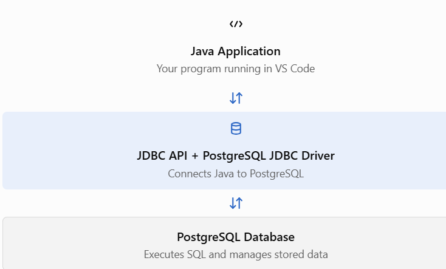
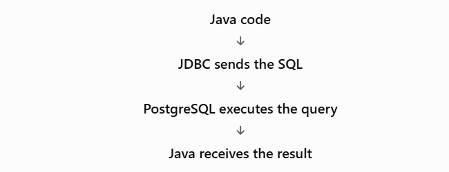

# Topic 2 — The Structured Query Language (SQL)

## 2. What is SQL?

SQL (Structured Query Language) is a language used to communicate with relational database management systems (RDBMS), such as PostgreSQL.

We use SQL to create database structures, store data, retrieve information, and modify or delete records.



For example, this SQL statement retrieves all students:

```
SELECT * FROM students;
```

Here, `SELECT` asks the database to retrieve data, `*` means all columns, and `students` is the table name.

Important distinction: SQL is the language for database operations. JDBC is the Java API that lets your Java code send SQL statements to the database and process the results.

## 3. Types of SQL commands

SQL commands are commonly grouped into five categories. This classification is useful for exams and helps you understand what each command does.&#x20;

[image](https://www.google.com/s2/favicons?domain=https://www.postgresql.org\&sz=32)

PostgreSQL

+1


| Category | Full form                    | Purpose                     | Examples                          |
| -------- | ---------------------------- | --------------------------- | --------------------------------- |
| DDL      | Data Definition Language     | Defines database structures | `CREATE`, `ALTER`, `DROP`         |
| DML      | Data Manipulation Language   | Changes stored data         | `INSERT`, `UPDATE`, `DELETE`      |
| DQL      | Data Query Language          | Retrieves data              | `SELECT`                          |
| DCL      | Data Control Language        | Controls permissions        | `GRANT`, `REVOKE`                 |
| TCL      | Transaction Control Language | Manages transactions        | `COMMIT`, `ROLLBACK`, `SAVEPOINT` |

Let's understand them through a single example.

## 4. Practical SQL with PostgreSQL

We'll create a `students` table and perform the same operations you'll eventually implement through Java JDBC.

### Step 1 — Create a database

Run this in PostgreSQL's Query Tool or `psql`:

```
CREATE DATABASE college_db;
```

Connect to `college_db` before running the following commands. If you're using `psql`, type:

```
\c college_db
```

### Step 2 — Create a table (DDL)

A table stores related information in rows and columns.

```
CREATE TABLE students (
    id INTEGER GENERATED ALWAYS AS IDENTITY PRIMARY KEY,
    name VARCHAR(100) NOT NULL,
    age INTEGER,
    course VARCHAR(100),
    marks NUMERIC(5, 2)
);
```

What does this mean?

- `id`: automatically generated unique identifier.
- `PRIMARY KEY`: uniquely identifies each student.
- `VARCHAR(100)`: stores text up to 100 characters.
- `NOT NULL`: requires a value for `name`.
- `NUMERIC(5, 2)`: stores numbers with up to two decimal places.

This is DDL because we're defining the database structure.

### Step 3 — Insert records (DML)

```
INSERT INTO students (name, age, course, marks)
VALUES
    ('Aarav', 21, 'Java', 85.50),
    ('Sita', 20, 'Python', 92.00),
    ('Ram', 22, 'Java', 68.00),
    ('Mina', 21, 'Database', 78.50);
```

We inserted four students. PostgreSQL generates their IDs automatically.

To see the stored data, use:

```
SELECT * FROM students;
```

Expected result:

| id | name  | age | course   | marks |
| -- | ----- | --- | -------- | ----- |
| 1  | Aarav | 21  | Java     | 85.50 |
| 2  | Sita  | 20  | Python   | 92.00 |
| 3  | Ram   | 22  | Java     | 68.00 |
| 4  | Mina  | 21  | Database | 78.50 |

The exact generated IDs depend on the database's current identity sequence.

### Step 4 — Retrieve specific data (DQL)

A. Select specific columns

```
SELECT name, marks
FROM students;
```

B. Filter records using `WHERE`

```
SELECT *
FROM students
WHERE marks >= 80;
```

This returns students whose marks are at least 80.

C. Combine conditions

```
SELECT *
FROM students
WHERE course = 'Java' AND marks >= 70;
```

`AND` requires both conditions to be true. `OR` requires at least one condition to be true.

D. Sort records

```
SELECT name, marks
FROM students
ORDER BY marks DESC;
```

- `ASC`: ascending order.
- `DESC`: descending order.

E. Limit the number of results

```
SELECT *
FROM students
ORDER BY marks DESC
LIMIT 2;
```

This returns the two highest-scoring students.

PostgreSQL's official documentation explains the full `SELECT` syntax, including filtering, ordering, and limiting results.&#x20;

[image](https://www.google.com/s2/favicons?domain=https://www.postgresql.org\&sz=32)

PostgreSQL

+1


### Step 5 — Update a record (DML)

Suppose Ram improves his marks to 75.

```
UPDATE students
SET marks = 75
WHERE name = 'Ram';
```

Important: Always understand your `WHERE` condition before running `UPDATE`. Without `WHERE`, every row in the table may be updated.

### Step 6 — Delete a record (DML)

Suppose we want to delete student Ram:

```
DELETE FROM students
WHERE name = 'Ram';
```

Again, without `WHERE`, all rows in the table may be deleted.

These four operations are known as CRUD:

Create

`INSERT` — add records

Read

`SELECT` — retrieve records

Update

`UPDATE` — modify records

Delete

`DELETE` — remove records

These operations will form the foundation of your JDBC mini project.

## 5. Useful SQL functions

SQL also lets us calculate information from database records.

| Function  | Purpose            | Example                            |
| --------- | ------------------ | ---------------------------------- |
| `COUNT()` | Counts rows        | `SELECT COUNT(*) FROM students;`   |
| `AVG()`   | Calculates average | `SELECT AVG(marks) FROM students;` |
| `MAX()`   | Finds maximum      | `SELECT MAX(marks) FROM students;` |
| `MIN()`   | Finds minimum      | `SELECT MIN(marks) FROM students;` |
| `SUM()`   | Calculates total   | `SELECT SUM(marks) FROM students;` |

You can also group records with `GROUP BY`.

```
SELECT course, AVG(marks) AS average_marks
FROM students
GROUP BY course;
```

This calculates the average marks for each course.

To filter grouped results, use `HAVING`:

```
SELECT course, AVG(marks) AS average_marks
FROM students
GROUP BY course
HAVING AVG(marks) >= 80;
```

Remember the difference:

- `WHERE` filters individual rows before grouping.
- `HAVING` filters groups after grouping.

## 6. How will SQL work with Java JDBC?

So far, we've executed SQL directly in PostgreSQL. In a later topic, you'll execute SQL through Java.

For example, the SQL statement:

```
SELECT * FROM students;
```

will eventually be sent from Java using JDBC objects such as `Connection`, `Statement` or `PreparedStatement`, and `ResultSet`.

The general flow is:



