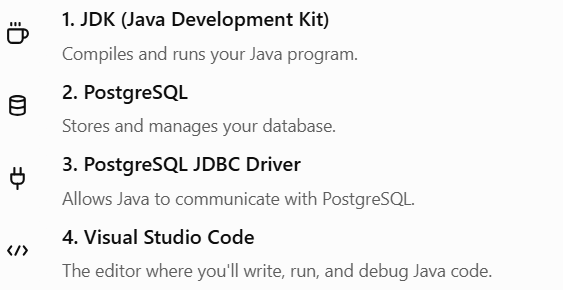
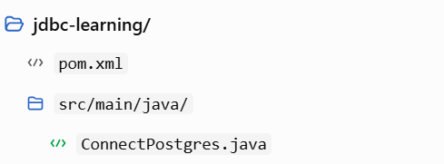

# Topic 3 — JDBC Configuration

## 1. What does JDBC configuration mean?

JDBC configuration means preparing your development environment so a Java program can connect to PostgreSQL and communicate with it.

We need four main components:



The PostgreSQL JDBC driver, commonly called pgJDBC, implements JDBC's standard interfaces for PostgreSQL.


## 2. Check your existing setup

Before installing anything, let's check what you already have. This avoids unnecessary installations.

Open the VS Code terminal using Terminal → New Terminal and execute these commands one at a time.

Check Java:

```
java -version
```

Check the Java compiler:

```
javac -version
```

Check Maven:

```
mvn -version
```

Check PostgreSQL command-line tools:

```
psql --version
```

What the results mean:

- If `java` and `javac` show version numbers, your Java runtime and compiler are available.
- If `mvn` shows a version, Maven is installed and available in your terminal.
- If `psql` shows a version, the PostgreSQL command-line client is available. This alone does not prove that the database server is running.

For VS Code, the official Java documentation recommends the Extension Pack for Java for features such as code completion, running, debugging, and project management.


Official guide: [Java development in VS Code](https://code.visualstudio.com/docs/java/java-tutorial).

## 3. Add the PostgreSQL JDBC driver

We'll use a Maven project. Maven automatically downloads the JDBC driver and manages its dependencies, so you don't need to download and manually attach a JAR file.

The official pgJDBC documentation provides the driver through Maven Central.



### Step 1 — Create a Maven project in VS Code

1. Open VS Code.
2. Press `Ctrl + Shift + P`.
3. Search for `Java: Create Java Project`.
4. Select Maven or Maven Archetype, depending on the options shown.
5. Choose a basic Java project template.
6. Select a project name such as `jdbc-learning`.
7. Open the generated project folder.

If the Java project commands are missing, install the [Extension Pack for Java](https://marketplace.visualstudio.com/items?itemName=vscjava.vscode-java-pack).

Your project should have a structure similar to this:


### Step 2 — Add the JDBC dependency

Open `pom.xml`. Inside the existing `dependencies` section, add this dependency. If there is no `dependencies` section, create one inside the main `project` element.

```

<dependencies>
    <dependency>
        <groupId>org.postgresql</groupId>
        <artifactId>postgresql</artifactId>
        <version>42.7.14</version>
    </dependency>
</dependencies>

```

The version shown is the current release identified on the official driver download page when checked.


Save the file. Maven should resolve and download the dependency; allow VS Code to finish importing the project.

What did we just configure?

- `groupId`: identifies the PostgreSQL driver project.
- `artifactId`: identifies the driver library.
- `version`: specifies which driver release Maven should use.

You have now added the bridge between Java and PostgreSQL.

## 4. Configure PostgreSQL

We will use the database you created in Topic 2: `college_db`.

Make sure your PostgreSQL server is running. In pgAdmin, open the Query Tool for `college_db`, or connect through `psql`, and run:

```
SELECT current_database(), current_user;
```

This tells you which database and PostgreSQL user you're connected as.

For this lesson, we'll assume:

| Setting  | Example value            |
| -------- | ------------------------ |
| Host     | `localhost`              |
| Port     | `5432`                   |
| Database | `college_db`             |
| Username | `postgres`               |
| Password | Your PostgreSQL password |

These are example settings, not guaranteed to match your installation. Use the port, username, and password you actually configured.

## 5. Understand the JDBC connection URL

The PostgreSQL JDBC URL generally follows this pattern:

```
jdbc:postgresql://host:port/database
```

For our example:

```
String url =
    "jdbc:postgresql://localhost:5432/college_db";
```

Breakdown:

- `jdbc`: indicates a JDBC connection.
- `postgresql`: identifies the database driver type.
- `localhost`: means the database server is on your own computer.
- `5432`: the usual PostgreSQL port.
- `college_db`: the database to connect to.

The Java `DriverManager.getConnection()` method uses the URL and credentials to request a database connection.


## 6. Write your first JDBC connection program

Now for the exciting part: let's connect Java to PostgreSQL for the first time!

Create a file named `ConnectPostgres.java` inside `src/main/java/`. If Maven created a package declaration, keep it at the top of the file.

```

import java.sql.Connection;
import java.sql.DriverManager;
import java.sql.SQLException;

public class ConnectPostgres {

    public static void main(String[] args) {

        String url =
            "jdbc:postgresql://localhost:5432/college_db";

        String username = "postgres";
        String password = "YOUR_POSTGRES_PASSWORD";

        try (Connection connection =
                 DriverManager.getConnection(
                     url, username, password)) {

            System.out.println(
                "Connected to PostgreSQL successfully!");

            System.out.println(
                "Database: " +
                connection.getCatalog());

        } catch (SQLException e) {
            System.out.println(
                "Database connection failed.");

            e.printStackTrace();
        }
    }
}

```

Replace `YOUR_POSTGRES_PASSWORD` with your actual PostgreSQL password. This is fine for a local learning exercise; don't commit real passwords to Git or use hardcoded credentials in production.

### How does the code work?

1. Import JDBC classes. `Connection` represents the database connection, `DriverManager` obtains it, and `SQLException` represents database-related errors.
2. Define the connection details. The URL identifies the PostgreSQL server and database; the username and password authenticate your connection.
3. Call `DriverManager.getConnection()`. The driver establishes the connection. With a modern JDBC driver correctly included in Maven, you generally don't need to call `Class.forName()` manually.
4. Check the result. If successful, the program prints a success message and database name.
5. Close the connection. The try-with-resources statement closes the connection automatically, even if an exception occurs.

### Run the program

1. Save the file.
2. Wait for Maven to finish downloading the dependencies.
3. Click Run above the `main()` method in VS Code.
4. Check the terminal output.

Expected output:

```
Connected to PostgreSQL successfully!
Database: college_db
```

The exact output depends on your database configuration.

## 7. Troubleshooting common errors

| Error                                  | Likely cause                          | What to check                             |
| -------------------------------------- | ------------------------------------- | ----------------------------------------- |
| `No suitable driver`                   | Driver missing from project classpath | Maven dependency and project import       |
| `Connection refused`                   | Server stopped or wrong port          | PostgreSQL service and port               |
| `password authentication failed`       | Incorrect credentials                 | Username and password                     |
| `database "college_db" does not exist` | Database missing                      | Create the database or correct its name   |
| `Connection timed out`                 | Network or server accessibility issue | Host, port, firewall, and server settings |

Don't worry if you encounter an error. Copy the complete error message and share it with me; we'll troubleshoot it together.

