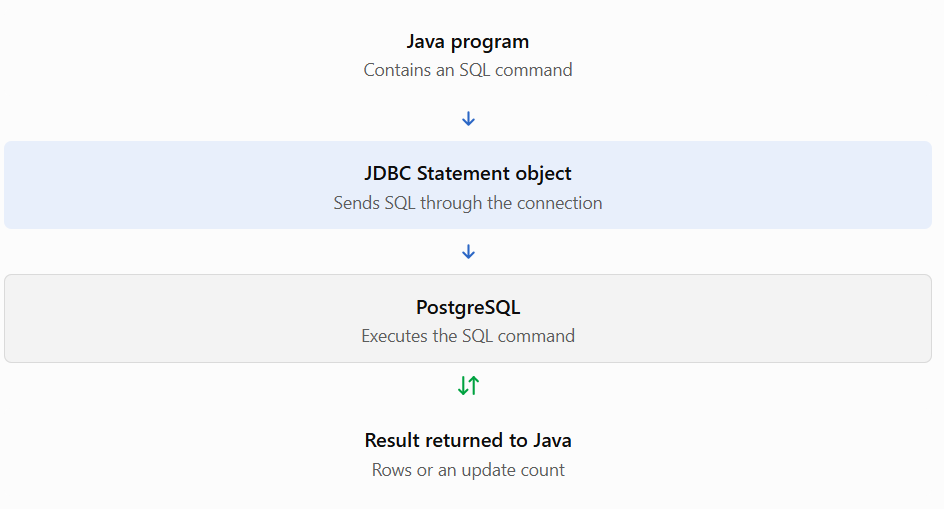
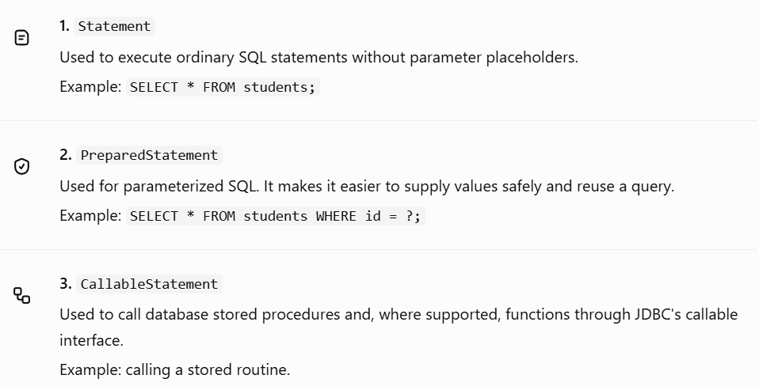
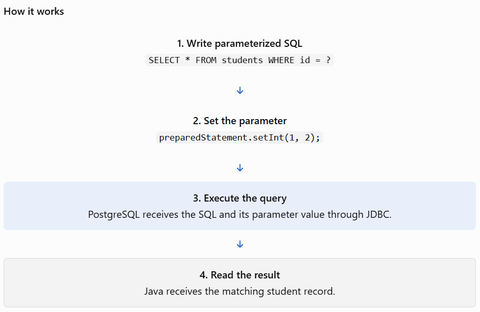

# Topic 4. Working with JDBC Statements

## 2. What is a JDBC Statement?

A JDBC statement is an object that allows Java to send SQL commands to a database.

For example, in PostgreSQL you might run:

```
SELECT * FROM students;
```

But how can your Java program execute this SQL? It creates a JDBC statement object and uses it to send the SQL to PostgreSQL.



According to the official Java documentation, `Statement` is an interface used to execute static SQL statements and retrieve their results.


## 3. Types of JDBC statements

JDBC provides three main statement interfaces.



We'll focus first on `Statement`, then learn `PreparedStatement`, which you'll use frequently in your CRUD application.

## 4. Working with `Statement`

### Step 1 — Create a statement object

You need an established database connection first.

```
Statement statement = connection.createStatement();
```

Here:

- `connection` represents the active database connection.
- `createStatement()` creates a statement object.
- `statement` is used to execute SQL.

Remember to import:

```
import java.sql.Statement;
```

### Step 2 — Execute a SELECT query

For a `SELECT` query, use `executeQuery()`. It returns a `ResultSet` containing the rows returned by the query.

```
ResultSet rs =
    statement.executeQuery("SELECT * FROM students");
```

To read the returned rows, use `rs.next()`.

- `next()` moves the cursor to the next row.
- It returns `true` when a row exists.
- It returns `false` when no more rows remain.

### Complete runnable example

Create `ReadStudents.java` in your Maven project's Java source folder.

```

import java.sql.Connection;
import java.sql.DriverManager;
import java.sql.Statement;
import java.sql.ResultSet;
import java.sql.SQLException;

public class ReadStudents {

    public static void main(String[] args) {

        String url =
            "jdbc:postgresql://localhost:5432/college_db";
        String username = "postgres";
        String password = "YOUR_POSTGRES_PASSWORD";

        String sql = "SELECT id, name, marks FROM students";

        try (
            Connection connection =
                DriverManager.getConnection(
                    url, username, password
                );
            Statement statement =
                connection.createStatement();
            ResultSet rs =
                statement.executeQuery(sql)
        ) {
            while (rs.next()) {
                int id = rs.getInt("id");
                String name = rs.getString("name");
                double marks = rs.getDouble("marks");

                System.out.println(
                    id + " | " + name + " | " + marks
                );
            }

        } catch (SQLException e) {
            e.printStackTrace();
        }
    }
}

```

Before running, replace the password with your PostgreSQL password and ensure the `students` table exists.

Possible output:

```
1 | Aarav | 85.5
2 | Sita | 92.0
3 | Ram | 68.0
4 | Mina | 78.5
```

Your output depends on the records currently in your database.

Notice how the connection, statement, and result set are all inside try-with-resources. Java closes them automatically in the correct order.

## 5. Three important execution methods

JDBC provides three execution methods you'll use frequently.


| Method            | Purpose                                                                              | Return type |
| ----------------- | ------------------------------------------------------------------------------------ | ----------- |
| `executeQuery()`  | Retrieves query results, usually from `SELECT`                                       | `ResultSet` |
| `executeUpdate()` | Executes an update, insert, delete, or a statement that returns no rows, such as DDL | `int`       |
| `execute()`       | Executes SQL when the result type may vary                                           | `boolean`   |

For example:

```
// SELECT
ResultSet rs =
    statement.executeQuery("SELECT * FROM students");

// UPDATE
int count = statement.executeUpdate(
    "UPDATE students SET marks = 95 WHERE id = 2"
);

System.out.println("Rows affected: " + count);
```

The second example returns the number of rows affected. If student ID 2 exists, it should normally return `1`.

Important: Don't use `executeQuery()` for an `UPDATE`, `INSERT`, or `DELETE`. Use `executeUpdate()` for those commands.


//Part 2

# Topic 4.2 — PreparedStatement

## 2. What is PreparedStatement?

`PreparedStatement` is a JDBC interface used to execute parameterized SQL statements.

Unlike a basic `Statement`, where you might build a SQL string manually, `PreparedStatement` lets you write the SQL with placeholders (`?`) and supply the values separately.

Suppose you want to find a student by ID.

With a regular `Statement`, you might write:

```
String sql =
    "SELECT * FROM students WHERE id = " + studentId;
```

With a `PreparedStatement`, you write:

```
String sql =
    "SELECT * FROM students WHERE id = ?";
```

The `?` represents a value that you'll supply later.



The JDBC API defines `PreparedStatement` as a precompiled SQL statement that can be executed efficiently with different parameter values. Actual preparation and caching behavior depends on the driver and database.

## 3. Important methods of PreparedStatement

Let's understand the methods you'll use most often.

| Method                             | Purpose                                                                  |
| ---------------------------------- | ------------------------------------------------------------------------ |
| `connection.prepareStatement(sql)` | Creates a prepared statement                                             |
| `setInt(index, value)`             | Sets an integer parameter                                                |
| `setString(index, value)`          | Sets a string parameter                                                  |
| `setDouble(index, value)`          | Sets a decimal parameter                                                 |
| `setBoolean(index, value)`         | Sets a boolean parameter                                                 |
| `executeQuery()`                   | Executes a query and returns a `ResultSet`                               |
| `executeUpdate()`                  | Executes an insert, update, or delete and returns the affected-row count |
| `clearParameters()`                | Clears parameter values before setting them again                        |

Remember two important rules:

1. Parameter indexes start at 1, not 0.
2. The `?` placeholders represent values, not table names, column names, or SQL keywords.

For example:

```
String sql = "SELECT * FROM students WHERE id = ?";
PreparedStatement ps = connection.prepareStatement(sql);

ps.setInt(1, 2);
```

Here, `1` identifies the first placeholder, and `2` is the student ID we're searching for.

## 4. Practical example — Find a student by ID

Let's modify your previous program to use `PreparedStatement`.

Create `FindStudent.java` in your Maven project's Java source folder.

```

import java.sql.Connection;
import java.sql.DriverManager;
import java.sql.PreparedStatement;
import java.sql.ResultSet;
import java.sql.SQLException;

public class FindStudent {

    public static void main(String[] args) {

        String url =
            "jdbc:postgresql://localhost:5432/college_db";
        String username = "postgres";
        String password = "YOUR_POSTGRES_PASSWORD";

        String sql =
            "SELECT id, name, age, course, marks " +
            "FROM students WHERE id = ?";

        int studentId = 2;

        try (
            Connection connection =
                DriverManager.getConnection(
                    url, username, password
                );
            PreparedStatement ps =
                connection.prepareStatement(sql)
        ) {
            // Set the first parameter
            ps.setInt(1, studentId);

            // Execute the SELECT query
            try (ResultSet rs = ps.executeQuery()) {

                if (rs.next()) {
                    System.out.println(
                        "ID: " + rs.getInt("id")
                    );
                    System.out.println(
                        "Name: " + rs.getString("name")
                    );
                    System.out.println(
                        "Age: " + rs.getInt("age")
                    );
                    System.out.println(
                        "Course: " + rs.getString("course")
                    );
                    System.out.println(
                        "Marks: " + rs.getDouble("marks")
                    );
                } else {
                    System.out.println(
                        "Student not found."
                    );
                }
            }

        } catch (SQLException e) {
            e.printStackTrace();
        }
    }
}

```

Replace the password with your actual PostgreSQL password, then run the program.

If student ID 2 belongs to Sita in your database, the output should resemble:

```
ID: 2
Name: Sita
Age: 20
Course: Python
Marks: 92.0
```

### Understand the execution flow

1. `prepareStatement(sql)` creates a statement containing the SQL and its placeholder.
2. `ps.setInt(1, studentId)` supplies the student ID to the first placeholder.
3. `ps.executeQuery()` executes the query and returns matching rows.
4. `rs.next()` checks whether a matching student exists.
5. Getters such as `getString("name")` and `getDouble("marks")` retrieve column values.

Notice that we didn't concatenate `studentId` into the SQL string. The parameter is bound separately.

## 5. Why is PreparedStatement important?

### A. It helps prevent SQL injection

Suppose a login program builds SQL by concatenating user input:

```
String sql =
    "SELECT * FROM users WHERE username = '"
    + input + "'";
```

If untrusted input contains SQL syntax, it can alter the intended query.

With `PreparedStatement`:

```
String sql =
    "SELECT * FROM users WHERE username = ?";

PreparedStatement ps =
    connection.prepareStatement(sql);

ps.setString(1, input);
```

The supplied input is treated as a parameter value rather than being inserted into the SQL syntax. This is a key defense against SQL injection when parameters are used correctly.

### B. It makes code cleaner

Compare these two approaches:

| `Statement`                                | `PreparedStatement`                                            |
| ------------------------------------------ | -------------------------------------------------------------- |
| Often requires SQL string construction     | Uses parameter placeholders                                    |
| Easy to make unsafe concatenation mistakes | Separates SQL structure from values                            |
| Suitable for simple, fixed SQL             | Particularly useful for repeated queries with different values |

### C. It supports repeated execution

You can reuse the same prepared statement with different values:

```
String sql =
    "SELECT * FROM students WHERE id = ?";

try (PreparedStatement ps =
         connection.prepareStatement(sql)) {

    ps.setInt(1, 1);

    try (ResultSet rs = ps.executeQuery()) {
        while (rs.next()) {
            System.out.println(rs.getString("name"));
        }
    }

    ps.setInt(1, 2);

    try (ResultSet rs = ps.executeQuery()) {
        while (rs.next()) {
            System.out.println(rs.getString("name"));
        }
    }
}
```

The same SQL structure is executed twice, with different student IDs. Depending on the driver and execution pattern, the driver may also reuse server-side prepared statements.

## 6. PreparedStatement for CRUD operations

You'll use this same pattern in your mini project.

Create — INSERT

```
String sql =
    "INSERT INTO students (name, age, course, marks) " +
    "VALUES (?, ?, ?, ?)";

PreparedStatement ps =
    connection.prepareStatement(sql);

ps.setString(1, "Hari");
ps.setInt(2, 21);
ps.setString(3, "Java");
ps.setDouble(4, 88.5);

int rows = ps.executeUpdate();
```

Update — UPDATE

```
String sql =
    "UPDATE students SET marks = ? WHERE id = ?";

PreparedStatement ps =
    connection.prepareStatement(sql);

ps.setDouble(1, 95.0);
ps.setInt(2, 2);

int rows = ps.executeUpdate();
```

Delete — DELETE

```
String sql = "DELETE FROM students WHERE id = ?";

PreparedStatement ps =
    connection.prepareStatement(sql);

ps.setInt(1, 2);

int rows = ps.executeUpdate();
```

These snippets illustrate the parameter-setting pattern. In a real program, wrap JDBC resources in try-with-resources and validate inputs before executing modifications.

Safety tip: Always include an appropriate `WHERE` clause when updating or deleting a specific record. For user-supplied values, prefer `PreparedStatement` over string concatenation.

