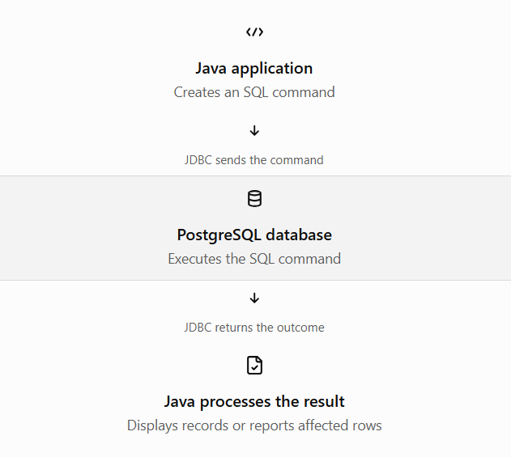

# Topic 5 — Query Execution


## 1. Learning objectives

By the end of this topic, you should be able to:

- Understand how JDBC executes SQL statements.
- Choose between `executeQuery()`, `executeUpdate()`, and `execute()`.
- Process query results using `ResultSet`.
- Understand affected-row counts and boolean return values.
- Write and run complete Java programs using PostgreSQL.

## 2. What is query execution?

Query execution is the process of sending an SQL command from a Java application to the database, having PostgreSQL execute it, and receiving the result.

For example, imagine your `students` table contains student records. Your Java application wants to find students enrolled in Java.



### Why do we need query execution methods?

Different SQL commands produce different kinds of results.

- `SELECT` returns rows of data.
- `INSERT`, `UPDATE`, and `DELETE` usually report how many rows were affected.
- Other commands may need a more general execution method.

JDBC provides three main methods for handling these cases.

## 3. The three JDBC execution methods


| Method            | Return type | Typical use                                               |
| ----------------- | ----------- | --------------------------------------------------------- |
| `executeQuery()`  | `ResultSet` | `SELECT` queries                                          |
| `executeUpdate()` | `int`       | `INSERT`, `UPDATE`, `DELETE`, and many DDL commands       |
| `execute()`       | `boolean`   | Commands where you need to inspect the type of the result |

### A. `executeQuery()` — retrieve data

Use this when you expect a result set, usually from a `SELECT` query.

```
String sql = "SELECT name, marks FROM students";
PreparedStatement ps = connection.prepareStatement(sql);

ResultSet rs = ps.executeQuery();

while (rs.next()) {
    System.out.println(rs.getString("name"));
    System.out.println(rs.getDouble("marks"));
}
```

How it works:

1. `prepareStatement(sql)` prepares the SQL command.
2. `executeQuery()` sends it for execution.
3. PostgreSQL returns the matching rows.
4. `rs.next()` moves to the next row.
5. Getter methods retrieve values from the current row.

Important: `executeQuery()` does not return the student's data directly. It returns a `ResultSet` object through which you read that data.

### B. `executeUpdate()` — change data

Use this for commands such as `INSERT`, `UPDATE`, and `DELETE`. It returns the number of rows affected, not a `ResultSet`.

```
String sql = "UPDATE students SET marks = ? WHERE name = ?";

try (PreparedStatement ps = connection.prepareStatement(sql)) {
    ps.setDouble(1, 95.0);
    ps.setString(2, "Sita");

    int rowsAffected = ps.executeUpdate();

    System.out.println("Rows affected: " + rowsAffected);
}
```

Possible outcomes:

- `1` — one matching row was updated.
- `0` — no rows matched the condition.
- More than `1` — multiple rows were updated.

This example changes Sita's marks if that record exists, so don't run it unless you intend to make that change.

### C. `execute()` — general-purpose execution

Use this when the SQL command's result type isn't known in advance, or when working with commands that may produce different kinds of results.

```
boolean hasResultSet = ps.execute();

if (hasResultSet) {
    try (ResultSet rs = ps.getResultSet()) {
        while (rs.next()) {
            System.out.println(rs.getString("name"));
        }
    }
} else {
    int rowsAffected = ps.getUpdateCount();
    System.out.println("Rows affected: " + rowsAffected);
}
```

Here:

- `true` means the first result is a `ResultSet`.
- `false` means the first result is an update count or there is no result.

Notice that `execute()` returns a boolean, not the data or the affected-row count itself. You retrieve those separately.

For ordinary `SELECT` and update operations, prefer `executeQuery()` and `executeUpdate()` respectively. The general-purpose `execute()` method is useful when you need that flexibility.


## 4. Practical exercise — execute a SELECT query

Let's put the concepts into a complete Java program using your PostgreSQL `students` table.

Create a file named `ExecuteStudentQuery.java` in your existing Java project.

```

import java.sql.Connection;
import java.sql.DriverManager;
import java.sql.PreparedStatement;
import java.sql.ResultSet;
import java.sql.SQLException;

public class ExecuteStudentQuery {

    public static void main(String[] args) {

        String url = "jdbc:postgresql://localhost:5432/studentdb";
        String username = System.getenv("DB_USERNAME");
        String password = System.getenv("DB_PASSWORD");

        String sql =
                "SELECT name, course, marks FROM students WHERE marks >= ?";

        if (username == null || password == null) {
            System.out.println("Set DB_USERNAME and DB_PASSWORD first.");
            return;
        }

        try (Connection connection =
                     DriverManager.getConnection(url, username, password);
             PreparedStatement ps = connection.prepareStatement(sql)) {

            ps.setDouble(1, 80.0);

            try (ResultSet rs = ps.executeQuery()) {

                boolean found = false;

                while (rs.next()) {
                    found = true;

                    System.out.println("Name: " +
                            rs.getString("name"));
                    System.out.println("Course: " +
                            rs.getString("course"));
                    System.out.println("Marks: " +
                            rs.getDouble("marks"));
                    System.out.println("-------------------");
                }

                if (!found) {
                    System.out.println(
                            "No students found with marks >= 80.");
                }
            }

        } catch (SQLException e) {
            System.out.println("Database operation failed.");
            e.printStackTrace();
        }
    }
}

```

This program uses environment variables for database credentials instead of hardcoding a password in your source code. Set `DB_USERNAME` and `DB_PASSWORD` in the environment used to launch Java before running it.

### Understand the practical program

The key line is:

```
ps.setDouble(1, 80.0);
```

It fills the first `?` placeholder with `80.0`, so the SQL becomes logically equivalent to:

```
SELECT name, course, marks
FROM students
WHERE marks >= 80.0;
```

Only students with marks greater than or equal to 80 are returned. The actual SQL is executed using the parameterized `PreparedStatement`, rather than by manually joining values into a string.

The program also handles two important situations:

- Matching rows exist: prints each student's details.
- No matching rows: prints a message instead of silently displaying nothing.

For the official reference, see the [Java ](https://docs.oracle.com/en/java/javase/26/docs/api/java.sql/java/sql/Statement.html)[`Statement`](https://docs.oracle.com/en/java/javase/26/docs/api/java.sql/java/sql/Statement.html)[ API](https://docs.oracle.com/en/java/javase/26/docs/api/java.sql/java/sql/Statement.html) and the [pgJDBC query guide](https://jdbc.postgresql.org/documentation/query/).


