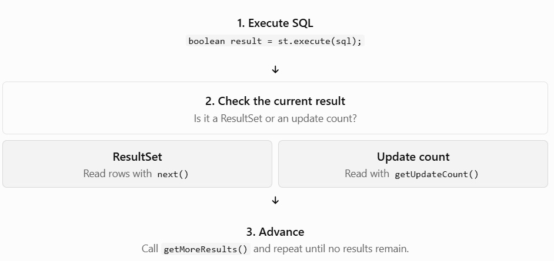

# Topic 7 — Multiple Results


## 1. Learning objectives

By the end of this topic, you'll be able to:

- Explain what multiple results mean in JDBC.
- Understand `execute()`, `getResultSet()`, `getUpdateCount()`, and `getMoreResults()`.
- Process a sequence of results and update counts.
- Understand how this applies to PostgreSQL.

## 2. What are multiple results?

Normally, you execute one SQL statement and process its result. But some database operations can produce more than one result in sequence—for example, a result set followed by an update count, or multiple result sets from a stored procedure or a database that supports multiple-result commands.

Imagine an operation that:

1. Retrieves a list of students.
2. Updates some student records.
3. Produces another result set.

Your Java application must know how to process each result in the correct order.

One important detail: JDBC supports processing multiple results, but whether a particular SQL command can produce them depends on the database and driver. PostgreSQL's JDBC driver doesn't support every multi-result scenario in the same way that some other database drivers do.

## 3. The four JDBC methods you need to know

The official Java `Statement` API describes how to retrieve the current result and advance to the next one.


| Method             | What it does                                                                       |
| ------------------ | ---------------------------------------------------------------------------------- |
| `execute(sql)`     | Executes SQL and tells you whether the first result is a `ResultSet`.              |
| `getResultSet()`   | Retrieves the current result set.                                                  |
| `getUpdateCount()` | Retrieves the current update count, or `-1` when there is no current update count. |
| `getMoreResults()` | Advances to the next result.                                                       |

The key is that `execute()` doesn't return the actual rows. You must retrieve them separately.

### How the result-processing loop works



The end-of-results condition is important:

```
!hasResultSet && st.getUpdateCount() == -1
```

It means there is no current result set and no current update count left to process.

## 4. Complete Java practical — processing JDBC results

Create a file named `MultipleResultsDemo.java` in your existing Java project.

This example uses a normal PostgreSQL `SELECT` query to demonstrate the result-processing pattern. It will process the first result set and then check whether any more results are available. It demonstrates the JDBC mechanism, but this particular query produces only one result set.

```

import java.sql.Connection;
import java.sql.DriverManager;
import java.sql.ResultSet;
import java.sql.SQLException;
import java.sql.Statement;

public class MultipleResultsDemo {

    public static void main(String[] args) {

        String url = "jdbc:postgresql://localhost:5432/studentdb";
        String username = System.getenv("DB_USERNAME");
        String password = System.getenv("DB_PASSWORD");

        if (username == null || password == null) {
            System.out.println("Set DB_USERNAME and DB_PASSWORD first.");
            return;
        }

        String sql =
                "SELECT id, name, marks FROM students ORDER BY id";

        try (Connection con =
                     DriverManager.getConnection(url, username, password);
             Statement st = con.createStatement()) {

            boolean hasResultSet = st.execute(sql);

            while (true) {

                if (hasResultSet) {

                    try (ResultSet rs = st.getResultSet()) {
                        System.out.println("--- Result Set ---");

                        while (rs.next()) {
                            System.out.println(
                                    rs.getInt("id") + " | " +
                                    rs.getString("name") + " | " +
                                    rs.getDouble("marks")
                            );
                        }
                    }

                } else {

                    int updateCount = st.getUpdateCount();

                    if (updateCount == -1) {
                        break;
                    }

                    System.out.println(
                            "Rows affected: " + updateCount);
                }

                hasResultSet = st.getMoreResults();
            }

            System.out.println("All available results processed.");

        } catch (SQLException e) {
            System.out.println("Database operation failed.");
            e.printStackTrace();
        }
    }
}

```

### Walk through the important lines

Step 1 — Execute the SQL

```
boolean hasResultSet = st.execute(sql);
```

If the first result is a `ResultSet`, the variable is `true`.

Step 2 — Read the rows

```
try (ResultSet rs = st.getResultSet()) {
    while (rs.next()) {
        System.out.println(rs.getString("name"));
    }
}
```

This retrieves the current result set and reads its rows.

Step 3 — Check for more results

```
hasResultSet = st.getMoreResults();
```

This advances to the next result, if one exists. The loop continues until there are no more results or update counts.

### PostgreSQL-specific note

The pgJDBC driver has its own limitations around multiple result sets. Don't assume that submitting several SQL commands together will always behave identically across database drivers. The [official pgJDBC query documentation](https://jdbc.postgresql.org/documentation/query/) explains its statement and result-set behavior.


For normal PostgreSQL applications, executing separate statements is often clearer. Multiple-results handling is particularly relevant when working with database operations or drivers that genuinely return a sequence of results.


