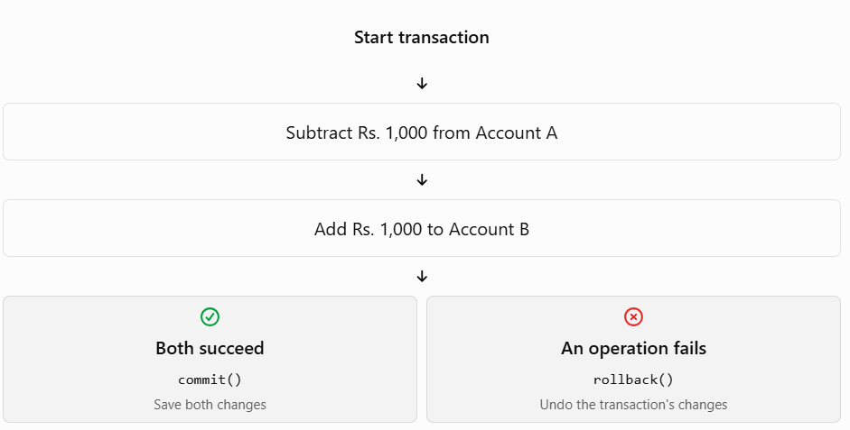
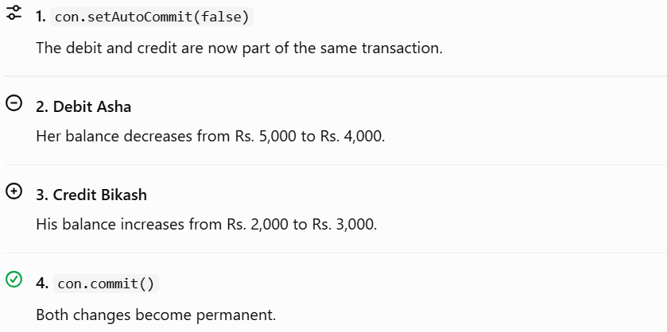

# Topic 9 — Transactions in Java (JDBC)

## Learning objectives

By the end of this topic, you should be able to:

- Explain what a database transaction is.
- Understand ACID properties.
- Use `commit()` and `rollback()` in JDBC.
- Disable auto-commit and manage transactions safely with PostgreSQL.
- Implement a transaction in a runnable Java program.

## 1. What is a transaction?

A transaction is a group of database operations treated as one logical unit of work.

Imagine transferring Rs. 1,000 from Account A to Account B.

1. Subtract Rs. 1,000 from Account A.
2. Add Rs. 1,000 to Account B.

Both operations must succeed. If the first operation succeeds but the second fails, the money could disappear from the first account without reaching the second.

A transaction ensures that either both operations succeed or neither operation takes effect.


## 2. Why are transactions needed?

Transactions help maintain data consistency when multiple operations depend on each other.

Common examples include:

- Bank transfers.
- Placing an order and reducing product stock.
- Registering a student and recording their course enrollment.
- Saving related records across multiple database tables.

Without a transaction, a failure halfway through can leave the database in a partially updated state.

## 3. The four ACID properties

Database transactions are commonly described using ACID. These properties help keep data reliable.


| Property        | Meaning                                                                    | Bank transfer example                             |
| --------------- | -------------------------------------------------------------------------- | ------------------------------------------------- |
| A — Atomicity   | All operations succeed or none do.                                         | Debit and credit both happen, or neither does.    |
| C — Consistency | Data remains valid according to database rules.                            | Account balances follow defined constraints.      |
| I — Isolation   | Concurrent transactions are controlled so they don't improperly interfere. | Two transfers don't expose incomplete changes.    |
| D — Durability  | Committed changes persist.                                                 | After a successful commit, the transfer is saved. |

Exam tip: Remember ACID as Atomicity, Consistency, Isolation, Durability.

## 4. Managing transactions in JDBC

By default, a JDBC `Connection` uses auto-commit mode. That means each completed SQL statement is committed as its own transaction. To group multiple statements, disable auto-commit.


Three key methods:

| Method                 | Purpose                                                |
| ---------------------- | ------------------------------------------------------ |
| `setAutoCommit(false)` | Start managing a group of statements as a transaction. |
| `commit()`             | Make the transaction's changes permanent.              |
| `rollback()`           | Undo uncommitted changes in the current transaction.   |

The typical flow is:

```
con.setAutoCommit(false);

try {
    // Execute related SQL statements
    con.commit();
} catch (SQLException e) {
    con.rollback();
}
```

One important detail: `setAutoCommit(false)` disables automatic commits; the transaction begins with database work on that connection. You should call `commit()` or `rollback()` explicitly.

## 5. Practical example — transfer money between accounts

We'll create a small `accounts` table and transfer money between two accounts. This example is separate from your existing `students` table.

### Step 1: Create and populate the table

Run this SQL in PostgreSQL or your database client:

```
CREATE TABLE accounts (
    id INTEGER PRIMARY KEY,
    holder_name VARCHAR(100) NOT NULL,
    balance NUMERIC(12, 2) NOT NULL CHECK (balance >= 0)
);

INSERT INTO accounts (id, holder_name, balance)
VALUES
    (1, 'Asha', 5000.00),
    (2, 'Bikash', 2000.00);
```

If you run the setup more than once, the `CREATE TABLE` or `INSERT` statements may fail because the objects or rows already exist. Don't rerun the inserts blindly.

### Step 2: Create `TransferMoney.java`

This is a complete Java example using PostgreSQL JDBC and `PreparedStatement`.

```

import java.math.BigDecimal;
import java.sql.Connection;
import java.sql.DriverManager;
import java.sql.PreparedStatement;
import java.sql.SQLException;

public class TransferMoney {

    public static void main(String[] args) {
        String url = "jdbc:postgresql://localhost:5432/studentdb";
        String username = System.getenv("DB_USERNAME");
        String password = System.getenv("DB_PASSWORD");

        if (username == null || password == null) {
            System.out.println("Set DB_USERNAME and DB_PASSWORD first.");
            return;
        }

        BigDecimal amount = new BigDecimal("1000.00");
        int fromAccount = 1;
        int toAccount = 2;

        try (Connection con =
                     DriverManager.getConnection(url, username, password)) {

            con.setAutoCommit(false);

            try {
                // Debit the source account.
                String debitSql =
                    "UPDATE accounts SET balance = balance - ? WHERE id = ?";

                try (PreparedStatement debit =
                         con.prepareStatement(debitSql)) {
                    debit.setBigDecimal(1, amount);
                    debit.setInt(2, fromAccount);

                    if (debit.executeUpdate() != 1) {
                        throw new SQLException("Source account not found.");
                    }
                }

                // Credit the destination account.
                String creditSql =
                    "UPDATE accounts SET balance = balance + ? WHERE id = ?";

                try (PreparedStatement credit =
                         con.prepareStatement(creditSql)) {
                    credit.setBigDecimal(1, amount);
                    credit.setInt(2, toAccount);

                    if (credit.executeUpdate() != 1) {
                        throw new SQLException("Destination account not found.");
                    }
                }

                con.commit();
                System.out.println("Transfer completed successfully.");

            } catch (SQLException e) {
                try {
                    con.rollback();
                    System.out.println("Transfer rolled back.");
                } catch (SQLException rollbackError) {
                    e.addSuppressed(rollbackError);
                }

                throw e;
            }

        } catch (SQLException e) {
            System.out.println("Database transaction failed.");
            e.printStackTrace();
        }
    }
}

```

### Step 3: Understand the execution



Expected successful output:

```
Transfer completed successfully.
```

The resulting balances are:

| Account holder | Before    | After     |
| -------------- | --------- | --------- |
| Asha           | Rs. 5,000 | Rs. 4,000 |
| Bikash         | Rs. 2,000 | Rs. 3,000 |

### Step 4: What happens if something fails?

Suppose account `2` does not exist.

- The debit may execute successfully.
- The credit updates zero rows, triggering an exception.
- `rollback()` undoes the debit.
- Asha's balance remains Rs. 5,000.

Important production note: This is a teaching example, not a complete banking implementation. A real transfer must also validate the amount, prevent overdrafts, check account ownership and status, and handle concurrent transfers safely. For example, the source-account update should check that sufficient funds exist rather than allowing a negative balance. The database constraint protects against negative balances, but the application should report the business rule clearly.
