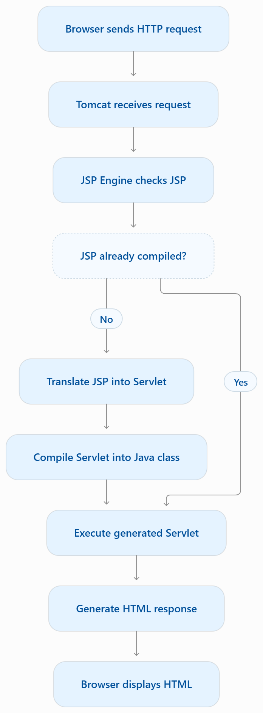
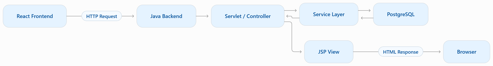

# Lesson 12.1: Basics of Java Server Pages

## 1. What is Java Server Pages (JSP)?
**Java Server Pages (JSP)** is a server-side technology used to create dynamic web pages using Java.

It allows us to combine HTML with dynamic data generated by Java code, JavaBeans, Expression Language (EL), and custom tags.

According to the official Jakarta Server Pages 3.1 specification, a JSP page is processed by a JSP container and ultimately translated into a Jakarta Servlet.


Official documentation:

- [Jakarta Server Pages 3.1 Specification](https://jakarta.ee/specifications/pages/3.1/?utm_source=chatgpt.com)
- [Apache Tomcat 10.1 Documentation](https://tomcat.apache.org/tomcat-10.1-doc/?utm_source=chatgpt.com)

### Simple definition

> JSP is a server-side Java technology that helps generate dynamic HTML content by combining presentation markup with Java-based functionality.

## 2. Why do we need JSP?

Before JSP, developers commonly used Servlets to generate HTML responses.

Consider this Servlet:

```
@WebServlet("/welcome")
public class WelcomeServlet extends HttpServlet {

    @Override
    protected void doGet(
            HttpServletRequest request,
            HttpServletResponse response
    ) throws IOException {

        response.setContentType("text/html");

        PrintWriter out = response.getWriter();

        out.println("<html>");
        out.println("<body>");
        out.println("<h1>Welcome to Java</h1>");
        out.println("</body>");
        out.println("</html>");
    }
}
```

### Problems with generating HTML in Servlets

1. HTML is mixed with Java code.
2. Large pages become difficult to maintain.
3. Frontend developers must understand Java code to modify the UI.
4. Designing complex pages becomes inconvenient.

JSP provides a more convenient way to write the presentation layer.

### The same example using JSP

Create a file named `welcome.jsp`:

```
<!DOCTYPE html>
<html>
<head>
    <title>Welcome Page</title>
</head>
<body>

    <h1>Welcome to Java Server Pages!</h1>

</body>
</html>
```

Notice that we can write normal HTML without repeatedly calling `out.println()`.

This is one of the primary reasons JSP was introduced.

## 3. How does JSP work internally?

This is one of the most important concepts in this lesson.

JSP is not directly executed by the browser. The server processes it first.

[What is the Difference Between JAR and WAR Files - Pediaa.Com](https://images.openai.com/static-rsc-4/QTY_8ppveFjQqxFp0cwE8KdK3qBNUoZkr-8_2Amyrd7GIrGrOrE7kUpRxeKuIzWMFzY67eQk1q8vIqND_kVlwvCM4qIFkmYblu1E5YA-SnAFkvJeW9qD4O6fH3XsK7UQKEsng5EgE7VOZVdR6NW-TpmGD7B4gZG2-dfpq4DwDXs?purpose=inline)

[Lecture 4:  JavaServer Pages (JSP) & Expression Language (EL) | PDF](https://images.openai.com/static-rsc-4/GQ2OSfHfrp6SMBME9EX98dKWa6fwMYPrB9zZAlpeL3n3YXOwbdi_FXh2IXi_aYLLKc-8InHsdHc2Gjywj9LYcImPUxpW4nRP-qqaiepStV0XLiZDOr9tLHAknYrs8UornvVvK6Awke3goLXM0H4qw42HDuICyOig1Fy0hXfYpf8?purpose=inline)

[Java-Latte: Lifecycle of Java Server Pages](https://images.openai.com/static-rsc-4/2mEYQde26jvbm2uCJaMbyNMO0Vv2gkH7wigpPxnss830KtgCZEMl9c2N1c38YkdVd1GVzBf59447LFbjDa-ViguSzu8UsK5DLXm5fRYRxr9CCEHqbYrb6zY_SCGhPcPQbKPGMJU3ep_9eb-qkfkQGMgR2sK7UGfSvF9VdlERT58?purpose=inline)


### JSP processing flow


### Step-by-step explanation

| Step | Description                                                    |
| ---- | -------------------------------------------------------------- |
| 1    | Browser requests a JSP page.                                   |
| 2    | Tomcat receives the request.                                   |
| 3    | JSP engine checks whether the JSP has already been compiled.   |
| 4    | If necessary, JSP is translated into Java Servlet source code. |
| 5    | The generated Servlet is compiled into a class.                |
| 6    | The Servlet processes the request and generates HTML.          |
| 7    | HTML is returned to the browser.                               |

Tomcat 10.1 uses Jasper 2 as its JSP engine and implements Jakarta Pages 3.1.


### Important interview question

Q: Is JSP executed directly by the browser?

No. JSP is processed on the server, translated into a Servlet, and executed by the Servlet container. The browser receives the resulting response, typically HTML.

## 4. JSP vs Servlet

| Feature         | Servlet                              | JSP                                      |
| --------------- | ------------------------------------ | ---------------------------------------- |
| Main purpose    | Request processing and control logic | Presentation and dynamic views           |
| File extension  | `.java`                              | `.jsp`                                   |
| HTML generation | Often through Java output statements | HTML written directly                    |
| Java code       | Written in Java classes              | Can be embedded, but should be minimized |
| Compilation     | Java source compiled into a class    | JSP translated and compiled by container |
| Best use        | Controllers and backend processing   | Rendering server-side views              |

### Modern best practice

Keep business logic in Java classes or Servlets, and use JSP primarily for presentation.

The Jakarta EE guidance also recommends avoiding embedded Java code in JSP views where possible.


## 5. Our first complete JSP example

Let's create a dynamic JSP page that displays a student's name and course.

### Project structure

```
JspLearning/
│
├── src/
│   └── main/
│       └── java/
│
└── src/
    └── main/
        └── webapp/
            └── welcome.jsp
```

### File: `welcome.jsp`

```
<%@ page contentType="text/html; charset=UTF-8"
         pageEncoding="UTF-8" %>

<!DOCTYPE html>
<html>
<head>
    <meta charset="UTF-8">
    <title>JSP Learning</title>
</head>
<body>

    <h1>Welcome to JSP</h1>

    <%
        String studentName = "Daenish";
        String course = "Advance Java";
    %>

    <p>Student Name: <%= studentName %></p>

    <p>Course: <%= course %></p>

</body>
</html>
```

### Understanding the code

| JSP syntax        | Purpose                     |
| ----------------- | --------------------------- |
| `<%@ page ... %>` | Page directive              |
| `<% ... %>`       | Scriptlet: Java statements  |
| `<%= ... %>`      | Expression: outputs a value |
| HTML tags         | Define the page structure   |

We'll explore these syntax elements in detail in Lesson 12.2.

### Expected browser output

Browser preview

# Welcome to JSP

Student Name: Daenish

Course: Advance Java

The browser does not receive the JSP source code or Java variables. It receives the generated HTML.

## 6. How to run JSP in IntelliJ IDEA

Since we're using Tomcat 10.1, we need a Jakarta-compatible JSP setup.

1. Create a Java web application project in IntelliJ IDEA.
2. Configure Apache Tomcat 10.1 as the application server.
3. Place `welcome.jsp` inside the web application's root directory.
4. Build and deploy the application.
5. Start Tomcat.
6. Open the JSP in your browser.

For example:

```
http://localhost:8080/JspLearning/welcome.jsp
```

Replace `JspLearning` with your actual deployed application context path.

Important: Tomcat 10.1 uses `jakarta.*` APIs rather than the older `javax.*` APIs. We'll use the Jakarta ecosystem throughout this chapter.

## 7. JSP in our React + Java application

Our existing application uses React, Java Servlets, and PostgreSQL.

Here's how JSP fits into the architecture:



In a traditional Java web application, JSP renders HTML on the server.

In our React application, React normally renders the frontend, while Java Servlets provide backend APIs.

We'll study both approaches so you understand JSP concepts and how they relate to modern Java web development.

## 8. Lesson 12.1 — Key takeaways

Make sure you understand these five points:

1. JSP stands for Java Server Pages.
2. JSP is used to generate dynamic server-side content.
3. JSP is translated into a Servlet and compiled by the JSP container.
4. Tomcat 10.1 uses Jasper 2 to process JSP.
5. JSP is primarily intended for presentation, while business logic belongs in Java classes.
