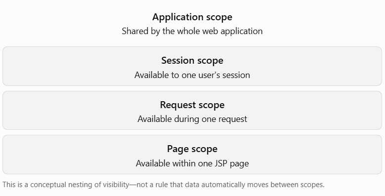

# 12.4 Scope Of JSP objects

## Learning objectives

By the end of this lesson, you should be able to:

1. Explain what scope means in JSP.
2. Distinguish the four JSP attribute scopes.
3. Store and retrieve attributes using JSP and Servlet APIs.
4. Choose the correct scope for data in a web application.

## 1. What is scope in JSP?

Scope determines how long an attribute remains available and which parts of a web application can access it.

For example, suppose a user logs in and your application stores their username:

- Should it be available only while rendering the current JSP?
- Should it be available throughout the current request?
- Should it remain available across multiple requests from the same user?
- Should it be shared across the entire web application?

JSP provides four attribute scopes to handle these situations.

## 2. The four JSP scopes

| Scope       | Constant                        | Lifetime / visibility                                          |
| ----------- | ------------------------------- | -------------------------------------------------------------- |
| Page        | `PageContext.PAGE_SCOPE`        | Only within the current JSP page                               |
| Request     | `PageContext.REQUEST_SCOPE`     | During the current request, including forwarded resources      |
| Session     | `PageContext.SESSION_SCOPE`     | Across multiple requests associated with the same HTTP session |
| Application | `PageContext.APPLICATION_SCOPE` | Shared across the web application while it is running          |

### Scope hierarchy



## 3. Page scope

Page scope is the narrowest scope. An attribute stored here is available only in the current JSP page.

### Example

```
<%
    pageContext.setAttribute("message", "Hello from page scope");
%>

<p>${pageScope.message}</p>
```

You can also retrieve it with Java:

```
<%
    String message =
        (String) pageContext.getAttribute("message");
    out.println(message);
%>
```

Use page scope for temporary data needed only while the current JSP is rendering.

## 4. Request scope

Request scope is useful when a Servlet forwards a request to a JSP and wants to provide data to that JSP.

### Servlet

```
@WebServlet("/student")
public class StudentServlet extends HttpServlet {

    @Override
    protected void doGet(
            HttpServletRequest request,
            HttpServletResponse response)
            throws ServletException, IOException {

        request.setAttribute("studentName", "Aarav");
        request.setAttribute("course", "Advanced Java");

        request.getRequestDispatcher("/student.jsp")
               .forward(request, response);
    }
}
```

### `student.jsp`

```
<h2>Student Details</h2>

<p>Name: ${requestScope.studentName}</p>
<p>Course: ${requestScope.course}</p>
```

The attributes are available to `student.jsp` because the Servlet forwards the same request.

Use request scope for results, messages, or data needed during one request-response cycle.

> A redirect creates a new HTTP request, so request-scoped attributes do not automatically survive a redirect.

## 5. Session scope

Session scope stores data associated with one user’s HTTP session. It can be accessed across multiple requests while that session remains valid.

### JSP example

```
<%
    session.setAttribute("username", "Aarav");
%>

<p>Welcome, ${sessionScope.username}</p>
```

### Servlet example

```
HttpSession session = request.getSession();
session.setAttribute("username", "Aarav");
```

Read it later:

```
String username =
    (String) session.getAttribute("username");
```

Use session scope for user-specific information such as a login identity or shopping cart.

Avoid storing large objects unnecessarily in sessions. Also, session attributes are not automatically permanent; sessions can expire or be invalidated.

## 6. Application scope

Application scope is shared across the web application. In Servlet terms, it is the `ServletContext`.

### Servlet example

```
ServletContext context = getServletContext();

context.setAttribute("appName", "Student Portal");
```

### JSP example

```
<p>Application: ${applicationScope.appName}</p>
```

Use application scope for application-wide data that should be shared among users, such as a simple global configuration value.

Do not use it for private user data. For mutable shared data, consider thread safety because multiple requests may access it concurrently.

## 7. Same attribute name in different scopes

An attribute name can exist in multiple scopes simultaneously.

```
<%
    pageContext.setAttribute("color", "Page Red");
    request.setAttribute("color", "Request Blue");
    session.setAttribute("color", "Session Green");
    application.setAttribute("color", "Application Yellow");
%>

<p>Page: ${pageScope.color}</p>
<p>Request: ${requestScope.color}</p>
<p>Session: ${sessionScope.color}</p>
<p>Application: ${applicationScope.color}</p>
```

Using explicit scope names makes the code clear and avoids confusion.

### What if you use `${color}`?

When EL searches for an unqualified attribute such as:

```
${color}
```

it looks through scopes in this order:

1. Page
2. Request
3. Session
4. Application

It returns the first matching attribute it finds.

Best practice: use `${requestScope.color}` or `${sessionScope.color}` when you want a particular scope.

## 8. Full example: Servlet → JSP using request scope

This example follows your Java + Tomcat + React + PostgreSQL learning stack. Here, the Servlet prepares data and the JSP displays it. In your React-based application, React would usually render the UI, while the Servlet returns JSON; this example demonstrates traditional JSP MVC.

### `StudentController.java`

```
package com.example.controller;

import jakarta.servlet.ServletException;
import jakarta.servlet.annotation.WebServlet;
import jakarta.servlet.http.HttpServlet;
import jakarta.servlet.http.HttpServletRequest;
import jakarta.servlet.http.HttpServletResponse;

import java.io.IOException;

@WebServlet("/student-details")
public class StudentController extends HttpServlet {

    @Override
    protected void doGet(
            HttpServletRequest request,
            HttpServletResponse response)
            throws ServletException, IOException {

        String studentName = "Aarav";
        String course = "Advanced Java";

        request.setAttribute("studentName", studentName);
        request.setAttribute("course", course);

        request.getRequestDispatcher("/student-details.jsp")
               .forward(request, response);
    }
}
```

### `student-details.jsp`

```
<%@ page contentType="text/html; charset=UTF-8"
         pageEncoding="UTF-8" %>

<!DOCTYPE html>
<html>
<head>
    <meta charset="UTF-8">
    <title>Student Details</title>
</head>
<body>

    <h1>Student Details</h1>

    <p>Name: ${requestScope.studentName}</p>
    <p>Course: ${requestScope.course}</p>

</body>
</html>
```

### Flow

```
Browser
   |
   | GET /student-details
   v
StudentController Servlet
   |
   | sets request attributes
   | forwards request
   v
student-details.jsp
   |
   | reads requestScope attributes
   | generates HTML
   v
Browser receives HTML
```

## 9. Which scope should you choose?

| Situation                                        | Recommended scope                    |
| ------------------------------------------------ | ------------------------------------ |
| Temporary value used only in one JSP             | Page                                 |
| Form validation error displayed after forwarding | Request                              |
| Logged-in username                               | Session                              |
| Shared application name or configuration         | Application                          |
| Data needed by React after an API call           | Usually JSON response, not JSP scope |

### Important distinction

Scope is not the same as parameter.

- `request.getParameter("username")` reads data sent by the client, such as a form field.
- `request.setAttribute("username", value)` stores server-side data for the request.
- `session.setAttribute(...)` stores server-side data for the user's session.


## Lesson 12.4 — Quick recap

- Page scope: current JSP page only.
- Request scope: current request; useful when forwarding from Servlet to JSP.
- Session scope: multiple requests from one user's session.
- Application scope: shared across the entire web application.
- EL searches unqualified attributes in this order: page → request → session → application.
- Prefer explicit EL scope names for clarity.
