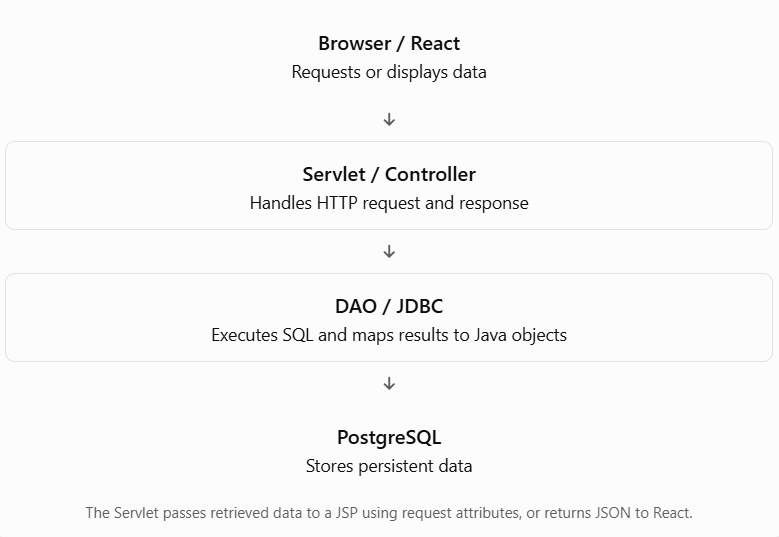

# Lesson 12.6 — Database Access with JSP

Let’s continue! This lesson explains how a Java web application connects to a database and retrieves or stores data.

For our examples, we’ll use your learning stack:

- Java 17+
- Jakarta Servlet / JSP
- Tomcat 10.1
- PostgreSQL
- JDBC
- IntelliJ IDEA

## Learning objectives

By the end of this lesson, you should be able to:

1. Explain how JSP can access a database through JDBC.
2. Configure a PostgreSQL JDBC connection.
3. Execute SQL using `PreparedStatement`.
4. Display database records in a JSP.
5. Understand why database logic should normally be kept out of JSP.

## 1. Why connect JSP to a database?

Most dynamic applications need persistent data, such as:

- Student records
- User accounts
- Products
- Orders
- Course registrations

A JSP page can display database information, but JSP should primarily handle presentation. Java classes such as a DAO (Data Access Object) should handle database operations.

### Recommended architecture



For learning, we’ll first understand JDBC, then build a small MVC example.

## 2. Set up PostgreSQL

Create a database:

```
CREATE DATABASE advance_java_db;
```

Connect to it, then create a table:

```
CREATE TABLE students (
    id SERIAL PRIMARY KEY,
    name VARCHAR(100) NOT NULL,
    email VARCHAR(150) UNIQUE NOT NULL,
    course VARCHAR(100) NOT NULL
);
```

Insert sample records:

```
INSERT INTO students (name, email, course)
VALUES
    ('Aarav Sharma', 'aarav@example.com', 'Advanced Java'),
    ('Maya Thapa', 'maya@example.com', 'Spring Boot'),
    ('Rohan Karki', 'rohan@example.com', 'React');
```

Check the data:

```
SELECT * FROM students;
```

## 3. Add the PostgreSQL JDBC driver

If your project uses Maven, add this dependency to `pom.xml`:

```
<dependency>
    <groupId>org.postgresql</groupId>
    <artifactId>postgresql</artifactId>
    <version>42.7.8</version>
</dependency>
```

The driver allows Java to communicate with PostgreSQL through JDBC.

Official documentation:

- [PostgreSQL JDBC documentation](https://jdbc.postgresql.org/documentation/?utm_source=chatgpt.com)
- [Java JDBC tutorial](https://docs.oracle.com/javase/tutorial/jdbc/?utm_source=chatgpt.com)

## 4. Understand the JDBC workflow

The typical JDBC workflow is:

1. Obtain a database connection.
2. Create a `PreparedStatement`.
3. Execute SQL.
4. Process the `ResultSet`, if the query returns rows.
5. Close resources.

Modern JDBC drivers are automatically discovered when the driver is on the classpath, so you generally do not need:

```
Class.forName("org.postgresql.Driver");
```

## 5. Create a Java model class

Create `Student.java`:

```
package com.example.model;

public class Student {

    private int id;
    private String name;
    private String email;
    private String course;

    public Student(int id, String name, String email, String course) {
        this.id = id;
        this.name = name;
        this.email = email;
        this.course = course;
    }

    public int getId() {
        return id;
    }

    public String getName() {
        return name;
    }

    public String getEmail() {
        return email;
    }

    public String getCourse() {
        return course;
    }
}
```

The model represents one row from the `students` table.

## 6. Create a database connection class

For this first demonstration, we’ll use a simple `DriverManager` connection. In production, a connection pool such as Tomcat’s JNDI `DataSource` is preferred.

Create `DatabaseConnection.java`:

```
package com.example.util;

import java.sql.Connection;
import java.sql.DriverManager;
import java.sql.SQLException;

public class DatabaseConnection {

    private static final String URL =
            "jdbc:postgresql://localhost:5432/advance_java_db";

    private static final String USER = "postgres";

    // For learning only. Use environment variables or a secret manager
    // rather than hardcoding credentials in real applications.
    private static final String PASSWORD = "your_password";

    public static Connection getConnection() throws SQLException {
        return DriverManager.getConnection(URL, USER, PASSWORD);
    }
}
```

### Connection URL breakdown

```
jdbc:postgresql://localhost:5432/advance_java_db
```

| Part              | Meaning                                 |
| ----------------- | --------------------------------------- |
| `jdbc:postgresql` | PostgreSQL JDBC protocol                |
| `localhost`       | Database server running on this machine |
| `5432`            | Default PostgreSQL port                 |
| `advance_java_db` | Database name                           |

Replace `your_password` with your local PostgreSQL password. Avoid committing credentials to source control.

## 7. Create a DAO to retrieve students

Create `StudentDAO.java`:

```
package com.example.dao;

import com.example.model.Student;
import com.example.util.DatabaseConnection;

import java.sql.Connection;
import java.sql.PreparedStatement;
import java.sql.ResultSet;
import java.sql.SQLException;
import java.util.ArrayList;
import java.util.List;

public class StudentDAO {

    public List<Student> findAll() throws SQLException {

        List<Student> students = new ArrayList<>();

        String sql = """
                SELECT id, name, email, course
                FROM students
                ORDER BY id
                """;

        try (
            Connection connection = DatabaseConnection.getConnection();
            PreparedStatement statement =
                    connection.prepareStatement(sql);
            ResultSet resultSet = statement.executeQuery()
        ) {
            while (resultSet.next()) {

                Student student = new Student(
                        resultSet.getInt("id"),
                        resultSet.getString("name"),
                        resultSet.getString("email"),
                        resultSet.getString("course")
                );

                students.add(student);
            }
        }

        return students;
    }
}
```

### What is happening?

- `Connection` represents the connection to PostgreSQL.
- `PreparedStatement` represents the SQL statement.
- `executeQuery()` runs a `SELECT` statement and returns a `ResultSet`.
- `resultSet.next()` moves to the next row.
- `try-with-resources` closes JDBC resources automatically.

### Why use `PreparedStatement`?

It supports parameterized SQL, helps prevent SQL injection, and handles SQL values appropriately.

For example:

```
String sql = "SELECT * FROM students WHERE email = ?";

try (Connection connection = DatabaseConnection.getConnection();
     PreparedStatement statement = connection.prepareStatement(sql)) {

    statement.setString(1, "aarav@example.com");

    try (ResultSet resultSet = statement.executeQuery()) {
        while (resultSet.next()) {
            System.out.println(resultSet.getString("name"));
        }
    }
}
```

The `?` is a placeholder. `setString(1, ...)` fills the first placeholder.

## 8. Create a Servlet controller

Create `StudentListServlet.java`:

```
package com.example.controller;

import com.example.dao.StudentDAO;
import com.example.model.Student;

import jakarta.servlet.ServletException;
import jakarta.servlet.annotation.WebServlet;
import jakarta.servlet.http.HttpServlet;
import jakarta.servlet.http.HttpServletRequest;
import jakarta.servlet.http.HttpServletResponse;

import java.io.IOException;
import java.sql.SQLException;
import java.util.List;

@WebServlet("/students")
public class StudentListServlet extends HttpServlet {

    private StudentDAO studentDAO;

    @Override
    public void init() {
        studentDAO = new StudentDAO();
    }

    @Override
    protected void doGet(
            HttpServletRequest request,
            HttpServletResponse response)
            throws ServletException, IOException {

        try {
            List<Student> students = studentDAO.findAll();

            request.setAttribute("students", students);

            request.getRequestDispatcher("/students.jsp")
                   .forward(request, response);

        } catch (SQLException exception) {
            throw new ServletException(
                    "Unable to retrieve students from the database.",
                    exception
            );
        }
    }
}
```

The Servlet:

1. Calls the DAO.
2. Receives a list of `Student` objects.
3. Stores the list in request scope.
4. Forwards the request to the JSP.

## 9. Display database records in JSP

Create `students.jsp`:

```
<%@ page contentType="text/html; charset=UTF-8"
         pageEncoding="UTF-8" %>

<%@ taglib prefix="c" uri="jakarta.tags.core" %>

<!DOCTYPE html>
<html>
<head>
    <meta charset="UTF-8">
    <title>Student List</title>
</head>
<body>

    <h1>Students</h1>

    <table border="1">
        <thead>
            <tr>
                <th>ID</th>
                <th>Name</th>
                <th>Email</th>
                <th>Course</th>
            </tr>
        </thead>

        <tbody>
            <c:forEach var="student" items="${requestScope.students}">
                <tr>
                    <td><c:out value="${student.id}"/></td>
                    <td><c:out value="${student.name}"/></td>
                    <td><c:out value="${student.email}"/></td>
                    <td><c:out value="${student.course}"/></td>
                </tr>
            </c:forEach>
        </tbody>
    </table>

</body>
</html>
```

### Why use JSTL instead of scriptlets?

Instead of embedding Java loops inside JSP:

```
<%
    // Java code inside JSP
%>
```

JSTL provides tags such as:

- `<c:forEach>` — iteration
- `<c:if>` — conditional rendering
- `<c:out>` — output with XML/HTML escaping by default

This makes JSP easier to read and reduces the risk of accidentally rendering unescaped user data.

For Jakarta Tags 3.0, the core tag library URI is:

```
<%@ taglib prefix="c" uri="jakarta.tags.core" %>
```

Make sure your project includes a compatible Jakarta Tags implementation.

## 10. Run the example

After deploying your application to Tomcat 10.1:

1. Ensure PostgreSQL is running.
2. Verify the database and `students` table exist.
3. Check your JDBC URL, username, and password.
4. Start the Tomcat server from IntelliJ IDEA.
5. Open:

```
http://localhost:8080/YourAppName/students
```

Expected output:

| ID | Name         | Email              | Course        |
| -- | ------------ | ------------------ | ------------- |
| 1  | Aarav Sharma | aarav\@example.com | Advanced Java |
| 2  | Maya Thapa   | maya\@example.com  | Spring Boot   |
| 3  | Rohan Karki  | rohan\@example.com | React         |

Your actual IDs may differ depending on previous inserts.

## 11. What about inserting form data into PostgreSQL?

A form submission should generally follow this flow:

```
HTML / React form
       ↓
Servlet validates input
       ↓
DAO executes INSERT using PreparedStatement
       ↓
PostgreSQL stores record
       ↓
Servlet redirects or returns a response
```

Example DAO method:

```
public void save(String name, String email, String course)
        throws SQLException {

    String sql = """
            INSERT INTO students (name, email, course)
            VALUES (?, ?, ?)
            """;

    try (Connection connection = DatabaseConnection.getConnection();
         PreparedStatement statement = connection.prepareStatement(sql)) {

        statement.setString(1, name);
        statement.setString(2, email);
        statement.setString(3, course);

        statement.executeUpdate();
    }
}
```

`executeUpdate()` is used for SQL statements such as `INSERT`, `UPDATE`, and `DELETE`. It returns the number of affected rows.

For a complete application, validate input in the Servlet/service layer before calling this DAO method.

## 12. Key takeaways

- JSP can access a database, but database code should normally live in a DAO or service class.
- JDBC connects Java to PostgreSQL.
- `PreparedStatement` is preferred for parameterized SQL.
- `ResultSet` represents rows returned by a query.
- Use `try-with-resources` to close JDBC resources.
- The Servlet passes data to JSP using request attributes.
- Use EL and JSTL to display data rather than Java scriptlets.
- For your React application, the backend will commonly return JSON instead of rendering JSP.
