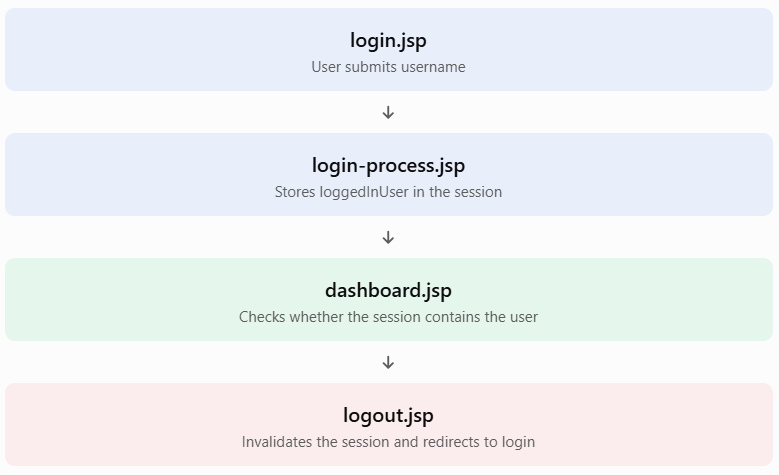

# Lesson 12.8 — JSP Session Tracking

### 1. What is session tracking?
HTTP is a **stateless protocol**. This means the server does not automatically remember a user's previous request when the user sends another request.

Imagine this sequence:
1. You log in to a website.
2. You open your profile page.
3. You open your dashboard.
4. You add a product to your cart.
The application needs a way to recognize that these requests belong to the same user. **Session tracking** provides that mechanism.

A session allows the server to maintain user-specific information across multiple HTTP requests.

Why do we need session tracking?
|Use case|	Example|
|--------|---------|
|Login management|	Remember that a user is authenticated|
|Shopping cart|	Keep selected products while navigating|
|User preferences|	Remember language or theme|
|Multi-step forms|	Retain information between steps|
|User activity	|Track the last activity time|

### 2. How does session tracking work?
In a typical Servlet/JSP application, Tomcat creates an HTTP session and gives it a unique session ID.


The usual cookie-based flow is:
1. The browser sends its first request.
2. Tomcat creates a session.
3. Tomcat sends the session ID to the browser, commonly in a cookie named `JSESSIONID`.
4. The browser sends that cookie with subsequent requests to the application.
5. Tomcat uses the ID to associate those requests with the existing session.
The session ID is a reference to server-side session state; it is not the user's actual profile data.

> Important: Cookies are the common session-tracking mechanism, but the Servlet specification also supports URL rewriting. 


### 3. JSP's `session` implicit object
JSP provides a built-in object named `session`.

Its Java type is:
```
jakarta.servlet.http.HttpSession
```

You can use it without declaring or creating it manually, provided the JSP session feature is enabled (it is enabled by default).

Common methods
|Method	|Purpose|
|setAttribute(name, value)|	Store information in a session|
|getAttribute(name)|Retrieve stored information|
|removeAttribute(name)|	Remove one stored value|
|getId()|	Get the session identifier|
|getCreationTime()|	Get the session creation time|
|getLastAccessedTime()|	Get the last access time|
|setMaxInactiveInterval(seconds)|	Set the inactivity timeout|
|getMaxInactiveInterval()|	Read the inactivity timeout|
|invalidate()	|End the session and remove its attributes|


### 4. Example 1 — Store and retrieve session data
Let's build a simple example that stores a student's name in a session and displays it on another JSP page
.
**File 1:**    `set-session.jsp`
```
<%@ page contentType="text/html; charset=UTF-8" %>

<%
    String studentName = "Daenish";

    // Store the name in the session
    session.setAttribute("studentName", studentName);

    // Redirect to another JSP
    response.sendRedirect("profile.jsp");
%>
```


**File 2:** `profile.jsp`
```
<%@ page contentType="text/html; charset=UTF-8" %>

<!DOCTYPE html>
<html>
<head>
    <title>Student Profile</title>
</head>
<body>

    <h2>Student Profile</h2>

    <p>
        Welcome,
        <%= session.getAttribute("studentName") %>
    </p>

</body>
</html>
```

**How does it work?**
1. `set-session.jsp` stores the student's name using `setAttribute()`.
2. The browser receives a redirect to `profile.jsp`.
3. The browser sends another request, normally including its `JSESSIONID` cookie.
4. Tomcat associates the request with the existing session.
5. `profile.jsp` retrieves the stored name.

**Notice:** The example uses a redirect, which creates a new request. Session data survives that request because it is stored in the session, unlike request-scoped attributes.


### 5. Example 2 — Use session data with Expression Language (EL)
In modern JSP, you should prefer EL over Java scriptlets for displaying session attributes.

You can replace the Java expression in `profile.jsp `with:
<p>Welcome, ${sessionScope.studentName}</p>


Here:
- sessionScope accesses attributes stored in the session.
- studentName is the name of the attribute.
- EL retrieves and displays its value.
You can also write:
```
${studentName}
```

However, that expression searches several scopes in order. Using `${sessionScope.studentName}` explicitly identifies the session value.

### 6. Example 3 — Session-based login demonstration
Let's understand how a login state can be stored in a session.

For learning only — this example does not authenticate a real user. A production login must verify credentials on the server.

**File 1:** `login.jsp`
```
<%@ page contentType="text/html; charset=UTF-8" %>

<!DOCTYPE html>
<html>
<head>
    <title>Login</title>
</head>
<body>

    <h2>Login Form</h2>

    <form action="login-process.jsp" method="post">

        <label>Username:</label>
        <input type="text" name="username" required>

        <button type="submit">Login</button>

    </form>

</body>
</html>
```

**File 2:** `login-process.jsp`
```
<%@ page contentType="text/html; charset=UTF-8" %>

<%
    request.setCharacterEncoding("UTF-8");

    String username = request.getParameter("username");

    if (username == null || username.isBlank()) {
        response.sendRedirect("login.jsp");
        return;
    }

    session.setAttribute("loggedInUser", username);

    response.sendRedirect("dashboard.jsp");
%>
```

**File 3:** `dashboard.jsp`
```
<%@ page contentType="text/html; charset=UTF-8" %>

<!DOCTYPE html>
<html>
<head>
    <title>Dashboard</title>
</head>
<body>

    <h2>Dashboard</h2>

    <%
        String username =
            (String) session.getAttribute("loggedInUser");

        if (username == null) {
            response.sendRedirect("login.jsp");
            return;
        }
    %>

    <h3>Welcome, <%= username %>!</h3>

    <a href="logout.jsp">Logout</a>

</body>
</html>
```

**File 4:** `logout.jsp`
```
<%@ page contentType="text/html; charset=UTF-8" %>

<%
    session.invalidate();

    response.sendRedirect("login.jsp");
%>
```


**Understand the login flow**



The important operations are:
```
session.setAttribute("loggedInUser", username);
```

Stores the login state.
```
session.getAttribute("loggedInUser");
```

Reads the login state.
```
session.invalidate();
```

Ends the session.

**Production recommendation:** Move login processing to a Servlet/controller and verify credentials through a secure authentication service. A JSP should display the result, not perform authentication.

### 7. Session timeout
A session should not remain active forever when a user stops using the application.

The inactivity timeout determines how long the server keeps a session without receiving another associated request.

**Option A: Configure timeout in** `web.xml`
```
<session-config>
    <session-timeout>30</session-timeout>
</session-config>
```

The value is in **minutes.** Here, the session timeout is 30 minutes.

**Option B: Configure timeout programmatically**
```
session.setMaxInactiveInterval(1800);
```

The value is in **seconds**. Here, 1800 seconds equals 30 minutes.

You can check the configured value:
```
int timeout = session.getMaxInactiveInterval();

out.println("Session timeout: " + timeout + " seconds");
```

A session can expire after the configured inactivity period. Calling `invalidate()` ends it immediately.

### 8. Disable session creation in a JSP
Sometimes a JSP does not need a session.

You can disable JSP session support with:
```
<%@ page session="false" %>
```

For example:
```
<%@ page session="false"
         contentType="text/html; charset=UTF-8" %>

<!DOCTYPE html>
<html>
<body>
    <h2>Public Information Page</h2>
    <p>This page does not need an HTTP session.</p>
</body>
</html>
```

When `session="false"` is set, the JSP cannot use the implicit session object.

This can avoid unnecessary session creation for public pages.

### 9. Session tracking security
Session tracking is useful, but sessions must be protected because possession of another user's session ID may allow someone to impersonate that user.

Follow these practices:
1. **Use HTTPS:** Protect session cookies while they travel between browser and server.
2. **Use HttpOnly cookies:** Prevent client-side JavaScript from reading the session cookie.
3. **Use Secure cookies:** Send the cookie only over secure HTTPS connections.
4. **Use an appropriate SameSite policy:** Help reduce cross-site request forgery risks.
5. **Invalidate sessions on logout:** Do not merely remove the username attribute.
6. **Regenerate the session ID after authentication:** Helps protect against session fixation.
For example, in a Servlet after successful authentication:
```
// After verifying the user's credentials:
request.changeSessionId();
```

This changes the session ID associated with the current request without discarding the session's existing attributes.

For production applications, configure session-cookie security through the container or application configuration. Never expose a session ID in application logs or URLs.
