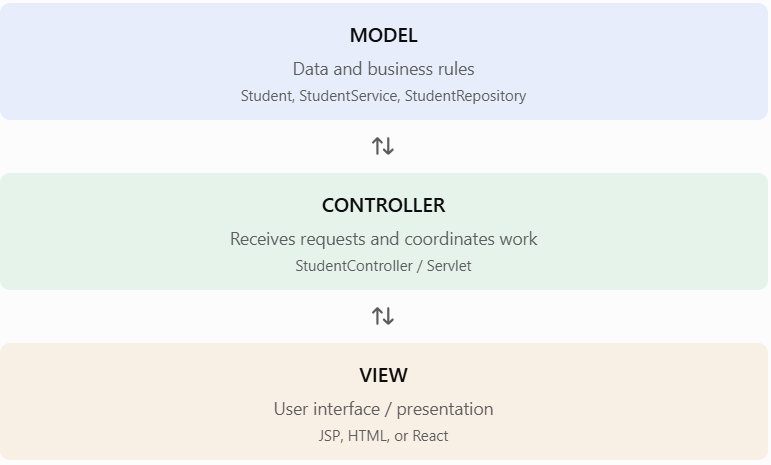

# Lesson 12.9 — Introduction to Java Web Frameworks
### 1. What is a Java web framework?
A **Java web framework** is a collection of libraries, APIs, and conventions that helps developers build web applications without implementing every common web feature manually.

Think about what you have already learned:

Using Servlets and JSP, you manually work with:
- HTTP requests and responses.
- URL mappings.
- Form processing.
- Session management.
- Database access.
- Exception handling.
- Request forwarding.
- HTML rendering.

As applications grow, manually coordinating all these parts becomes difficult. Web frameworks provide reusable structures and tools to organize this work.

**Why do we need frameworks?**

|Without a framework|	With a framework|
|-------------------|-------------------|
|Manually manage many request mappings|	Framework provides routing mechanisms|
|Repeated boilerplate code|	Reusable components and conventions|
|Manually connect application components|	Dependency injection can manage objects|
|Build common features repeatedly|	Built-in support for common web tasks|
|Application structure can become inconsistent|	Encourages organized architecture|

A framework does not eliminate Java, Servlets, or HTTP. Many Java web frameworks are built on top of the Servlet API.

### 2. Popular Java web frameworks and technologies

#### 1. Spring Framework

Provides dependency injection, Spring MVC, data access integration, security integration, and many other application features. Widely used for enterprise Java applications.


#### 2. Spring Boot
Makes it easier to create standalone Spring applications with auto-configuration and embedded web servers. It is commonly used to build REST APIs for React applications.


#### 3. Jakarta Faces (formerly JSF)
A component-based server-side UI framework. It supports UI components, validation, event handling, and page navigation.


#### 4. Apache Struts
An MVC-oriented Java web framework for building web applications.


**Important distinction:** Spring Boot and Spring MVC are related, but they are not the same thing. Spring MVC provides the web MVC programming model; Spring Boot simplifies configuring and running Spring applications.

Also, Hibernate is a popular Java ORM framework, but it is not a web MVC framework. It is used for database persistence.

### 3. Understanding MVC architecture
Most Java web frameworks support or encourage the **MVC (Model–View–Controller)** architectural pattern.

MVC separates an application into three main responsibilities.



|Component	|Responsibility|	Example|
|-----------|--------------|-----------|
|Model|	Represents data and application rules|	Student.java|
|View|	Displays information|	students.jsp or React|
|Controller|	Handles incoming requests|	Servlet or Spring controller|

#### How does MVC work?
Imagine a user requests a list of students:
1. The browser sends GET /students.
2. The controller receives the request.
3. The controller calls the service.
4. The service obtains data from the repository or DAO.
5. The controller returns the data or selects a view.
6. The view displays the result.
MVC helps keep database operations, business logic, and presentation separate.

### 4. Example: Traditional Servlet MVC vs Spring MVC
You already know this Servlet mapping:
```
@WebServlet("/students")
public class StudentServlet extends HttpServlet {
    // Handle HTTP requests here
}
```

In Spring MVC, you can use annotations:
```
@RestController
@RequestMapping("/api/students")
public class StudentController {

    @GetMapping
    public String getStudents() {
        return "List of students";
    }
}
```

Here:
- `@RestController` declares a REST controller.
- `@RequestMapping` defines the base URL.
- `@GetMapping` handles HTTP GET requests.
Spring handles much of the request routing and response processing for you.

### 5. Complete basic Spring Boot REST example
Let's create a small REST API that could be called by your React frontend.

**Project structure**
```
student-api/
 └── src/main/java/com/example/student/
      ├── StudentApiApplication.java
      ├── Student.java
      └── StudentController.java

```
**File 1:** `StudentApiApplication.java`
```
package com.example.student;

import org.springframework.boot.SpringApplication;
import org.springframework.boot.autoconfigure.SpringBootApplication;

@SpringBootApplication
public class StudentApiApplication {

    public static void main(String[] args) {
        SpringApplication.run(
            StudentApiApplication.class,
            args
        );
    }
}
```

**File 2:** `Student.java`
```
package com.example.student;

public record Student(
    Long id,
    String name,
    String course
) {}
```

A Java record is a concise way to represent data. It is suitable for this read-only response example.


**File 3:** `StudentController.java`
```
package com.example.student;

import org.springframework.web.bind.annotation.*;
import java.util.List;

@RestController
@RequestMapping("/api/students")
public class StudentController {

    @GetMapping
    public List<Student> getStudents() {

        return List.of(
            new Student(1L, "Aarav", "Advanced Java"),
            new Student(2L, "Maya", "Spring Boot"),
            new Student(3L, "Rohan", "React")
        );
    }
}
```

**Example JSON response**

When you call:
```
GET http://localhost:8080/api/students
```

The API returns:
```
[
  {
    "id": 1,
    "name": "Aarav",
    "course": "Advanced Java"
  },
  {
    "id": 2,
    "name": "Maya",
    "course": "Spring Boot"
  },
  {
    "id": 3,
    "name": "Rohan",
    "course": "React"
  }
]
```

Spring MVC converts the returned Java objects into JSON using an HTTP message converter.

**How React can consume the API**
```
async function fetchStudents() {
    const response = await fetch(
        "http://localhost:8080/api/students"
    );

    if (!response.ok) {
        throw new Error("Unable to load students");
    }

    const students = await response.json();

    console.log(students);
}
```

