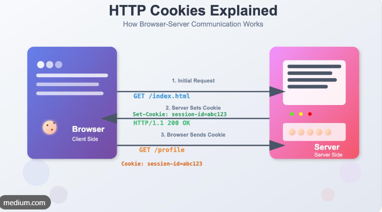
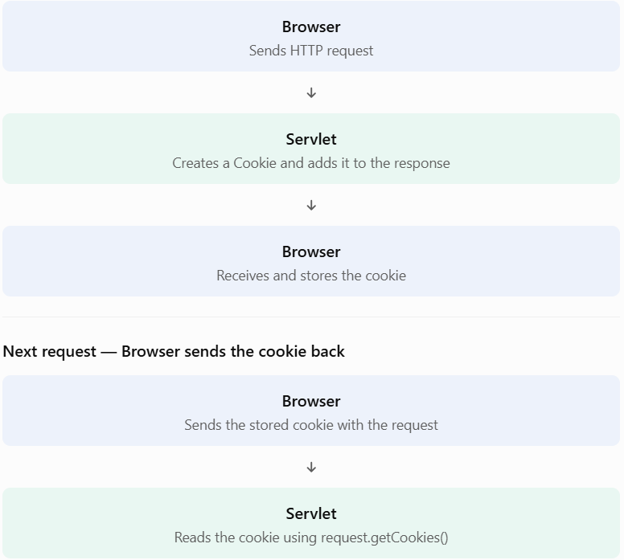

# Lesson 11.10 — Cookies in Servlet

### 1. What is a cookie?
A cookie is a small piece of data that a web server asks the browser to store. The browser can send that data back to the server with later HTTP requests.

For example, imagine a user visits your application:
1. The user opens your website.
2. The servlet sends a cookie containing username=David.
3. The browser stores the cookie.
4. The user visits another page.
5. The browser sends the cookie back to the server.
6. The servlet reads the cookie and can recognize the stored preference.




**Important:** Cookies are stored on the client side (usually in the browser), not in the servlet's memory.


### 2. Why do we need cookies?
HTTP is a stateless protocol. This means the server does not automatically remember information from one request to the next.

Cookies help applications retain small pieces of information between requests.

Common uses include:
- Remembering a user's language preference.
- Remembering a theme preference (dark or light).
- Remembering a shopping cart identifier.
- Supporting session tracking.
- Remembering non-sensitive user preferences.
Example: A user selects dark mode. A cookie can remember that preference so the application can use dark mode on the next visit.

Cookies are not a safe place for passwords, payment details, or other sensitive information.


### 3. How cookies work
The process has two important parts:




### 4. Important Cookie methods
Jakarta Servlet provides the jakarta.servlet.http.Cookie class.

|Method                   |	              Purpose                              |
|---------                |-----------                                         |
|new Cookie(name, value)  |Creates a cookie                                    |
|response.addCookie(cookie)|	Sends a cookie to the browser                  |
|request.getCookies()	  |Reads cookies sent by the browser                   |
|cookie.getName()	      |Gets the cookie name                                |
|cookie.getValue()	      |Gets the cookie value                               |
|cookie.setMaxAge(seconds)|	Sets the cookie's lifetime                         |
|cookie.setPath(path)	  |Sets the URL path for the cookie                    |
|cookie.setHttpOnly(true) |Prevents ordinary JavaScript access                 |
|cookie.setSecure(true)	  |Restricts sending the cookie to secure connections  |


### 5. Complete practical example
Let's create a small application with two servlets:
- SetCookieServlet: creates and sends a cookie.
- ReadCookieServlet: reads the cookie sent by the browser.

We'll use this cookie:
```
Name: studentName
Value: David
```


#### Step 1 — Create SetCookieServlet.java
```
package com.advancejava;

import jakarta.servlet.ServletException;
import jakarta.servlet.annotation.WebServlet;
import jakarta.servlet.http.Cookie;
import jakarta.servlet.http.HttpServlet;
import jakarta.servlet.http.HttpServletRequest;
import jakarta.servlet.http.HttpServletResponse;

import java.io.IOException;
import java.io.PrintWriter;

@WebServlet("/set-cookie")
public class SetCookieServlet extends HttpServlet {

    @Override
    protected void doGet(
            HttpServletRequest request,
            HttpServletResponse response)
            throws ServletException, IOException {

        // Create a cookie
        Cookie cookie = new Cookie("studentName", "David");

        // Cookie lifetime: 1 hour
        cookie.setMaxAge(60 * 60);

        // Make it available throughout this application
        String contextPath = request.getContextPath();
        cookie.setPath(
            contextPath.isEmpty() ? "/" : contextPath
        );

        // Security attributes
        cookie.setHttpOnly(true);
        cookie.setSecure(request.isSecure());

        // SameSite protection
        cookie.setAttribute("SameSite", "Lax");

        // Send cookie to browser
        response.addCookie(cookie);

        response.setContentType("text/html;charset=UTF-8");

        PrintWriter out = response.getWriter();

        out.println("<h2>Cookie Created Successfully!</h2>");
        out.println("<p>Name: studentName</p>");
        out.println("<p>Value: David</p>");
        out.println("<p>Now visit /read-cookie</p>");
    }
}
```

**Understand these lines carefully:**
```
Cookie cookie = new Cookie("studentName", "David");
```

Creates a cookie with a name and value.
```
cookie.setMaxAge(60 * 60);
```


Stores it for a maximum of 3,600 seconds (one hour).
```
cookie.setHttpOnly(true);
```


Prevents normal JavaScript access to this cookie. This helps reduce cookie theft through certain XSS attacks.
```
cookie.setSecure(request.isSecure());
```


Sets the Secure attribute when the request uses HTTPS. In production, serve sensitive cookies over HTTPS.
```
cookie.setAttribute("SameSite", "Lax");
```


Sets a SameSite policy to help limit cross-site cookie sending.
```
response.addCookie(cookie);
```


Adds the cookie to the HTTP response so the browser can store it.
#### Step 2 — Create ReadCookieServlet.java
```
package com.advancejava;

import jakarta.servlet.ServletException;
import jakarta.servlet.annotation.WebServlet;
import jakarta.servlet.http.Cookie;
import jakarta.servlet.http.HttpServlet;
import jakarta.servlet.http.HttpServletRequest;
import jakarta.servlet.http.HttpServletResponse;

import java.io.IOException;
import java.io.PrintWriter;

@WebServlet("/read-cookie")
public class ReadCookieServlet extends HttpServlet {

    @Override
    protected void doGet(
            HttpServletRequest request,
            HttpServletResponse response)
            throws ServletException, IOException {

        response.setContentType("text/html;charset=UTF-8");

        PrintWriter out = response.getWriter();

        // Get cookies sent by browser
        Cookie[] cookies = request.getCookies();

        if (cookies != null) {

            boolean found = false;

            for (Cookie cookie : cookies) {

                if ("studentName".equals(cookie.getName())) {

                    out.println("<h2>Cookie Found!</h2>");
                    out.println("<p>Student Name: "
                            + cookie.getValue() + "</p>");

                    found = true;
                    break;
                }
            }

            if (!found) {
                out.println("<h2>studentName cookie not found</h2>");
            }

        } else {
            out.println("<h2>No cookies received!</h2>");
        }
    }
}
```

**Important concepts:**
```
Cookie[] cookies = request.getCookies();
```


Returns an array of cookies sent by the browser. It can return null when no cookies are present.
```
for (Cookie cookie : cookies)
```


Loops through the received cookies.
```
cookie.getName()
```


Checks the cookie's name.
```
cookie.getValue()
```


Reads the cookie's value.
### 6. How to run this project
Assuming your Tomcat context path is servlet-learning:
1. Build and deploy your project in IntelliJ IDEA.
2. Open this URL:
   
   http://localhost:8080/servlet-learning/set-cookie
3. The browser receives and stores the cookie.
4. Open:
   
   http://localhost:8080/servlet-learning/read-cookie
5. You should see:

```
Expected output: 
Cookie Found!

Student Name: David
```

The browser automatically sends the cookie when you visit the second URL, provided its path and other cookie rules match.

### 7. How to test cookies in Postman
You can test the same application without React.

1. Send a GET request to /set-cookie.
2. Check the response's Set-Cookie header.
3. Postman should store the cookie in its cookie jar for the relevant host.
4. Send a GET request to /read-cookie.
5. Check the response for Student Name: David.
If the cookie is not sent, check Postman's cookie manager, the host, path, and cookie attributes.


### 8. How to delete a cookie
To delete a cookie, send another cookie with the same name and path but set its maximum age to zero.
```
Cookie cookie = new Cookie("studentName", "");

cookie.setPath(request.getContextPath().isEmpty()
        ? "/"
        : request.getContextPath());

cookie.setMaxAge(0);

response.addCookie(cookie);
```

The browser will remove the matching cookie.

### 9. Session Cookies vs Persistent Cookies
Type	Description
Session cookie	Usually deleted when the browser session ends
Persistent cookie	Stored until its expiration time

For example:
```
cookie.setMaxAge(-1); // Session cookie
cookie.setMaxAge(3600); // Persistent, one hour
cookie.setMaxAge(0); // Delete cookie
```


### 10. Important security points
- Never store passwords or sensitive personal data directly in cookies.
- Use HTTPS and the Secure attribute in production.
- Use HttpOnly for cookies that JavaScript does not need to access.
- Choose an appropriate SameSite policy.
- Validate cookie values on the server; never trust client-provided data.