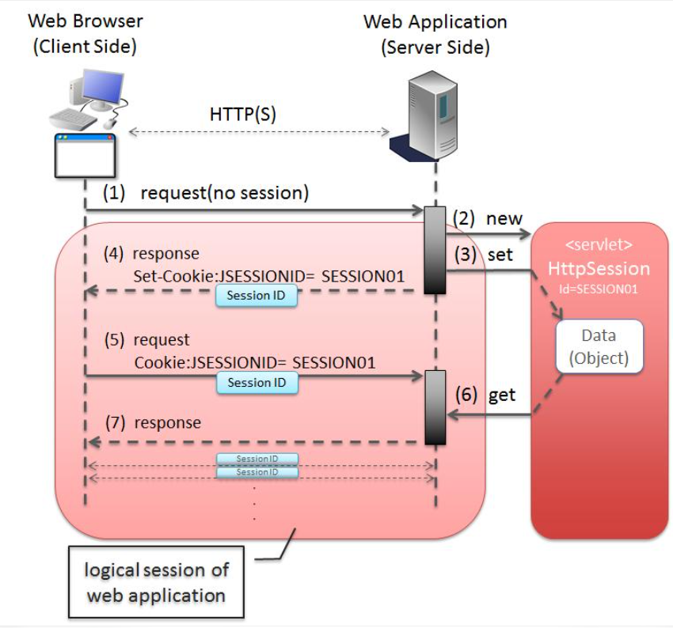
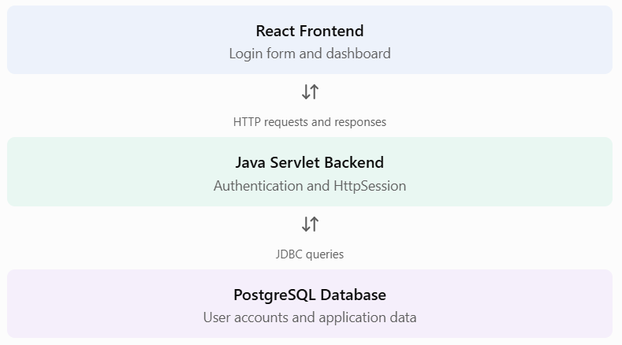

# Lesson 11.11 — Session Tracking in Servlets

### 1. What is session tracking?
In the previous lesson, we learned that cookies store small pieces of information in the browser.
Now imagine a user logs into your application. The user opens the dashboard, visits the profile page, and then opens the shopping cart.

Should the user have to log in again on every page?
No. We need a way to recognize the same user across multiple HTTP requests.
**Session tracking** is the technique used to maintain information about a user across multiple requests.
In Jakarta Servlets, the main interface for this is HttpSession.

According to the official Jakarta Servlet documentation, HttpSession allows a servlet to identify a user across multiple page requests and store information associated with that user. 


### 2. Why do we need sessions?
Remember:
- HTTP is stateless.
- Each HTTP request is independent by default.
- The server does not automatically remember the previous request.
Consider this example:


<div style="border: 1px solid #e2e8f0; border-radius: 8px; padding: 24px; font-family: sans-serif; max-width: 600px;">

### Without session tracking

1. User logs in.
2. User opens the dashboard.
3. Server receives another request but has no application-level login state associated with it.
4. User may be asked to log in again.

<hr style="border: 0; border-top: 1px solid #edf2f7; margin: 24px 0;" />

### With session tracking

1. User logs in.
2. Servlet creates a session and stores the user's information.
3. Browser sends the session identifier on subsequent requests.
4. Servlet container recognizes the session and retrieves the stored information.

</div>


Common uses:
- Login and logout.
- Shopping carts.
- User-specific dashboards.
- Multi-step forms.
- Temporary user preferences.
- Tracking a user's activity during an application visit.

### 3. How does session tracking work?
Let's understand the process.



1. The browser sends a login request.
2. The servlet container creates an HttpSession.
3. The server stores the session information.
4. The container sends the session identifier to the browser, usually through a cookie named JSESSIONID.
5. The browser sends that identifier with subsequent requests.
6. The container uses it to associate those requests with the existing session.

**Important distinction:**


- HttpSession and its attributes are managed on the server.
- The browser normally stores the session identifier, not the session's Java objects.
- JSESSIONID is the default session-tracking cookie name in servlet containers such as Tomcat.
The Servlet specification also describes URL rewriting and SSL sessions as session-tracking mechanisms. 

### 4. HttpSession interface and important methods
The **HttpSession** interface belongs to:
```
jakarta.servlet.http.HttpSession
```

Here are its most important methods:
|Method	|Purpose|
|-----|-----|
|request.getSession() |	Gets the current session or creates one|
|request.getSession(false)|	Gets the current session without creating one|
|session.setAttribute()|	Stores an object in the session|
|session.getAttribute()	|Retrieves a stored object|
|session.removeAttribute()|	Removes an attribute|
|session.getId()	|Gets the session identifier|
|session.invalidate()	|Ends the session|
|session.setMaxInactiveInterval()|	Sets the inactivity timeout in seconds|
|session.getMaxInactiveInterval()|	Gets the inactivity timeout|
|session.isNew()	|Checks whether the client has joined the session|


**Understand these three methods particularly well**
#### A. Creating or retrieving a session
```
HttpSession session = request.getSession();
```
- If a session already exists, it returns that session.
- If no session exists, it creates a new one.

#### B. Retrieving a session without creating one
```
HttpSession session = request.getSession(false);
```
- If a session exists, it returns it.
- If no session exists, it returns null.
This is especially useful when checking whether a user is logged in.

#### C. Storing and retrieving data
```
session.setAttribute("username", "David");

String username =
    (String) session.getAttribute("username");
```

**setAttribute()** accepts an **Object**, so sessions can store objects such as strings, lists, and Java objects. You must cast an object when retrieving it if you need a specific type.

### 5. Complete practical example — Login, Dashboard and Logout
Let's build a small session-based login example.

We'll create three servlets:
1. **LoginServlet** — creates a session after successful login.
2. **DashboardServlet** — checks the session and displays the username.
3. **LogoutServlet** — invalidates the session.


For this teaching example, we'll use hard-coded credentials. In a real application, authenticate users against PostgreSQL and store securely hashed passwords. Never use this example's plain-text password approach in production.

### Step 1 — LoginServlet.java
```
package com.advancejava;

import jakarta.servlet.ServletException;
import jakarta.servlet.annotation.WebServlet;
import jakarta.servlet.http.HttpServlet;
import jakarta.servlet.http.HttpServletRequest;
import jakarta.servlet.http.HttpServletResponse;
import jakarta.servlet.http.HttpSession;

import java.io.IOException;

@WebServlet("/login")
public class LoginServlet extends HttpServlet {

    @Override
    protected void doPost(
            HttpServletRequest request,
            HttpServletResponse response)
            throws ServletException, IOException {

        String username = request.getParameter("username");
        String password = request.getParameter("password");

        // Demonstration only: use database authentication in production
        if ("David".equals(username)
                && "java123".equals(password)) {

            // Prevent session fixation after authentication
            HttpSession existingSession =
                    request.getSession(false);

            if (existingSession != null) {
                existingSession.invalidate();
            }

            // Create a fresh session
            HttpSession session = request.getSession();

            // Store user information
            session.setAttribute("username", username);

            // Session expires after 15 minutes of inactivity
            session.setMaxInactiveInterval(15 * 60);

            response.sendRedirect(
                    request.getContextPath() + "/dashboard"
            );

        } else {

            response.sendError(
                    HttpServletResponse.SC_UNAUTHORIZED,
                    "Invalid username or password"
            );
        }
    }
}
```

Let's understand the important parts.
```
String username = request.getParameter("username");
String password = request.getParameter("password");
```
Reads the submitted login form values.

```
HttpSession existingSession =
        request.getSession(false);
```
Checks whether the browser already has an associated session.

```
existingSession.invalidate();

```
Invalidates the old session, if present. This example then creates a fresh session after authentication to reduce session-fixation risk.

```
HttpSession session = request.getSession();
```
Creates a new session.

```
session.setAttribute("username", username);
```
Stores the username in that session.

```
session.setMaxInactiveInterval(15 * 60);

```
Sets the maximum inactivity interval to 900 seconds (15 minutes). It is not a guarantee that the session lasts exactly 15 minutes from login; activity can extend it.


### Step 2 — DashboardServlet.java
```
package com.advancejava;

import jakarta.servlet.ServletException;
import jakarta.servlet.annotation.WebServlet;
import jakarta.servlet.http.HttpServlet;
import jakarta.servlet.http.HttpServletRequest;
import jakarta.servlet.http.HttpServletResponse;
import jakarta.servlet.http.HttpSession;

import java.io.IOException;
import java.io.PrintWriter;

@WebServlet("/dashboard")
public class DashboardServlet extends HttpServlet {

    @Override
    protected void doGet(
            HttpServletRequest request,
            HttpServletResponse response)
            throws ServletException, IOException {

        // Do not create a session just to check login
        HttpSession session = request.getSession(false);

        if (session == null ||
                session.getAttribute("username") == null) {

            response.sendError(
                    HttpServletResponse.SC_UNAUTHORIZED,
                    "Please login first"
            );

            return;
        }

        String username =
                (String) session.getAttribute("username");

        response.setContentType("text/html;charset=UTF-8");

        PrintWriter out = response.getWriter();

        out.println("<h1>Welcome, "
                + escapeHtml(username) + "!</h1>");

        out.println("<p>You are logged in.</p>");

        out.println("<a href='"
                + response.encodeURL(
                    request.getContextPath() + "/logout"
                )
                + "'>Logout</a>");
    }

    private String escapeHtml(String value) {

        return value.replace("&", "&amp;")
                    .replace("<", "&lt;")
                    .replace(">", "&gt;")
                    .replace("\"", "&quot;")
                    .replace("'", "&#x27;");
    }
}
```

Important:
```
HttpSession session = request.getSession(false);
```

We use **false** because we don't want to create a new session for someone who has not logged in.
```
session.getAttribute("username")
```

Retrieves the username stored during login.

If no session or username exists, the servlet rejects access to the dashboard.


### Step 3 — LogoutServlet.java
```
package com.advancejava;

import jakarta.servlet.ServletException;
import jakarta.servlet.annotation.WebServlet;
import jakarta.servlet.http.HttpServlet;
import jakarta.servlet.http.HttpServletRequest;
import jakarta.servlet.http.HttpServletResponse;
import jakarta.servlet.http.HttpSession;

import java.io.IOException;

@WebServlet("/logout")
public class LogoutServlet extends HttpServlet {

    @Override
    protected void doGet(
            HttpServletRequest request,
            HttpServletResponse response)
            throws ServletException, IOException {

        HttpSession session = request.getSession(false);

        if (session != null) {
            session.invalidate();
        }

        response.sendRedirect(
                request.getContextPath() + "/login-form.html"
        );
    }
}
```

The important method is:
```
session.invalidate();
```
It invalidates the session and unbinds its stored attributes.

After logout, the old session cannot be used again.

For a production application, logout is generally better implemented as a POST request with CSRF protection rather than a GET link.


### Step 4 — login-form.html
Create this file under:

src/main/webapp/login-form.html
```
<!DOCTYPE html>
<html>
<head>
    <title>Student Login</title>
</head>
<body>

    <h2>Login Form</h2>

    <form action="login" method="post">

        <label>Username:</label>
        <input type="text"
               name="username"
               required>

        <br><br>

        <label>Password:</label>
        <input type="password"
               name="password"
               required>

        <br><br>

        <button type="submit">Login</button>

    </form>

</body>
</html>
```

### Step 5 — Test the application
Assuming your context path is servlet-learning:
<div style="border: 1px solid #e2e8f0; border-radius: 8px; padding: 24px; font-family: sans-serif; max-width: 600px;">

### Test credentials
Username

David

Password

java123

<hr/>

### Test URL
http://localhost:8080/servlet-learning/login-form.html

Expected workflow:
1. Open the login form.
2. Enter the demonstration credentials.
3. Submit the form.
4. The servlet creates a session.
5. The browser receives the session identifier.
6. The dashboard recognizes the session and displays Welcome, David!.
7. Select Logout.
8. Try opening the dashboard again. Access should be rejected.
</div>


### 6. Session tracking techniques
There are three important mechanisms to understand:

|Technique	|Explanation|
|-----|-----|
|Cookies|	Browser sends a session identifier, commonly JSESSIONID|
|URL rewriting	|Session ID is encoded into URLs when necessary|
|SSL sessions	|HTTPS connection information can be used by the container for session tracking|

Cookies are the usual mechanism. URL rewriting can help when cookies are unavailable, but it exposes session IDs in URLs, logs, browser history, and potentially referrer information. Avoid it when cookie-based tracking is suitable. 


**URL rewriting example**
```
String url = response.encodeURL(
    request.getContextPath() + "/dashboard"
);

out.println("<a href='" + url + "'>Dashboard</a>");
```

**encodeURL()** allows the container to include the session ID in the URL when required. If cookie tracking is working, the URL may remain unchanged.

### 7. Cookie vs Session
This is one of the most important comparisons in Servlet Programming.

|Cookies	|Sessions|
|-----|-----|
|Stored in the browser|	Managed by the server|
|Store small text values|	Can store Java objects|
|Client can modify ordinary cookie values|	Session attributes are managed server-side|
|Have cookie expiration rules|	Have inactivity timeout and lifecycle rules|
|Created using Cookie|	Accessed using HttpSession|

>> Remember: A session often uses a cookie to identify the session, but the session data itself is maintained by the server.


### 8. How this fits into our React + Java + PostgreSQL application
In our application architecture:



In a production application:
- React sends login credentials to the Java backend over HTTPS.
- Java validates credentials against PostgreSQL.
- Java creates the session after successful authentication.
- The browser sends the session cookie with later requests.
- Java checks the session before returning protected data.
For cross-origin React and Java applications, cookie-based sessions require careful CORS and credential configuration. Also use CSRF protection for state-changing requests. Don't store session IDs in browser local storage as a substitute for secure cookie handling.
