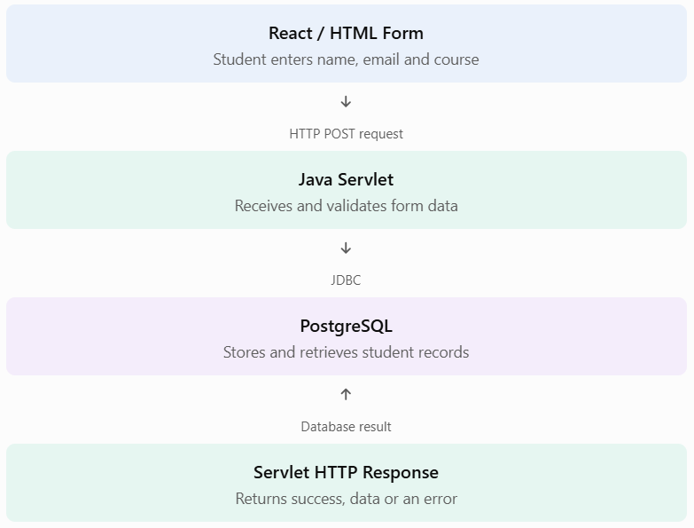
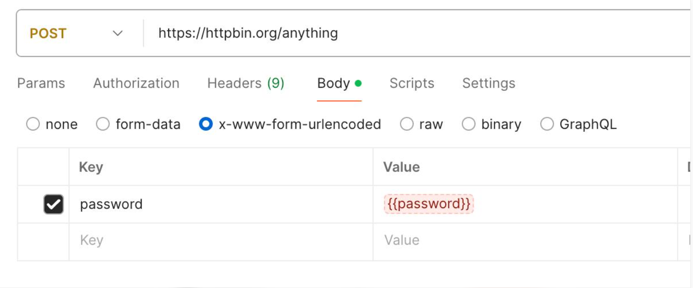

# Lesson 11.12 — Database Access with Servlets (JDBC + PostgreSQL)

## 1. What is database access with Servlets?
So far, our servlets have processed requests, read form data, managed cookies, and maintained sessions.

But imagine a student registration application. When a student submits a registration form, we need to:
1. Receive the student's information.
2. Connect to PostgreSQL.
3. Insert the student's information into a database table.
4. Return a success or error response.
A Servlet can perform these operations using **JDBC (Java Database Connectivity).**

**JDBC** is the standard Java API for connecting to relational databases, executing SQL statements, and processing results.


## 2. Understand the architecture
Our application will work like this:



The responsibilities are separate:
- React: user interface.
- Servlet: HTTP request processing and application logic.
- JDBC: communication between Java and PostgreSQL.
- PostgreSQL: permanent data storage.


## 3. Understand the JDBC components
JDBC provides several important interfaces and classes.

|Component	|Purpose|
|-----|-----|
|DriverManager|	Obtains database connections|
|Connection|	Represents a database connection|
|PreparedStatement|	Executes parameterized SQL|
|ResultSet	Reads| query results|
|SQLException	|Represents database access errors|

The usual JDBC workflow is:
1. Load or discover the JDBC driver.
2. Establish a connection with PostgreSQL.
3. Create a SQL statement.
4. Execute the SQL statement.
5. Process the result, if one is returned.
6. Close database resources.
A JDBC Connection can create a `PreparedStatement`, which is designed for parameterized SQL. 


**What is PreparedStatement, and why do we need it?**

Consider this unsafe SQL construction:
```
String sql =
    "SELECT * FROM students WHERE email = '"
    + email + "'";
```

If user input contains malicious SQL, directly concatenating it into the query can create a SQL injection vulnerability.

Instead, write:
```
String sql =
    "SELECT * FROM students WHERE email = ?";

PreparedStatement ps =
    connection.prepareStatement(sql);

ps.setString(1, email);
```

The `?` is a parameter placeholder. The value is supplied separately from the SQL structure.

**Our rule throughout this lesson: use `PreparedStatement` for queries containing user-provided values.**


## 4. Set up PostgreSQL
Let's create a database and a table.

Open PostgreSQL using pgAdmin or your SQL client and execute:
```
CREATE DATABASE advance_java_db;
```

Connect to `advance_java_db`, then execute:
```
CREATE TABLE students (
    id BIGINT GENERATED ALWAYS AS IDENTITY PRIMARY KEY,
    name VARCHAR(100) NOT NULL,
    email VARCHAR(150) NOT NULL UNIQUE,
    course VARCHAR(100) NOT NULL
);
```

This creates a `students` table.

Example record:
|id|	name|	email|	course|
|-----|-----|-----|-----|
|1|	David	|david@example.com|	Advance Java|

You can inspect the table with:
```
SELECT * FROM students;
```

## 5. Add the PostgreSQL JDBC driver to Maven
Our Java application needs a PostgreSQL JDBC driver to communicate with the database.

Open your project's `pom.xml` and add this dependency inside `<dependencies>`:
```
<dependency>
    <groupId>org.postgresql</groupId>
    <artifactId>postgresql</artifactId>
    <version>42.7.7</version>
</dependency>
```


This is the PostgreSQL JDBC driver, commonly called pgJDBC.


After adding it:
1. Open `pom.xml` in IntelliJ IDEA.
2. Click the Maven reload button.
3. Wait for Maven to download the dependency.
You do not need to add the Servlet API again if it is already configured in your project.


## 6. Understand the PostgreSQL connection URL
The JDBC URL will look like this:
```
String url =
    "jdbc:postgresql://localhost:5432/advance_java_db";
```
Let's break it down:

|Part|	Meaning|
|-----|-----|
|jdbc	|JDBC protocol|
|postgresql	|Database type|
|localhost	|Database server|
|5432	|PostgreSQL default port|
|advance_java_db	|Database name|

The pgJDBC documentation describes this URL format and the use of `DriverManager.getConnection()`. 


## 7. Create the database connection utility
Instead of writing database connection code repeatedly inside every servlet, let's create a separate utility class.

Create:

`src/main/java/com/advancejava/DBConnection.java
package com.advancejava`;
```
import java.sql.Connection;
import java.sql.DriverManager;
import java.sql.SQLException;

public class DBConnection {

    private static final String URL =
            System.getenv().getOrDefault(
                "ADVANCE_DB_URL",
                "jdbc:postgresql://localhost:5432/advance_java_db"
            );

    private static final String USER =
            System.getenv("ADVANCE_DB_USER");

    private static final String PASSWORD =
            System.getenv("ADVANCE_DB_PASSWORD");

    public static Connection getConnection()
            throws SQLException {

        if (USER == null || PASSWORD == null) {
            throw new IllegalStateException(
                "Database credentials are not configured."
            );
        }

        return DriverManager.getConnection(
                URL,
                USER,
                PASSWORD
        );
    }
}
```

**Configure your database credentials**

Set these environment variables in your IntelliJ Tomcat run configuration:
```
ADVANCE_DB_URL=jdbc:postgresql://localhost:5432/advance_java_db
ADVANCE_DB_USER=postgres
ADVANCE_DB_PASSWORD=your_actual_password
```

Replace the password with your actual PostgreSQL password.

We keep credentials outside the Java source code so that they are not accidentally committed to Git.

**Important:** This simple DriverManager approach is useful for learning JDBC. For a production web application, prefer a configured DataSource with connection pooling. Never keep one shared JDBC Connection in a servlet instance variable because multiple requests may execute concurrently.


## 8. Create the Student model
Create:

`src/main/java/com/advancejava/Student.java
package com.advancejava;`

```
public class Student {

    private long id;
    private String name;
    private String email;
    private String course;

    public Student() {
    }

    public Student(
            long id,
            String name,
            String email,
            String course) {

        this.id = id;
        this.name = name;
        this.email = email;
        this.course = course;
    }

    public Student(
            String name,
            String email,
            String course) {

        this.name = name;
        this.email = email;
        this.course = course;
    }

    public long getId() {
        return id;
    }

    public String getName() {
        return name;
    }

    public String getEmail() {
        return email;
    }

    public String getCourse() {
        return course;
    }
}
```

**Why do we need a model class?**

A model represents the data our application works with. Instead of passing individual values everywhere, we can work with a Student object.


## 9. Create the DAO class
DAO means **Data Access Object.**

Its responsibility is to separate database operations from servlet request processing.

Create:

`src/main/java/com/advancejava/StudentDAO.java
package com.advancejava;`

```
import java.sql.Connection;
import java.sql.PreparedStatement;
import java.sql.ResultSet;
import java.sql.SQLException;

import java.util.ArrayList;
import java.util.List;

public class StudentDAO {

    // Insert a student into PostgreSQL
    public boolean insertStudent(Student student)
            throws SQLException {

        String sql = """
                INSERT INTO students (name, email, course)
                VALUES (?, ?, ?)
                """;

        try (Connection connection =
                     DBConnection.getConnection();

             PreparedStatement ps =
                     connection.prepareStatement(sql)) {

            ps.setString(1, student.getName());
            ps.setString(2, student.getEmail());
            ps.setString(3, student.getCourse());

            int rowsInserted = ps.executeUpdate();

            return rowsInserted > 0;
        }
    }

    // Retrieve all students from PostgreSQL
    public List<Student> getAllStudents()
            throws SQLException {

        String sql = """
                SELECT id, name, email, course
                FROM students
                ORDER BY id
                """;

        List<Student> students = new ArrayList<>();

        try (Connection connection =
                     DBConnection.getConnection();

             PreparedStatement ps =
                     connection.prepareStatement(sql);

             ResultSet rs = ps.executeQuery()) {

            while (rs.next()) {

                Student student = new Student(
                        rs.getLong("id"),
                        rs.getString("name"),
                        rs.getString("email"),
                        rs.getString("course")
                );

                students.add(student);
            }
        }

        return students;
    }
}
```

**Understand the important JDBC methods**

**A.** `prepareStatement()`
```
PreparedStatement ps =
    connection.prepareStatement(sql);
```

Creates a prepared SQL statement.

**B.** `setString()`
```
ps.setString(1, student.getName());
```

Supplies a value for the first `?` placeholder.

The parameter positions start at 1, not 0.

**C.** `executeUpdate()`
```
int rowsInserted = ps.executeUpdate();
```

Used for SQL statements such as:
- `INSERT`
- `UPDATE`
- `DELETE`
It returns the number of affected rows.

**D.** `executeQuery()`
```
ResultSet rs = ps.executeQuery();
```

Used for `SELECT` statements. It returns a `ResultSet.`

**E.** `rs.next()`
```
while (rs.next()) {
    // Read current row
}
```

Moves the cursor to the next row in the result.

**F. Try-with-resources**
```
try (Connection connection = ...;
     PreparedStatement ps = ...) {
    // Database operations
}
```


Automatically closes resources when the block finishes, including when an exception occurs.

This is important because unclosed database connections can exhaust available database resources.


## 10. Create the StudentServlet
Now we connect our DAO to a servlet.

Create:

`src/main/java/com/advancejava/StudentServlet.java
package com.advancejava;`

```
import jakarta.servlet.ServletException;
import jakarta.servlet.annotation.WebServlet;
import jakarta.servlet.http.HttpServlet;
import jakarta.servlet.http.HttpServletRequest;
import jakarta.servlet.http.HttpServletResponse;

import java.io.IOException;
import java.io.PrintWriter;

import java.sql.SQLException;

import java.util.List;

@WebServlet("/students")
public class StudentServlet extends HttpServlet {

    private StudentDAO studentDAO;

    @Override
    public void init() throws ServletException {
        studentDAO = new StudentDAO();
    }

    // Display all students
    @Override
    protected void doGet(
            HttpServletRequest request,
            HttpServletResponse response)
            throws ServletException, IOException {

        response.setContentType("text/html;charset=UTF-8");

        try {
            List<Student> students =
                    studentDAO.getAllStudents();

            PrintWriter out = response.getWriter();

            out.println("<html><body>");
            out.println("<h2>Student Records</h2>");

            out.println("<table border='1'>");
            out.println("<tr>");
            out.println("<th>ID</th>");
            out.println("<th>Name</th>");
            out.println("<th>Email</th>");
            out.println("<th>Course</th>");
            out.println("</tr>");

            for (Student student : students) {

                out.println("<tr>");

                out.println("<td>"
                        + student.getId() + "</td>");

                out.println("<td>"
                        + escapeHtml(student.getName())
                        + "</td>");

                out.println("<td>"
                        + escapeHtml(student.getEmail())
                        + "</td>");

                out.println("<td>"
                        + escapeHtml(student.getCourse())
                        + "</td>");

                out.println("</tr>");
            }

            out.println("</table>");
            out.println("</body></html>");

        } catch (SQLException e) {

            getServletContext().log(
                    "Unable to retrieve students", e
            );

            response.sendError(
                    HttpServletResponse.SC_INTERNAL_SERVER_ERROR,
                    "Unable to retrieve student records."
            );
        }
    }

    // Insert a new student
    @Override
    protected void doPost(
            HttpServletRequest request,
            HttpServletResponse response)
            throws ServletException, IOException {

        request.setCharacterEncoding("UTF-8");

        String name = request.getParameter("name");
        String email = request.getParameter("email");
        String course = request.getParameter("course");

        if (name == null || name.isBlank()
                || email == null || email.isBlank()
                || course == null || course.isBlank()) {

            response.sendError(
                    HttpServletResponse.SC_BAD_REQUEST,
                    "All fields are required."
            );

            return;
        }

        Student student =
                new Student(name.trim(),
                            email.trim(),
                            course.trim());

        try {

            boolean inserted =
                    studentDAO.insertStudent(student);

            if (inserted) {

                // Post/Redirect/Get pattern
                response.sendRedirect(
                        request.getContextPath() + "/students"
                );

            } else {

                response.sendError(
                        HttpServletResponse.SC_INTERNAL_SERVER_ERROR,
                        "Student registration failed."
                );
            }

        } catch (SQLException e) {

            getServletContext().log(
                    "Unable to insert student", e
            );

            // PostgreSQL SQLSTATE 23505 = unique violation
            if ("23505".equals(e.getSQLState())) {

                response.sendError(
                        HttpServletResponse.SC_CONFLICT,
                        "A student with this email already exists."
                );

            } else {

                response.sendError(
                        HttpServletResponse.SC_INTERNAL_SERVER_ERROR,
                        "Database operation failed."
                );
            }
        }
    }

    // Basic HTML escaping for displayed database values
    private String escapeHtml(String value) {

        return value.replace("&", "&amp;")
                    .replace("<", "&lt;")
                    .replace(">", "&gt;")
                    .replace("\"", "&quot;")
                    .replace("'", "&#x27;");
    }
}
```

Notice that the servlet doesn't contain SQL queries. The SQL is inside StudentDAO.

This separation makes the application easier to maintain and test.


## 11. Create the student registration form
Create:

`src/main/webapp/student-form.html`

```
<!DOCTYPE html>
<html>
<head>
    <meta charset="UTF-8">
    <title>Student Registration</title>
</head>
<body>

    <h2>Student Registration Form</h2>

    <form action="students" method="post">

        <label>Student Name:</label>
        <input type="text"
               name="name"
               maxlength="100"
               required>

        <br><br>

        <label>Email:</label>
        <input type="email"
               name="email"
               maxlength="150"
               required>

        <br><br>

        <label>Course:</label>
        <input type="text"
               name="course"
               maxlength="100"
               required>

        <br><br>

        <button type="submit">
            Register Student
        </button>

    </form>

    <br>

    <a href="students">View All Students</a>

</body>
</html>
```

## 12. Run and test the complete application
Let's test it step by step.

**Step 1 — Start PostgreSQL**

Make sure your PostgreSQL server is running and the database and table have been created.

**Step 2 — Configure IntelliJ**

Set the three environment variables from Lesson section 7 in your Tomcat run configuration.

**Step 3 — Build and deploy**

Reload Maven, build the project, and deploy it to Tomcat 10.1.

**Step 4 — Open the registration form**

Assuming the context path is `servlet-learning:`

`http://localhost:8080/servlet-learning/student-form.html`

**Step 5 — Enter sample information**

Sample student

|Field|	Value|
|-----|-----|
|Name	|David|
|Email	|david@example.com|
|Course|	Advance Java|

Sample data for testing

**Step 6 — Submit the form**

The servlet receives the POST request, calls `StudentDAO`, and inserts the record into PostgreSQL.

After a successful insert, it redirects to:

`http://localhost:8080/servlet-learning/students`

**Expected output:**

Student Records
|ID|	Name|	Email|	Course|
|-----|-----|-----|-----|
|1	|David	|david@example.com|	Advance Java|


Your actual ID may be different if the table already contains records.

**Step 7 — Verify directly in PostgreSQL**

Run:
```
SELECT * FROM students;
```

You should see the newly registered student.


## 13. Test the servlet using Postman
You can also test without the HTML form.


**POST request**

URL:
`http://localhost:8080/servlet-learning/students`


Select:
- Method: `POST`
- Body: `x-www-form-urlencoded`

Add these key-value pairs:

|Key|	Value|
|-----|-----|
|name	|David|
|email	|david@example.com|
|course	|Advance Java|

Click Send.

After successful registration, the servlet responds with a redirect to the student list. If you want to inspect the initial response in Postman, turn off automatic redirect following in its request settings.

**GET request**
```
http://localhost:8080/servlet-learning/students
```


This retrieves and displays the student records.

## 14. Important JDBC concepts to remember
`executeQuery()` vs `executeUpdate()`

|Method	|Used for|	Return value|
|-----|-----|-----|
|executeQuery()|	SELECT|	ResultSet|
|executeUpdate()|	INSERT, UPDATE, DELETE|	Number of affected rows|
|execute()|	General SQL execution|	Boolean indicating result type|

**What is SQL injection?**

SQL injection happens when untrusted user input changes the intended structure of an SQL query.

Using `PreparedStatement` with parameter placeholders helps prevent this for values supplied through those parameters.

###  What is connection pooling?
Opening a new physical database connection for every request can be expensive.

Connection pooling maintains a reusable collection of database connections. A DataSource is the preferred abstraction for obtaining connections in server-side applications. 


For our learning example, we used `DriverManager`. Later, when building a production-style application, we should configure a pooled `DataSource` in Tomcat.


### What are JDBC transactions?
A transaction allows multiple database operations to succeed or fail together.

For example, when registering a student and creating a related student profile, we may need both operations to succeed.
```
connection.setAutoCommit(false);

try {

    // First SQL operation
    // Second SQL operation

    connection.commit();

} catch (SQLException e) {

    connection.rollback();
    throw e;
}
```

By default, JDBC connections use auto-commit mode. When you disable it, you must explicitly commit or roll back the transaction. 

