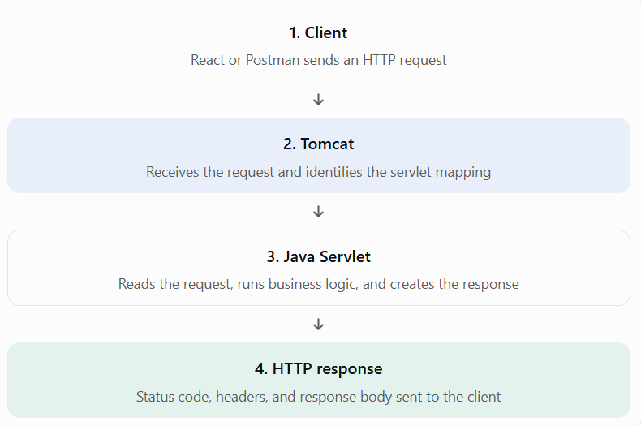
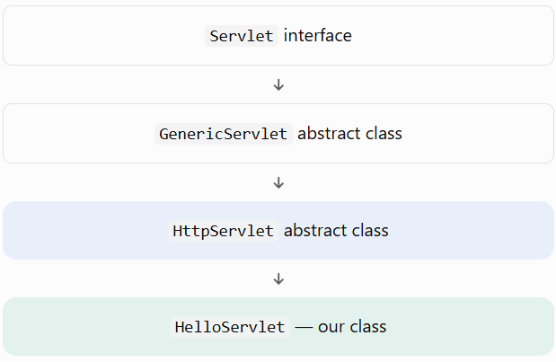

# Lesson 11.3 — Servlet and Servlet Technology

Advance Java • Concepts, official documentation, complete Java examples, and practical exercises

## 1. What is a Servlet?

A Servlet is a Java class managed by a servlet container that processes client requests and generates responses. It is commonly used to build the server-side part of a web application.


In our project:

- Java is the programming language.
- Jakarta Servlet is the server-side API.
- Apache Tomcat is the servlet container.
- React is the frontend.
- PostgreSQL is the database.
- Postman is the API testing tool.

### Why do we need Servlet technology?

Before frameworks such as Spring MVC became popular, Servlets were a fundamental way to build dynamic Java web applications. They remain useful for learning HTTP processing, request handling, session management, and the foundations of many Java web frameworks.

Servlets can:

- Receive form data from clients.
- Generate HTML or JSON responses.
- Handle login and authentication workflows.
- Maintain user sessions.
- Read initialization parameters.
- Forward requests to other server-side resources.
- Access databases through JDBC.

## 2. How does Servlet technology work?



Tomcat handles the low-level servlet infrastructure so we can focus on writing application code. Its `HttpServlet` implementation routes HTTP requests to the appropriate handler methods.


## 3. Important Servlet API classes and interfaces

The Jakarta Servlet API provides interfaces and classes for working with HTTP requests, responses, configuration, sessions, and more.


| API                   | Purpose                                                                      |
| --------------------- | ---------------------------------------------------------------------------- |
| `Servlet`             | Defines the basic servlet contract and life-cycle methods                    |
| `GenericServlet`      | Provides a protocol-independent base implementation                          |
| `HttpServlet`         | Base class for HTTP-specific servlets                                        |
| `HttpServletRequest`  | Reads request details, headers, parameters, and other information            |
| `HttpServletResponse` | Controls the HTTP response                                                   |
| `ServletConfig`       | Provides configuration for an individual servlet                             |
| `ServletContext`      | Provides application-wide context and access to shared application resources |
| `HttpSession`         | Maintains server-side state across multiple requests from a client           |
| `RequestDispatcher`   | Forwards a request to another server-side resource or includes its output    |

For our lessons, we'll primarily extend `HttpServlet`, because our application communicates over HTTP.

## 4. The Servlet class hierarchy

Understanding the hierarchy helps explain why we extend `HttpServlet` instead of implementing every method ourselves.



The `Servlet` interface defines the basic contract. `GenericServlet` provides a general implementation, and `HttpServlet` adds HTTP-specific request handling. Your class extends `HttpServlet` and overrides methods such as `doGet()` or `doPost()`.


## 5. Types of Servlets

Two important classes are available as base classes for servlet development.

### A. GenericServlet

- Protocol-independent base class.
- Implements the `Servlet` interface.
- Commonly requires overriding `service()` to process requests.

### B. HttpServlet

- Designed for HTTP-based applications.
- Supports methods such as `doGet()`, `doPost()`, `doPut()`, and `doDelete()`.
- Automatically dispatches HTTP requests to the appropriate handler method.

For modern web applications using Tomcat, `HttpServlet` is generally the appropriate choice.


## 6. Complete practical example — HTTP methods

Let's create one servlet that handles both GET and POST requests.

Create a new file named `StudentServlet.java` in `com.advancejava`.

```

package com.advancejava;

import java.io.IOException;
import jakarta.servlet.annotation.WebServlet;
import jakarta.servlet.http.HttpServlet;
import jakarta.servlet.http.HttpServletRequest;
import jakarta.servlet.http.HttpServletResponse;

@WebServlet("/api/student")
public class StudentServlet extends HttpServlet {

    @Override
    protected void doGet(
            HttpServletRequest request,
            HttpServletResponse response)
            throws IOException {

        response.setContentType("text/plain");
        response.setCharacterEncoding("UTF-8");

        response.getWriter().println(
                "GET request: Retrieve student information."
        );
    }

    @Override
    protected void doPost(
            HttpServletRequest request,
            HttpServletResponse response)
            throws IOException {

        request.setCharacterEncoding("UTF-8");

        String name = request.getParameter("name");

        response.setContentType("text/plain");
        response.setCharacterEncoding("UTF-8");

        if (name == null || name.isBlank()) {
            response.sendError(
                    HttpServletResponse.SC_BAD_REQUEST,
                    "Student name is required."
            );
            return;
        }

        response.setStatus(HttpServletResponse.SC_CREATED);

        response.getWriter().println(
                "Student received: " + name
        );
    }
}

```

### Understand the example

- `@WebServlet("/api/student")` maps the servlet URL.
- `doGet()` responds to GET requests.
- `doPost()` responds to POST requests.
- `request.getParameter("name")` retrieves a submitted parameter.
- `isBlank()` rejects missing or whitespace-only names.
- `SC_BAD_REQUEST` represents HTTP 400.
- `SC_CREATED` represents HTTP 201.

Notice that this example does not save a student to PostgreSQL. It demonstrates request processing only; database persistence will be added in Lesson 11.12.

### Test A — GET request in Postman

GET

`http://localhost:8080/servlet-learning/api/student`

Copy GET URL

Expected response:

`GET request: Retrieve student information.`

### Test B — POST request in Postman

POST

`http://localhost:8080/servlet-learning/api/student`

Postman configuration

1. Select the POST method.
2. Open Body → x-www-form-urlencoded.
3. Add a key named `name` and a value such as `Daenish`.
4. Click Send.

Expected response (HTTP 201):

`Student received: Daenish`

Copy POST URL

If you send the POST request without the `name` parameter, the servlet returns HTTP 400. This illustrates basic server-side validation.

Important security note: For a real application, user-provided text must be safely encoded before being placed into HTML, and authentication and authorization must be implemented where needed. This plain-text example avoids HTML rendering altogether.

## 7. Official Java documentation

Keep these official references available as you practice:

- [Servlet interface — Tomcat 10.1 Javadoc](https://tomcat.apache.org/tomcat-10.1-doc/servletapi/jakarta/servlet/Servlet.html?utm_source=chatgpt.com)
- [HttpServlet — Tomcat 10.1 Javadoc](https://tomcat.apache.org/tomcat-10.1-doc/servletapi/jakarta/servlet/http/HttpServlet.html?utm_source=chatgpt.com)
- [Jakarta Servlet 6.0 API documentation](https://jakarta.ee/specifications/servlet/6.0/apidocs/?utm_source=chatgpt.com)
- [Jakarta Servlet 6.0 specification (PDF)](https://jakarta.ee/specifications/servlet/6.0/jakarta-servlet-spec-6.0.pdf?utm_source=chatgpt.com)

We're using the Jakarta Servlet 6.0 API with Tomcat 10.1, so the `jakarta.servlet.*` package names in these references match our project.


## 8. Revision notes

Remember these key points:

- A Servlet is a Java web component managed by a servlet container.
- `HttpServlet` is the common base class for HTTP applications.
- `HttpServletRequest` provides access to incoming request information.
- `HttpServletResponse` lets the servlet construct the outgoing response.
- `doGet()` handles GET requests, while `doPost()` handles POST requests.
- Tomcat manages the servlet's life cycle and request dispatching.
- React can communicate with a Servlet backend through HTTP, and Postman can test it independently.

