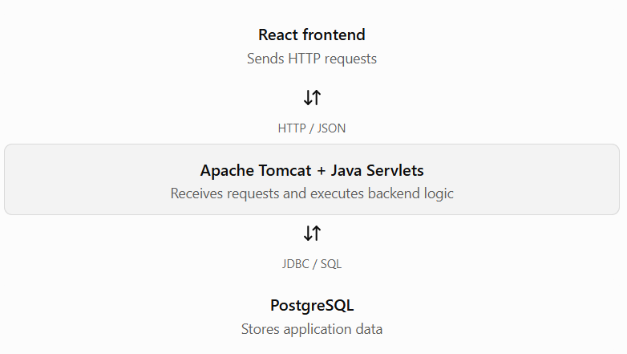

## Lesson 11.4: Environment Setup for Servlets

Goal: Understand the tools needed to build, deploy, and test a Java Servlet application—and know how to verify that each one is working.

### 1. Why is environment setup needed?

A servlet is not a standalone Java program that you normally run with `java MyServlet`. It is a web component managed by a Servlet container, such as Tomcat. Your code must be compiled, packaged into a web application, and deployed to that container.


Here is how your technology stack fits together:



Maven builds and packages the Java web application; IntelliJ IDEA helps you write, build, debug, and run it; Postman lets you test the backend independently of React.

### 2. Check the required tools

Open the terminal in Windows (Command Prompt or PowerShell) and run these commands one at a time:

| Tool          | Command                                       | What to check                                          |
| ------------- | --------------------------------------------- | ------------------------------------------------------ |
| Java JDK      | `java -version`                               | Java version is displayed                              |
| Java compiler | `javac -version`                              | Compiler version is displayed                          |
| Maven         | `mvn -version`                                | Maven and the Java version it uses are displayed       |
| Tomcat        | Start Tomcat and open `http://localhost:8080` | Tomcat welcome page or a valid server response appears |
| PostgreSQL    | `psql --version`                              | PostgreSQL client version is displayed                 |

Important: `java` working does not guarantee that `javac` works. If `javac` is not recognized, check that a JDK is installed and that your `PATH` and `JAVA_HOME` are configured correctly. You can still use IntelliJ's bundled Maven in some configurations, but it is useful to verify the command-line setup too.

For our examples, use Java 17 or later, Tomcat 10.1, Maven, and the `jakarta.servlet.*` imports.

### 3. Verify your Maven project configuration

For a traditional Servlet application deployed to Tomcat, Maven should package the project as a WAR file. The Servlet API dependency uses `provided` scope because Tomcat supplies the Servlet API at runtime.

Use this `pom.xml` in your project root:

```

<project xmlns="http://maven.apache.org/POM/4.0.0"
         xmlns:xsi="http://www.w3.org/2001/XMLSchema-instance"
         xsi:schemaLocation="http://maven.apache.org/POM/4.0.0
         https://maven.apache.org/xsd/maven-4.0.0.xsd">

    <modelVersion>4.0.0</modelVersion>

    <groupId>com.advancejava</groupId>
    <artifactId>servlet-learning</artifactId>
    <version>1.0-SNAPSHOT</version>
    <packaging>war</packaging>

    <properties>
        <maven.compiler.release>17</maven.compiler.release>
        <project.build.sourceEncoding>UTF-8</project.build.sourceEncoding>
    </properties>

    <dependencies>
        <dependency>
            <groupId>jakarta.servlet</groupId>
            <artifactId>jakarta.servlet-api</artifactId>
            <version>6.0.0</version>
            <scope>provided</scope>
        </dependency>
    </dependencies>

    <build>
        <finalName>servlet-learning</finalName>
    </build>

</project>

```

The official Jakarta Servlet release page lists the dependency coordinates `jakarta.servlet:jakarta.servlet-api:6.0.0`.


### 4. Create a setup-test servlet

This small servlet checks whether Tomcat can load your application and route a request to your code.

Create `src/main/java/com/advancejava/SetupCheckServlet.java`:

```

package com.advancejava;

import java.io.IOException;

import jakarta.servlet.annotation.WebServlet;
import jakarta.servlet.http.HttpServlet;
import jakarta.servlet.http.HttpServletRequest;
import jakarta.servlet.http.HttpServletResponse;

@WebServlet("/setup-check")
public class SetupCheckServlet extends HttpServlet {

    @Override
    protected void doGet(
            HttpServletRequest request,
            HttpServletResponse response) throws IOException {

        response.setContentType("text/plain");
        response.setCharacterEncoding("UTF-8");

        response.getWriter().println(
                "Servlet environment is working!"
        );
    }
}

```

What each important part does:

- `extends HttpServlet` makes the class an HTTP servlet.
- `@WebServlet("/setup-check")` maps requests to the servlet.
- `doGet()` handles incoming GET requests.
- `response.getWriter()` writes the response body.

Tomcat discovers the annotation during deployment and maps the URL accordingly.


### 5. Build, deploy, and test

1. Save the `pom.xml` and Java file in the correct project locations.

2. Open a terminal at the project root and run:

   `bash     mvn clean package     `

   A successful build should produce `target/servlet-learning.war`.

3. Deploy the WAR to Tomcat's `webapps` directory, or configure your IntelliJ Tomcat run configuration to deploy the WAR artifact. Tomcat supports deployment using WAR files.

4. Start Tomcat and test this URL in a browser or Postman:

   `http://localhost:8080/servlet-learning/setup-check`

5. Confirm the response body is:

   `text     Servlet environment is working!     `

If your application uses a different context path, replace `servlet-learning` in the URL with that path.

### 6. Troubleshooting checklist

| Problem                                  | First thing to check                          |
| ---------------------------------------- | --------------------------------------------- |
| `mvn` not recognized                     | Maven installation or PATH                    |
| `package jakarta.servlet does not exist` | Maven dependency and project reload           |
| HTTP 404                                 | Context path, servlet mapping, and deployment |
| HTTP 500                                 | Tomcat logs and the exception stack trace     |
| Port 8080 already in use                 | Whether another server is using that port     |
| `javax.servlet` imports fail             | Use `jakarta.servlet` for Tomcat 10.1         |

