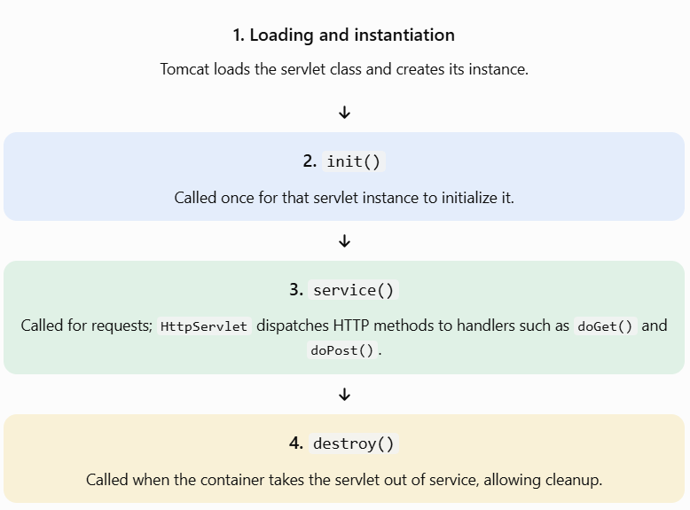

# Lesson 11.5: Servlet Life Cycle


## 1. What is the Servlet Life Cycle?

The Servlet Life Cycle is the sequence of stages a servlet passes through from the time the servlet container loads it until the container removes it from service.

In our project, Apache Tomcat manages the servlet life cycle. You write the servlet class, but Tomcat calls the life-cycle methods at the appropriate times.

### Why do we need it?

Understanding the life cycle helps you:

- Initialize resources at the correct time.
- Process multiple HTTP requests efficiently.
- Avoid creating expensive resources for every request.
- Release resources when the servlet is taken out of service.
- Write safer code when multiple requests arrive concurrently.

## 2. The four main stages

### 1. Loading and instantiation

Tomcat loads the servlet class and creates its instance.



Important distinction: Loading and instantiation happen before initialization. The three main life-cycle methods you should remember are `init()`, `service()`, and `destroy()`.

## 3. Understand each life-cycle method

| Method                 | When it runs                                                          | Typical purpose                            |
| ---------------------- | --------------------------------------------------------------------- | ------------------------------------------ |
| Constructor            | When Tomcat creates an instance                                       | Object construction                        |
| `init()`               | Once after construction, before requests are served                   | Load configuration or initialize resources |
| `service()`            | For each request handled by the servlet                               | Dispatch request processing                |
| `doGet()` / `doPost()` | When `HttpServlet.service()` dispatches the corresponding HTTP method | Handle the specific request                |
| `destroy()`            | When the instance is being removed from service                       | Release resources and perform cleanup      |

The Servlet API specifies that `init()` must complete successfully before the servlet can serve requests. The container calls `destroy()` when taking the servlet out of service.&#x20;

[image](https://www.google.com/s2/favicons?domain=https://jakarta.ee\&sz=32)

Jakarta EE

+1


### Key concept: `service()` versus `doGet()`

Because our class extends `HttpServlet`, you normally override `doGet()` or `doPost()` rather than `service()`.

For example, when Postman sends a GET request:

1. Tomcat receives the HTTP request.
2. Tomcat invokes the servlet's service mechanism.
3. `HttpServlet.service()` identifies the HTTP method.
4. It dispatches the request to your `doGet()` method.
5. Your servlet writes the HTTP response.

The `service()` method is the dispatcher; `doGet()` and `doPost()` contain your method-specific logic.


## 4. Complete practical example

Let's create a servlet that logs its life-cycle events to the Tomcat console.

Create `ServletLifecycleDemo.java` in `src/main/java/com/advancejava/`.

```

package com.advancejava;

import java.io.IOException;

import jakarta.servlet.ServletException;
import jakarta.servlet.annotation.WebServlet;
import jakarta.servlet.http.HttpServlet;
import jakarta.servlet.http.HttpServletRequest;
import jakarta.servlet.http.HttpServletResponse;

@WebServlet(
    value = "/lifecycle",
    loadOnStartup = 1
)
public class ServletLifecycleDemo extends HttpServlet {

    @Override
    public void init() throws ServletException {
        super.init();
        System.out.println("1. init(): Servlet initialized");
    }

    @Override
    protected void doGet(
            HttpServletRequest request,
            HttpServletResponse response)
            throws IOException {

        System.out.println("2. doGet(): Request received");

        response.setContentType("text/plain");
        response.setCharacterEncoding("UTF-8");

        response.getWriter().println(
            "Servlet Life Cycle Demo"
        );
        response.getWriter().println(
            "The servlet is handling a GET request."
        );
    }

    @Override
    protected void doPost(
            HttpServletRequest request,
            HttpServletResponse response)
            throws IOException {

        System.out.println("2. doPost(): Request received");

        response.setContentType("text/plain");
        response.setCharacterEncoding("UTF-8");

        response.getWriter().println(
            "The servlet is handling a POST request."
        );
    }

    @Override
    public void destroy() {
        System.out.println("3. destroy(): Servlet is shutting down");
        super.destroy();
    }
}

```

### Why use `loadOnStartup = 1`?

Normally, a container may initialize a servlet when its first request arrives. A positive `loadOnStartup` value asks the container to initialize the servlet during application startup; lower positive values have higher priority. This makes it easier to observe `init()` without first opening the endpoint.

### How to test it

1. Build and redeploy your WAR using the same process from Lesson 11.4.
2. Start Tomcat and check its console or logs.
3. Send a GET request from Postman to:

   `http://localhost:8080/servlet-learning/lifecycle`
4. Send the same GET request a few times.
5. Stop Tomcat or undeploy/redeploy the application to observe the cleanup log.

Expected response body:

```
Servlet Life Cycle Demo
The servlet is handling a GET request.
```

Expected log pattern (the order shown is simplified; other server messages may appear between these lines):

```
1. init(): Servlet initialized
2. doGet(): Request received
2. doGet(): Request received
2. doGet(): Request received
3. destroy(): Servlet is shutting down
```

Notice that `init()` normally runs once for this servlet instance, while `doGet()` runs for each GET request. `destroy()` is not called when you close the browser or finish a Postman request; it is called when the container removes the servlet from service.

## 5. Important interview and real-project concepts

### A. Does `init()` run for every request?

No. It runs once per servlet instance after successful initialization. Repeated requests are handled by the servlet's service mechanism.

### B. Is a new servlet object created for every request?

Normally, no. A servlet instance generally handles many requests. Tomcat may process requests concurrently using multiple threads, so you must write servlet code with thread safety in mind.

For example, avoid storing a request-specific value in a shared instance field:

```
// Unsafe design for request-specific data:
private String currentUsername;
```

Prefer a local variable inside the handler:

```
protected void doGet(
        HttpServletRequest request,
        HttpServletResponse response) throws IOException {

    String username = request.getParameter("username");
    // Process this request's value here.
}
```

### C. What should go inside `destroy()`?

Use it to clean up resources owned by the servlet, such as a manually managed background task or resource that requires explicit closure. Do not assume that `destroy()` will run after every kind of abrupt process failure.

In a real application, use appropriate resource-management patterns, such as try-with-resources for JDBC connections created for an individual operation.

[**For more info click this link**](https://www.geeksforgeeks.org/java/life-cycle-of-a-servlet/)
