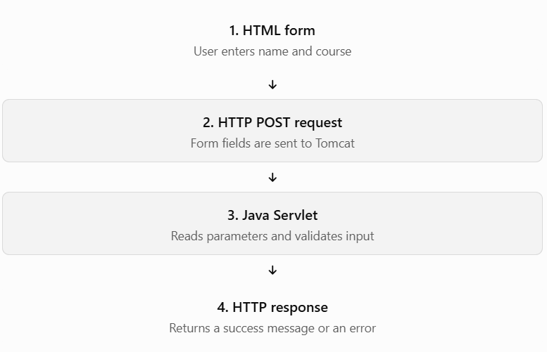

# Lesson 11.7 — Processing HTML Form Data Using Servlets


Learning objective: Build an HTML form, submit its data to a Java servlet, read the submitted values, validate them, and return a response.

## 1. What is form data processing?

An HTML form allows a user to enter information, such as a student's name, email, or course. When the user submits the form, the browser sends the field names and values in an HTTP request. The servlet reads those values and processes them.

For example, a form might submit:

```
name=Daenish&course=Advance+Java
```

Your servlet can retrieve the values using `request.getParameter("name")` and `request.getParameter("course")`. These values are returned as Java `String` objects.


### How the process works



Why do we need this? Forms provide a way to collect input from users. Servlet form processing lets your Java backend validate that input and decide what to do with it—for example, create a student record in PostgreSQL in a later lesson.

## 2. Understand the important HTML form attributes

| Attribute  | Purpose                                        | Example                            |
| ---------- | ---------------------------------------------- | ---------------------------------- |
| `action`   | Specifies where the form is submitted          | `/servlet-learning/submit-student` |
| `method`   | Specifies the HTTP method                      | `POST`                             |
| `name`     | Identifies a field in submitted data           | `name="studentName"`               |
| `type`     | Specifies the kind of input                    | `type="text"`                      |
| `required` | Enables browser-side required-field validation | `required`                         |

The `name` attribute is especially important: the servlet uses that name when reading a parameter. An `id` attribute alone does not submit a value as a named form field.

HTML forms commonly use GET for retrieving information and POST for submitting data that may change server state. The default encoding for ordinary POST forms is `application/x-www-form-urlencoded`; file uploads require different handling.

## 3. Build a complete working example

We'll create two files:

```
src/
└── main/
    ├── java/
    │   └── com/
    │       └── advancejava/
    │           └── StudentFormServlet.java
    └── webapp/
        └── student-form.html
```

### File A — `student-form.html`

This is the form the user sees in the browser.

```

<!DOCTYPE html>
<html lang="en">
<head>
    <meta charset="UTF-8">
    <meta name="viewport" content="width=device-width, initial-scale=1.0">
    <title>Student Registration Form</title>
</head>
<body>
    <h1>Student Registration</h1>

    <form action="submit-student" method="post">
        <div>
            <label for="studentName">Student Name:</label>
            <input
                type="text"
                id="studentName"
                name="studentName"
                required
            >
        </div>

        <br>

        <div>
            <label for="email">Email:</label>
            <input
                type="email"
                id="email"
                name="email"
                required
            >
        </div>

        <br>

        <div>
            <label for="course">Course:</label>
            <select id="course" name="course" required>
                <option value="">Select a course</option>
                <option value="Advance Java">Advance Java</option>
                <option value="Spring Boot">Spring Boot</option>
                <option value="React">React</option>
            </select>
        </div>

        <br>

        <button type="submit">Register</button>
    </form>
</body>
</html>

```

Understand the form:

- `action="submit-student"` sends the request to the servlet mapping relative to the current application path.
- `method="post"` submits the form using HTTP POST.
- `name="studentName"`, `name="email"`, and `name="course"` define the parameter names that Java will read.
- `required` and `type="email"` help with browser-side validation. They do not replace server-side validation.

### File B — `StudentFormServlet.java`

Now let's process the submitted data on the server.

```

package com.advancejava;

import java.io.IOException;

import jakarta.servlet.annotation.WebServlet;
import jakarta.servlet.http.HttpServlet;
import jakarta.servlet.http.HttpServletRequest;
import jakarta.servlet.http.HttpServletResponse;

@WebServlet("/submit-student")
public class StudentFormServlet extends HttpServlet {

    @Override
    protected void doPost(
            HttpServletRequest request,
            HttpServletResponse response)
            throws IOException {

        // Set request encoding before reading parameters.
        request.setCharacterEncoding("UTF-8");

        // Read submitted form values.
        String studentName = request.getParameter("studentName");
        String email = request.getParameter("email");
        String course = request.getParameter("course");

        // Validate on the server.
        if (studentName == null || studentName.isBlank()
                || email == null || email.isBlank()
                || course == null || course.isBlank()) {

            response.sendError(
                HttpServletResponse.SC_BAD_REQUEST,
                "Name, email, and course are required."
            );
            return;
        }

        // Return a simple text response.
        response.setContentType("text/plain");
        response.setCharacterEncoding("UTF-8");
        response.setStatus(HttpServletResponse.SC_OK);

        response.getWriter().println("Registration received!");
        response.getWriter().println("Student Name: " + studentName);
        response.getWriter().println("Email: " + email);
        response.getWriter().println("Course: " + course);
    }
}

```

### Explanation of the Java code

1\. `@WebServlet("/submit-student")`

Maps the servlet to the `/submit-student` URL within your deployed application.

2\. `doPost()`

Handles the form's HTTP POST request. Because this form uses `method="post"`, the servlet processes the submission in `doPost()`.

3\. `request.setCharacterEncoding("UTF-8")`

Sets the character encoding for reading the request body. Call it before reading form parameters when you need UTF-8 form data to be decoded correctly.

4\. `request.getParameter("studentName")`

Reads the value associated with the field's `name` attribute. If that parameter is absent, the result is `null`.

5\. Server-side validation

The servlet checks that required values are present and nonblank. Real applications should also validate email syntax, enforce length limits, and validate course choices against allowed values.

6\. The response

The servlet returns plain text. This is intentional: user-provided values are not being inserted into an HTML page, avoiding the need to HTML-escape them for display.

Notice that this example does not save a student to PostgreSQL yet. It demonstrates receiving, validating, and responding to form data. Database persistence comes later in Lesson 11.12.

## 4. Run and test it

1. Put the HTML file in `src/main/webapp/` and the servlet in `src/main/java/com/advancejava/`.
2. Build the project:
   ```
   mvn clean package
   ```
3. Deploy the resulting WAR to Tomcat, or run it using your existing IntelliJ Tomcat configuration.
4. Open the form:

   `http://localhost:8080/servlet-learning/student-form.html`
5. Enter a name, email, and course, then click Register.

Example input:

- Student Name: `Daenish`
- Email: `daenish@example.com`
- Course: `Advance Java`

Expected response:

```
Registration received!
Student Name: Daenish
Email: daenish@example.com
Course: Advance Java
```

The servlet returns HTTP `200 OK` for a valid submission and HTTP `400 Bad Request` if required parameters are missing or blank.

## 5. Test the same servlet using Postman

You do not need React or a browser form to test your Java backend. Postman can send the same kind of request.

Postman request setup

POST

URL

`http://localhost:8080/servlet-learning/submit-student`

Body → x-www-form-urlencoded

| Key           | Value                 |
| ------------- | --------------------- |
| `studentName` | `Daenish`             |
| `email`       | `daenish@example.com` |
| `course`      | `Advance Java`        |

Expected status: `200 OK`

&#x20;Copy endpoint URL

To test validation, remove one of the required fields and send the request again. You should receive `400 Bad Request`.

## 6. How does this work with React?

In a traditional HTML form, the browser submits the form and displays the server's response. In a React application, React often sends form data using `fetch()` and updates the UI without a full-page reload.

For example, the React frontend can send form data to the same servlet:

```
const formData = new URLSearchParams({
  studentName: "Daenish",
  email: "daenish@example.com",
  course: "Advance Java"
});

const response = await fetch(
  "http://localhost:8080/servlet-learning/submit-student",
  {
    method: "POST",
    headers: {
      "Content-Type": "application/x-www-form-urlencoded"
    },
    body: formData
  }
);

const result = await response.text();
console.log(result);
```

This request uses the same form-encoded format that the servlet reads with `request.getParameter()`. If React runs on a different origin or port, you may also need to configure CORS on the backend. In a larger API, returning JSON instead of plain text is often more convenient.

## 7. Common mistakes to avoid

- Wrong parameter name: Java reads `studentName`, but the HTML field is named `name`. These names must match.
- Wrong HTTP method: The form sends POST, but the servlet only implements `doGet()`.
- Reading parameters too early: Call `setCharacterEncoding()` before reading form parameters.
- Trusting browser validation: Users can bypass browser-side checks; validate again in the servlet.
- Assuming the data is saved: Reading form data and returning a message does not persist it in PostgreSQL.
- Exposing submitted values in HTML without escaping: This can create cross-site scripting (XSS) vulnerabilities.

Official references:

- [Jakarta Servlet 6.0 — ](https://jakarta.ee/specifications/servlet/6.0/apidocs/jakarta.servlet/jakarta/servlet/servletrequest?utm_source=chatgpt.com)[`ServletRequest`](https://jakarta.ee/specifications/servlet/6.0/apidocs/jakarta.servlet/jakarta/servlet/servletrequest?utm_source=chatgpt.com)
- [MDN — Sending and retrieving form data](https://developer.mozilla.org/en-US/docs/Learn_web_development/Extensions/Forms/Sending_and_retrieving_form_data?utm_source=chatgpt.com)&#x20;

  [image](https://www.google.com/s2/favicons?domain=https://javadoc.io\&sz=32)

  javadoc.io+1


