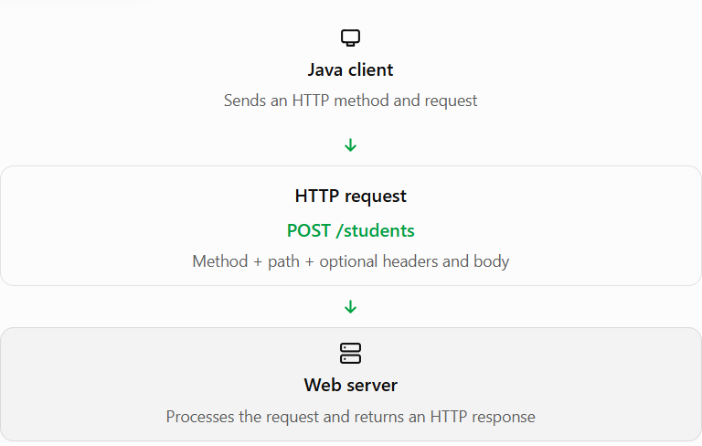

# Topic 4.2 — HTTP Methods

## 1. TEACH — What are HTTP methods?

An HTTP method tells the server the intended action for a particular resource.

Imagine you're building a student management system. You might want to:

- Retrieve a student's details.
- Create a new student.
- Update a student's marks.
- Delete a student.

HTTP methods communicate these intentions to the server.

| Method    | Purpose                                                | Example                         |
| --------- | ------------------------------------------------------ | ------------------------------- |
| `GET`     | Retrieve data                                          | View student details            |
| `POST`    | Submit data, often to create a resource                | Register a student              |
| `PUT`     | Create or completely replace a resource at a known URI | Replace a student's details     |
| `PATCH`   | Partially update a resource                            | Change only the student's marks |
| `DELETE`  | Delete a resource                                      | Remove a student                |
| `HEAD`    | Retrieve response headers without the response body    | Check resource metadata         |
| `OPTIONS` | Discover communication options supported by a resource | Check allowed methods           |

These are standard HTTP methods, and the server determines which ones it supports for a particular resource.

### How does it work?



For example, `GET /students/10` asks the server to retrieve student 10, whereas `DELETE /students/10` asks it to delete that resource. The URL can be the same; the method expresses a different intention.

## 2. WHY — Why are different methods needed?

Why not use `GET` for everything?

Because different operations have different meanings, safety expectations, and effects on server data.

Two important concepts often appear in exams:

- Safe method: Intended to retrieve information without requesting a change to server state. `GET`, `HEAD`, and `OPTIONS` are defined as safe.
- Idempotent method: Repeating the same request has the same intended effect on server state as making it once. `GET`, `HEAD`, `OPTIONS`, `PUT`, and `DELETE` are idempotent.

`POST` and `PATCH` are not guaranteed to be idempotent by the HTTP standard.

For example, sending the same payment-creation `POST` request twice might create two payments unless the application implements duplicate-request protection.

## 3. Understand each method

### GET

Retrieve a resource

Example: `GET /students/10`

Used to read student 10's information. A GET request should not be used to perform a state-changing operation.

### POST

Submit data for processing

Example: `POST /students`

Often used to create a student. The request body can contain the student's name, course, and marks.

### PUT

Create or replace a resource

Example: `PUT /students/10`

Typically sends a complete new representation of student 10. Repeating the same PUT should have the same intended effect.

### PATCH

Partially modify a resource

Example: `PATCH /students/10`

Could update only the marks field, leaving other student information unchanged. Its exact behavior depends on the patch format and API.

### DELETE

Remove a resource

Example: `DELETE /students/10`

Requests deletion of student 10. Repeating the request might return a different status, but its intended deletion effect is idempotent.

### HEAD

Retrieve headers only

Example: `HEAD /students/10`

Similar to GET, but the server must not send response content. Useful for checking metadata such as content type or modification information.

### OPTIONS

Discover communication options

Example: `OPTIONS /students/10`

A server may indicate supported methods in the `Allow` response header. OPTIONS is also used in CORS preflight requests in browsers.

### Important comparison for exams

| Feature                  | GET                | POST           | PUT               | PATCH          |
| ------------------------ | ------------------ | -------------- | ----------------- | -------------- |
| Main purpose             | Read               | Submit/process | Create or replace | Partial update |
| Request body             | Usually not needed | Often used     | Often used        | Often used     |
| Safe                     | Yes                | No             | No                | No             |
| Idempotent by definition | Yes                | No guarantee   | Yes               | No guarantee   |

Note: HTTP does not categorically forbid a GET request body, but it has no generally defined semantics and should be avoided in normal API design.

## 4. CODE — Complete runnable Java example

Java 11 introduced `java.net.http.HttpClient`, which lets us send HTTP requests without third-party libraries.

We'll use the public testing service `httpbin.org` to demonstrate all seven methods. The requests below use a test endpoint and do not modify a real student database.

Create `HttpMethodsDemo.java`:

```

import java.net.URI;
import java.net.http.HttpClient;
import java.net.http.HttpRequest;
import java.net.http.HttpResponse;

public class HttpMethodsDemo {

    private static final String URL =
            "https://httpbin.org/anything/students/10";

    public static void main(String[] args) throws Exception {

        HttpClient client = HttpClient.newHttpClient();

        // 1. GET: Retrieve data
        sendRequest(client, "GET", null);

        // 2. POST: Submit data
        sendRequest(client, "POST",
                "{\"name\":\"Ram\",\"course\":\"Java\"}");

        // 3. PUT: Replace a resource representation
        sendRequest(client, "PUT",
                "{\"name\":\"Ram\",\"course\":\"Spring Boot\"}");

        // 4. PATCH: Partially update a resource
        sendRequest(client, "PATCH",
                "{\"course\":\"Python\"}");

        // 5. DELETE: Request resource deletion
        sendRequest(client, "DELETE", null);

        // 6. HEAD: Retrieve headers without response content
        sendRequest(client, "HEAD", null);

        // 7. OPTIONS: Discover communication options
        sendRequest(client, "OPTIONS", null);
    }

    private static void sendRequest(
            HttpClient client,
            String method,
            String body) throws Exception {

        HttpRequest.BodyPublisher bodyPublisher;

        if (body == null) {
            bodyPublisher =
                    HttpRequest.BodyPublishers.noBody();
        } else {
            bodyPublisher =
                    HttpRequest.BodyPublishers.ofString(body);
        }

        HttpRequest.Builder builder = HttpRequest.newBuilder()
                .uri(URI.create(URL))
                .header("Accept", "application/json");

        if (body != null) {
            builder.header("Content-Type", "application/json");
        }

        HttpRequest request = builder
                .method(method, bodyPublisher)
                .build();

        HttpResponse<String> response = client.send(
                request,
                HttpResponse.BodyHandlers.ofString()
        );

        System.out.println("\nMethod: " + method);
        System.out.println("Status: " + response.statusCode());
        System.out.println("Allow header: "
                + response.headers()
                          .firstValue("Allow")
                          .orElse("Not provided"));

        if (!response.body().isEmpty()) {
            System.out.println("Response body:");
            System.out.println(response.body());
        } else {
            System.out.println("No response body.");
        }
    }
}

```

### How does the code work?

1. `HttpClient.newHttpClient()` creates a client that can send requests.
2. `HttpRequest.newBuilder()` prepares each request.
3. `.method(method, bodyPublisher)` selects the HTTP method and supplies the request body, if any.
4. `.header("Content-Type", "application/json")` tells the server that the supplied body is JSON.
5. `client.send()` sends the request and waits for the response.
6. `response.statusCode()` reads the HTTP status code.
7. `response.body()` reads the response content. A HEAD response has no response body.

How to run it in VS Code

1. Save the code as `HttpMethodsDemo.java`.
2. Open the terminal in the directory containing the file.
3. Run `javac HttpMethodsDemo.java`.
4. Run `java HttpMethodsDemo`.

You need JDK 11 or later and an internet connection. The test service may be unavailable or return different status codes or headers, so the exact output can vary.

### One Java detail to remember

The `HttpRequest.Builder` API provides convenient methods for GET and POST, but you can use `.method()` for other methods, too.

For example:

```
HttpRequest request = HttpRequest.newBuilder()
        .uri(URI.create("https://httpbin.org/anything"))
        .method("DELETE",
                HttpRequest.BodyPublishers.noBody())
        .build();
```

This creates a DELETE request without a body.


## 6. REVISION — Quick exam notes

- GET: Retrieve a resource.
- POST: Submit data for processing; often used to create resources.
- PUT: Create or replace a resource at a known URI.
- PATCH: Partially modify a resource.
- DELETE: Request resource deletion.
- HEAD: Get response headers without response content.
- OPTIONS: Discover communication options.
- Safe: GET, HEAD, OPTIONS.
- Idempotent: GET, HEAD, OPTIONS, PUT, DELETE.

**Idempotent** : 

means that an operation, function, or action can be applied multiple times without changing the final result beyond the initial application.

**Web Development & HTTP Methods:**
 Certain web requests are designed so that repeating them has no extra side effects.
 

- Idempotent methods: GET, PUT, and DELETE (deleting a file once leaves it deleted; deleting it a second time results in the same missing state).

- Non-idempotent methods: POST (submitting a payment or order form multiple times can charge you or create duplicate orders).
