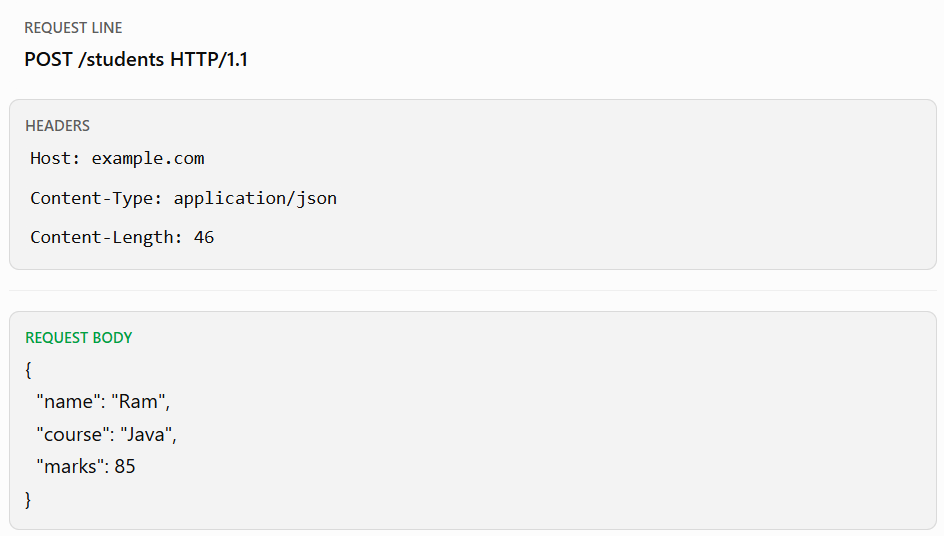
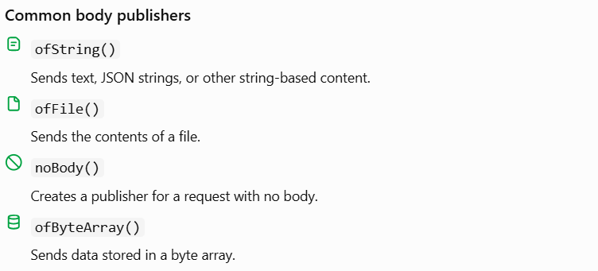

# Unit 4 — Topic 4.3: The HTTP Request Body

Our goal is to understand how a Java client sends data to a server, especially when submitting forms, sending JSON, or uploading content.

## 1. TEACH — What is an HTTP request body?

An HTTP request body is the part of an HTTP request that carries data from the client to the server.

For example, imagine you're registering a student in your student management system. You need to send the student's name, course, and marks to the server.

The request could look like this:



The content length above is illustrative; the actual byte length depends on the exact body sent.

Notice the three parts:

- Request line: Specifies the HTTP method, resource path, and protocol version.
- Headers: Provide metadata about the request, such as the data format.
- Body: Contains the actual data being sent.

### Why do we need a request body?

Some requests need to carry more data than is convenient to put in a URL.

Common examples include:

- Registering a new student.
- Sending login credentials in a POST request.
- Updating a student's marks.
- Submitting a JSON document.
- Uploading a file.

A request body is common with `POST`, `PUT`, and `PATCH`. These methods can carry bodies, but a body is not mandatory for every request using them.

`GET` usually has no body in normal API design, and its body has no generally defined semantics.

## 2. WHY — Headers vs. request body

This distinction is especially important in exams and programming.

| Feature             | HTTP headers                       | Request body                     |
| ------------------- | ---------------------------------- | -------------------------------- |
| Purpose             | Describe the request               | Carry the submitted content      |
| Example             | `Content-Type: application/json`   | `{"name":"Ram"}`                 |
| Typical information | Format, authorization, preferences | Student data, text, file content |
| Java API            | `.header()`                        | `BodyPublishers`                 |

For example:

```
.header("Content-Type", "application/json")
```

tells the server that the request body contains JSON.

It does not create the JSON body. You must supply the body separately.

### What is `Content-Type`?

`Content-Type` tells the server how to interpret the body.

| Content type                        | Typical use                                             |
| ----------------------------------- | ------------------------------------------------------- |
| `application/json`                  | JSON data                                               |
| `text/plain`                        | Plain text                                              |
| `application/x-www-form-urlencoded` | Form fields encoded as key-value pairs                  |
| `multipart/form-data`               | Form submissions containing multiple parts, often files |

Don't confuse `Content-Type` with `Accept`:

- `Content-Type`: The format of the content you're sending.
- `Accept`: The response formats your client is willing to receive.

## 3. CODE — Sending request bodies using Java

We'll use Java's built-in `HttpClient` API, available from JDK 11 onward.

The most important class for today's topic is:

`HttpRequest.BodyPublishers`

It provides ways to supply content for an outgoing request.



### Example A — Send a JSON request body

Create a file named `HttpRequestBodyDemo.java`.

```

import java.net.URI;
import java.net.http.HttpClient;
import java.net.http.HttpRequest;
import java.net.http.HttpResponse;

public class HttpRequestBodyDemo {

    public static void main(String[] args) throws Exception {

        // Create an HTTP client
        HttpClient client = HttpClient.newHttpClient();

        // Prepare JSON data
        String json = """
                {
                    "name": "Ram",
                    "course": "Java",
                    "marks": 85
                }
                """;

        // Build a POST request with a body
        HttpRequest request = HttpRequest.newBuilder()
                .uri(URI.create("https://httpbin.org/post"))
                .header("Content-Type", "application/json")
                .header("Accept", "application/json")
                .POST(HttpRequest.BodyPublishers.ofString(json))
                .build();

        // Send the request and receive the response
        HttpResponse<String> response = client.send(
                request,
                HttpResponse.BodyHandlers.ofString()
        );

        System.out.println("Status: " + response.statusCode());
        System.out.println("Response:");
        System.out.println(response.body());
    }
}

```

How it works

1. `String json` stores the data we want to send.
2. `Content-Type` identifies the body as JSON.
3. `BodyPublishers.ofString(json)` supplies the string as the outgoing body.
4. `.POST(...)` sets the HTTP method to POST and attaches the publisher.
5. `client.send(...)` sends the request and waits for the response.
6. `BodyHandlers.ofString()` reads the response body into a Java `String`.

Expected result: If the test service is available, you should typically receive a `200` response and JSON showing the request data that was received.

The server may return an error if the network is unavailable or the external service is down.

### Example B — Send plain text in the request body

You can send plain text just as easily as JSON. The body publisher doesn't automatically decide the content type; set the correct header yourself.

```
HttpRequest request = HttpRequest.newBuilder()
        .uri(URI.create("https://httpbin.org/post"))
        .header("Content-Type", "text/plain; charset=UTF-8")
        .POST(HttpRequest.BodyPublishers.ofString(
                "Hello from Java Network Programming!"
        ))
        .build();
```

This is the request-building portion. It can replace the request-building section in Example A.

### Example C — Send a file using `ofFile()`

Suppose a file named `message.txt` contains:

```
Hello server! This is a file upload test.
```

The following is a complete runnable program.

```

import java.net.URI;
import java.net.http.HttpClient;
import java.net.http.HttpRequest;
import java.net.http.HttpResponse;
import java.nio.file.Path;

public class HttpFileBodyDemo {

    public static void main(String[] args) throws Exception {

        HttpClient client = HttpClient.newHttpClient();

        Path file = Path.of("message.txt");

        HttpRequest request = HttpRequest.newBuilder()
                .uri(URI.create("https://httpbin.org/post"))
                .header("Content-Type", "text/plain")
                .POST(HttpRequest.BodyPublishers.ofFile(file))
                .build();

        HttpResponse<String> response = client.send(
                request,
                HttpResponse.BodyHandlers.ofString()
        );

        System.out.println("Status: " + response.statusCode());
        System.out.println(response.body());
    }
}

```

Before running it, create `message.txt` in the same directory. `ofFile()` reads the file's contents for the request body; it doesn't attach a file-picker or automatically create a multipart upload.

Important distinction: Sending raw file contents is not the same as uploading a file through a web form. A server expecting `multipart/form-data` requires a multipart-formatted body.

### Example D — Send a request with no body

```
HttpRequest request = HttpRequest.newBuilder()
        .uri(URI.create("https://httpbin.org/get"))
        .GET()
        .build();
```

For GET, Java's `.GET()` is the simplest option. For a method that accepts a body publisher, `BodyPublishers.noBody()` represents an empty body.

## 4. Common mistakes to avoid

- Forgetting `Content-Type`: The server may not know how to interpret your body.
- Confusing `Accept` and `Content-Type`: They describe different things.
- Assuming JSON is automatically validated: Sending JSON doesn't guarantee that the server accepts its fields or values.
- Assuming `ofFile()` means multipart upload: It sends the file contents directly.
- Forgetting that `build()` is necessary: It creates the final `HttpRequest` from the builder.


## 6. REVISION — Quick exam notes

- Request body: Carries content sent by the client to the server.
- `Content-Type`: Describes the format of the content being sent.
- `Accept`: Indicates which response media types the client can accept.
- `ofString()`: Publishes a string as request-body content.
- `ofFile()`: Publishes file contents as request-body content.
- `ofByteArray()`: Publishes bytes from a byte array.
- `noBody()`: Supplies an empty request body.
