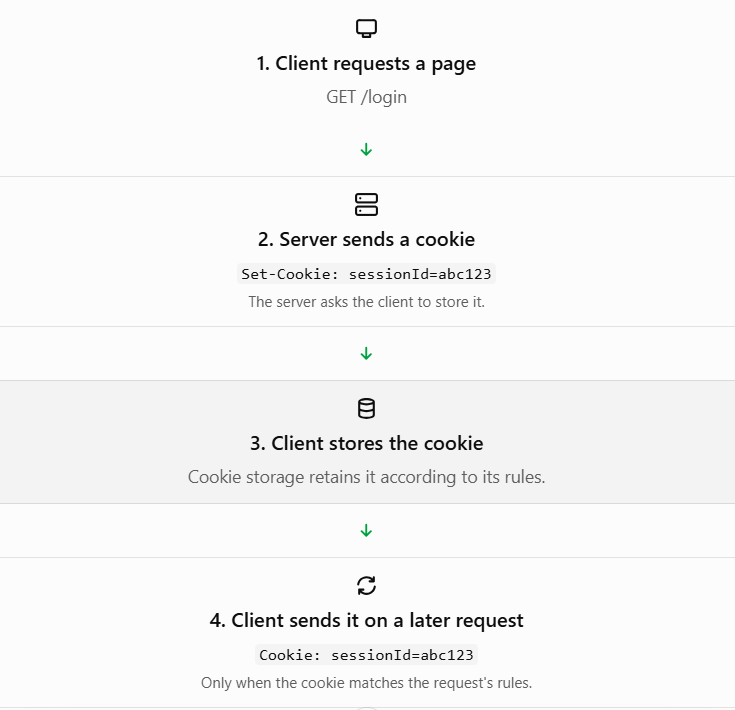
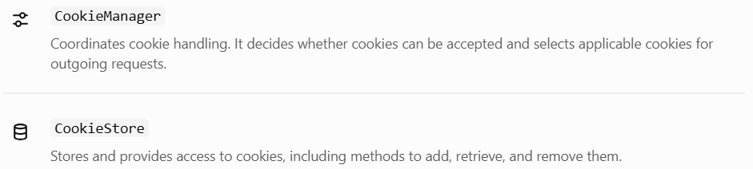

# Unit 4 — Topic 4.4: Cookies, `CookieManager` and `CookieStore`

This is the final topic in your HTTP unit! 🚀 Let's understand how websites remember a user between requests and how Java manages cookies automatically.

## 1. TEACH — What is an HTTP cookie?

An HTTP cookie is a small piece of data that a server asks a client to store and send back with later requests when the cookie's rules permit it.

HTTP is largely stateless: each request is handled independently at the protocol level. Cookies help applications maintain state across multiple requests.

For example, imagine you log in to a website. You navigate from your profile page to your dashboard. The website needs a way to recognize your session rather than treating every request as unrelated.

Cookies can help with:

- Maintaining login sessions.
- Remembering user preferences.
- Keeping shopping-cart identifiers.
- Tracking certain interactions, where permitted.

### How cookies work



Notice the difference between the two important headers:

| Header       | Direction       | Purpose                                            |
| ------------ | --------------- | -------------------------------------------------- |
| `Set-Cookie` | Server → client | Instructs the client to store or update a cookie   |
| `Cookie`     | Client → server | Sends applicable stored cookies back to the server |

The server does not need to send `Set-Cookie` with every response. Once a cookie is stored, the client can send it with later matching requests.

## 2. WHY — Why do we need cookies in Java networking?

Suppose your Java program sends two requests to a website:

- Request 1: The server responds with a cookie.
- Request 2: The server expects the client to send that cookie back.

Without cookie management, you might have to inspect response headers, store cookies, and construct the appropriate `Cookie` header yourself.

Java provides two useful classes:



Think of it this way:

- `CookieManager` is the manager that coordinates cookie processing.
- `CookieStore` is the storage where cookies are kept.

Java's `java.net` package provides both classes.

## 3. CODE — Complete runnable Java example

We'll use Java's built-in `HttpClient`, `CookieManager`, and `CookieStore`. Our example will ask a public test service to set a cookie, inspect the stored cookie, and make another request to see whether the cookie is sent back.

Create a file named `CookieManagerDemo.java`.

```

import java.net.CookieManager;
import java.net.CookiePolicy;
import java.net.CookieStore;
import java.net.HttpCookie;
import java.net.URI;
import java.net.http.HttpClient;
import java.net.http.HttpRequest;
import java.net.http.HttpResponse;

public class CookieManagerDemo {

    public static void main(String[] args) throws Exception {

        // 1. Create a cookie manager
        CookieManager cookieManager =
                new CookieManager(
                        null,
                        CookiePolicy.ACCEPT_ALL
                );

        // 2. Create an HTTP client that uses the manager
        HttpClient client = HttpClient.newBuilder()
                .cookieHandler(cookieManager)
                .build();

        // 3. Request that the test server set a cookie
        HttpRequest setCookieRequest =
                HttpRequest.newBuilder()
                        .uri(URI.create(
                                "https://httpbin.org/cookies/set?student=Ram"
                        ))
                        .GET()
                        .build();

        HttpResponse<String> firstResponse = client.send(
                setCookieRequest,
                HttpResponse.BodyHandlers.ofString()
        );

        System.out.println("First response status: "
                + firstResponse.statusCode());

        // 4. Access the cookie store
        CookieStore store = cookieManager.getCookieStore();

        System.out.println("\nStored cookies:");

        for (HttpCookie cookie : store.getCookies()) {
            System.out.println(
                    cookie.getName() + "=" + cookie.getValue()
            );
        }

        // 5. Make another request using the same client
        HttpRequest secondRequest = HttpRequest.newBuilder()
                .uri(URI.create(
                        "https://httpbin.org/cookies"
                ))
                .GET()
                .build();

        HttpResponse<String> secondResponse = client.send(
                secondRequest,
                HttpResponse.BodyHandlers.ofString()
        );

        System.out.println("\nSecond response status: "
                + secondResponse.statusCode());

        System.out.println("Server response:");
        System.out.println(secondResponse.body());
    }
}

```

### How the code works

1. Create the manager. `CookieManager` is configured with `ACCEPT_ALL`, allowing cookies subject to the manager's policy. In production, choose a policy appropriate for your application.
2. Connect the manager to the client. `.cookieHandler(cookieManager)` enables automatic cookie processing for that client.
3. Receive a cookie. The test endpoint sets a `student=Ram` cookie and redirects the request. The HTTP client can process the cookie from the response.
4. Inspect the store. `getCookieStore()` returns the store used by the manager, and `getCookies()` returns its stored cookies.
5. Reuse the client. The second request goes to the cookie-inspection endpoint. If the cookie remains valid and matches that endpoint, the client sends it automatically.

Expected result: If the test service is available, you should see the stored `student=Ram` cookie and a JSON response showing the cookie received by the server. Status codes and output may vary if the service or network behaves differently.

Run it using:

```
javac CookieManagerDemo.java
java CookieManagerDemo
```

You'll need JDK 11 or later and internet access.

## 4. Learn the important `CookieStore` methods

These methods are especially useful for exam questions.

| Method                | Purpose                                           |
| --------------------- | ------------------------------------------------- |
| `getCookieStore()`    | Gets the store used by a `CookieManager`          |
| `getCookies()`        | Returns the currently stored cookies              |
| `getURIs()`           | Returns URIs associated with cookies in the store |
| `add(uri, cookie)`    | Adds a cookie associated with a URI               |
| `get(uri)`            | Retrieves cookies applicable to a URI             |
| `remove(uri, cookie)` | Removes a specific cookie association             |
| `removeAll()`         | Removes all cookies from the store                |

Example:

```
CookieStore store = cookieManager.getCookieStore();

// Display stored cookies
for (HttpCookie cookie : store.getCookies()) {
    System.out.println(cookie);
}

// Remove all stored cookies
store.removeAll();
```

Remember that removing cookies from the store affects subsequent requests made through the manager. It does not invalidate a session on the server by itself.

## 5. Cookie policies and security

`CookieManager` supports these standard policies through `CookiePolicy`:

- `ACCEPT_ALL` — accepts all cookies presented to the manager, subject to the underlying cookie-handling rules.
- `ACCEPT_NONE` — accepts no cookies.
- `ACCEPT_ORIGINAL_SERVER` — accepts cookies only from the original server associated with the request.

Cookies can also have attributes such as:

- `Domain` and `Path`: Restrict where a cookie is sent.
- `Max-Age` and `Expires`: Control cookie lifetime.
- `Secure`: Restricts sending to secure connections such as HTTPS.
- `HttpOnly`: Prevents access through browser JavaScript APIs; it is not an authentication or encryption mechanism.

A critical security rule: don't blindly accept cookies from untrusted sources in a production application. Cookies can contain session identifiers, so protect them and use HTTPS. Also, a stored cookie does not prove that a user is authorized to access a resource.


**If you want to remove every cookie from a CookieStore, which method would you call? Does this automatically log the user out on the server?**


->I will use the removeAll() method to remove every cookie from the CookieStore.


No, removing cookies on the client side using methods like removeAll() 
does not automatically log the user out on the server.
Because HTTP is a stateless protocol, clearing cookies is a purely client-side action. When you wipe the cookies from the 
browser or local cookie store, you are only destroying the client's copy of the session token. The server remains completely 
unaware that these cookies have been deleted.