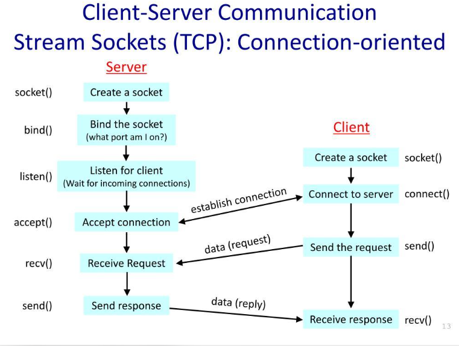
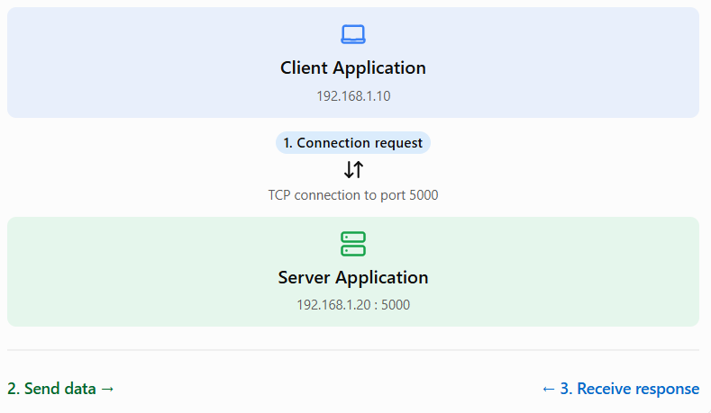

# Lesson 6.1: Introduction to Socket

### 1. What is a Socket?
A socket is an endpoint of communication between two devices over a network.

In simple terms, a socket allows two applications to communicate with each other by sending and receiving data.

For example, imagine that you open a web browser and visit a website.

What happens behind the scenes?
- Your browser acts as a client.
- The website's server waits for incoming connections.
- Your browser establishes a connection with the server.
- Your browser sends an HTTP request.
- The server processes the request and sends an HTTP response.
Sockets provide the communication mechanism that makes this possible.



### 2. Why do we need sockets?
Imagine developing these applications:
- A chat application like WhatsApp.
- An online multiplayer game.
- A file-sharing application.
- A web browser.
- A remote database client.
- A real-time notification system.
All these applications need some way to communicate over a network.

Sockets provide an interface through which applications can establish network connections and exchange data.

Without sockets or an equivalent networking API, applications would need to implement low-level network communication themselves.

### 3. How does socket communication work?
Let's understand it through a simple example.

Suppose:
- Client IP address: `192.168.1.10`
- Server IP address: `192.168.1.20`
- Server port: `5000`
The communication process looks like this:



The basic process:
1. The server creates a socket and listens on a port.
2. The client creates a socket and connects to the server's IP address and port.
3. The client sends data.
4. The server receives and processes the data.
5. The server sends a response.
6. The client receives the response.
7. The connection is eventually closed.
This is a simplified TCP communication flow.


### 4. Understanding IP addresses and port numbers
Two important concepts are involved in socket communication.

**IP address**

An IP address identifies a device on a network.

Example: `192.168.1.20`

**Port number**

A port number identifies a particular application or service running on that device.

Example:

|Service|	Default port|
|-------|---------------|
|HTTP	|80|
|HTTPS	|443|
|FTP control|	21|
|SSH|	22|
|PostgreSQL	|5432|

The combination of IP address and port identifies a network endpoint.

For example:

`192.168.1.20:5000`

This means port 5000 on the device identified by that IP address.

### 5. Types of sockets
There are two important transport protocols to understand.
#### 1. TCP Socket
Connection-oriented
- Establishes a connection before communication.
- Provides reliable, ordered delivery.
- Detects lost data and retransmits it.
- Commonly used for web applications, file transfers and database connections.
  
  Java class: `java.net.Socket (client)`, `java.net.ServerSocket (server)`.


#### 2. UDP Socket
Connectionless
- Does not establish a TCP-style connection.
- Sends independent datagrams.
- Does not guarantee delivery or ordering.
- Commonly used for DNS, real-time communication and some gaming applications.
  
  Java class: `java.net.DatagramSocket`.


**Important:** Our Chapter 6 primarily focuses on TCP client sockets using Java's `Socket`class.

### 6. Java Socket programming
Java provides networking classes through the `java.net` package.

The two most important TCP classes are:
|Class|	Purpose|
|-----|--------|
|`Socket`|	Creates the client-side communication endpoint.|
|`ServerSocket`|	Listens for incoming client connections on the server side.|

According to the official Java documentation, Socket represents an endpoint for communication between two machines. 

#### Example 1: A simple TCP server
First, let's create a server that listens on port 5000.
```
import java.io.*;
import java.net.*;

public class SimpleServer {

    public static void main(String[] args) {

        try (ServerSocket serverSocket =
                     new ServerSocket(5000)) {

            System.out.println("Server is waiting...");

            try (Socket clientSocket = serverSocket.accept();
                 BufferedReader input =
                     new BufferedReader(
                         new InputStreamReader(
                             clientSocket.getInputStream()));
                 PrintWriter output =
                     new PrintWriter(
                         clientSocket.getOutputStream(), true)) {

                System.out.println("Client connected!");

                String message = input.readLine();

                System.out.println("Client says: " + message);

                output.println("Hello Client! Message received.");

            }

        } catch (IOException e) {
            e.printStackTrace();
        }
    }
}
```


**Understanding the important methods:**
- `new ServerSocket(5000)` creates a server socket bound to port 5000.
- `accept()` waits for a client connection.
- `getInputStream()` obtains data sent by the client.
- `getOutputStream()` allows the server to send data to the client.
- `readLine()` reads a line of text.
- `println()` sends a line of text.

#### Example 2: A TCP client
Now let's create a client that connects to our server.
```
import java.io.*;
import java.net.*;

public class SimpleClient {

    public static void main(String[] args) {

        try (Socket socket =
                     new Socket("localhost", 5000);

             PrintWriter output =
                     new PrintWriter(
                         socket.getOutputStream(), true);

             BufferedReader input =
                     new BufferedReader(
                         new InputStreamReader(
                             socket.getInputStream()))) {

            System.out.println("Connected to server!");

            // Send message
            output.println("Hello Server!");

            // Receive response
            String response = input.readLine();

            System.out.println("Server says: " + response);

        } catch (IOException e) {
            e.printStackTrace();
        }
    }
}
```


### 7. How to run this project in IntelliJ IDEA
Create two Java files:
- `SimpleServer.java`
- `SimpleClient.java`
Run them in this order:
1. Run `SimpleServer.java.`
2. Wait until you see `Server is waiting....`
3. Run `SimpleClient.java.`
4. Observe the output in both consoles.

**Expected client output**
```
Connected to server!
Server says: Hello Client! Message received.
```


**Expected server output**
```
Server is waiting...
Client connected!
Client says: Hello Server!
```

**Expected successful communication**

#### Why use try-with-resources?

Notice that we used:
```
try (Socket socket = new Socket("localhost", 5000)) {
    // Communication
}
```

This automatically closes the socket when execution leaves the block, even if an exception occurs.

This is important because network connections consume operating-system resources.

### 8. Important concepts to remember
|Concept|	Meaning|
|-------|----------|
|Socket	|Communication endpoint|
|IP address|	Identifies a network device|
|Port|	Identifies a service/application endpoint|
|TCP	|Reliable, connection-oriented protocol|
|UDP	|Connectionless datagram protocol|
|`Socket`	|Java TCP client socket|
|`ServerSocket`|	Java TCP server socket|
|`accept()`	|Waits for an incoming connection|
|`getInputStream()`|	Reads incoming bytes|
|`getOutputStream()`|	Writes outgoing bytes|
