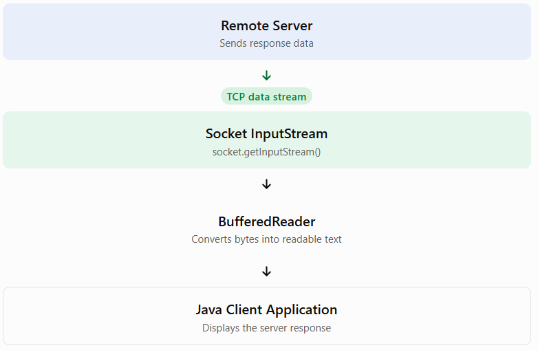

# Lesson 6.2: Using Sockets
Our lesson has three parts:
1. Investigating Protocols with Telnet.
2. Reading from Servers with Sockets.
3. Writing to Servers with Sockets.
By the end of this lesson, you should understand how to communicate with a remote server manually using Telnet and programmatically using Java sockets.

## Part 1: Investigating Protocols with Telnet
### 1. What is Telnet?
**Telnet (Teletype Network Protocol)** is a network protocol and command-line tool that allows a user to establish a text-based connection to a remote host.

It is useful for understanding how network protocols communicate using text-based commands.

For example, suppose you want to investigate how an HTTP server responds to an HTTP request.

You can establish a TCP connection to a web server and manually send an HTTP request.

This helps us understand what happens behind the scenes when a browser communicates with a web server.

### 2. Why do we need Telnet?
Telnet is useful for:
- Testing whether a remote TCP port is reachable.
- Investigating text-based network protocols.
- Understanding HTTP request and response formats.
- Troubleshooting network connectivity.
- Testing services without developing a complete client application.

**Important security note:** Traditional Telnet transmits data without encryption. Never use it to send passwords or sensitive information over an untrusted network. For secure remote administration, use SSH.

### 3. Practical: Investigating HTTP using Telnet
Let's investigate a real HTTP server.

STEP 1 — OPEN YOUR TERMINAL

On Windows, open Command Prompt. On Linux, open your terminal.

Enter:
```
telnet example.com 80
```

Here:
- `example.com` is the server hostname.
- `80` is the HTTP port.
- Telnet attempts to establish a TCP connection.
If Telnet is not installed on Windows, enable **Telnet Client** through Windows Optional Features.

STEP 2 — SEND AN HTTP REQUEST

After connecting, manually type:
```
GET / HTTP/1.1
Host: example.com
Connection: close
```

Important: Press Enter after the `Connection` header, then press Enter once more to create the empty line that ends the HTTP headers.

STEP 3 — OBSERVE THE RESPONSE

The server should return an HTTP response resembling:
```
HTTP/1.1 200 OK
Content-Type: text/html
Content-Length: ...
Connection: close

<!doctype html>
<html>
...
```

The actual status, headers and HTML content can vary.
### 4. Understanding the HTTP request
Let's break down the request:
|Component	|Purpose|
|-----------|-------|
|`GET`|	Requests a resource from the server|
|`/`|	Requests the root resource|
|`HTTP/1.1`|	Specifies the HTTP protocol version|
|`Host`|	Identifies the requested virtual host|
|`Connection: close`|	Requests connection closure after the response|
|`Empty line`|	Marks the end of the request headers|

**Why is the empty line important?**

HTTP/1.1 messages use a start-line, header fields, an empty line, and an optional message body.

The empty line tells the server that the request headers have ended. 


## Part 2: Reading from Servers with Sockets
Now let's move from manual communication to Java programming.
### 5. What does reading from a server mean?
When a client establishes a socket connection, the server can send data to the client.

The client uses the socket's input stream to receive that data.

Java provides:
```
socket.getInputStream();
```

This method returns an InputStream that reads bytes from the connected server. 

The communication process:



### 6. Complete Java example: Reading an HTTP response
Create a Java file named `SocketReadClient.java`.
```
import java.io.*;
import java.net.*;
import java.nio.charset.StandardCharsets;

public class SocketReadClient {

    public static void main(String[] args) {

        String host = "example.com";
        int port = 80;

        try (Socket socket = new Socket(host, port);

             BufferedReader reader =
                 new BufferedReader(
                     new InputStreamReader(
                         socket.getInputStream(),
                         StandardCharsets.US_ASCII))) {

            System.out.println("Connected to server!");

            String line;

            // Read the server response
            while ((line = reader.readLine()) != null) {
                System.out.println(line);
            }

        } catch (IOException e) {
            System.out.println("Error: " + e.getMessage());
        }
    }
}
```
**What does this program do?**
1. Connects to example.com on port 80.
2. Obtains the socket's input stream.
3. Converts incoming bytes into text.
4. Reads the response line by line.
5. Displays the received information.

**Important observation:** This example only reads. It does not send an HTTP request. A server may wait for a request before sending its response, so this program may block waiting for data.

That is why we need to learn how to write to servers.

## Part 3: Writing to Servers with Sockets
### 7. What does writing to a server mean?
Writing to a server means sending data from a client application to a remote server through a socket's output stream.

Java provides:
```
socket.getOutputStream();
```

This method returns an `OutputStream` that sends bytes to the connected server. 


For example, when your browser sends:
```
GET / HTTP/1.1
Host: example.com
```

It is writing request data to the server.
### 8. Complete Java example: Writing an HTTP request
Create `SocketWriteClient.java`.
```
import java.io.*;
import java.net.*;
import java.nio.charset.StandardCharsets;

public class SocketWriteClient {

    public static void main(String[] args) {

        String host = "example.com";
        int port = 80;

        try (Socket socket = new Socket(host, port);

             BufferedWriter writer =
                 new BufferedWriter(
                     new OutputStreamWriter(
                         socket.getOutputStream(),
                         StandardCharsets.US_ASCII))) {

            System.out.println("Connected to server!");

            // Send HTTP request
            writer.write("GET / HTTP/1.1\r\n");
            writer.write("Host: example.com\r\n");
            writer.write("Connection: close\r\n");
            writer.write("\r\n");

            // Ensure data is sent
            writer.flush();

            System.out.println("HTTP request sent!");

        } catch (IOException e) {
            System.out.println("Error: " + e.getMessage());
        }
    }
}
```

**Understanding the important methods:**
|Method	|Purpose|
|-------|-------|
|`getOutputStream()`|	Gets the socket output stream|
|`write()`|	Writes data into the stream|
|`flush()`|	Pushes buffered data toward the destination|
|`close()`|	Closes the resource|

**Why do we use `flush()`?**

`BufferedWriter` temporarily holds data in memory.

Calling `flush()` ensures buffered characters are passed to the underlying output stream instead of waiting for the buffer to fill or close.

Notice that we used `\r\n` explicitly. HTTP/1.1 uses CRLF as the line terminator.

## Part 4: Combining Reading and Writing
### 9. Complete practical example: Socket HTTP Client
Now let's combine both operations into one application.

This is the most important practical example of Lesson 6.2.

Create `SocketHttpClient.java`.
```
import java.io.*;
import java.net.*;
import java.nio.charset.StandardCharsets;

public class SocketHttpClient {

    public static void main(String[] args) {

        String host = "example.com";
        int port = 80;

        try (Socket socket = new Socket(host, port);

             BufferedWriter writer =
                 new BufferedWriter(
                     new OutputStreamWriter(
                         socket.getOutputStream(),
                         StandardCharsets.US_ASCII));

             BufferedReader reader =
                 new BufferedReader(
                     new InputStreamReader(
                         socket.getInputStream(),
                         StandardCharsets.ISO_8859_1))) {

            System.out.println("Connected to " + host);

            // STEP 1: Write request to server
            writer.write("GET / HTTP/1.1\r\n");
            writer.write("Host: example.com\r\n");
            writer.write("Connection: close\r\n");
            writer.write("\r\n");

            writer.flush();

            System.out.println("Request sent!");
            System.out.println("\nServer Response:");

            // STEP 2: Read response from server
            String response;

            while ((response = reader.readLine()) != null) {
                System.out.println(response);
            }

            System.out.println("\nConnection completed.");

        } catch (IOException e) {
            System.out.println("Network error: " + e.getMessage());
        }
    }
}
```

### 10. Understanding the complete execution flow
1. Create socket
   
   new Socket(host, port)
   
   Establishes a TCP connection.
2. Obtain output stream
   
   socket.getOutputStream()
   
   Prepares to send data.
3. Send HTTP request
   
   writer.write(...)
   
   Sends the GET request to the server.
4. Flush the writer
   
   writer.flush()
   
   Ensures the buffered request is sent.
5. Obtain input stream
   
   socket.getInputStream()
   
   Prepares to receive data.
6. Read server response
   
   reader.readLine()
   
   Reads the response line by line.
7. Close connection
   
   Try-with-resources automatically closes the resources.

### 11. Important comparison: Reading vs Writing
|Reading from server|	Writing to server|
|-------------------|--------------------|
|Receives data	|Sends data|
|getInputStream()|	getOutputStream()|
|InputStream|	OutputStream|
|BufferedReader|	BufferedWriter|
|read() / readLine()|	write()|
|Server → Client|	Client → Server|

Remember this:
- **InputStream = Data coming into your client.**
- **OutputStream = Data going out from your client.**

### 12. Important real-world considerations
1. **Blocking operations:** `readLine()` may wait indefinitely if the server does not send a line terminator or close the connection. Socket timeouts can help control waiting time.
2. **Protocol matters:** A socket only transports bytes. Your application must follow the server's protocol, such as HTTP.
3. **Character encoding:** Choose an encoding appropriate for the protocol and payload.
4. **Resource management:** Always close sockets and streams.
5. **HTTPS:** Port 443 requires TLS encryption. A plain `Socket` connection to port 443 does not perform a TLS handshake. Java provides `SSLSocket` for TLS connections.
