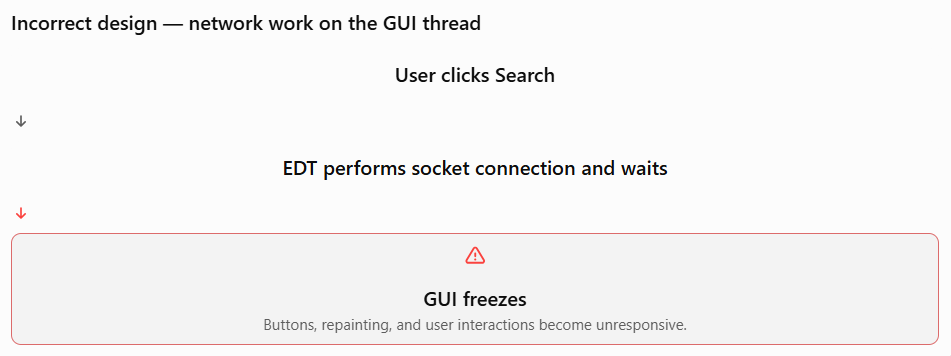
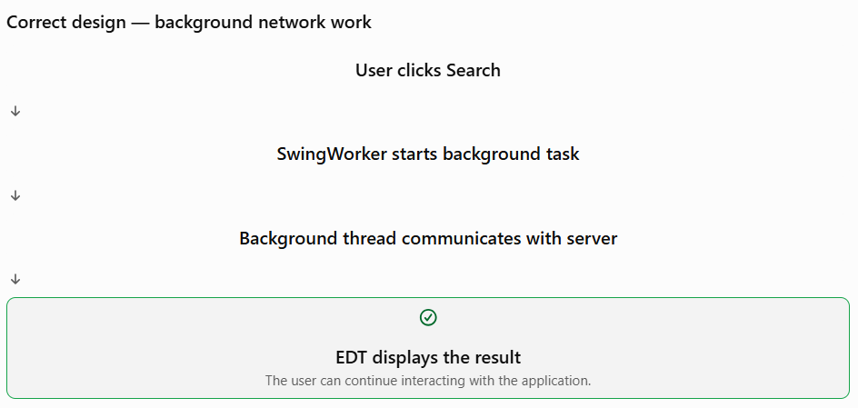
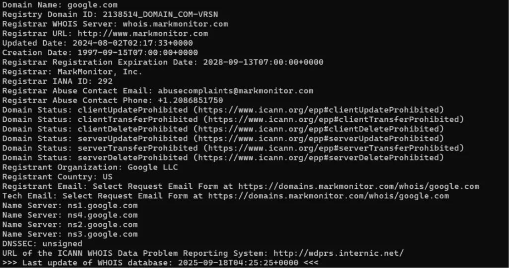
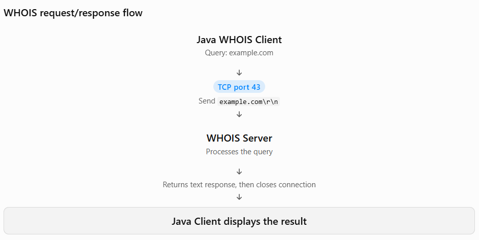
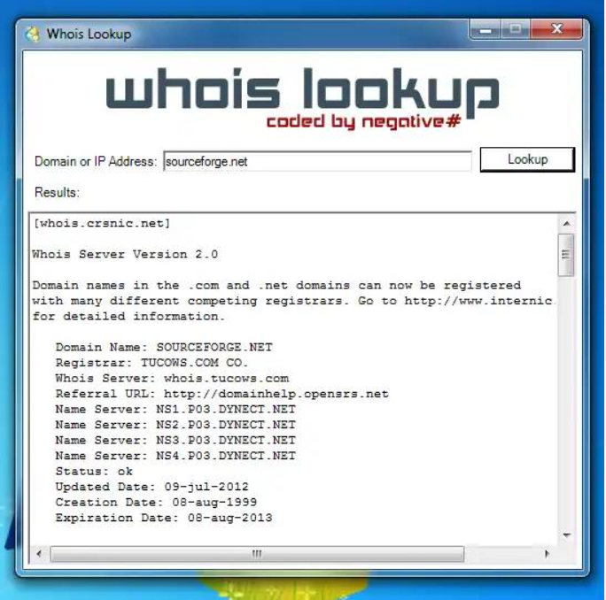
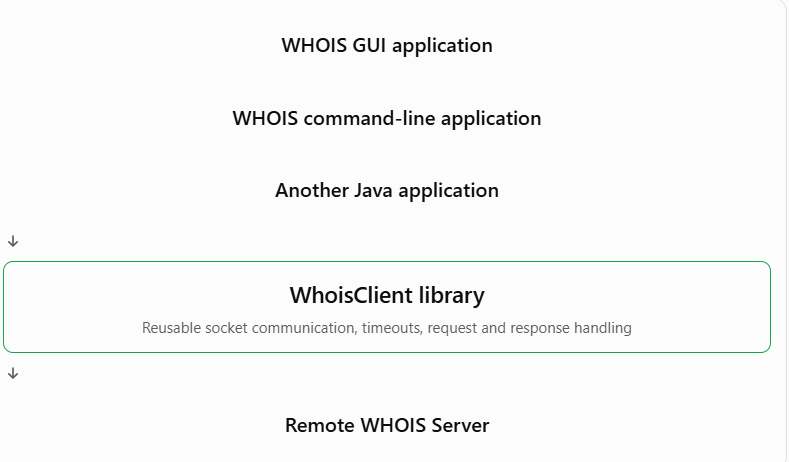

# Lesson 6.6 — Socket in GUI Applications: Whois and A Network Client Library
**What you'll learn**
1. Why network operations in GUI applications must not block the user interface.
2. What the WHOIS protocol does and how a Java socket client communicates with a WHOIS server.
3. How to build a graphical WHOIS lookup application using Java Swing.
4. How to design a reusable network client library that separates networking from the GUI.
5. How to handle timeouts, errors, and background tasks.

## 1. What is a GUI network application?
A **GUI (Graphical User Interface)** network application allows users to communicate with remote servers through visual controls instead of typing commands into a terminal.

Examples include:
- A WHOIS lookup application.
- An email client.
- A chat application.
- A file downloader.
- A network monitoring tool.
In Java, we can build these applications using **Swing**, a GUI toolkit included in the Java platform.

**The important problem: blocking the GUI**

Imagine a user clicks a button labelled **Search Domain.**

Your application connects to a remote server, sends a request, and waits for the response. Network operations can take seconds—or longer if the server is slow or unreachable.

If you perform that work directly on Swing's Event Dispatch Thread (EDT), the GUI may freeze:


The solution is to run network operations on a **background thread**, then update Swing components on the EDT.

**Key rule:** Perform lengthy network operations in the background. Create and update Swing components on the EDT. Oracle's Swing concurrency guidance explains this separation. 

## 2. Understanding WHOIS

**WHOIS** is a TCP-based, text request/response protocol traditionally used to retrieve registration information about domain names, IP addresses, and network resources.

For example, a WHOIS query may return information such as:
- Registrar.
- Registration and expiration dates.
- Domain name servers.
- Domain status.
- Registration organization or contact information, where publicly available.
The WHOIS protocol is described in **RFC 3912**.

### How WHOIS communication works
The traditional WHOIS protocol uses:
- Transport protocol: `TCP`.
- Server port: `43`.
- Request: text query terminated by `CRLF (\r\n)`.
- Response: text, potentially multiple lines.
- End of response: server closes the TCP connection.



**Example request**

Suppose your client wants information about `example.com`.

It sends:
```
example.com\r\n
```

Here:
- `\r` means carriage return.
- `\n` means line feed.
- Together they form `CRLF`.
The server sends its response, which can contain multiple lines. **Do not stop reading at the first newline**. The server's connection closure signals that the complete response has arrived. 


**Important modern context:** WHOIS is a legacy protocol. Its responses and privacy rules vary by registry and registrar. Some contact information may be redacted, and WHOIS does not provide strong confidentiality or integrity protection. RDAP is a newer alternative for registration data. 


## 3. Build a WHOIS client using Java sockets
Let's build the network part first, independently of the GUI.

The WHOIS client will:
1. Create a TCP socket.
2. Connect to the WHOIS server on port 43.
3. Send the domain query followed by CRLF.
4. Read the response until the server closes the connection.
5. Return the response as a Java String.

### Step 1 — `Create WhoisClient.java`
This is our reusable network client class. It does not know anything about Swing, buttons, or text fields.
```
import java.io.BufferedReader;
import java.io.BufferedWriter;
import java.io.IOException;
import java.io.InputStreamReader;
import java.io.OutputStreamWriter;
import java.net.InetSocketAddress;
import java.net.Socket;
import java.nio.charset.StandardCharsets;

public class WhoisClient {

    private static final int WHOIS_PORT = 43;
    private static final int CONNECT_TIMEOUT = 5000;
    private static final int READ_TIMEOUT = 8000;

    public String lookup(String server, String query)
            throws IOException {

        if (server == null || server.isBlank()) {
            throw new IllegalArgumentException(
                "WHOIS server cannot be empty."
            );
        }

        if (query == null || query.isBlank()) {
            throw new IllegalArgumentException(
                "WHOIS query cannot be empty."
            );
        }

        try (Socket socket = new Socket()) {

            // Connect to WHOIS server
            socket.connect(
                new InetSocketAddress(server, WHOIS_PORT),
                CONNECT_TIMEOUT
            );

            // Prevent indefinite blocking while reading
            socket.setSoTimeout(READ_TIMEOUT);

            // Send query using ASCII and CRLF
            BufferedWriter writer = new BufferedWriter(
                new OutputStreamWriter(
                    socket.getOutputStream(),
                    StandardCharsets.US_ASCII
                )
            );

            writer.write(query);
            writer.write("\r\n");
            writer.flush();

            // Read response until server closes connection
            BufferedReader reader = new BufferedReader(
                new InputStreamReader(
                    socket.getInputStream(),
                    StandardCharsets.UTF_8
                )
            );

            StringBuilder response = new StringBuilder();
            String line;

            while ((line = reader.readLine()) != null) {
                response.append(line).append('\n');
            }

            return response.toString();
        }
    }
}
```
**Understanding the code**
|Code	|Purpose|
|-------|-------|
|`new Socket()`|	Creates an unconnected TCP socket|
|`connect(..., 5000)`|	Connects with a 5-second timeout|
|`setSoTimeout(8000)`|	Limits blocking reads to 8 seconds|
|`writer.write(query)`|	Sends the domain query|
|`writer.write("\r\n")`|	Terminates the WHOIS request|
|`writer.flush()`|	Pushes buffered output toward the socket|
|`reader.readLine()`|	Reads response lines|
|`line != null`|	Continues until the server closes its output|
|`try-with-resources`|	Automatically closes the socket|

**A note about character encoding:** RFC 3912 does not specify a universal response character set. We send the protocol query in ASCII and decode the response as UTF-8 for this example. Some WHOIS servers may use another encoding, so unusual characters may not display correctly.

### Step 2 — Test the client without a GUI
Create `WhoisClientTest.java`:
```
public class WhoisClientTest {

    public static void main(String[] args) {

        WhoisClient client = new WhoisClient();

        try {
            String result = client.lookup(
                "whois.iana.org",
                "example.com"
            );

            System.out.println("WHOIS RESULT:");
            System.out.println(result);

        } catch (Exception e) {
            System.out.println(
                "WHOIS lookup failed: " + e.getMessage()
            );
        }
    }
}
```
Run this class first. It tests the socket communication independently of the GUI.

Network requirement

 Your computer/network must allow outbound TCP connections to port 43. Some networks and firewalls block this port. If the request times out or is refused, that does not necessarily mean your Java code is wrong.
Also, WHOIS responses can contain a referral to another WHOIS server. Our first version displays the response; it does not automatically follow referrals.

## 4. Build the graphical WHOIS application using Swing
Now let's connect our reusable `WhoisClient` library to a GUI.


Our GUI will contain:
- Domain input field.
- WHOIS server input field.
- Search button.
- Result display area.
- Status messages.

### Step 3 — Create `WhoisGUI.java`
```
import javax.swing.*;
import java.awt.*;
import java.util.concurrent.ExecutionException;

public class WhoisGUI extends JFrame {

    private final JTextField domainField;
    private final JTextField serverField;
    private final JTextArea resultArea;
    private final JButton searchButton;
    private final JLabel statusLabel;

    private final WhoisClient whoisClient;

    public WhoisGUI() {

        whoisClient = new WhoisClient();

        setTitle("Java WHOIS Lookup");
        setSize(700, 500);
        setDefaultCloseOperation(JFrame.EXIT_ON_CLOSE);
        setLocationRelativeTo(null);

        // Input fields
        domainField = new JTextField("example.com", 20);
        serverField = new JTextField("whois.iana.org", 20);

        searchButton = new JButton("Search");

        // Result area
        resultArea = new JTextArea();
        resultArea.setEditable(false);
        resultArea.setLineWrap(true);
        resultArea.setWrapStyleWord(true);

        JScrollPane scrollPane =
            new JScrollPane(resultArea);

        // Status
        statusLabel = new JLabel("Ready");

        // Input panel
        JPanel inputPanel = new JPanel(
            new GridLayout(3, 2, 8, 8)
        );

        inputPanel.setBorder(
            BorderFactory.createEmptyBorder(10, 10, 10, 10)
        );

        inputPanel.add(new JLabel("Domain:"));
        inputPanel.add(domainField);

        inputPanel.add(new JLabel("WHOIS Server:"));
        inputPanel.add(serverField);

        inputPanel.add(new JLabel(""));
        inputPanel.add(searchButton);

        // Bottom panel
        JPanel bottomPanel = new JPanel(
            new BorderLayout()
        );

        bottomPanel.setBorder(
            BorderFactory.createEmptyBorder(5, 10, 10, 10)
        );

        bottomPanel.add(statusLabel, BorderLayout.CENTER);

        // Main layout
        setLayout(new BorderLayout());

        add(inputPanel, BorderLayout.NORTH);
        add(scrollPane, BorderLayout.CENTER);
        add(bottomPanel, BorderLayout.SOUTH);

        // Search button action
        searchButton.addActionListener(e -> searchDomain());
    }

    private void searchDomain() {

        String domain = domainField.getText().trim();
        String server = serverField.getText().trim();

        if (domain.isEmpty() || server.isEmpty()) {
            JOptionPane.showMessageDialog(
                this,
                "Enter both domain and WHOIS server."
            );
            return;
        }

        // Prevent duplicate requests while searching
        searchButton.setEnabled(false);

        resultArea.setText("");
        statusLabel.setText("Searching...");

        // Network work happens in the background
        SwingWorker<String, Void> worker =
            new SwingWorker<String, Void>() {

                @Override
                protected String doInBackground()
                        throws Exception {

                    return whoisClient.lookup(
                        server,
                        domain
                    );
                }

                @Override
                protected void done() {

                    try {
                        String result = get();

                        resultArea.setText(
                            result.isBlank()
                                ? "No response received."
                                : result
                        );

                        statusLabel.setText("Lookup completed.");

                    } catch (InterruptedException e) {

                        Thread.currentThread().interrupt();

                        statusLabel.setText(
                            "Lookup interrupted."
                        );

                    } catch (ExecutionException e) {

                        Throwable cause = e.getCause();

                        resultArea.setText(
                            "Error: " + cause.getMessage()
                        );

                        statusLabel.setText(
                            "Lookup failed."
                        );

                    } finally {
                        searchButton.setEnabled(true);
                    }
                }
            };

        worker.execute();
    }

    public static void main(String[] args) {

        SwingUtilities.invokeLater(() -> {

            WhoisGUI gui = new WhoisGUI();

            gui.setVisible(true);
        });
    }
}
```

### Step 4 — Understand `SwingWorker`
This is the most important part of the GUI application.
```
SwingWorker<String, Void> worker =
    new SwingWorker<String, Void>() {
```

`SwingWorker<T, V>` has two type parameters:
- `T`: the final result type returned by `doInBackground()`.
- `V`: the type of intermediate results sent using `publish()` and received by `process()`.

In our application:
- `String` is the final WHOIS response.
- `Void` means we are not publishing intermediate chunks.

The three important methods:
|Method	|Executes on	|Purpose|
|-------|---------------|-------|
|`doInBackground()`|	Background worker thread|	Performs network communication|
|`done()`	|Swing EDT|	Handles completion and updates the GUI|
|`get()`|	Called in `done()` here|	Retrieves the completed result|

`execute()` schedules the background task and returns immediately. `done()` runs on the EDT when the background operation finishes. 

**Why don't we call `get()` immediately after `execute()`?**

Because `get()` waits for the result. If called on the EDT before the task finishes, it can freeze the GUI again. In our example, `get()` is called inside `done()`, after the worker has finished.

## 5. What is a Network Client Library?
A **network client library** is reusable Java code that handles network communication and provides a simple interface to other parts of an application.

Instead of writing socket connection code repeatedly in every application, we put the networking logic into a separate class.

Our `WhoisClient` is already a small example of this design.

**Without a client library**
Imagine three applications:
- WHOIS desktop application.
- WHOIS command-line application.
- WHOIS web application.
Without a reusable library, each application might implement socket communication independently.

This creates duplicated code and makes maintenance difficult.

**With a client library**




**Why is this architecture useful?**
1. **Reusability:** Multiple applications can use the same network code.
2. **Maintainability:** Fix networking bugs in one place.
3. **Separation of concerns:** GUI code handles presentation; the client library handles communication.
4. **Testing:** You can test networking independently of the GUI.
5. **Extensibility:** You can add features such as retries, logging, caching, and support for different servers.

Our project has this separation:
|File	|Responsibility|
|-------|--------------|
|`WhoisClient.java`	|Socket communication|
|`WhoisClientTest.java`|	Command-line testing|
|`WhoisGUI.java`|	Graphical user interface|

The important design principle is that `WhoisClient` should not depend on Swing. That allows other Java applications to reuse it.

## 6. Project structure and execution
In IntelliJ IDEA, create a Java project with this structure:
```
SocketWhoisApplication

src

WhoisClient.java

WhoisClientTest.java

WhoisGUI.java
```

**Run in this order:**
1. Run `WhoisClientTest.java` to test the network connection.
2. If that works, run `WhoisGUI.java`.
3. Enter `example.com` in the domain field.
4. Keep `whois.iana.org` as the initial WHOIS server.
5. Click **Search**.
6. Inspect the result in the text area.

If the response includes a referral such as another WHOIS server, you can enter that server in the GUI and perform another lookup.

### Troubleshooting
|Problem	|Possible reason|
|-----------|---------------|
|Connection refused|	WHOIS server is not accepting the connection|
|Connection timed out|	Port 43 is blocked or server is unreachable|
|Read timed out|	Server did not close the response connection within the configured timeout|
|Unknown host|	DNS could not resolve the server name|
|Empty result|	Server returned no readable content|
|Strange characters|	Server uses a different character encoding|

## 7. Important concepts to remember
|Concept	|Remember this|
|-----------|-------------|
|Swing EDT|	Handles GUI events and component updates|
|Background thread|	Performs lengthy network operations|
|`SwingWorker`|	Connects background work with Swing|
|`doInBackground()`|	Runs network operations|
|`done()`	|Handles completion on the EDT|
|WHOIS|	Traditional TCP text-based lookup protocol|
|Port 43|	Default WHOIS server port|
|CRLF|	Terminates a WHOIS request|
|Network client library|	Reusable networking code separated from the GUI|
