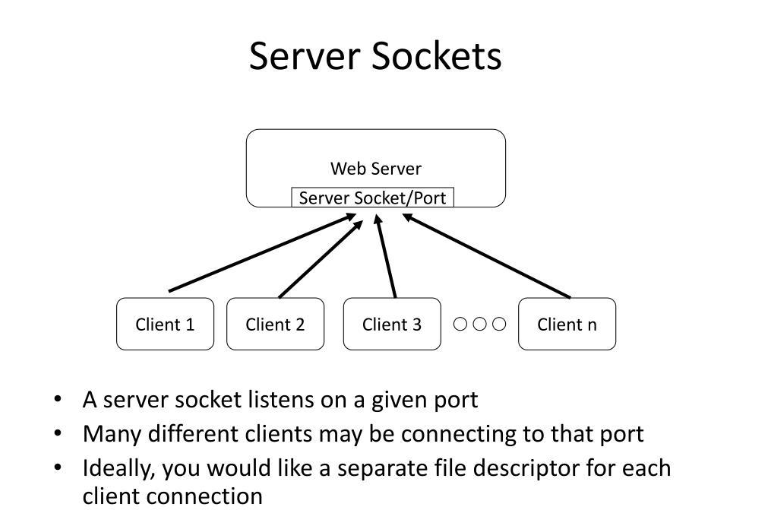
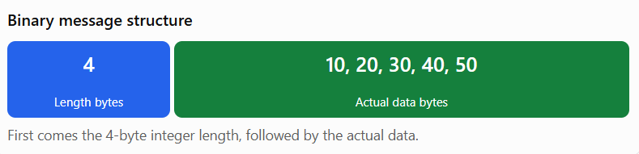

# 1. What will we learn in Chapter 7?
A server waits for incoming client connections, accepts them, communicates with clients, processes their requests, and sends responses.



## Lesson 7.1 includes four important subtopics:
1. ServerSocket Class
2. Serving Binary Data
3. Multithreaded Servers
4. Closing Server Sockets

We'll cover all four before taking your lesson quiz.

## 2. Why do we need ServerSocket?
Imagine that you are developing a chat application.
- A client wants to send a message.
- A server needs to wait for incoming connections.
- When a client connects, the server accepts the connection.
- Both sides exchange information.

In Java, we use two important classes:

|Class	|Responsibility|
|-------|--------------|
|`Socket`	|Establishes communication between two endpoints.|
|`ServerSocket`|	Waits for and accepts incoming TCP connections.|

**Real-world analogy:**

Think of a restaurant:
- `ServerSocket` = Restaurant entrance, waiting for customers.
- `Socket` = A table assigned to a particular customer.
- `Client` = Customer.
- `Server` = Restaurant staff handling the customer's request.

The important distinction is that `ServerSocket` accepts connections, while the returned `Socket` handles communication with the connected client.

## 3. Understanding the ServerSocket class
The ServerSocket class belongs to Java's `java.net `package.


Its primary responsibilities are:
1. Create a TCP server endpoint.
2. Bind the server to an IP address and port.
3. Listen for incoming client connections.
4. Accept client connections.
5. Return a `Socket` object for communication with each client.

**Important ServerSocket constructors**

|Constructor	|Purpose|
|---------------|-------|
|`ServerSocket()`|	Creates an unbound server socket.|
|`ServerSocket(int port)`|	Creates and binds a server to a port.|
|`ServerSocket(int port, int backlog)`|	Specifies the port and pending connection queue size.|
|`ServerSocket(int port, int backlog, InetAddress address)`|	Specifies the port, backlog, and local IP address.|

**What is backlog?**

Backlog represents the requested maximum queue length for incoming connection requests waiting to be accepted.

For example:
```
ServerSocket server = new ServerSocket(5000, 50);
```

Here:
- `5000` = Server port.
- `50` = Requested connection backlog.

Remember: backlog is not the maximum number of clients the server can handle. It concerns pending connection requests, and its exact behavior is implementation-dependent.

**Important ServerSocket methods**

|Method|	Explanation|
|------|---------------|
|`accept()`|	Waits for and accepts a client connection.|
|`bind()`|	Binds the server to an IP address and port.|
|`close()`|	Closes the server socket.|
|`getLocalPort()`|	Returns the listening port.|
|`getInetAddress()`|	Returns the local address.|
|`isBound()`|	Checks whether the socket has been bound.|
|`isClosed()`|	Checks whether the socket is closed.|
|`setSoTimeout()`|	Sets a timeout for accept().|

One particularly important method is:
```
Socket clientSocket = server.accept();
```

**How does `accept()` work?**

- It blocks the executing thread until a client connects.
- Once a client connects, it returns a new `Socket`.
- That returned `Socket` is used to communicate with the client.

The `ServerSocket` continues listening for other clients.

This is the foundation of server-side socket programming. 


## 4. First practical example: Creating a TCP server
Let's create our first server using Java 17.

**Server.java**
```
import java.io.*;
import java.net.*;

public class Server {

    public static void main(String[] args) {

        try (ServerSocket server = new ServerSocket(5000)) {

            System.out.println("Server started on port 5000");
            System.out.println("Waiting for client...");

            try (Socket client = server.accept()) {

                System.out.println("Client connected!");

                BufferedReader input = new BufferedReader(
                    new InputStreamReader(client.getInputStream())
                );

                PrintWriter output = new PrintWriter(
                    client.getOutputStream(), true
                );

                String message = input.readLine();

                System.out.println("Client says: " + message);

                output.println("Hello! Message received by server.");

            }

        } catch (IOException e) {
            e.printStackTrace();
        }
    }
}
```


**Client.java**

```
import java.io.*;
import java.net.*;

public class Client {

    public static void main(String[] args) {

        try (Socket socket = new Socket("localhost", 5000)) {

            PrintWriter output = new PrintWriter(
                socket.getOutputStream(), true
            );

            BufferedReader input = new BufferedReader(
                new InputStreamReader(socket.getInputStream())
            );

            output.println("Hello Server!");

            String response = input.readLine();

            System.out.println("Server says: " + response);

        } catch (IOException e) {
            e.printStackTrace();
        }
    }
}
```

**How to execute**

1. Create `Server.java` and `Client.java`.
2. Compile both:
```
javac Server.java Client.java
```

3. Start the server first:
```
java Server
```

4. Open another terminal and run:
```
java Client
```

Expected output
```
Server terminal

Server started on port 5000
Waiting for client...
Client connected!
Client says: Hello Server!
```

```
Client terminal

Server says: Hello! Message received by server.
```


**Understanding the execution flow**
1. Server creates ServerSocket

Port 5000

2. Server calls accept()

Waits for a client

3. Client connects

A new Socket is returned

4. Data exchange

InputStream and OutputStream

5. Connection closes

Resources are released


## 5. Serving Binary Data
So far, our example exchanged text messages.

But what if we want to transfer:
- Images (JPG, PNG).
- PDF documents.
- Audio files.
- Video files.
- ZIP files.
- Other binary information.

This is where **serving binary data** becomes important.

**What is binary data?**

Binary data is information represented as bytes rather than text characters.

For example:
```
byte[] data = {
    10, 20, 30, 40, 50
};
```

We should not use `BufferedReader` or `PrintWriter` to transfer arbitrary binary data because they are character-oriented.

Instead, we use:
- `InputStream` to receive bytes.
- `OutputStream` to send bytes.
- `DataInputStream` and `DataOutputStream` when we need structured binary values.

**Complete binary transfer example**

Let's create a server that receives a byte array from a client and sends it back.

**BinaryServer.java**

```
import java.io.*;
import java.net.*;

public class BinaryServer {

    public static void main(String[] args) {

        try (ServerSocket server = new ServerSocket(5001)) {

            System.out.println("Binary server waiting...");

            try (Socket client = server.accept();
                 DataInputStream input = new DataInputStream(
                     client.getInputStream());
                 DataOutputStream output = new DataOutputStream(
                     client.getOutputStream())) {

                int length = input.readInt();

                if (length < 0 || length > 1_000_000) {
                    throw new IOException("Invalid data length");
                }

                byte[] receivedData = new byte[length];

                input.readFully(receivedData);

                System.out.println(
                    "Received " + receivedData.length + " bytes"
                );

                output.writeInt(receivedData.length);
                output.write(receivedData);
                output.flush();

                System.out.println("Data sent back!");

            }

        } catch (IOException e) {
            e.printStackTrace();
        }
    }
}
```


**BinaryClient.java**

```
import java.io.*;
import java.net.*;
import java.util.Arrays;

public class BinaryClient {

    public static void main(String[] args) {

        byte[] originalData = {
            10, 20, 30, 40, 50
        };

        try (Socket socket = new Socket("localhost", 5001);
             DataOutputStream output = new DataOutputStream(
                 socket.getOutputStream());
             DataInputStream input = new DataInputStream(
                 socket.getInputStream())) {

            // Send data length first
            output.writeInt(originalData.length);

            // Send actual binary data
            output.write(originalData);
            output.flush();

            // Receive response
            int length = input.readInt();

            if (length < 0 || length > 1_000_000) {
                throw new IOException("Invalid response length");
            }

            byte[] response = new byte[length];

            input.readFully(response);

            System.out.println(
                "Received: " + Arrays.toString(response)
            );

        } catch (IOException e) {
            e.printStackTrace();
        }
    }
}
```


**Expected output:**
```
Received: [10, 20, 30, 40, 50]
```

**Why do we send the length first?**

TCP provides a continuous stream of bytes. It does not automatically preserve application-level message boundaries.

Therefore, our protocol sends:




`readFully()` ensures that the requested number of bytes is read, unless the stream ends prematurely.

**Important:** In real applications, always validate incoming lengths and consider maximum file sizes to prevent excessive memory allocation.

This technique is called **length-prefixed message framing**.

## 6. Multithreaded Servers

Now let's understand one of the most important concepts in server programming.

**The problem with a single-threaded server**

Look at our first server example:
```
Socket client = server.accept();

// Handle client
```

Suppose three clients connect:
- Client A connects.
- Client B connects.
- Client C connects.

If the server handles Client A and spends 30 seconds processing its request, Clients B and C must wait.

This is because the server is processing one client at a time.

**What is a multithreaded server?**

A multithreaded server creates a separate thread of execution for each client connection, allowing multiple clients to be handled concurrently.

For example:
|Client	|Server thread|
|-------|-------------|
|Client A|	Thread 1|
|Client B|	Thread 2|
|Client C|	Thread 3|
|Client D|	Thread 4|

Now multiple clients can communicate with the server without waiting for another client's entire request processing to finish.

**Complete multithreaded server example**

We'll use Java's `ExecutorService` to manage worker threads.

Why use `ExecutorService` instead of creating unlimited threads manually?

- It manages a pool of threads.
- It reuses available threads.
- It limits the number of concurrently executing tasks.
- It makes server resource management easier.

**MultiThreadServer.java**
```
import java.io.*;
import java.net.*;
import java.util.concurrent.*;

public class MultiThreadServer {

    public static void main(String[] args) {

        ExecutorService pool =
            Executors.newFixedThreadPool(10);

        try (ServerSocket server = new ServerSocket(5002)) {

            System.out.println("Multithreaded server started!");

            while (true) {

                Socket client = server.accept();

                System.out.println(
                    "Client connected: " + client.getInetAddress()
                );

                pool.execute(() -> handleClient(client));
            }

        } catch (IOException e) {

            e.printStackTrace();

        } finally {

            pool.shutdown();
        }
    }

    private static void handleClient(Socket client) {

        try (client;
             BufferedReader input = new BufferedReader(
                 new InputStreamReader(client.getInputStream()));
             PrintWriter output = new PrintWriter(
                 client.getOutputStream(), true)) {

            String message = input.readLine();

            System.out.println(
                Thread.currentThread().getName()
                + " handling: " + message
            );

            output.println(
                "Hello! Your request was processed."
            );

        } catch (IOException e) {

            System.err.println(
                "Client handling error: " + e.getMessage()
            );
        }
    }
}
```


**Understanding the code**

**1. Creating a thread pool**
```
ExecutorService pool =
    Executors.newFixedThreadPool(10);
```

This creates a thread pool with a maximum of 10 worker threads executing tasks concurrently.

**2. Accepting connections**
```
Socket client = server.accept();
```

The main server thread waits for an incoming connection.

**3. Submitting client work**
```
pool.execute(() -> handleClient(client));
```

The client-handling task is submitted to the thread pool.

**4. Processing the client**
```
private static void handleClient(Socket client)
```

This method handles communication with an individual client.

**5. Releasing resources**
```
try (client; ...)
```

The client socket and its streams are automatically closed when processing finishes.

**What happens when 15 clients connect?**

Our thread pool has 10 worker threads.
- First 10 tasks can execute concurrently.
- The remaining 5 tasks wait in the executor's task queue.
- When a worker finishes, it can process another task.

This is better than creating an unlimited number of threads.

One important production consideration: the default executor queue is unbounded. A production server should consider bounded queues, overload handling, connection limits, and graceful shutdown.

## 7. Closing Server Sockets
Why is closing a server socket important?

When a server opens a socket, the operating system allocates network resources for it.

If we do not close sockets properly, we can encounter:
- Resource leaks.
- Port conflicts.
- Unnecessary resource consumption.
- Connections remaining open longer than intended.

**Closing a ServerSocket**

We can close it using:
```
server.close();
```

After closing:

- The server socket cannot accept new connections.
- Threads blocked in `accept()` are awakened with a `SocketException`.
- The server socket is considered closed.

**Closing a client Socket**
```
client.close();
```

This closes the individual client connection.

Remember the difference:
|Operation|	Purpose|
|---------|--------|
|`server.close()`|	Closes the listening server socket.|
|`client.close()`|	Closes an individual client connection.|

**Best practice: try-with-resources**

Instead of manually closing every socket, Java provides try-with-resources.

Example:
```
try (ServerSocket server = new ServerSocket(5000)) {

    Socket client = server.accept();

    try (client) {

        System.out.println("Client connected!");

    }

} catch (IOException e) {

    e.printStackTrace();
}
```

Java automatically closes the resources when execution leaves the corresponding try block, even if an exception occurs.

This is the recommended approach for ordinary socket resource management.

**Important:** Closing a `ServerSocket` does not automatically mean that every previously accepted client connection has been closed. Manage accepted sockets separately.

In our multithreaded server, the worker method owns and closes each client socket.


## 8. Lesson 7.1 – Quick revision
Let's summarize what we learned.

|Concept|	Key point|
|-------|------------|
|`ServerSocket`|	Creates a TCP listening endpoint.|
|`accept()`|	Blocks until a client connects.|
|`Socket`|	Handles communication with an accepted client.|
|`Backlog`|	Requested queue size for pending connections.|
|`Binary data`|	Transferred using byte streams.|
|`DataInputStream`|	Reads structured binary data.|
|`DataOutputStream`|	Writes structured binary data.|
|`Multithreading`|	Allows multiple clients to be processed concurrently.|
|`ExecutorService`|	Manages a pool of worker threads.|
|close()|	Releases socket resources.|
|`Try-with-resources`|	Automatically closes resources.|
