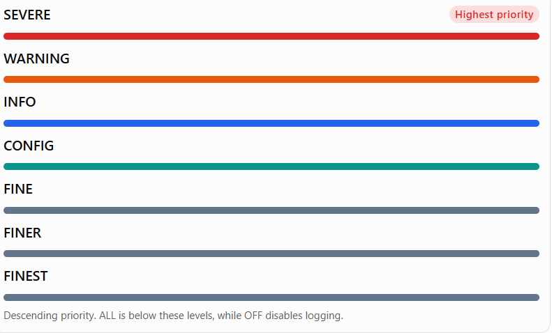

## **Lesson 7.2 – Logging: What to Log and How to Log**


## **1. What is Logging?**

Logging is the process of recording important events, activities, warnings, and errors that happen while a program is running.

In simple words:

**Logging means keeping a history of what your application is doing.**

Imagine you've created a Java TCP server, and suddenly a client reports:

"My application cannot connect to your server."

How would you investigate?

You need answers to questions such as:

- When did the client try to connect?
- Did the server accept the connection?
- Which IP address connected?
- Did an exception occur?
- Was the server running correctly?
- When did the error happen?

Logging helps us answer these questions.

### **Logging versus System.out.println()**

You might be thinking:

"Why don't we simply use `System.out.println()`?"

Let's compare them.

| System.out.println()                    | Logging                                                 |
| --------------------------------------- | ------------------------------------------------------- |
| Prints messages to the console          | Records structured log events                           |
| No built-in severity levels             | Supports different severity levels                      |
| No built-in file management             | Supports file logging                                   |
| Limited configuration                   | Configurable logging behavior                           |
| Not designed for application monitoring | Designed for application monitoring and troubleshooting |

For example:

Using `System.out.println()`:

```
System.out.println("Client connected!");
```

Using logging:

```
logger.info("Client connected!");
```

The second approach allows us to control which messages are recorded, where they are stored, and how they are formatted.

**Why do we need logging in network programming?**

1. Troubleshooting: Find out why connections fail.
2. Monitoring: Understand server activities.
3. Security: Record suspicious connection attempts.
4. Performance: Identify slow operations.
5. Maintenance: Investigate problems after they happen.

Oracle's Java Logging documentation also identifies security failures, configuration errors, performance bottlenecks, and application bugs as important logging use cases.


## **2. What should we log in a network server?**

This is an important part of today's lesson.

Not everything that happens inside a program needs to be logged.

We should record events that help us understand the behavior and health of our server.

Let's imagine we're building a chat server.

### **A. Client connection events**

Record when a client connects or disconnects.

Example:

```
INFO: Client connected from 192.168.1.10
INFO: Client disconnected: 192.168.1.10
```

Why?

To understand how many clients are connecting and when connections are terminated.

### **B. Errors and exceptions**

Record unexpected errors.

Example:

```
SEVERE: Failed to accept client connection
WARNING: Client connection terminated unexpectedly
```

Why?

To identify problems that could affect server operation.

### **C. Server startup and shutdown**

Record important server lifecycle events.

Example:

```
INFO: Server starting on port 5000
INFO: Server successfully started
INFO: Server shutting down
```

Why?

To know when the server started, stopped, or failed to start.

### **D. Performance information**

Record how long important operations take.

Example:

```
INFO: Request processed in 125 ms
```

Why?

To identify slow operations and performance bottlenecks.

### **E. Security-related events**

Record relevant security events, such as:

- Repeated failed authentication attempts.
- Invalid protocol messages.
- Unexpected connection behavior.
- Access denied events.

Why?

To investigate suspicious activity.

**Important security rule:** Never log passwords, authentication tokens, session IDs, private keys, or sensitive personal information. Avoid logging complete request bodies or message contents unless there is a carefully justified and protected requirement.

## **3. Understanding Java Logging API**

Java provides a built-in logging framework through:

```
java.util.logging
```

This is called JUL (Java Util Logging).

We don't need to install an external library to use it.

Official Java 17 documentation:

- [java.util.logging – Package Documentation](https://docs.oracle.com/en/java/javase/17/docs/api/java.logging/java/util/logging/package-summary.html?utm_source=chatgpt.com)
- [Logger Class Documentation](https://docs.oracle.com/en/java/javase/17/docs/api/java.logging/java/util/logging/Logger.html?utm_source=chatgpt.com)
- [Handler Class Documentation](https://docs.oracle.com/en/java/javase/17/docs/api/java.logging/java/util/logging/Handler.html?utm_source=chatgpt.com)

Let's understand its main components.

### **The five important logging components**

**1. Logger**

Creates logging messages

**2. LogRecord**

Contains the logging event information

**3. Handler**

Sends log records to a destination

**4. Formatter**

Converts records into readable output

**5. Destination**

Console, file, or another supported output

Let's understand each one.

**1. Logger**

A `Logger` is responsible for creating logging messages.

Example:

```
Logger logger = Logger.getLogger("MyServer");

logger.info("Server started");
```

**2. LogRecord**

A `LogRecord` represents an individual logging event.

It can contain:

- Logging level.
- Message.
- Timestamp.
- Logger name.
- Source class and method.
- Exception information.
- Thread information.

**3. Handler**

A `Handler` determines where log records are sent.

Common handlers:

| Handler          | Purpose                                             |
| ---------------- | --------------------------------------------------- |
| `ConsoleHandler` | Writes logs to the console (normally `System.err`). |
| `FileHandler`    | Writes logs to files.                               |
| `SocketHandler`  | Sends logs to a remote TCP endpoint.                |
| `MemoryHandler`  | Buffers logs in memory.                             |

**4. Formatter**

A `Formatter` controls how log records are displayed.

Two built-in formatters:

- `SimpleFormatter`: Human-readable text.
- `XMLFormatter`: XML-formatted output.

**5. Destination**

The final location where your logs are stored or displayed.

For example:

```
Console
server.log
Remote logging server
```

These components are part of Java's logging architecture.


## **4. Logging Levels in Java**

Java provides different logging levels to classify the importance of messages.

This is extremely important because a server can generate thousands of log messages.

We don't always want to record every single detail.

### **Standard logging levels**

| Level     | Purpose                   | Example                      |
| --------- | ------------------------- | ---------------------------- |
| `SEVERE`  | Serious failure           | Server cannot start          |
| `WARNING` | Potential problem         | Unexpected client disconnect |
| `INFO`    | Normal operational event  | Client connected             |
| `CONFIG`  | Configuration information | Server port configuration    |
| `FINE`    | General debugging         | Processing a request         |
| `FINER`   | Detailed debugging        | Detailed method activity     |
| `FINEST`  | Very detailed tracing     | Low-level execution details  |

There are also:

- `ALL`: Enables all logging levels.
- `OFF`: Disables logging.

### **Understanding their priority**



Descending priority. ALL is below these levels, while OFF disables logging.

### **Example: Using different logging levels**

```
import java.util.logging.*;

public class LoggingExample {

    public static void main(String[] args) {

        Logger logger = Logger.getLogger("MyServer");

        logger.severe("Server failure!");
        logger.warning("Unexpected client disconnect");
        logger.info("Server started");
        logger.config("Server port: 5000");
        logger.fine("Processing client request");
        logger.finer("Detailed request processing");
        logger.finest("Low-level debugging information");
    }
}
```

By default, the root logger commonly uses `INFO` as its level.

Therefore, you will generally see:

```
SEVERE: Server failure!
WARNING: Unexpected client disconnect
INFO: Server started
```

The lower-priority messages are filtered out under the default configuration.

You can change the logging level:

```
logger.setLevel(Level.ALL);
```

Now the logger allows all levels, subject to the handler's own filtering configuration.

**Remember:** A message must pass the logger's level and the handler's level to be published.


## **5. How to log messages into a file**

Until now, we've displayed logging messages in the console.

But imagine your server runs 24 hours a day. You cannot keep watching its console continuously.

Instead, we can store log messages in a file.

Java provides the `FileHandler` class for this purpose.

### **Example: Writing logs to server.log**

Create a file named `FileLoggingExample.java`.

```

import java.io.IOException;
import java.util.logging.*;

public class FileLoggingExample {

    public static void main(String[] args) {

        Logger logger = Logger.getLogger("MyServer");

        FileHandler fileHandler = null;

        try {

            // Create or append to a log file
            fileHandler = new FileHandler("server.log", true);

            // Format messages as readable text
            fileHandler.setFormatter(new SimpleFormatter());

            // Allow INFO and higher-priority messages
            fileHandler.setLevel(Level.INFO);

            // Configure logger
            logger.setUseParentHandlers(false);
            logger.setLevel(Level.INFO);
            logger.addHandler(fileHandler);

            logger.info("Server started");
            logger.warning("Client disconnected unexpectedly");
            logger.severe("Database connection failed");

            System.out.println("Logs written successfully!");

        } catch (IOException e) {

            System.err.println("Unable to create log file");
            e.printStackTrace();

        } finally {

            if (fileHandler != null) {
                logger.removeHandler(fileHandler);
                fileHandler.close();
            }
        }
    }
}

```

### **Explanation**

**1. Creating the logger**

```
Logger logger = Logger.getLogger("MyServer");
```

Creates a logger named `MyServer`.

**2. Creating the file handler**

```
fileHandler = new FileHandler("server.log", true);
```

This creates a file handler.

The second parameter means:

- `true`: Append new logs to the existing file.
- `false`: Replace the existing log file when opened.

**3. Setting the formatter**

```
fileHandler.setFormatter(new SimpleFormatter());
```

Makes the log records human-readable.

**4. Disabling parent handlers**

```
logger.setUseParentHandlers(false);
```

Prevents the logger from also sending messages to its parent handlers, avoiding duplicate console output in this example.

**5. Connecting the logger to the file handler**

```
logger.addHandler(fileHandler);
```

Now the logger can publish records to `server.log`.

### **Expected log file**

**server.log**

```
INFO: Server started

WARNING: Client disconnected unexpectedly

SEVERE: Database connection failed
```

Actual SimpleFormatter output also includes timestamps and other record details.

### **Advanced concept: Log file rotation**

What happens if your server runs for months and `server.log` becomes several gigabytes?

We can configure `FileHandler` to rotate log files.

For example:

```
FileHandler handler = new FileHandler(
    "server-%g.log",
    1_000_000,
    3,
    true
);
```

Parameters:

| Parameter         | Meaning                                   |
| ----------------- | ----------------------------------------- |
| `"server-%g.log"` | File naming pattern                       |
| `1_000_000`       | Approximate maximum file size in bytes    |
| `3`               | Number of rotating files                  |
| `true`            | Append to an existing file where possible |

This helps control log file growth.

## **6. Practical project: Logging in a TCP server**

Now let's combine what we've learned in this lesson with our previous lesson, 7.1.

We'll build a TCP server that:

1. Starts on port 5000.
2. Records server startup.
3. Records incoming client connections.
4. Records received message information.
5. Records exceptions.
6. Saves logs into a file.

### **LoggingServer.java**

```

import java.io.*;
import java.net.*;
import java.util.logging.*;

public class LoggingServer {

    private static final Logger logger =
        Logger.getLogger(LoggingServer.class.getName());

    public static void main(String[] args) {

        FileHandler fileHandler = null;

        try {

            // Configure file logging
            fileHandler = new FileHandler(
                "server.log", true
            );

            fileHandler.setFormatter(new SimpleFormatter());
            fileHandler.setLevel(Level.ALL);

            logger.setUseParentHandlers(false);
            logger.setLevel(Level.INFO);
            logger.addHandler(fileHandler);

            logger.info("Starting TCP server...");

            // Start server
            try (ServerSocket server = new ServerSocket(5000)) {

                logger.info("Server listening on port 5000");

                // Accept one client for this demonstration
                try (Socket client = server.accept()) {

                    String address =
                        client.getInetAddress().getHostAddress();

                    logger.info("Client connected: " + address);

                    BufferedReader input = new BufferedReader(
                        new InputStreamReader(
                            client.getInputStream()
                        )
                    );

                    PrintWriter output = new PrintWriter(
                        client.getOutputStream(), true
                    );

                    String message = input.readLine();

                    if (message != null) {

                        logger.info(
                            "Received message of "
                            + message.length() + " characters"
                        );

                        output.println("Message received!");

                    } else {

                        logger.warning(
                            "Client closed connection without a message"
                        );
                    }
                }
            }

        } catch (IOException e) {

            logger.log(
                Level.SEVERE,
                "Server encountered an I/O error",
                e
            );

        } finally {

            logger.info("Server shutting down");

            if (fileHandler != null) {
                logger.removeHandler(fileHandler);
                fileHandler.close();
            }
        }
    }
}

```

### **Client.java**

You can reuse this simple client to test the logging server.

```

import java.io.*;
import java.net.*;

public class Client {

    public static void main(String[] args) {

        try (Socket socket =
                 new Socket("localhost", 5000)) {

            PrintWriter output = new PrintWriter(
                socket.getOutputStream(), true
            );

            BufferedReader input = new BufferedReader(
                new InputStreamReader(
                    socket.getInputStream()
                )
            );

            output.println("Hello Logging Server!");

            System.out.println(input.readLine());

        } catch (IOException e) {

            e.printStackTrace();
        }
    }
}

```

### **Run the project**

First compile:

```
javac LoggingServer.java Client.java
```

Start the server:

```
java LoggingServer
```

Open another terminal:

```
java Client
```

Expected client output:

```
Message received!
```

Check your `server.log` file.

You should find entries similar to:

```
INFO: Starting TCP server...
INFO: Server listening on port 5000
INFO: Client connected: 127.0.0.1
INFO: Received message of 22 characters
INFO: Server shutting down
```

The exact timestamp and formatting will depend on your Java configuration.

**Important production note:** This is a one-client demonstration, not a complete production server. In a multithreaded server, each worker should log its own connection events and exceptions. Avoid blocking the main accept loop with client processing, and use a deliberate shutdown strategy to ensure all handlers and client sockets are closed.

## **7. Best practices – What professional developers should follow**

Let's summarize some important rules.

| Practice                           | Why it matters                             |
| ---------------------------------- | ------------------------------------------ |
| Use appropriate logging levels     | Makes logs easier to filter.               |
| Include timestamps                 | Helps reconstruct event sequences.         |
| Include client IP when appropriate | Helps investigate connections.             |
| Log exceptions with stack traces   | Helps identify the actual cause of errors. |
| Avoid sensitive information        | Protects user privacy and security.        |
| Use file rotation                  | Prevents uncontrolled file growth.         |
| Avoid excessive logging            | Reduces unnecessary overhead.              |
| Use meaningful messages            | Makes troubleshooting easier.              |
| Configure logging centrally        | Makes maintenance easier.                  |

### **One more important concept: Logging exceptions correctly**

Avoid this:

```
logger.severe("Something went wrong");
```

This tells us that an error happened, but not what caused it.

Prefer:

```
logger.log(
    Level.SEVERE,
    "Failed to accept client connection",
    exception
);
```

This attaches the exception to the log record, allowing the formatter to include its stack trace.

Also, avoid building expensive log messages unnecessarily. Java supports lazy logging:

```
logger.fine(() -> "Detailed state: " + calculateDebugInfo());
```

The supplier is evaluated only when that log level is enabled.

## **8. Lesson 7.2 – Final revision**

Let's check what you should remember from today's lesson.

| Question                                  | Answer                                         |
| ----------------------------------------- | ---------------------------------------------- |
| What is logging?                          | Recording application events.                  |
| Which package provides Java logging?      | `java.util.logging`                            |
| Which class creates log messages?         | `Logger`                                       |
| Which class represents a log event?       | `LogRecord`                                    |
| Which class sends logs to destinations?   | `Handler`                                      |
| Which class formats logs?                 | `Formatter`                                    |
| Which handler writes logs to files?       | `FileHandler`                                  |
| Which level represents serious failures?  | `SEVERE`                                       |
| Which level represents normal operations? | `INFO`                                         |
| How do we log exceptions?                 | `logger.log(Level.SEVERE, message, exception)` |
