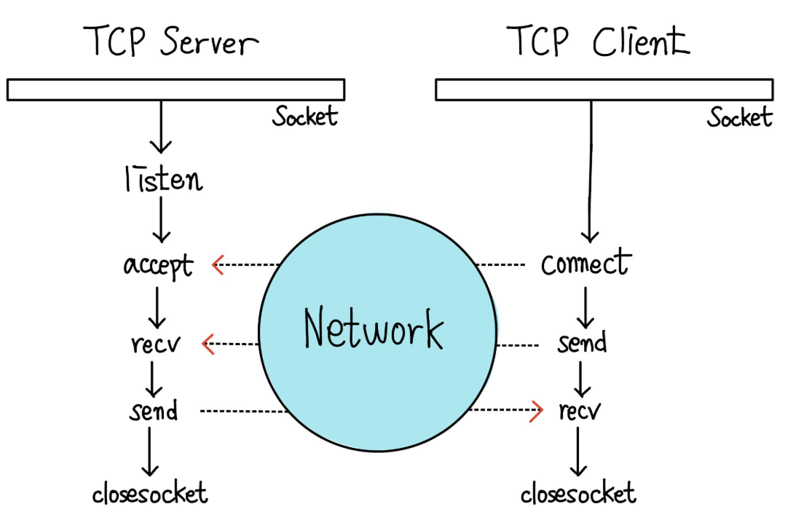
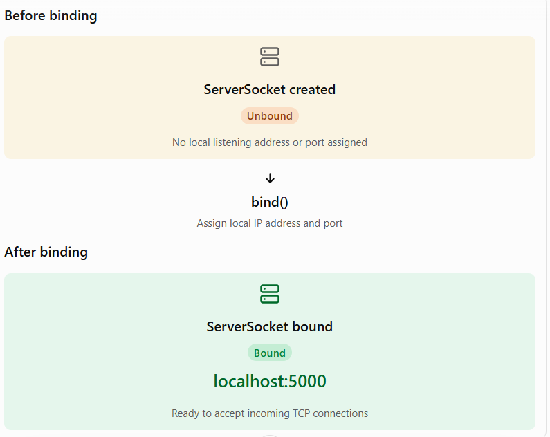

# **Lesson 7.3 – Constructing Server Sockets: Constructing Without Binding**



## **1. What does constructing a ServerSocket mean?**

Before understanding *constructing without binding*, let's revise something from Lesson 7.1.

Previously, we created a server like this:

```
ServerSocket server = new ServerSocket(5000);
```

What happens here?

Java performs two operations:

1. Creates a `ServerSocket` object.
2. Binds that socket to port `5000`.

These operations happen together in this constructor.

But what if we want to create the server socket first and decide its port or IP address later?

That's where **constructing without binding** becomes useful.

## **2. What is binding in networking?**

Before going further, let's understand the word **binding**.

Binding means associating a server socket with a local network address and port number.

For example:

```
server.bind(
    new InetSocketAddress("localhost", 5000)
);
```

This tells the operating system:

"Associate this server socket with the local loopback address and port 5000."

Let's break it down.



**Important distinction:**

Creating a server socket does not necessarily mean that it is ready to accept connections.

It must be bound first.

## **3. Constructing a ServerSocket without binding**

Java provides a special constructor for this:

```
ServerSocket server = new ServerSocket();
```

This creates an unbound server socket.

According to the official Java 17 documentation, the no-argument constructor creates a server socket without binding it to a local address.


Let's compare the two approaches.

| Bound during construction                   | Constructed without binding   |
| ------------------------------------------- | ----------------------------- |
| `new ServerSocket(5000)`                    | `new ServerSocket()`          |
| Immediately binds to port 5000              | Does not bind yet             |
| Address and port chosen during construction | Address and port chosen later |
| Less flexible                               | More flexible                 |

### **Understanding the socket state**

Consider this example:

```
import java.net.*;

public class ServerState {

    public static void main(String[] args) throws Exception {

        ServerSocket server = new ServerSocket();

        System.out.println("Bound: " + server.isBound());

        System.out.println("Port: " + server.getLocalPort());

        server.close();
    }
}
```

Expected output:

```
Bound: false
Port: -1
```

Why?

- `isBound()` returns `false` because the socket has not been bound.
- `getLocalPort()` returns `-1` because no local listening port has been assigned.

This is useful when you want to create a socket first and configure it before deciding where it should listen.

## **4. Binding the ServerSocket later**

After constructing an unbound socket, we can bind it using the `bind()` method.

The method accepts a `SocketAddress`.

We commonly use:

```
InetSocketAddress
```

An `InetSocketAddress` represents an IP address and port combination.

### **Syntax**

```
server.bind(new InetSocketAddress("localhost", 5000));
```

Or, if you want to specify the backlog:

```
server.bind(
    new InetSocketAddress("localhost", 5000),
    50
);
```

Here:

- `localhost` identifies the local loopback interface.
- `5000` is the port.
- `50` is the requested backlog.

The `bind()` method can also throw an `IOException`, for example, when the port cannot be bound or the socket is already bound.


### **Complete example**

Let's construct an unbound server socket and bind it later.

Practical example 1

**UnboundServer.java**

```

import java.io.*;
import java.net.*;

public class UnboundServer {

    public static void main(String[] args) {

        try (ServerSocket server = new ServerSocket()) {

            // Step 1: Check initial state
            System.out.println(
                "Before binding: " + server.isBound()
            );

            // Step 2: Bind the socket
            server.bind(
                new InetSocketAddress("localhost", 5003)
            );

            // Step 3: Check new state
            System.out.println(
                "After binding: " + server.isBound()
            );

            System.out.println(
                "Listening port: " + server.getLocalPort()
            );

            System.out.println("Waiting for client...");

            // Step 4: Accept client
            try (Socket client = server.accept()) {

                System.out.println("Client connected!");

                PrintWriter output = new PrintWriter(
                    client.getOutputStream(), true
                );

                output.println("Welcome to the Java server!");

            }

        } catch (IOException e) {

            e.printStackTrace();
        }
    }
}

```

### **Client program**

**Client.java**

```

import java.io.*;
import java.net.*;

public class Client {

    public static void main(String[] args) {

        try (Socket socket =
                 new Socket("localhost", 5003)) {

            BufferedReader input = new BufferedReader(
                new InputStreamReader(
                    socket.getInputStream()
                )
            );

            System.out.println(input.readLine());

        } catch (IOException e) {

            e.printStackTrace();
        }
    }
}

```

### **Execute the program**

Compile:

```
javac UnboundServer.java Client.java
```

Start the server first:

```
java UnboundServer
```

Then start the client in another terminal:

```
java Client
```

Expected server output:

```
Before binding: false
After binding: true
Listening port: 5003
Waiting for client...
Client connected!
```

Expected client output:

```
Welcome to the Java server!
```

### **Understand the execution flow**

**Step 1: Create ServerSocket**

`new ServerSocket()`

Unbound

**Step 2: Bind the socket**

`server.bind(address)`

Bound

**Step 3: Accept connection**

`server.accept()`

**Step 4: Communicate**

`Socket` handles client communication.

## **5. Why construct a ServerSocket without binding?**

You might be wondering:

"If we eventually need to bind the server socket, why not bind it immediately?"

Excellent question!

There are several situations where constructing without binding is useful.

### **A. Configure socket options before binding**

Some socket options are best configured before binding.

For example, `SO_REUSEADDR`.

```
ServerSocket server = new ServerSocket();

server.setReuseAddress(true);

server.bind(
    new InetSocketAddress(5000)
);
```

Why?

`SO_REUSEADDR` can allow a server to bind to an address even when a previous connection involving that address is still in the TCP `TIME_WAIT` state, subject to operating-system behavior.

Java's documentation specifically recommends enabling this option before binding. We'll study it in detail in Lesson 7.5.


### **B. Choose a specific network interface**

Imagine your computer has multiple network interfaces:

- Wi-Fi.
- Ethernet.
- Loopback.

You may want your server to accept connections only through one particular interface.

For example:

```
ServerSocket server = new ServerSocket();

InetAddress address =
    InetAddress.getByName("127.0.0.1");

server.bind(
    new InetSocketAddress(address, 5000)
);
```

This binds the server to the loopback interface.

Local connections only

Other computers cannot connect to this server through your computer's external network interfaces.

### **C. Let the operating system select a port**

Sometimes you don't want to choose a fixed port.

You can ask the operating system to select an available ephemeral port.

```
ServerSocket server = new ServerSocket();

server.bind(null);

System.out.println(server.getLocalPort());

server.close();
```

Here, `bind(null)` asks Java to select a suitable local address and an automatically assigned port.

Another way to do this is:

```
ServerSocket server = new ServerSocket(0);
```

Both approaches request automatic port assignment, but they use different construction and binding sequences.

**Important difference:**

| Code                  | Result                                                                         |
| --------------------- | ------------------------------------------------------------------------------ |
| `new ServerSocket()`  | Creates an unbound socket                                                      |
| `new ServerSocket(0)` | Immediately binds to an automatically assigned port                            |
| `server.bind(null)`   | Binds an existing unbound socket to an automatically assigned address and port |

You can retrieve the assigned port using:

```
server.getLocalPort();
```

The operating system typically selects the port from its ephemeral port range.


## **6. Important methods related to binding**

Let's revise the important methods.

| Method                     | Purpose                                  |
| -------------------------- | ---------------------------------------- |
| `bind(SocketAddress)`      | Binds the server to a local address      |
| `bind(SocketAddress, int)` | Binds with a requested backlog           |
| `isBound()`                | Checks whether the socket has been bound |
| `getLocalPort()`           | Gets the assigned local port             |
| `getInetAddress()`         | Gets the bound local address             |
| `getLocalSocketAddress()`  | Gets the complete local endpoint         |
| `isClosed()`               | Checks whether the socket is closed      |
| `close()`                  | Closes the server socket                 |

### **What happens if you call accept() before binding?**

Consider:

```
ServerSocket server = new ServerSocket();

server.accept();
```

This is incorrect.

Why?

The server socket has not been assigned a local listening address and port.

Calling `accept()` on an unbound `ServerSocket` results in an `IOException` (typically a `SocketException`).

Correct approach:

```
ServerSocket server = new ServerSocket();

server.bind(
    new InetSocketAddress(5000)
);

Socket client = server.accept();
```

Always bind before accepting connections.

## **7. Understanding the different binding addresses**

There is another important distinction worth learning.

When binding a server socket, you can choose which local interface should receive connections.

**Option 1 – Loopback address**

```
server.bind(
    new InetSocketAddress("127.0.0.1", 5000)
);
```

Local machine only

Useful for local testing and services that should not be exposed to other machines.

**Option 2 – Wildcard address**

```
server.bind(
    new InetSocketAddress(5000)
);
```

All suitable local interfaces

Listens on a wildcard address, allowing connections through suitable local network interfaces, subject to firewall and network configuration.

**Option 3 – Specific network interface**

```
InetAddress ip =
    InetAddress.getByName("192.168.1.10");

server.bind(
    new InetSocketAddress(ip, 5000)
);
```

Specific interface

Listens only on the specified local address, if that address is assigned to the machine.

For example, if your computer has:

- Wi-Fi: `192.168.1.10`
- Ethernet: `192.168.1.20`
- Loopback: `127.0.0.1`

You can choose which interface should accept incoming connections.

This is particularly useful when building servers that should be accessible only from a particular network.

## **8. Common mistakes to avoid**

| Mistake                                                  | Correct approach                                       |
| -------------------------------------------------------- | ------------------------------------------------------ |
| Calling `accept()` before binding                        | Bind first                                             |
| Binding the same socket twice                            | Bind only once                                         |
| Binding to a port already occupied                       | Choose another available port                          |
| Assuming `new ServerSocket()` starts listening           | It creates an unbound socket                           |
| Assuming `new ServerSocket(0)` creates an unbound socket | It binds immediately to an automatically assigned port |
| Forgetting to close the socket                           | Use try-with-resources                                 |

**A useful technical detail:** Once a `ServerSocket` has been bound, you cannot change its binding to another port. Close it and create a new socket if you need another binding.

## **9. Lesson 7.3 – Quick revision**

Let's summarize the most important points.

1. Binding means associating a server socket with a local IP address and port.
2. `new ServerSocket()` creates an unbound server socket.
3. `bind()` binds the socket to a local address.
4. `InetSocketAddress` represents an IP address and port.
5. `isBound()` checks the binding state.
6. `getLocalPort()` returns the assigned port.
7. `bind(null)` requests an automatically selected local address and port.
8. Configure relevant socket options before binding.
9. `accept()` requires a bound server socket.
10. A bound socket cannot be rebound to a different address.
