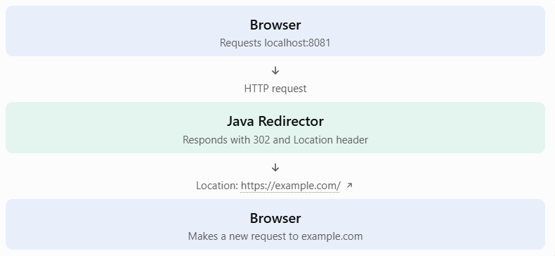

# Lesson 7.6: HTTP Servers
In this lesson, we'll learn how a Java server receives HTTP requests, sends HTTP responses, serves files, redirects browsers, and handles multiple clients.

We'll use **Java 17+** and build practical examples that you can run in IntelliJ IDEA.

## 1. What is an HTTP server?
An **HTTP server** is a program that listens for HTTP requests from clients (such as browsers, React applications, or Postman) and sends back HTTP responses.

For example, when you open:
```
http://localhost:8080/index.html
```

The communication is roughly:
HTTP Client
```
Browser / React / Postman

HTTP Request
GET /index.html

Java HTTP Server

Receives and processes the request

HTTP Response
200 OK + HTML content

HTTP Client

Displays the received page
```

#### Why do we need an HTTP server?

TCP sockets provide a communication channel, but they do not automatically understand HTTP. An HTTP server must interpret the HTTP request format, decide what resource or operation is requested, and construct a valid HTTP response.

For example:
- A browser requests an HTML file.
- A React application requests JSON from a backend.
- Postman sends a POST request containing data.
- A server redirects a browser to another URL.

## 2. Understanding an HTTP request and response
HTTP is an application-layer, request/response protocol. An HTTP message contains control information, headers, and sometimes a body. 

**Example HTTP request**
```
GET /index.html HTTP/1.1
Host: localhost:8080
Accept: text/html
```

Meaning:
|Part	|Meaning|
|-------|-------|
|`GET`	|Request method|
|`/index.html`|	Requested resource|
|`HTTP/1.1`|	HTTP version|
|`Host`	|Target host and port|
|`Accept`	|Content types the client can accept|

**Example HTTP response**
```
HTTP/1.1 200 OK
Content-Type: text/html; charset=UTF-8
Content-Length: 44

<h1>Welcome to Java HTTP Server</h1>
```

The response contains:
- **Status line:** HTTP version and result.
- **Headers:** Information about the response.
- **Blank line:** Separates headers from the body.
- **Body:** The requested content, when applicable.

**Common HTTP status codes**
|Code	|Meaning	|Example|
|-------|-----------|-------|
|`200`	|OK	|Request succeeded|
|`301`	|Moved Permanently	|Permanent redirect|
|`302`	|Found	|Temporary redirect|
|`400`	|Bad Request	|Invalid request|
|`404`	|Not Found	|Resource doesn't exist|
|`500`	|Internal Server Error	|Server-side failure|

HTTP status codes are grouped into five classes: 1xx informational, 2xx success, 3xx redirection, 4xx client errors, and 5xx server errors. 


## 3. Three types of HTTP servers
Our lesson covers three implementations.

### A. Single-file server
Reads a requested file from a directory and sends it to the client. For example, serving `index.html`.

### B. Redirector
Sends a redirect response with a `Location` header so the client can request another URL.

### C. Full-fledged HTTP server

Handles multiple paths, HTTP methods, errors, concurrent clients, and application logic.

## 4. A. Building a single-file HTTP server
A single-file server returns a file requested by the client. We will create a small server that serves files from a folder called `www`.

**Project structure**
```
SingleFileServer/
├── src/
│   └── SingleFileServer.java
└── www/
    └── index.html
```

Create `www/index.html`:
```
<!DOCTYPE html>
<html>
<head>
    <title>Java HTTP Server</title>
</head>
<body>
    <h1>Hello from my Java HTTP Server!</h1>
    <p>This page is being served using ServerSocket.</p>
</body>
</html>
```

**Java code** – `SingleFileServer.java`
This example uses `ServerSocket` directly, so you can see how HTTP is carried over TCP.
```
import java.io.*;
import java.net.*;
import java.nio.charset.StandardCharsets;
import java.nio.file.*;

public class SingleFileServer {

    private static final int PORT = 8080;
    private static final Path ROOT =
            Paths.get("www").toAbsolutePath().normalize();

    public static void main(String[] args) throws IOException {

        Files.createDirectories(ROOT);

        try (ServerSocket server = new ServerSocket(PORT)) {

            System.out.println("HTTP server running at:");
            System.out.println("http://localhost:" + PORT);

            while (true) {
                try (Socket client = server.accept()) {
                    handleRequest(client);
                } catch (IOException e) {
                    System.out.println("Request error: " + e.getMessage());
                }
            }
        }
    }

    private static void handleRequest(Socket client)
            throws IOException {

        BufferedReader reader = new BufferedReader(
                new InputStreamReader(
                        client.getInputStream(),
                        StandardCharsets.ISO_8859_1
                )
        );

        OutputStream output = client.getOutputStream();

        // Read the HTTP request line
        String requestLine = reader.readLine();

        if (requestLine == null || requestLine.isBlank()) {
            return;
        }

        System.out.println("Request: " + requestLine);

        String[] parts = requestLine.split(" ");

        if (parts.length != 3) {
            sendResponse(output, 400, "Bad Request",
                    "Invalid HTTP request".getBytes(
                            StandardCharsets.UTF_8),
                    "text/plain; charset=UTF-8");
            return;
        }

        String method = parts[0];
        String target = parts[1];

        // Read and discard request headers
        String header;
        while ((header = reader.readLine()) != null
                && !header.isEmpty()) {
            // Headers are not needed for this simple example
        }

        if (!method.equals("GET")) {
            sendResponse(output, 405, "Method Not Allowed",
                    "Only GET is supported".getBytes(
                            StandardCharsets.UTF_8),
                    "text/plain; charset=UTF-8");
            return;
        }

        try {
            String path = URI.create(target).getPath();

            if (path == null || path.equals("/")) {
                path = "/index.html";
            }

            // Resolve requested path safely inside ROOT
            Path file = ROOT.resolve(
                    path.substring(1)
            ).normalize();

            if (!file.startsWith(ROOT)) {
                sendResponse(output, 403, "Forbidden",
                        "Access denied".getBytes(
                                StandardCharsets.UTF_8),
                        "text/plain; charset=UTF-8");
                return;
            }

            if (!Files.isRegularFile(file)) {
                sendResponse(output, 404, "Not Found",
                        "File not found".getBytes(
                                StandardCharsets.UTF_8),
                        "text/plain; charset=UTF-8");
                return;
            }

            byte[] body = Files.readAllBytes(file);

            String contentType = Files.probeContentType(file);
            if (contentType == null) {
                contentType = "application/octet-stream";
            }

            sendResponse(output, 200, "OK",
                    body, contentType);

        } catch (IllegalArgumentException e) {
            sendResponse(output, 400, "Bad Request",
                    "Invalid request target".getBytes(
                            StandardCharsets.UTF_8),
                    "text/plain; charset=UTF-8");
        }
    }

    private static void sendResponse(
            OutputStream output,
            int status,
            String reason,
            byte[] body,
            String contentType
    ) throws IOException {

        String headers =
                "HTTP/1.1 " + status + " " + reason + "\r\n" +
                "Content-Type: " + contentType + "\r\n" +
                "Content-Length: " + body.length + "\r\n" +
                "Connection: close\r\n" +
                "\r\n";

        output.write(headers.getBytes(
                StandardCharsets.ISO_8859_1));

        output.write(body);
        output.flush();
    }
}
```

**How does this code work?**

1. `ServerSocket` listens on port `8080`.
2. `accept()` waits for an incoming TCP connection.
3. `BufferedReader` reads the HTTP request line and headers.
4. The server checks whether the method is `GET`.
5. It finds the requested file inside the `www `directory.
6. It sends an HTTP response containing a status code, headers, and file bytes.
7. The client connection closes after the response.

**Important:** This is an educational, sequential `HTTP/1.1` example. It handles one request per connection, supports only `GET`, and does not implement all HTTP requirements. It is not intended for production use.

**Test it**

1. Run `SingleFileServer`.
2. Open your browser.
3. Visit `http://localhost:8080/`.
4. You should see the HTML page.
You can also test a missing file:
```
http://localhost:8080/missing.html
```

Expected status: `404 Not Found`.

## 5. B. Building an HTTP redirector
A **redirector** does not serve the requested page itself. Instead, it tells the client to visit another URL.

For example:
```
http://localhost:8081/
```

Redirects the browser to:
```
https://example.com/
```

### How does redirection work?



**Java code** – `Redirector.java`

```
import java.io.*;
import java.net.*;
import java.nio.charset.StandardCharsets;

public class Redirector {

    public static void main(String[] args) throws IOException {

        int port = 8081;

        try (ServerSocket server = new ServerSocket(port)) {

            System.out.println(
                    "Redirector running at http://localhost:" + port
            );

            while (true) {
                try (Socket client = server.accept()) {

                    BufferedReader reader = new BufferedReader(
                            new InputStreamReader(
                                    client.getInputStream(),
                                    StandardCharsets.ISO_8859_1
                            )
                    );

                    // Read request line
                    String requestLine = reader.readLine();
                    System.out.println("Request: " + requestLine);

                    // Consume request headers
                    String line;
                    while ((line = reader.readLine()) != null
                            && !line.isEmpty()) {
                        // No additional processing required
                    }

                    String response =
                            "HTTP/1.1 302 Found\r\n" +
                            "Location: https://example.com/\r\n" +
                            "Content-Length: 0\r\n" +
                            "Connection: close\r\n" +
                            "\r\n";

                    OutputStream output = client.getOutputStream();

                    output.write(response.getBytes(
                            StandardCharsets.ISO_8859_1));

                    output.flush();
                }
            }
        }
    }
}
```


**Important:** `302` versus `301`

|Status	|Meaning|
|-------|-------|
|`301 Moved Permanently`|	The resource has moved permanently.|
|`302 Found`|	Temporary redirection.|

The `Location` response header tells the client where to go next. 


**Test it:** Run `Redirector.java` and open `http://localhost:8081/`. Your browser should navigate to `https://example.com/`.

This simple redirector always redirects and is intended for learning; a real redirector should validate the request and use a controlled destination.

## 6. C. Building a more complete HTTP server
So far, we used `ServerSocket` directly. That means we had to manually:
- Read HTTP request lines.
- Read headers.
- Construct response headers.
- Set status codes.
- Send response bodies.

Java also provides a higher-level API called `HttpServer` in the `com.sun.net.httpserver` package. It is part of the JDK's jdk.httpserver module and is designed for simple embedded HTTP servers. 


**Important classes**
|Class	|Purpose|
|-------|-------|
|`HttpServer`|	Creates and starts the HTTP server|
|`HttpHandler`|	Processes an incoming request|
|`HttpExchange`|	Provides access to request and response information|
|`HttpContext`|	Maps a URL path to a handler|
|`Executor`|	Controls how request-handling tasks are executed|

The server can register different handlers for different URL paths. It can also use an executor to process requests concurrently. 


**Project structure**
```
FullHttpServer/
└── FullHttpServer.java
```

**Complete Java code** – `FullHttpServer.java`

```
import com.sun.net.httpserver.HttpExchange;
import com.sun.net.httpserver.HttpServer;

import java.io.IOException;
import java.io.OutputStream;
import java.net.InetSocketAddress;
import java.nio.charset.StandardCharsets;
import java.time.LocalDateTime;
import java.util.concurrent.Executors;

public class FullHttpServer {

    public static void main(String[] args) throws IOException {

        // Create an HTTP server on port 8082
        HttpServer server = HttpServer.create(
                new InetSocketAddress("127.0.0.1", 8082),
                0
        );

        // Route 1: Home page
        server.createContext("/", exchange -> {

            String path = exchange.getRequestURI().getPath();

            if (!path.equals("/")) {
                sendText(exchange, 404,
                        "Page not found");
                return;
            }

            if (!exchange.getRequestMethod().equals("GET")) {
                exchange.getResponseHeaders()
                        .set("Allow", "GET");

                sendText(exchange, 405,
                        "Method not allowed");
                return;
            }

            String html = """
                    <!DOCTYPE html>
                    <html>
                    <head>
                        <title>Java HTTP Server</title>
                    </head>
                    <body>
                        <h1>Welcome!</h1>
                        <p>My Java HTTP server is working.</p>
                        <a href="/api/hello">Hello API</a>
                    </body>
                    </html>
                    """;

            exchange.getResponseHeaders().set(
                    "Content-Type",
                    "text/html; charset=UTF-8"
            );

            sendText(exchange, 200, html);
        });

        // Route 2: JSON API
        server.createContext("/api/hello", exchange -> {

            if (!exchange.getRequestMethod().equals("GET")) {
                exchange.getResponseHeaders()
                        .set("Allow", "GET");

                sendText(exchange, 405,
                        "Method not allowed");
                return;
            }

            String json = """
                    {
                        "message": "Hello from Java HTTP Server",
                        "language": "Java",
                        "status": "success"
                    }
                    """;

            exchange.getResponseHeaders().set(
                    "Content-Type",
                    "application/json; charset=UTF-8"
            );

            sendText(exchange, 200, json);
        });

        // Route 3: Current server time
        server.createContext("/api/time", exchange -> {

            if (!exchange.getRequestMethod().equals("GET")) {
                exchange.getResponseHeaders()
                        .set("Allow", "GET");

                sendText(exchange, 405,
                        "Method not allowed");
                return;
            }

            String time = LocalDateTime.now().toString();

            String json = "{\"serverTime\":\"" + time + "\"}";

            exchange.getResponseHeaders().set(
                    "Content-Type",
                    "application/json; charset=UTF-8"
            );

            sendText(exchange, 200, json);
        });

        // Handle requests using a pool of worker threads
        server.setExecutor(Executors.newFixedThreadPool(10));

        // Start the server
        server.start();

        System.out.println(
                "Server running at http://localhost:8082"
        );
        System.out.println("Try /api/hello and /api/time");
    }

    private static void sendText(
            HttpExchange exchange,
            int statusCode,
            String response
    ) throws IOException {

        byte[] bytes = response.getBytes(StandardCharsets.UTF_8);

        exchange.sendResponseHeaders(statusCode, bytes.length);

        try (OutputStream output = exchange.getResponseBody()) {
            output.write(bytes);
        }
    }
}
```

### How does this server work?
#### Step 1 – Create the server
```
HttpServer server = HttpServer.create(
    new InetSocketAddress("127.0.0.1", 8082), 0
);
```

This binds the server to localhost on port `8082`.

#### Step 2 – Register URL paths
```
server.createContext("/api/hello", exchange -> {
    // Process request
});

```
When a request matches `/api/hello`, its handler executes.

#### Step 3 – Read the request
```
exchange.getRequestMethod();
exchange.getRequestURI();
```

These methods let you inspect the HTTP method and requested URI.

#### Step 4 – Send the response
```
exchange.sendResponseHeaders(200, bytes.length);
```

This sends the status code and response length. Then we write the response body.

#### Step 5 – Configure worker threads
```
server.setExecutor(Executors.newFixedThreadPool(10));
```

This provides a pool of worker threads for handling requests. The executor must be configured before `start()`. 

#### Step 6 – Start the server
```
server.start();
```

The server begins accepting and processing HTTP requests.

**Run and test in IntelliJ IDEA**
1. Create `FullHttpServer.java`.
2. Paste the complete code.
3. Run the `main()` method.
4. Open your browser or Postman.

Try these URLs:
|URL	|Expected result|
|-------|---------------|
|`http://localhost:8082/`	|HTML welcome page|
|`http://localhost:8082/api/hello`	|JSON greeting|
|`http://localhost:8082/api/time`	|JSON server time|
|`http://localhost:8082/unknown`	|404 Not Found|

For Postman, use the `GET` method to test the three successful endpoints.

If your project uses an explicit Java module declaration and the package is not visible, add this to `module-info.java`:
```
module FullHttpServer {
    requires jdk.httpserver;
}
```

#### Is this a production-ready server?
Not by itself. This is a useful learning and embedded-server API, but production applications need additional concerns such as TLS configuration, authentication, authorization, request validation, logging, resource limits, and robust error handling. The JDK also provides `HttpsServer` for HTTPS support. 

## 7. Comparing the three server types
|Feature|	Single-file server|	Redirector|	More complete HTTP server|
|-------|---------------------|---------|--------|
|Main purpose|	Serve files|	Redirect clients|	Handle application requests|
|Main response|	File content|	301/302 + Location|	HTML, JSON, errors, etc.|
|Multiple routes|	Limited|	Usually no|	Yes|
|Concurrent handling|	Not in our example|	Not in our example|	Configured with executor|
|Java implementation|	   `ServerSocket`|	`ServerSocket`|	`HttpServer`|

**Remember this distinction:** `ServerSocket` provides the TCP connection. Your program must implement HTTP itself. `HttpServer` provides a higher-level API that handles much of the HTTP server infrastructure for you.

## 8. Important concepts to remember
1. HTTP is a request/response protocol.
2. `ServerSocket` handles TCP connections, not HTTP automatically.
3. An HTTP response contains a status code, headers, and possibly a body.
4. A single-file server serves requested resources.
5. A redirector uses the `Location` header to direct clients elsewhere.
6. `HttpServer` provides a higher-level Java API for handling HTTP requests.
7. `HttpHandler` processes requests, and `HttpExchange `provides request/response access.
8. An executor can handle multiple requests using worker threads.

