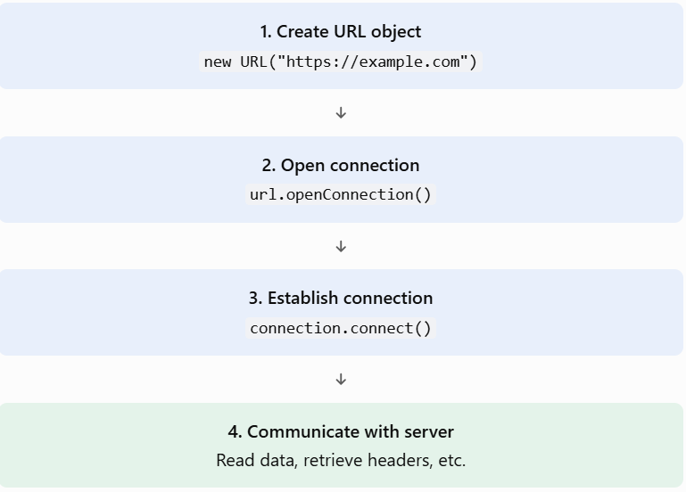

# Unit 5 — URL Connections

## Topic 5.1: Opening URL Connections

Our goal in this topic is to understand how Java establishes a connection with a resource available on a remote server using the `URLConnection` class.

We'll go step by step.

## 1. TEACH — What is URLConnection?

`URLConnection` is an abstract class provided by Java's `java.net` package.

It represents a communication link between a Java application and a resource identified by a URL.

It allows us to:

- Establish a connection with a remote resource.
- Read data from a server.
- Send data to a server.
- Retrieve HTTP header information.
- Configure connection properties.
- Control caching and timeouts.

Example scenario:

Suppose you want to retrieve a webpage from:

`https://example.com`

Your Java application needs to establish communication with the server before retrieving the webpage.

This is where `URLConnection` comes into play.

## 2. WHY — Why do we need URLConnection?

You might remember that in Unit 3, we studied the `URL` class.

You may wonder:

If we already have the URL class, why do we need URLConnection?

The difference is important.

| URL                                       | URLConnection                                           |
| ----------------------------------------- | ------------------------------------------------------- |
| Represents a resource's address.          | Represents a communication connection to that resource. |
| Identifies where the resource is located. | Provides methods to communicate with the resource.      |
| Can open a connection.                    | Can read and send data.                                 |
| Uses `openConnection()`.                  | Provides configuration and communication methods.       |

Think of it this way:

- `URL` = Address of a house.
- `URLConnection` = Communication channel established with that house.


## 3. CODE — Opening a URL Connection

Let's understand the two important methods.

A. `URL.openConnection()`

Syntax:

```
URLConnection openConnection() throws IOException
```

It creates and returns a `URLConnection` object representing a connection to the resource identified by the URL.

Important: Calling `openConnection()` does not necessarily establish the actual network connection immediately. It prepares the connection object.

B. `URLConnection.connect()`

Syntax:

```
void connect() throws IOException
```

It establishes the actual communication link with the resource.

The connection is normally established automatically when an operation requiring it is performed, such as reading the input stream.

### Complete runnable Java example

Create a file named `OpenURLConnection.java`.

```
import java.net.URL;
import java.net.URLConnection;
import java.io.IOException;

public class OpenURLConnection {

    public static void main(String[] args) {

        try {
            // Step 1: Create URL object
            URL url = new URL("https://example.com");

            // Step 2: Open connection
            URLConnection connection = url.openConnection();

            System.out.println("Connection object created.");

            // Step 3: Establish actual connection
            connection.connect();

            System.out.println("Connection established!");

            // Step 4: Display content type
            System.out.println(
                "Content Type: " + connection.getContentType()
            );

            // Step 5: Display content length
            System.out.println(
                "Content Length: " + connection.getContentLength()
            );

        } catch (IOException e) {
            System.out.println("Error: " + e.getMessage());
        }
    }
}
```

Expected output (illustrative)

```
Connection object created.
Connection established!
Content Type: text/html
Content Length: ...
```

The content length can vary depending on the server response.

### 4. Understanding the execution flow

Let's break down what happens internally.



Important points to remember:

1. `URLConnection` is an abstract class.
2. `URL.openConnection()` returns a `URLConnection` object.
3. `connect()` establishes the connection.
4. A connection can also be established implicitly when an operation requires it.
5. Once connected, certain configuration properties can no longer be changed.


## 5. REVISION — Exam notes

- URLConnection: Abstract class used for communication with resources identified by URLs.
- openConnection(): Creates and returns a URLConnection object.
- connect(): Establishes the actual connection.
- URL: Represents the resource address.
- URLConnection: Provides communication and configuration capabilities.

