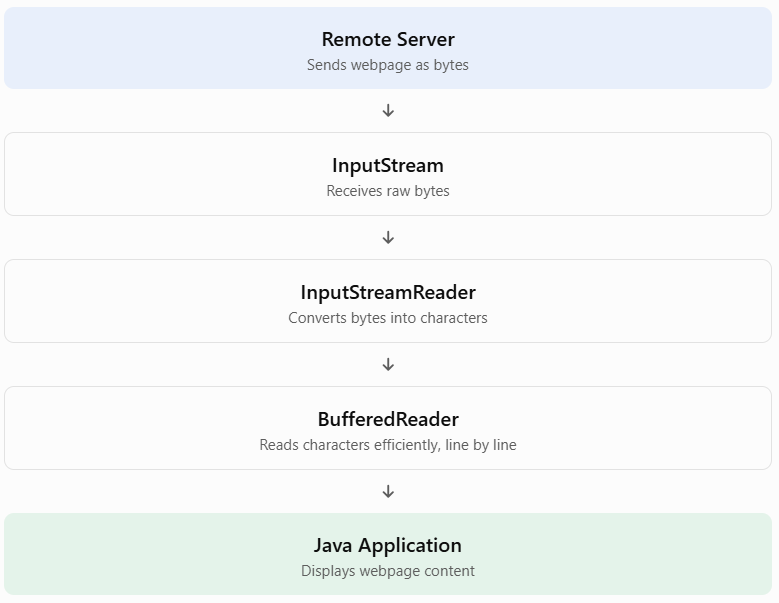

## Topic 5.2: Reading Data from Server

### 1. TEACH — Understanding the concept

When a Java application connects to a web server, the server may return different types of data, such as:

- HTML documents
- Plain text
- JSON responses
- Images
- PDF documents

How do we read this information using Java?

We use the `getInputStream()` method provided by the `URLConnection` class.

What is `getInputStream()`?

It returns an `InputStream` that allows our Java application to read data sent by the remote server.

Syntax:

```
public InputStream getInputStream() throws IOException
```

Return type: `InputStream`

Package: `java.io`

Class providing the method: `URLConnection`

### 2. WHY — Why do we need InputStream?

Imagine that you request a webpage from `https://example.com`.

The server sends the webpage's contents back to your Java application.

But how does Java receive those contents?

The answer is through a stream.

A stream represents a continuous flow of data from one location to another.

In our example:

- Source: Remote web server.
- Destination: Java application.
- Direction: Server → Java application.
- Mechanism: InputStream.

[Streams work on a concept called a buffer. | by Dennis Ozoemena | Medium](https://images.openai.com/static-rsc-4/9rGHXOHzviCFDKCbpoQ6PNEd0k6watf9thkfXByNSEFKR4oH_suXX1DvUfTNKoz7AJihY4uSX318AWx4QaadDJqxYKOjfxdoyRZHHG_OU5q9Wro2PdwVFIaF8PsjTdxS1LxmaOUap552czUzLfypLNANIGnaB7p8oYaW_40J6TQ?purpose=inline)

[denny11.medium.com](https://denny11.medium.com/streams-work-on-a-concept-called-a-buffer-ea9c29b03aaf?utm_source=chatgpt.com)

Important distinction:

| Method             | Purpose                                 |
| ------------------ | --------------------------------------- |
| `openConnection()` | Creates a connection object.            |
| `connect()`        | Establishes the connection.             |
| `getInputStream()` | Retrieves a stream to read server data. |

Remember: `getInputStream()` can establish the connection automatically if it has not already been established.

### 3. CODE — Reading data from a server

Let's build a complete Java program.

We'll retrieve a webpage and print its contents to the console.

File: `ReadServerData.java`

```
import java.net.URL;
import java.net.URLConnection;
import java.io.InputStream;
import java.io.BufferedReader;
import java.io.InputStreamReader;
import java.io.IOException;

public class ReadServerData {

    public static void main(String[] args) {

        try {

            // Step 1: Create URL object
            URL url = new URL("https://example.com");

            // Step 2: Open connection
            URLConnection connection = url.openConnection();

            // Step 3: Obtain InputStream
            InputStream input = connection.getInputStream();

            // Step 4: Convert byte stream into character stream
            InputStreamReader reader =
                    new InputStreamReader(input);

            // Step 5: Read efficiently using BufferedReader
            BufferedReader br =
                    new BufferedReader(reader);

            // Step 6: Read server response line by line
            String line;

            while ((line = br.readLine()) != null) {
                System.out.println(line);
            }

            // Step 7: Close resources
            br.close();

        } catch (IOException e) {

            System.out.println("Error: " + e.getMessage());

        }
    }
}
```

### 4. Understanding the code step by step

Let's understand the three important classes used in this program.

A. InputStream

```
InputStream input = connection.getInputStream();
```

- Receives raw bytes from the server.
- Used for reading binary data.
- It is an abstract class.

For example, images and PDF files are also read as bytes.

B. InputStreamReader

```
InputStreamReader reader = new InputStreamReader(input);
```

- Converts bytes into characters.
- Acts as a bridge between byte streams and character streams.
- Useful when reading text such as HTML or plain text.

C. BufferedReader

```
BufferedReader br = new BufferedReader(reader);
```

- Reads text efficiently using an internal buffer.
- Provides the convenient `readLine()` method.
- Reduces repeated low-level reading operations.

How do these three classes work together?



### 5. An important alternative: try-with-resources

In our previous example, we manually closed the `BufferedReader`.

Java provides a better approach called try-with-resources.

Example:

```
try (
    InputStream input = connection.getInputStream();
    BufferedReader br = new BufferedReader(
        new InputStreamReader(input)
    )
) {
    String line;

    while ((line = br.readLine()) != null) {
        System.out.println(line);
    }

} catch (IOException e) {
    System.out.println(e.getMessage());
}
```

Java automatically closes resources when the try block finishes.

This is generally the recommended approach.

## 6. Important: Reading binary data

What if the server sends an image instead of HTML?

Can we use `BufferedReader`?

No! `BufferedReader` is designed for character data, not arbitrary binary data.

For binary data, read directly from `InputStream`.

For example:

```
InputStream input = connection.getInputStream();

int data;

while ((data = input.read()) != -1) {
    System.out.print(data + " ");
}

input.close();
```

Here:

- `read()` reads one byte.
- `-1` indicates the end of the stream.
- The returned integer represents a byte value from 0 to 255, or -1 at EOF.

For real applications, use a byte buffer rather than reading one byte at a time.