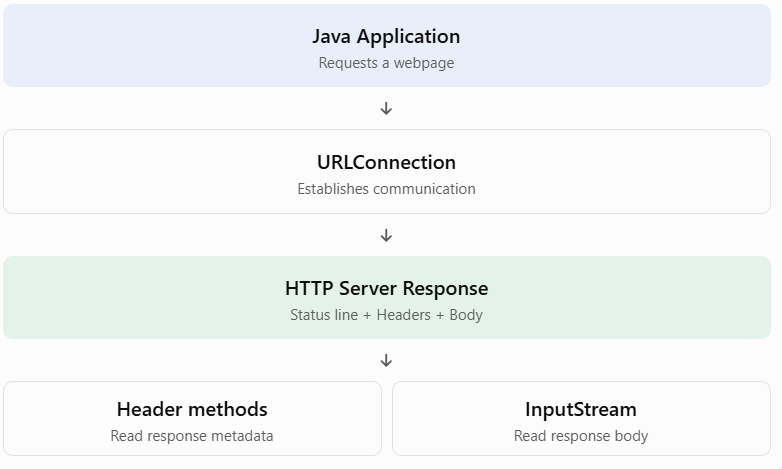

## Topic 5.3 — Reading Headers

We'll cover two major concepts:

1. Retrieving Specific Header Fields.
2. Retrieving Arbitrary Header Fields.

## 1. TEACH — What are HTTP headers?

Before learning the Java methods, let's understand HTTP headers.

Whenever a client communicates with an HTTP server, the server sends a response containing:

- Status line
- Response headers
- Response body

For example, imagine your Java application requests a webpage.

The server might return:

```
HTTP/1.1 200 OK
Content-Type: text/html
Content-Length: 1250
Date: Sun, 01 Nov 2026 10:00:00 GMT
Cache-Control: max-age=3600

<html>
    <body>
        Hello World!
    </body>
</html>
```

Here:

Headers provide additional information about the response.

For example:

| Header           | Meaning                             |
| ---------------- | ----------------------------------- |
| `Content-Type`   | Type of returned content            |
| `Content-Length` | Size of returned content in bytes   |
| `Date`           | Date and time of response           |
| `Cache-Control`  | Instructions for caching            |
| `Last-Modified`  | When the resource was last modified |

[Getting Started with cURL - DEV Community](https://images.openai.com/static-rsc-4/ErEFnUjYkXoo31q4t2m0GM2B8D-oeXYAAbCKMvt75x-k_41mTMa1FBYwIxpf8gTSN6aJ3Kd_L5sBEpPBe6qD1zSWY87LZkIzT02XO9b7LksVFBN69S5Jko19TrHHIQt2vl57K24gQaY3N3mKUoMlTIZ3qjFMVqOAQ_NPvUdV87c?purpose=inline)

[dev.to](https://dev.to/debashis_das_4deca65ec224/getting-started-with-curl-11n9?utm_source=chatgpt.com)

Our goal: Learn how Java retrieves these headers using `URLConnection`.

## 2. WHY — Why do we need to read headers?

Suppose you're downloading a file from a server.

Before downloading it, you might want to know:

- Is the returned content an image or a PDF?
- How large is the file?
- When was it last modified?
- Is the response cacheable?
- When does the cached response expire?

Instead of downloading and inspecting the entire response body, you can retrieve this information from its headers.

This is particularly useful when developing download managers, web crawlers, HTTP clients and caching systems.

## 3. Retrieving Specific Header Fields

Java's `URLConnection` class provides several methods to retrieve commonly used header information directly.

Let's study them one by one.

### A. `getContentType()`

Returns the MIME type of the content provided by the server.

Syntax:

```
String getContentType()
```

Example:

```
String type = connection.getContentType();

System.out.println(type);
```

Possible output:

```
text/html
```

Other possible values:

- `application/json`
- `image/png`
- `application/pdf`
- `text/plain`

### B. `getContentLength()`

Returns the content length in bytes.

Syntax:

```
int getContentLength()
```

Example:

```
int length = connection.getContentLength();

System.out.println("Size: " + length);
```

Important: It returns `-1` if the content length is unknown or unavailable.

There is also:

```
long getContentLengthLong()
```

This is preferable for potentially large files because it supports lengths greater than the maximum `int` value.

### C. `getContentEncoding()`

Returns the encoding applied to the content, if specified.

Syntax:

```
String getContentEncoding()
```

Example:

```
String encoding = connection.getContentEncoding();

System.out.println(encoding);
```

Possible output:

```
gzip
```

If no content encoding is specified, it returns `null`.

Note: This is not the same as the character encoding used to decode HTML text, which may be specified through the `charset` parameter in `Content-Type`.

### D. `getDate()`

Returns the date and time when the response was generated.

Syntax:

```
long getDate()
```

Example:

```
long date = connection.getDate();

System.out.println(date);
```

It returns a timestamp in milliseconds since January 1, 1970 (Unix epoch), or `0` if unavailable.

### E. `getExpiration()`

Returns the expiration time of the resource.

Syntax:

```
long getExpiration()
```

Example:

```
long expiration = connection.getExpiration();

System.out.println(expiration);
```

It also returns milliseconds since the Unix epoch, or `0` if unavailable.

### F. `getLastModified()`

Returns the time when the resource was last modified.

Syntax:

```
long modified = connection.getLastModified();
```

Example:

```
System.out.println(
    "Last Modified: " + connection.getLastModified()
);
```

It returns milliseconds since the Unix epoch, or `0` if unavailable.

### Quick revision of specific header methods

| Method                   | Information returned   |
| ------------------------ | ---------------------- |
| `getContentType()`       | MIME type              |
| `getContentLength()`     | Content size as int    |
| `getContentLengthLong()` | Content size as long   |
| `getContentEncoding()`   | Content encoding       |
| `getDate()`              | Response date          |
| `getExpiration()`        | Expiration date        |
| `getLastModified()`      | Last modification date |

Remember: These methods retrieve information from response headers. They do not retrieve the actual response body.

## 4. Retrieving Arbitrary Header Fields

Now comes the second major concept.

What if you want to retrieve a header that doesn't have a dedicated getter method?

For example:

- `Cache-Control`
- `ETag`
- `Server`
- `Set-Cookie`
- `Location`

Java provides the following method:

### A. `getHeaderField(String name)`

It retrieves the value of a specific header when you provide its name.

Syntax:

```
String getHeaderField(String name)
```

Example:

```
String cache = connection.getHeaderField("Cache-Control");

System.out.println(cache);
```

Possible output:

```
max-age=3600
```

Another example:

```
String server = connection.getHeaderField("Server");
```

This method is useful when retrieving arbitrary headers by name.

If the header doesn't exist, it returns `null`.

### B. `getHeaderField(int n)`

What if you don't know the header name but want to retrieve a header by its position?

Java provides:

```
String getHeaderField(int n)
```

It retrieves the value of the header field at the specified index.

Example:

```
String value = connection.getHeaderField(0);

System.out.println(value);
```

Important: Header ordering is not guaranteed to be consistent across servers or implementations. Avoid relying on a particular index for a specific header.

### C. `getHeaderFieldKey(int n)`

This method retrieves the name of a header field at a specified index.

Syntax:

```
String getHeaderFieldKey(int n)
```

Example:

```
String key = connection.getHeaderFieldKey(0);

System.out.println(key);
```

It may return `null` for the status line or when the requested field has no key.

### D. `getHeaderFields()`

This method retrieves all available header fields as a `Map`.

Syntax:

```
Map<String, List<String>> getHeaderFields()
```

Example:

```
Map<String, List<String>> headers =
        connection.getHeaderFields();
```

Why a `Map`?

Because each header has a name and one or more values.

For example:

```
Content-Type  -> text/html
Cache-Control -> max-age=3600
Server        -> ExampleServer
```

A header can have multiple values, which is why Java uses `List<String>`.

You can iterate through all headers:

```
for (Map.Entry<String, List<String>> entry
        : headers.entrySet()) {

    System.out.println(
        entry.getKey() + " : " + entry.getValue()
    );
}
```

One important detail: HTTP header names are case-insensitive. Also, the map may contain a `null` key representing the HTTP status line.

## 5. CODE — Complete runnable Java example

Let's combine everything into one program.

We'll connect to `https://example.com` and retrieve specific and arbitrary response headers.

File: `ReadHTTPHeaders.java`

```
import java.net.URL;
import java.net.URLConnection;
import java.io.IOException;
import java.util.Map;
import java.util.List;

public class ReadHTTPHeaders {

    public static void main(String[] args) {

        try {

            // Step 1: Create URL
            URL url = new URL("https://example.com");

            // Step 2: Open connection
            URLConnection connection = url.openConnection();

            // Step 3: Establish connection
            connection.connect();

            // =================================
            // PART 1: SPECIFIC HEADER FIELDS
            // =================================

            System.out.println("=== SPECIFIC HEADERS ===");

            System.out.println(
                "Content Type: " +
                connection.getContentType()
            );

            System.out.println(
                "Content Length: " +
                connection.getContentLengthLong()
            );

            System.out.println(
                "Content Encoding: " +
                connection.getContentEncoding()
            );

            System.out.println(
                "Date: " + connection.getDate()
            );

            System.out.println(
                "Expiration: " + connection.getExpiration()
            );

            System.out.println(
                "Last Modified: " +
                connection.getLastModified()
            );

            // =================================
            // PART 2: ARBITRARY HEADER FIELDS
            // =================================

            System.out.println("\n=== ARBITRARY HEADERS ===");

            System.out.println(
                "Server: " +
                connection.getHeaderField("Server")
            );

            System.out.println(
                "Cache-Control: " +
                connection.getHeaderField("Cache-Control")
            );

            // Retrieve header by index
            System.out.println(
                "Header at index 0: " +
                connection.getHeaderField(0)
            );

            // Retrieve header name by index
            System.out.println(
                "Header key at index 0: " +
                connection.getHeaderFieldKey(0)
            );

            // =================================
            // PART 3: ALL HEADER FIELDS
            // =================================

            System.out.println("\n=== ALL RESPONSE HEADERS ===");

            Map<String, List<String>> headers =
                    connection.getHeaderFields();

            for (Map.Entry<String, List<String>> entry
                    : headers.entrySet()) {

                System.out.println(
                    entry.getKey() + " : " + entry.getValue()
                );
            }

        } catch (IOException e) {

            System.out.println("Error: " + e.getMessage());

        }
    }
}
```

### Understanding the program

We have used three different approaches:

| Approach    | Method                     | What it does                         |
| ----------- | -------------------------- | ------------------------------------ |
| Specific    | `getContentType()`         | Retrieves MIME type                  |
| By name     | `getHeaderField("Server")` | Retrieves a named header             |
| By index    | `getHeaderField(0)`        | Retrieves a header value by position |
| All headers | `getHeaderFields()`        | Retrieves all headers in a map       |

The output depends on the actual response from the server. Some fields may return `null`, `0`, or `-1` if unavailable.

### 6. Understanding the complete execution flow


The important distinction is that headers and body are two different parts of an HTTP response.


## 7. REVISION — Exam quick notes

Remember these important methods:

| Method                   | Purpose                        |
| ------------------------ | ------------------------------ |
| `getContentType()`       | Returns MIME type              |
| `getContentLength()`     | Returns content length as int  |
| `getContentLengthLong()` | Returns content length as long |
| `getContentEncoding()`   | Returns content encoding       |
| `getDate()`              | Returns response date          |
| `getExpiration()`        | Returns expiration date        |
| `getLastModified()`      | Returns last modification date |
| `getHeaderField(String)` | Retrieves a header by name     |
| `getHeaderField(int)`    | Retrieves a header by index    |
| `getHeaderFieldKey(int)` | Retrieves header name by index |
| `getHeaderFields()`      | Retrieves all headers          |
