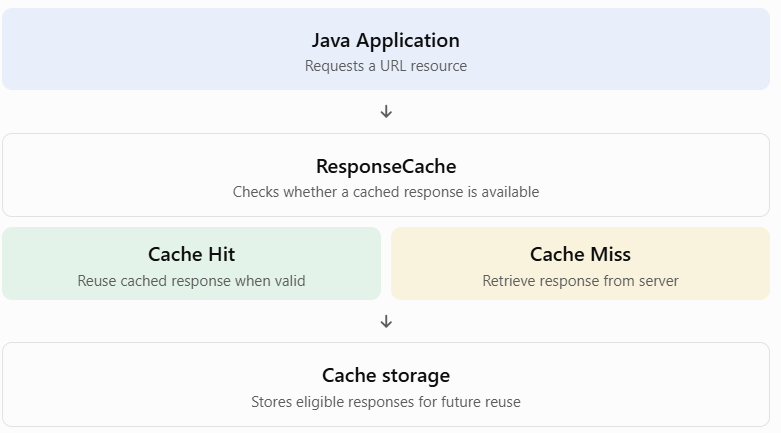

## Topic 5.4: Cache — Web Cache for Java

### 1. TEACH — What is Web Caching?

A web cache is a mechanism that temporarily stores copies of resources retrieved from a server so that they can potentially be reused later without downloading them again.

Let's understand with a simple example.

Imagine your Java application downloads a webpage from `https://example.com`.

First request:

1. Java requests the webpage.
2. The server sends the webpage.
3. The response may be stored in a cache.

Second request:

1. Java requests the same webpage again.
2. If a valid cached response exists, Java may reuse it.
3. It may not need to download the entire resource again.


There are two important terms:

- Cache Hit: Requested resource is available in the cache and can be reused.
- Cache Miss: Requested resource is not available in the cache, so it must be retrieved from the server.

### 2. WHY — Why do we need Web Caching?

Web caching provides several benefits:

| Benefit             | Explanation                                     |
| ------------------- | ----------------------------------------------- |
| Faster response     | Cached resources can be retrieved more quickly. |
| Reduced bandwidth   | Avoids unnecessary data transfers.              |
| Reduced server load | Fewer requests may reach the server.            |
| Better performance  | Improves application responsiveness.            |

Real-world example:

Suppose your application repeatedly retrieves a configuration file from a remote server.

Without caching, it may download the file every time.

With caching, the application can reuse a valid cached copy.

## 3. TEACH — Java's Web Cache Support

Java provides caching support through the `java.net` package.

The important classes are:

| Class           | Purpose                                                                     |
| --------------- | --------------------------------------------------------------------------- |
| `ResponseCache` | Provides the abstraction for caching URL responses.                         |
| `CacheRequest`  | Represents a request to store a response in the cache.                      |
| `CacheResponse` | Represents a cached response.                                               |
| `URLConnection` | Provides cache configuration through `setUseCaches()` and `getUseCaches()`. |

Let's understand these classes.

### A. `ResponseCache`

`ResponseCache` is an abstract class that provides a mechanism for storing and retrieving responses.

It allows Java applications to implement their own caching mechanism.

Important methods:

1\. `getDefault()`

```
ResponseCache.getDefault();
```

Returns the currently installed default response cache.

2\. `setDefault()`

```
ResponseCache.setDefault(cache);
```

Installs a default response cache for the application.

3\. `get()`

```
CacheResponse get(
    URI uri,
    String requestMethod,
    Map<String, List<String>> requestHeaders
);
```

Attempts to retrieve a cached response for a particular request.

4\. `put()`

```
CacheRequest put(
    URI uri,
    URLConnection connection
);
```

Attempts to store a server response in the cache.

Important: `ResponseCache` itself is abstract. You need an implementation to actually store and retrieve cached responses.

### B. `CacheRequest`

`CacheRequest` represents an attempt to store a response in the cache.

It provides methods such as:

- `getBody()` — Returns an output stream into which the response body can be written.
- `abort()` — Aborts the caching operation.

### C. `CacheResponse`

`CacheResponse` represents a response retrieved from the cache.

Important methods:

- `getBody()` — Retrieves the cached response body.
- `getHeaders()` — Retrieves the cached response headers.

## 4. CODE — Understanding URLConnection caching configuration

Before implementing a complete custom cache, let's understand the basic caching configuration available in `URLConnection`.

Two important methods:

A. `setUseCaches(boolean)`

```
connection.setUseCaches(true);
```

Enables or disables the use of caching for this connection.

B. `getUseCaches()`

```
connection.getUseCaches();
```

Returns whether this connection is configured to use caches.

Here's a complete runnable example.

File: `WebCacheExample.java`

```
import java.net.URL;
import java.net.URLConnection;
import java.io.InputStream;
import java.io.IOException;

public class WebCacheExample {

    public static void main(String[] args) {

        try {

            // Step 1: Create URL
            URL url = new URL("https://example.com");

            // Step 2: Open connection
            URLConnection connection = url.openConnection();

            // Step 3: Enable caching
            connection.setUseCaches(true);

            // Step 4: Check caching configuration
            System.out.println(
                "Caching enabled: " +
                connection.getUseCaches()
            );

            // Step 5: Retrieve server response
            try (InputStream input =
                    connection.getInputStream()) {

                byte[] buffer = new byte[1024];

                int bytesRead;

                while ((bytesRead = input.read(buffer)) != -1) {

                    System.out.println(
                        "Received bytes: " + bytesRead
                    );
                }
            }

        } catch (IOException e) {

            System.out.println("Error: " + e.getMessage());

        }
    }
}
```

Possible output:

```
Caching enabled: true
Received bytes: ...
```

The number of bytes depends on the actual server response.

Important distinction:

Calling:

```
connection.setUseCaches(true);
```

does not create a cache or guarantee that the response will be cached.

It only permits the connection to use an available caching mechanism.

Also, `URLConnection` normally has caching enabled by default, but applications should configure it explicitly when needed.

## 5. WHY — How does Java know where to store cached data?

This is where `ResponseCache` becomes important.

Java allows you to install a custom response cache:

```
ResponseCache.setDefault(myCache);
```

Once installed, URL connections can use that cache to retrieve and store responses.

Conceptually:



A custom `ResponseCache` implementation decides how responses are stored and retrieved.

There is no automatic guarantee that every server response will be cached. HTTP caching rules, response headers, request properties and the cache implementation all matter.

## 7. REVISION — Exam quick notes

| Term                         | Meaning                                   |
| ---------------------------- | ----------------------------------------- |
| Web Cache                    | Temporarily stores reusable web responses |
| Cache Hit                    | A usable response is found in cache       |
| Cache Miss                   | A usable response is not found            |
| `ResponseCache`              | Abstract caching mechanism                |
| `CacheRequest`               | Represents an attempt to store a response |
| `CacheResponse`              | Represents a cached response              |
| `setUseCaches(true)`         | Allows caching for a connection           |
| `getUseCaches()`             | Checks caching configuration              |
| `ResponseCache.setDefault()` | Installs default response cache           |
