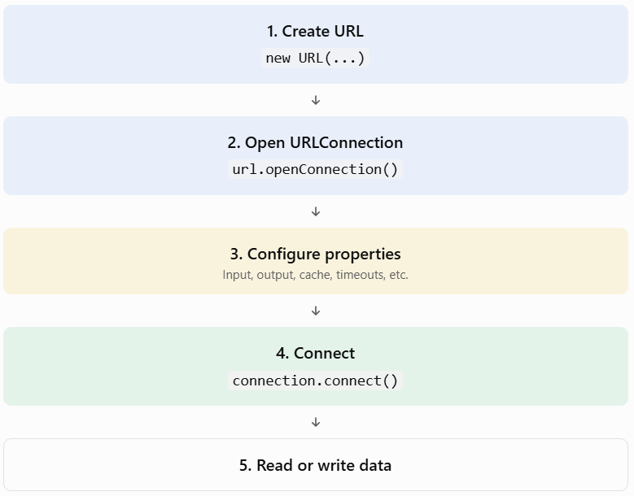

## Topic 5.5: Configuring the Connection

In this topic, we'll learn how to configure a `URLConnection` before establishing communication with a server.

We'll cover:

1. `protected URL url`
2. `protected boolean connected`
3. `protected boolean allowUserInteraction`
4. `protected boolean doInput`
5. `protected boolean doOutput`
6. `protected long ifModifiedSince`
7. `protected boolean useCaches`
8. Connection and read timeouts

## 1. TEACH — What does configuring a connection mean?

In Topic 5.1, we learned:

```
URL url = new URL("https://example.com");

URLConnection connection = url.openConnection();

connection.connect();
```

But imagine you want to:

- Prevent your application from sending data.
- Allow your application to send data to a server.
- Disable caching.
- Set a timeout if the server doesn't respond.
- Retrieve a resource only if it has been modified.

How can we control these behaviours?

Java provides several fields and methods in the `URLConnection` class to configure the connection.

Important concept: Most connection settings must be configured before the connection is established.

Once a connection is established, changing certain properties may throw an `IllegalStateException`.

## 2. Understanding the protected fields

Before studying individual fields, understand what `protected` means.

In Java, `protected` is an access modifier.

A protected member can generally be accessed:

- Within the same package.
- Within subclasses, subject to Java's inheritance access rules.

Therefore, you normally configure these properties through the public setter methods instead of directly accessing the protected fields.

## 3. Understanding each configuration field

### A. `protected URL url`

Purpose: Stores the URL representing the remote resource to which the connection is opened.

Declaration:

```
protected URL url;
```

Example:

```
URL url = new URL("https://example.com");

URLConnection connection = url.openConnection();

System.out.println(connection.getURL());
```

Output:

```
https://example.com
```

Important points:

- It identifies the remote resource.
- Its value is initialized from the URL passed to the connection constructor.
- You can retrieve it using `getURL()`.

### B. `protected boolean connected`

Purpose: Indicates whether the communication link with the remote resource has been established.

Declaration:

```
protected boolean connected;
```

It has two possible states:

| Value   | Meaning                              |
| ------- | ------------------------------------ |
| `false` | Connection has not been established. |
| `true`  | Connection has been established.     |

Example:

```
URL url = new URL("https://example.com");

URLConnection connection = url.openConnection();

// Connection object created
// Actual connection may not yet be established

connection.connect();

// Communication link established
```

Important: `connected` is a protected field. There is no public `isConnected()` method in `URLConnection`.

Also, once connected, you cannot change certain configuration properties.

### C. `protected boolean allowUserInteraction`

Purpose: Determines whether user interaction is allowed while accessing the resource.

Declaration:

```
protected boolean allowUserInteraction;
```

For example, imagine a connection that requires authentication.

If interaction is allowed, an implementation may permit an authentication dialog or another form of user interaction.

Java provides:

```
connection.setAllowUserInteraction(true);
```

To retrieve its value:

```
connection.getAllowUserInteraction();
```

Possible values:

- `true` → User interaction is allowed.
- `false` → User interaction is not allowed.

This setting is mainly of historical relevance in modern applications; authentication is generally handled programmatically.

### D. `protected boolean doInput`

Purpose: Determines whether the application intends to read data from the URL connection.

Declaration:

```
protected boolean doInput;
```

Java provides:

```
connection.setDoInput(true);
```

To retrieve its value:

```
connection.getDoInput();
```

Default value: `true`.

Example:

```
connection.setDoInput(true);

InputStream input = connection.getInputStream();
```

If `doInput` is set to `false`, attempting to obtain the input stream is not supported.

Remember: `doInput = true` means Java intends to receive data from the server.

### E. `protected boolean doOutput`

Purpose: Determines whether the application intends to send data to the remote resource.

Declaration:

```
protected boolean doOutput;
```

Java provides:

```
connection.setDoOutput(true);
```

To retrieve its value:

```
connection.getDoOutput();
```

Default value: `false`.

Example:

```
connection.setDoOutput(true);

OutputStream output = connection.getOutputStream();
```

When would you use this?

Suppose your Java application needs to send information to a server through an HTTP request.

You can enable output and write data using the connection's output stream.

Important distinction:

| Property   | Direction                 | Default |
| ---------- | ------------------------- | ------- |
| `doInput`  | Server → Java application | `true`  |
| `doOutput` | Java application → Server | `false` |

Both can be enabled simultaneously.

### F. `protected long ifModifiedSince`

This is an important field related to HTTP conditional requests.

Purpose: Specifies that the resource should only be retrieved if it has been modified after a particular date and time.

Declaration:

```
protected long ifModifiedSince;
```

Java provides:

```
connection.setIfModifiedSince(timestamp);
```

To retrieve its value:

```
connection.getIfModifiedSince();
```

The timestamp is measured in milliseconds since January 1, 1970 (Unix epoch).

Let's understand with an example.

Imagine:

- You downloaded a file yesterday.
- You want to download it again today.
- But you only want to download it if the server's file has changed.

You can specify the last time you want to check against:

```
connection.setIfModifiedSince(
    System.currentTimeMillis() - 86400000L
);
```

Here, `86400000` represents 24 hours in milliseconds.

For HTTP connections, this can result in an `If-Modified-Since` request header.

The server may respond:

- `200 OK` → The resource has been modified, and a new representation is returned.
- `304 Not Modified` → The resource has not changed, so the cached copy can be reused.

This helps avoid unnecessary downloads.

### G. `protected boolean useCaches`

Purpose: Determines whether the connection is allowed to use caching.

Declaration:

```
protected boolean useCaches;
```

Java provides:

```
connection.setUseCaches(true);
```

To retrieve the current setting:

```
connection.getUseCaches();
```

Possible values:

| Value   | Meaning                                                           |
| ------- | ----------------------------------------------------------------- |
| `true`  | The protocol may use available caching.                           |
| `false` | The protocol should ignore caches and try to obtain a fresh copy. |

The default is generally `true`, subject to protocol-specific defaults.

Remember our previous topic, 5.4? This is where caching configuration comes into play!

## 4. Configuring Connection and Read Timeouts

Now let's understand the final important part of this topic.

Imagine your Java application connects to a server that is not responding.

Should your application wait forever?

Obviously not!

Java provides two timeout settings.

### A. Connection Timeout

A connection timeout specifies how long Java should wait while attempting to establish a connection with a server.

Method:

```
connection.setConnectTimeout(5000);
```

Here, `5000` means 5,000 milliseconds (5 seconds).

To retrieve the timeout:

```
connection.getConnectTimeout();
```

If the timeout expires before the connection is established, Java can throw:

```
SocketTimeoutException
```

### B. Read Timeout

A read timeout specifies how long Java should wait for data to become available when reading from an established connection.

Method:

```
connection.setReadTimeout(10000);
```

Here, Java waits up to 10 seconds for data during a read operation.

To retrieve it:

```
connection.getReadTimeout();
```

If the timeout expires before data becomes available, Java can throw `SocketTimeoutException`.

### Connection Timeout vs Read Timeout

| Connection Timeout                        | Read Timeout                                         |
| ----------------------------------------- | ---------------------------------------------------- |
| Controls connection establishment time.   | Controls waiting time for incoming data.             |
| Applied before connection is established. | Applied when reading from an established connection. |
| `setConnectTimeout()`                     | `setReadTimeout()`                                   |
| `getConnectTimeout()`                     | `getReadTimeout()`                                   |


Important exam point: A timeout value of `0` means infinite timeout (disabled timeout). Negative values are not allowed.

## 5. CODE — Complete runnable Java example

Let's combine the configuration options into one practical program.

File: `ConfigureURLConnection.java`

```
import java.net.URL;
import java.net.URLConnection;
import java.io.BufferedReader;
import java.io.InputStreamReader;
import java.io.IOException;
import java.nio.charset.StandardCharsets;

public class ConfigureURLConnection {

    public static void main(String[] args) {

        try {

            // Step 1: Create URL
            URL url = new URL("https://example.com");

            // Step 2: Open connection
            URLConnection connection = url.openConnection();

            // Step 3: Configure connection BEFORE connecting

            connection.setAllowUserInteraction(false);

            connection.setDoInput(true);

            connection.setDoOutput(false);

            connection.setIfModifiedSince(0);

            connection.setUseCaches(false);

            // Connection timeout: 5 seconds
            connection.setConnectTimeout(5000);

            // Read timeout: 10 seconds
            connection.setReadTimeout(10000);

            // Step 4: Display configuration

            System.out.println("URL: " + connection.getURL());

            System.out.println(
                "Allow Interaction: " +
                connection.getAllowUserInteraction()
            );

            System.out.println(
                "Do Input: " + connection.getDoInput()
            );

            System.out.println(
                "Do Output: " + connection.getDoOutput()
            );

            System.out.println(
                "Use Caches: " + connection.getUseCaches()
            );

            System.out.println(
                "Connect Timeout: " +
                connection.getConnectTimeout()
            );

            System.out.println(
                "Read Timeout: " +
                connection.getReadTimeout()
            );

            // Step 5: Establish connection
            connection.connect();

            System.out.println("\nConnection established!");

            // Step 6: Read server response
            try (
                BufferedReader reader = new BufferedReader(
                    new InputStreamReader(
                        connection.getInputStream(),
                        StandardCharsets.UTF_8
                    )
                )
            ) {

                String line;

                while ((line = reader.readLine()) != null) {
                    System.out.println(line);
                }
            }

        } catch (IOException e) {

            System.out.println("Error: " + e.getMessage());

        }
    }
}
```

### Understanding the execution order

Notice something important in this program.

We configure all the connection properties before calling `connect()`.

The correct sequence is:



If you attempt to change certain properties after connecting, Java throws `IllegalStateException`.

One more thing: operations such as `getInputStream()` can establish the connection implicitly, so don't wait until after reading begins to configure it.

## 6. REVISION — Exam-ready summary

| Field                  | Configuration method        | Default                     |
| ---------------------- | --------------------------- | --------------------------- |
| `url`                  | `getURL()`                  | URL supplied to constructor |
| `connected`            | No public getter            | `false` before connection   |
| `allowUserInteraction` | `setAllowUserInteraction()` | Configurable default        |
| `doInput`              | `setDoInput()`              | `true`                      |
| `doOutput`             | `setDoOutput()`             | `false`                     |
| `ifModifiedSince`      | `setIfModifiedSince()`      | `0`                         |
| `useCaches`            | `setUseCaches()`            | Generally `true`            |
| Connect timeout        | `setConnectTimeout()`       | `0`                         |
| Read timeout           | `setReadTimeout()`          | `0`                         |
