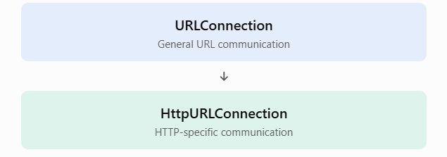

# 5.9 — HttpURLConnection
### 1. TEACH — What is HttpURLConnection?
`HttpURLConnection` is a Java class in the `java.net` package used to communicate with web servers through the **HTTP protocol.**

It extends `URLConnection`.
URLConnection




For example, it allows Java applications to:
- Send HTTP GET and POST requests.
- Read HTTP response codes.
- Retrieve response headers.
- Read response bodies.
- Configure HTTP-specific behavior.
- Disconnect from the server.
Example:
```
URL url = new URL("https://example.com");

HttpURLConnection connection =
    (HttpURLConnection) url.openConnection();
```

Notice that `openConnection()` returns a `URLConnection`, so we cast it to `HttpURLConnection` when the URL uses HTTP or HTTPS.

### 2. WHY — Why do we need HttpURLConnection?
Imagine you're developing a Java application that communicates with a REST API.

You need to:
1. Request student information.
2. Send student data to the server.
3. Check whether the server returned status `200`,` 201`, or `404`.
4. Read the server response.

`URLConnection` provides general communication functionality, but `HttpURLConnection` provides HTTP-specific features such as request methods and response status codes.

That's why it's useful when working directly with HTTP.

### 3. HTTP Request Methods
An HTTP request method tells the server what action the client wants to perform.

The most commonly used methods are:
|Method	|Purpose|	Example|
|-------|-------|----------|
|`GET`|	Retrieve data|	Get student details|
|`POST`|	Submit data|	Create a student|
|`PUT`	|Replace/update a resource|	Update student details|
|`DELETE`|	Delete a resource|	Delete a student|
|`PATCH	`|Partially update a resource|	Update student's email|

`HttpURLConnection` supports these standard methods, but the server must also support the method for the requested resource.

#### A. Setting the request method
Use:
```
connection.setRequestMethod("GET");
```

To retrieve the method:
```
String method = connection.getRequestMethod();
```

The default request method is `GET`.

**Important:** Set the request method before connecting. Calling setRequestMethod() after the connection has been established can cause a ProtocolException.

#### B. Sending data using POST
To send data to a server, enable output and set the method to POST:
```
connection.setRequestMethod("POST");
connection.setDoOutput(true);
```

Then write data through the output stream:
```
try (var output = connection.getOutputStream()) {
    output.write(jsonData.getBytes(StandardCharsets.UTF_8));
}
```

For JSON requests, also configure:
```
connection.setRequestProperty(
    "Content-Type", "application/json"
);
```

### 4. CODE — GET and POST example
Create `HttpMethodsExample.java`.

This example uses httpbin.org, a testing service that echoes HTTP requests.
```
import java.io.BufferedReader;
import java.io.InputStream;
import java.io.InputStreamReader;
import java.io.OutputStream;
import java.io.IOException;
import java.net.HttpURLConnection;
import java.net.URL;
import java.nio.charset.StandardCharsets;

public class HttpMethodsExample {

    public static void main(String[] args) {

        try {
            // Example 1: GET request
            sendGetRequest();

            // Example 2: POST request
            sendPostRequest();

        } catch (IOException e) {
            System.out.println("Error: " + e.getMessage());
        }
    }

    private static void sendGetRequest() throws IOException {

        URL url = new URL("https://httpbin.org/get");

        HttpURLConnection connection =
                (HttpURLConnection) url.openConnection();

        try {
            connection.setRequestMethod("GET");
            connection.setConnectTimeout(5000);
            connection.setReadTimeout(10000);

            System.out.println("\nGET Response Code: "
                    + connection.getResponseCode());

            readResponse(connection);

        } finally {
            connection.disconnect();
        }
    }

    private static void sendPostRequest() throws IOException {

        URL url = new URL("https://httpbin.org/post");

        HttpURLConnection connection =
                (HttpURLConnection) url.openConnection();

        try {
            connection.setRequestMethod("POST");
            connection.setDoOutput(true);

            connection.setRequestProperty(
                    "Content-Type", "application/json"
            );

            connection.setConnectTimeout(5000);
            connection.setReadTimeout(10000);

            String json = """
                    {
                        "name": "Alex",
                        "course": "Java Networking"
                    }
                    """;

            // Send request body
            try (OutputStream output = connection.getOutputStream()) {
                output.write(json.getBytes(StandardCharsets.UTF_8));
            }

            System.out.println("\nPOST Response Code: "
                    + connection.getResponseCode());

            readResponse(connection);

        } finally {
            connection.disconnect();
        }
    }

    private static void readResponse(
            HttpURLConnection connection) throws IOException {

        int status = connection.getResponseCode();

        InputStream stream;

        if (status >= 200 && status < 400) {
            stream = connection.getInputStream();
        } else {
            stream = connection.getErrorStream();
        }

        if (stream == null) {
            System.out.println("No response body.");
            return;
        }

        try (BufferedReader reader = new BufferedReader(
                new InputStreamReader(
                        stream, StandardCharsets.UTF_8))) {

            String line;

            while ((line = reader.readLine()) != null) {
                System.out.println(line);
            }
        }
    }
}
```


**Understand the flow:**
1. Create a URL.
2. Open an HttpURLConnection.
3. Set the request method.
4. Configure headers, timeouts, and output if needed.
5. Send the request body for POST.
6. Retrieve the response code.
7. Read the response.
8. Disconnect the connection.
Run with an internet connection. The testing service may impose rate limits or be unavailable temporarily.

### 5. Disconnecting from the server
`HttpURLConnection` provides:
```
connection.disconnect();
```

**Purpose:** Terminates the connection and releases associated network resources where possible.

Example:
```
HttpURLConnection connection =
    (HttpURLConnection) url.openConnection();

try {
    // Perform HTTP operations
} finally {
    connection.disconnect();
}
```

Why use `finally?`

Because it runs whether the request succeeds or an exception occurs.

Remember that `disconnect()` is not a replacement for closing streams. Close input/output streams separately, preferably using try-with-resources.

### 6. Handling server responses
When a Java client sends an HTTP request, the server returns a status code.

Common status codes:
|Status	|Meaning|
|-------|-------|
|`200 OK`	|Request successful|
|`201 Created`|	Resource created|
|`204 No Content`|	Successful, no response body|
|`301 Moved Permanently`|	Resource permanently redirected|
|`400 Bad Request`|	Invalid request|
|`401 Unauthorized`|	Authentication required or failed|
|`403 Forbidden`|	Access denied|
|`404 Not Found`|	Resource not found|
|`500 Internal Server Error`|	Server-side error|

**Important response methods**
|Method	|Purpose|
|-------|-------|
|`getResponseCode()`|	Retrieves HTTP status code|
|`getResponseMessage()`|	Retrieves status message|
|`getInputStream()`|	Reads normal response body|
|`getErrorStream()`|	Reads error response body|
|`getHeaderField()`	|Retrieves a response header|

**Important distinction:**
- `getInputStream()` normally reads successful responses. For HTTP error responses, it commonly throws an `IOException`.
- `getErrorStream()` can read the body supplied with an HTTP error response. It may return `null`.
Example:
```
int code = connection.getResponseCode();

if (code >= 200 && code < 400) {
    System.out.println("Success: " + code);
} else {
    System.out.println("Request failed: " + code);
}
```

### 7. Working with Proxies
**What is a proxy?**

A proxy server acts as an intermediary between a Java client and the destination server.

Instead of connecting directly:
```
Java Client → Web Server
```

The request travels through a proxy:
```
Java Client → Proxy Server → Web Server
```

**Why use a proxy?**
- Network access control.
- Monitoring network traffic.
- Corporate network communication.
- Routing requests through a particular server.
**Using a proxy with HttpURLConnection**

Java provides the `Proxy` class.

Example:
```
import java.net.*;

public class ProxyExample {

    public static void main(String[] args) throws Exception {

        URL url = new URL("https://example.com");

        Proxy proxy = new Proxy(
                Proxy.Type.HTTP,
                new InetSocketAddress("127.0.0.1", 8080)
        );

        HttpURLConnection connection =
                (HttpURLConnection) url.openConnection(proxy);

        connection.setConnectTimeout(5000);
        connection.setReadTimeout(10000);

        System.out.println(
                "Response Code: " + connection.getResponseCode()
        );

        connection.disconnect();
    }
}
```

Here:
- `Proxy.Type.HTTP` specifies an HTTP proxy.
- `InetSocketAddress` specifies the proxy host and port.
- `openConnection(proxy)` creates a connection through that proxy.
This example assumes an HTTP proxy is running at 127.0.0.1:8080. Without one, the connection will fail.

### 8. Streaming Mode
**What is streaming mode?**

Normally, when you send data using `HttpURLConnection`, Java may buffer the request body before transmitting it.

For large request bodies, buffering can consume significant memory.

**Streaming mode** allows request data to be transmitted without buffering the entire body in memory.

There are two important streaming modes.
#### A. Fixed-length streaming mode
Use this when you already know the exact size of the request body.
```
connection.setFixedLengthStreamingMode(length);
```

Example:
```
byte[] data = json.getBytes(StandardCharsets.UTF_8);

connection.setFixedLengthStreamingMode(data.length);
connection.setDoOutput(true);
```

Java knows the exact number of bytes it must send.

This is useful when:
- Uploading files of known size.
- Sending a request body with a known length.
- Avoiding unnecessary buffering.

#### B. Chunked streaming mode
Use this when you don't know the complete request body's size in advance.
```
connection.setChunkedStreamingMode(4096);
```

Here, `4096` is the preferred chunk size in bytes.

Instead of sending one complete body with a known content length, the data is transmitted in chunks using HTTP chunked transfer encoding.

Useful when:
- Uploading large data progressively.
- Generating data while sending it.
- The total request body size is unknown.

**Fixed-length vs Chunked streaming**

|Fixed-length	|Chunked|
|---------------|-------|
|Exact size is known|	Exact size may be unknown|
|Uses `setFixedLengthStreamingMode()`|	Uses `setChunkedStreamingMode()`|
|Sends a known content length|	Uses chunked transfer encoding|
|Suitable for known-size uploads|	Suitable for progressively generated data|

**Important exam point:** Configure streaming mode before connecting or obtaining the output stream. In streaming mode, automatic authentication and redirection handling may be unavailable; Java can throw `HttpRetryException` if it needs to retry or redirect the request.

### 9. CODE — Fixed-length streaming example
Here's a complete example that sends a request body using fixed-length streaming.

Create `FixedLengthStreamingExample.java`:
```
import java.net.HttpURLConnection;
import java.net.URL;
import java.io.InputStream;
import java.io.OutputStream;
import java.io.IOException;
import java.nio.charset.StandardCharsets;

public class FixedLengthStreamingExample {

    public static void main(String[] args) {

        HttpURLConnection connection = null;

        try {
            URL url = new URL("https://httpbin.org/post");

            connection = (HttpURLConnection) url.openConnection();

            String data = "name=Alex&course=Java";

            byte[] requestBody =
                    data.getBytes(StandardCharsets.UTF_8);

            connection.setRequestMethod("POST");
            connection.setDoOutput(true);

            // Configure fixed-length streaming
            connection.setFixedLengthStreamingMode(
                    requestBody.length
            );

            connection.setRequestProperty(
                    "Content-Type",
                    "application/x-www-form-urlencoded"
            );

            connection.setConnectTimeout(5000);
            connection.setReadTimeout(10000);

            // Send request body
            try (OutputStream output = connection.getOutputStream()) {
                output.write(requestBody);
            }

            // Receive response
            int responseCode = connection.getResponseCode();

            System.out.println("Response Code: " + responseCode);

        } catch (IOException e) {
            System.out.println("Error: " + e.getMessage());

        } finally {
            if (connection != null) {
                connection.disconnect();
            }
        }
    }
}
```
For chunked streaming, replace:
```
connection.setFixedLengthStreamingMode(requestBody.length);
```
with:
```
connection.setChunkedStreamingMode(4096);
```

The rest of the request can remain the same.

### 10. REVISION — Important methods for exams
|Method	|Purpose|
|-------|-------|
|`setRequestMethod()`|	Sets GET, POST, PUT, DELETE, etc.|
|`getRequestMethod()`|	Retrieves the current request method|
|`getResponseCode()`|	Retrieves HTTP response status|
|`getResponseMessage()`|	Retrieves response message|
|`getInputStream()`|	Reads successful response body|
|`getErrorStream()`|	Reads error response body|
|`disconnect()`	|Releases connection resources|
|`usingProxy()`|	Checks whether the connection uses a proxy|
|`setFixedLengthStreamingMode()`	|Enables fixed-length streaming|
|`setChunkedStreamingMode()`	|Enables chunked streaming|

### Quick comparison
**URLConnection vs HttpURLConnection**
|URLConnection	|HttpURLConnection|
|---------------|-----------------|
|General URL communication|	HTTP-specific communication|
|No HTTP request method API|	Supports HTTP methods|
|No HTTP response-code API|	Supports response codes|
|General connection handling|	HTTP response and proxy handling|
