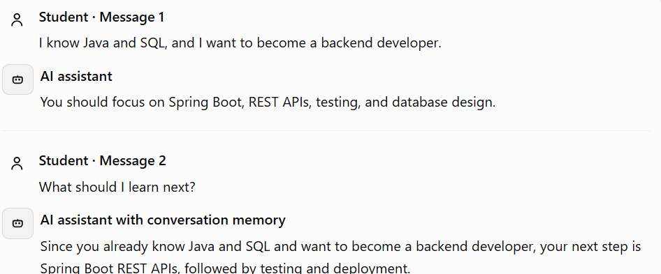
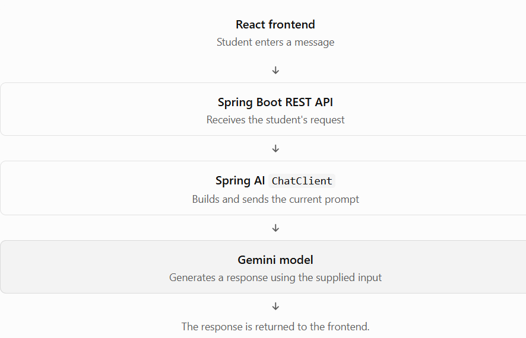
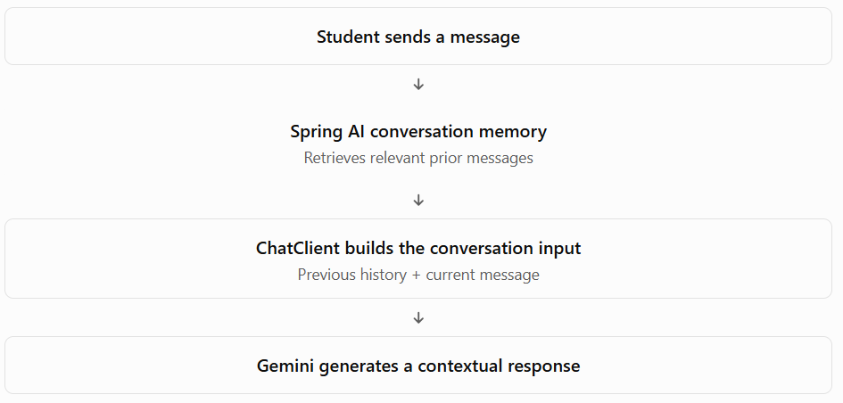

# Phase 3 — Conversation Memory
# Topic 3.1 — Understanding Conversation Memory

## 1. What is conversation memory?

Conversation memory is the ability of an AI application to retain and reuse relevant information from earlier messages when responding to later messages.

Imagine a student talks to your career assistant.



The assistant can give a relevant answer because the earlier conversation is available to it.

Without that history, the question "What should I learn next?" is ambiguous. The model does not automatically know what the student said in the previous request.

## 2. What is a stateless AI request?

A stateless AI request is a request where the current model call does not automatically receive the history of previous calls.

Suppose we send these two requests separately:

Request 1

```
I know Java and SQL.
I want to become a backend developer.
```

The model generates a response based on that request.

Request 2

```
What should I learn next?
```

If the second request contains no previous conversation history, the model might give a generic answer. It cannot reliably connect the question to the student's Java and SQL background.

Here's the important distinction:

- The model can use the messages included in its current input.
- It does not automatically remember earlier independent API calls.
- Your application can store conversation history and send relevant messages again in subsequent requests.

Important: Stateless does not mean the AI is incapable of understanding context. It means the earlier context is not automatically available unless it is supplied to the current request.

## 3. How does statelessness work in Spring AI?

Let's connect this to your existing Spring Boot knowledge.

Your application sends a request through Spring AI's `ChatClient`, which communicates with an AI model such as Gemini.



In a simple stateless implementation, every request builds a new prompt without the previous conversation messages.

### Example: Stateless `ChatClient`

Assume you already configured the `ChatClient` bean and Gemini connection in your Spring Boot application.

```
@Service
public class CareerAssistantService {

    private final ChatClient chatClient;

    public CareerAssistantService(ChatClient.Builder builder) {
        this.chatClient = builder.build();
    }

    public String chat(String message) {
        return chatClient.prompt()
                .user(message)
                .call()
                .content();
    }
}
```

This is a simplified service using the Spring AI `ChatClient` API.

Now call it twice:

```
chat("I know Java and SQL.");
chat("What should I learn next?");
```

The second call contains only the second message. The first message is not automatically included.

The model therefore cannot reliably use the student's earlier statement to personalize its answer.

Notice that this service doesn't save any history in a database, a Java collection, or a memory component.

## 4. How does conversation memory solve this?

Conversation memory adds a mechanism for retaining relevant messages and making them available during later requests.



For example, the input sent to the model could contain:

```
Previous conversation:
User: I know Java and SQL.
Assistant: You should explore Spring Boot.

Current message:
User: What should I learn next?
```

Now the model has the context required to provide a more personalized answer.

In Spring AI, we'll later explore `ChatMemory`, `MessageChatMemoryAdvisor`, and how to integrate memory with `ChatClient`.

One crucial detail: conversation memory is not the same as training the model. We're supplying stored conversational context to the model, not changing the model's learned parameters.

## 5. Why is conversation memory important in modern AI applications?

| Application        | How memory helps                                                   |
| ------------------ | ------------------------------------------------------------------ |
| Career assistant   | Remembers a student's career goal and previously discussed skills. |
| Customer support   | Keeps track of the issue being discussed.                          |
| AI tutor           | Builds on concepts already explained to a student.                 |
| Shopping assistant | Uses previously stated product preferences.                        |
| Coding assistant   | Continues working with the requirements discussed earlier.         |

For your career platform, imagine a student has already discussed Java, SQL, and their goal of becoming a backend developer. They should not have to repeat all that information every time they ask a follow-up question.

Memory makes the interaction feel continuous rather than like a series of unrelated questions.

### One more distinction: memory is not unlimited

Conversation memory does not mean that the model should receive every message forever. Long histories can increase token usage, cost, and latency. Some information may also be outdated or irrelevant.


