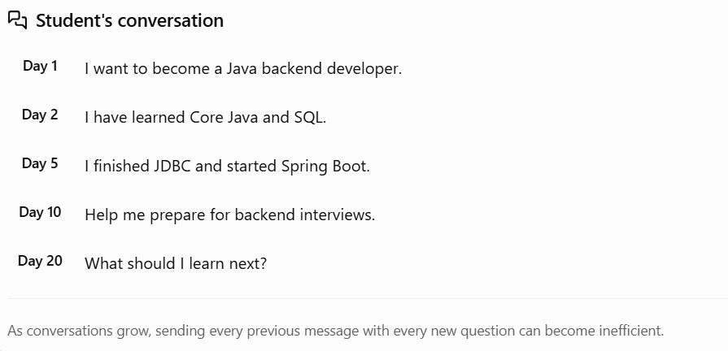
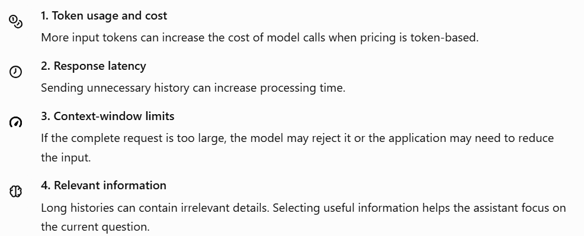
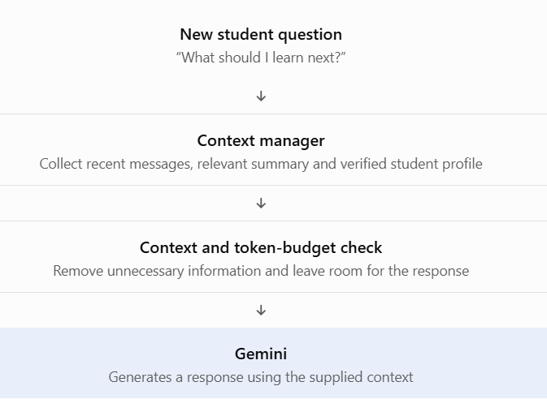

# Phase 3 — Topic 3.10: Memory Limits and Context Management

## 1. What is a context window?

A context window is the amount of information a model can process in a single request. It includes the instructions, conversation history, current question, relevant retrieved information, and other input supplied to the model. The model's generated response also uses the available context capacity, depending on the model's limits.

Imagine a student has a long conversation with your career assistant:



If the application sends the entire conversation every time, it may use more tokens, increase latency and cost, and eventually exceed the model's context limit.

Important: Chat memory and the context window are related, but they are not the same thing. Memory manages conversation information; the context window limits how much information can fit into a particular model request.

## 2. Why does context management matter?

There are four main problems to understand.



## 3. Four strategies for managing conversation context

### Strategy A — Message window

Keep only a limited number of recent messages in the active AI context.

For example, Spring AI provides `MessageWindowChatMemory`.

```
ChatMemory chatMemory = MessageWindowChatMemory.builder()
        .maxMessages(10)
        .build();
```

This illustrates a memory window containing up to 10 messages. It does not mean the model receives exactly 10 messages in every request: system instructions and the current prompt can add more content, and the actual memory behavior depends on the configured implementation.

Best for: Chatbots where recent conversation is the most important context.

### Strategy B — Summarization

Instead of retaining every old message in the active context, summarize the important information from earlier conversation.

For example, 50 messages could be summarized as:

> The student wants to become a Java backend developer. They know Core Java, SQL and JDBC, and are currently learning Spring Boot. Their next goal is to build a REST API project.

The assistant can use this concise summary alongside recent messages.

Best for: Long-running career coaching, tutoring and support conversations.

Caution: summaries can omit details or introduce inaccuracies, so preserve important facts and allow corrections.

### Strategy C — Selective retrieval

Store older information and retrieve only the parts relevant to the current question.

For example, if the student asks, “What should I learn after JDBC?”, the application retrieves their previous learning progress rather than including unrelated discussions about interview scheduling.

Retrieval might use a database query, metadata filters, or semantic search over embeddings. You'll explore embeddings and retrieval more deeply in later phases.

Best for: Conversations containing many different topics.

### Strategy D — Structured profile or facts

Store important long-term information separately from ordinary chat messages.

For your career platform, a student profile could include:

```
{
  "careerGoal": "Java Backend Developer",
  "completedSkills": ["Core Java", "SQL", "JDBC"],
  "currentSkill": "Spring Boot",
  "nextGoal": "Build a REST API"
}
```

This is application-managed data, not automatic model memory. Your backend should update and validate these fields rather than blindly trusting AI-generated statements.

Best for: Persistent facts such as career goals, completed skills and learning preferences.

## 4. Compare the strategies

| Strategy            | Keeps recent messages        | Preserves older information       | Main trade-off                      |
| ------------------- | ---------------------------- | --------------------------------- | ----------------------------------- |
| Message window      | Yes                          | Not necessarily in active context | Older details can be omitted        |
| Summarization       | Usually, alongside a summary | As summarized information         | Some details may be lost            |
| Selective retrieval | Relevant messages only       | Yes, if stored and retrievable    | Retrieval may miss relevant details |
| Structured profile  | Not its main purpose         | Selected facts                    | Requires explicit data management   |

Real applications often combine these approaches rather than choosing only one.

## 5. Applying this to your career platform

Here is a practical design for your student career assistant:



A useful rule is to reserve capacity for the response as well as the input. If the model supports a context window of a particular size, the prompt and expected output must fit within the model's applicable limits.

Also, remember the distinction from Topic 3.9: your database may retain a complete chat transcript even when the AI receives only a small subset of it.