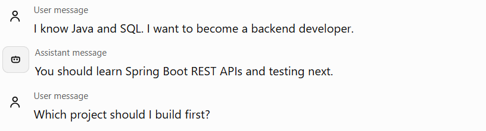
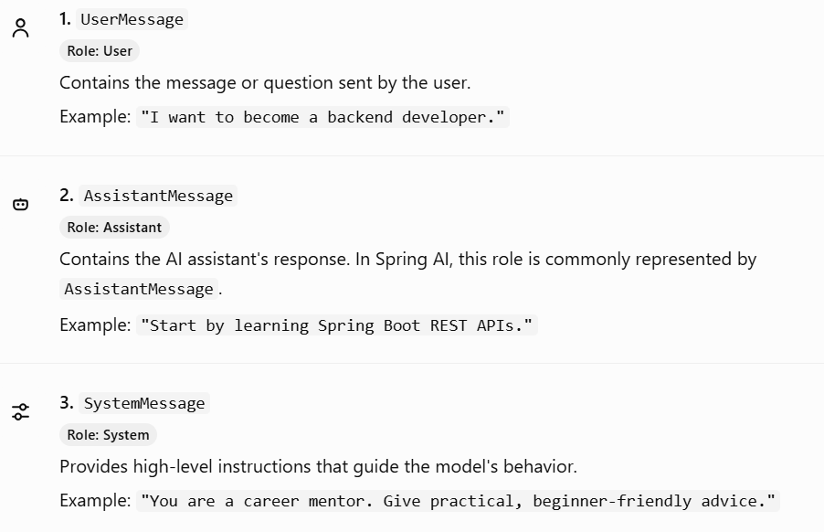
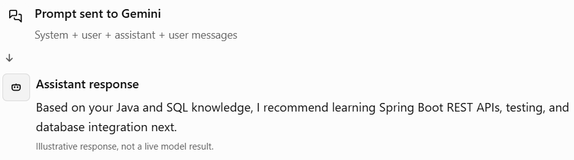

# Phase 3 — Topic 3.2: Understanding Messages and Chat History

## 1. What is a message in Spring AI?

A message is a single unit of communication between a participant and an AI model.

For example, consider this conversation:



This conversation contains three messages. Each message has content and a role that identifies its source.

In Spring AI, messages are represented by Java objects. These objects allow Spring AI to organize conversation input and pass it to the model.

## 2. The three important message types

For now, focus on these three core message types.


### How are they different?

| Message type       | Main purpose               | Example                   |
| ------------------ | -------------------------- | ------------------------- |
| `SystemMessage`    | Guides AI behavior         | Act as a career mentor.   |
| `UserMessage`      | Supplies user input        | What should I learn next? |
| `AssistantMessage` | Represents the AI response | Learn Spring Boot next.   |

Important: A system message is not the same as conversation history. It usually contains behavioral instructions, while chat history records earlier conversational messages.

## 3. How are messages and chat history related?

This is an important distinction for the rest of Phase 3.

- Messages: Individual pieces of communication.
- Chat history: The sequence of messages exchanged during a conversation.
- Conversation memory: The mechanism that manages which previous messages or information should be available to the model.

Spring AI's documentation distinguishes the full conversation history from the context retained and reused by chat memory.


For example:

Chat history for conversation `career-101`

User

I know Java.

Assistant

Great! You can build on that foundation.

User

I want to become a backend developer.

Assistant

Let's create a backend development roadmap.

User

What should I learn first?

The five messages form a chat history. A memory mechanism can retrieve relevant earlier messages and include them when processing the final question.

In a real application, chat history might be stored in a database, while memory determines which messages to include as context. The two are related, but they are not interchangeable.

## 4. How do we represent messages in Java?

Let's write some Spring AI code! You already know Spring Boot, so focus on how the Java objects fit together.

### Example A — Creating messages manually

```
import java.util.List;

import org.springframework.ai.chat.messages.AssistantMessage;
import org.springframework.ai.chat.messages.Message;
import org.springframework.ai.chat.messages.SystemMessage;
import org.springframework.ai.chat.messages.UserMessage;
import org.springframework.ai.chat.prompt.Prompt;

public class CareerConversationExample {

    public static void main(String[] args) {

        List<Message> messages = List.of(
            new SystemMessage(
                "You are a helpful career mentor."
            ),
            new UserMessage(
                "I know Java and SQL."
            ),
            new AssistantMessage(
                "You can start learning Spring Boot."
            ),
            new UserMessage(
                "What should I learn next?"
            )
        );

        Prompt prompt = new Prompt(messages);

        System.out.println("Total messages: "
                + prompt.getInstructions().size());
    }
}
```

This example illustrates how Spring AI represents a multi-message prompt. It creates the prompt but does not call Gemini yet.

The `Prompt` acts as a container for the ordered messages sent to the model.


Expected output:

```
Total messages: 4
```

The code requires Spring AI dependencies on your project classpath. You can run it in your existing Spring Boot project; the main method does not need an API key because it doesn't make a model request.

### Example B — Sending the messages to Gemini using `ChatClient`

Now let's turn the previous example into a Spring service that actually asks the model a question.

```
import java.util.List;

import org.springframework.ai.chat.client.ChatClient;
import org.springframework.ai.chat.messages.AssistantMessage;
import org.springframework.ai.chat.messages.Message;
import org.springframework.ai.chat.messages.SystemMessage;
import org.springframework.ai.chat.messages.UserMessage;
import org.springframework.ai.chat.prompt.Prompt;
import org.springframework.stereotype.Service;

@Service
public class CareerAssistantService {

    private final ChatClient chatClient;

    public CareerAssistantService(ChatClient.Builder builder) {
        this.chatClient = builder.build();
    }

    public String askCareerQuestion() {

        List<Message> messages = List.of(
            new SystemMessage(
                "You are a helpful career mentor."
            ),
            new UserMessage(
                "I know Java and SQL."
            ),
            new AssistantMessage(
                "You can start learning Spring Boot."
            ),
            new UserMessage(
                "What should I learn next?"
            )
        );

        return chatClient.prompt(new Prompt(messages))
                .call()
                .content();
    }
}
```

This uses the documented `ChatClient` API to submit a `Prompt` containing the messages.


When `askCareerQuestion()` is called, Spring AI sends the conversation to your configured model, and `.content()` returns its textual response.

The model can now see the earlier Java and SQL message because we included it explicitly.

But here's the catch: this service manually rebuilds the same conversation every time. It doesn't save new messages or automatically remember what happened in previous calls.

In the next topics, we'll progressively replace this manual approach with proper conversation memory.

## 5. What happens when Gemini responds?

The model generates an assistant response. Conceptually, the conversation now looks like this:



Spring AI represents the generated answer using an `AssistantMessage` within its response structure. Your application can return the answer to React and, if required, separately save the user message and assistant response to the conversation history.

## 6. How this fits your 6th-semester project

For your AI Skill and Career Management Platform, the flow will eventually look like this:

1. React sends the student's message to your Spring Boot API.
2. Spring AI identifies the conversation's earlier messages.
3. The application supplies the relevant history and current question to Gemini.
4. Gemini generates a contextual answer.
5. The application returns the answer to React and manages the conversation history.

PostgreSQL can later store the complete conversation history. Spring AI's memory components can help manage the context used during model calls.
