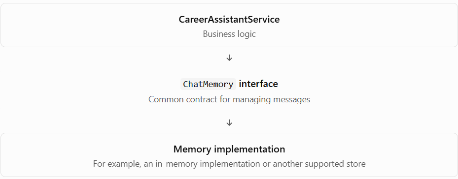
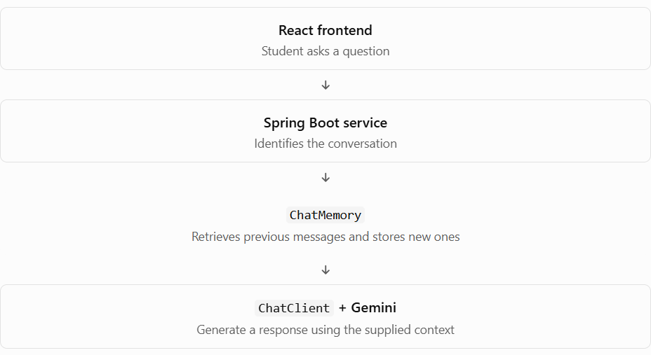

# Phase 3 — Topic 3.4: Introduction to `ChatMemory`

## 1. What is `ChatMemory`?

In Spring AI, `ChatMemory` is a Java interface for managing conversation messages.

Think of it as a contract that defines how an application can store and retrieve messages associated with a conversation.

Instead of writing all memory-management logic directly into your service, you can work with the `ChatMemory` abstraction and use an implementation that fits your needs.

For example, your Career Assistant might need to:

- Add a student's latest messages to the conversation.
- Retrieve earlier messages when the student asks a follow-up question.
- Keep conversations belonging to different students separate.
- Limit how much conversation history is retained.

`ChatMemory` provides the foundation for managing these messages. It does not, by itself, guarantee that previous messages will automatically be sent to Gemini.

## 2. Why does Spring AI provide `ChatMemory`?

Imagine you build a career assistant without a memory abstraction.

Your service might have to manage a collection of messages, decide which messages belong to each conversation, remove older messages, and retrieve the right history before every model call.

As the application grows, that logic becomes difficult to maintain.

Spring AI gives you a common abstraction so that your application can interact with conversation memory through a consistent API.



The important software-design idea here is programming to an interface rather than tying your business logic to one concrete implementation.

Later, you'll see how Spring AI advisors use this memory to help make previous messages available to `ChatClient`.

## 3. The three main methods of `ChatMemory`

The `ChatMemory` interface provides three operations you'll use frequently.


| Method    | Purpose                                       |
| --------- | --------------------------------------------- |
| `add()`   | Adds one or more messages to a conversation.  |
| `get()`   | Retrieves messages for a conversation.        |
| `clear()` | Removes the stored memory for a conversation. |

Let's understand each one.

### A. `add()` — Store messages

```
chatMemory.add(
    "career-chat-101",
    new UserMessage("I know Java and SQL.")
);
```

Here:

- `"career-chat-101"` is the conversation ID.
- `new UserMessage(...)` is the message to store.

Spring AI associates that message with the specified conversation.

### B. `get()` — Retrieve messages

```
List<Message> messages =
    chatMemory.get("career-chat-101");
```

This retrieves the messages stored under that conversation ID.

Your application can then use the messages to build a prompt for an AI model.

### C. `clear()` — Clear conversation memory

```
chatMemory.clear("career-chat-101");
```

This clears the memory associated with that conversation ID. It does not mean that every other conversation must be cleared.

Important: `clear()` operates on the configured chat-memory store. If your application separately saves a permanent chat transcript in another database table, that transcript is not automatically deleted by this operation.

## 4. Practical Java example — Using `ChatMemory`

Let's create a small example using Spring AI's `MessageWindowChatMemory`. This implementation keeps a bounded window of messages. The code below uses APIs documented in Spring AI 2.0.x; if your project uses another version, check its corresponding documentation before copying the code.


```
import java.util.List;

import org.springframework.ai.chat.memory.ChatMemory;
import org.springframework.ai.chat.memory.MessageWindowChatMemory;
import org.springframework.ai.chat.messages.Message;
import org.springframework.ai.chat.messages.UserMessage;
import org.springframework.ai.chat.messages.AssistantMessage;

public class ChatMemoryDemo {

    public static void main(String[] args) {

        // Create conversation memory
        ChatMemory chatMemory = MessageWindowChatMemory.builder()
                .maxMessages(10)
                .build();

        String conversationId = "career-chat-101";

        // Store the first user message
        chatMemory.add(
                conversationId,
                new UserMessage("I know Java and SQL.")
        );

        // Store an assistant response
        chatMemory.add(
                conversationId,
                new AssistantMessage(
                        "Great! You can start learning Spring Boot."
                )
        );

        // Store another user message
        chatMemory.add(
                conversationId,
                new UserMessage("What should I learn next?")
        );

        // Retrieve conversation messages
        List<Message> messages =
                chatMemory.get(conversationId);

        System.out.println("Stored messages:");

        for (Message message : messages) {
            System.out.println(
                    message.getMessageType() + ": "
                            + message.getText()
            );
        }

        // Clear this conversation's memory
        chatMemory.clear(conversationId);

        System.out.println(
                "Messages after clearing: "
                        + chatMemory.get(conversationId).size()
        );
    }
}
```

Expected output:

```
Stored messages:
USER: I know Java and SQL.
ASSISTANT: Great! You can start learning Spring Boot.
USER: What should I learn next?
Messages after clearing: 0
```

The exact formatting of message types can depend on the Spring AI version, but the example illustrates the expected behavior.

### What did we accomplish?

Created a memory implementation.

Stored three messages under one conversation ID.

Retrieved the messages in conversation order.

Cleared the conversation and verified that its memory was empty.

One important limitation: this example stores and retrieves messages, but it does not call Gemini. Also, the default in-memory repository is not durable storage; its data is normally lost when the application process stops.

## 5. How does `ChatMemory` work with your Career Assistant?

Let's connect the example to your Spring Boot application.



In a real Spring AI application, you can manually manage the history or use an advisor such as `MessageChatMemoryAdvisor` to integrate memory with `ChatClient`. We'll implement that advisor in Topic 3.5.

One more distinction to remember:

- `ChatMemory` manages the messages used as conversational memory.
- `ChatMemoryRepository` handles the underlying storage and retrieval of those messages.
- `MessageWindowChatMemory` decides how to manage the retained message window.

These are separate responsibilities in Spring AI's design.


