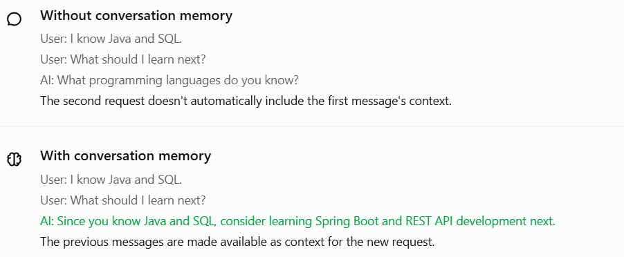
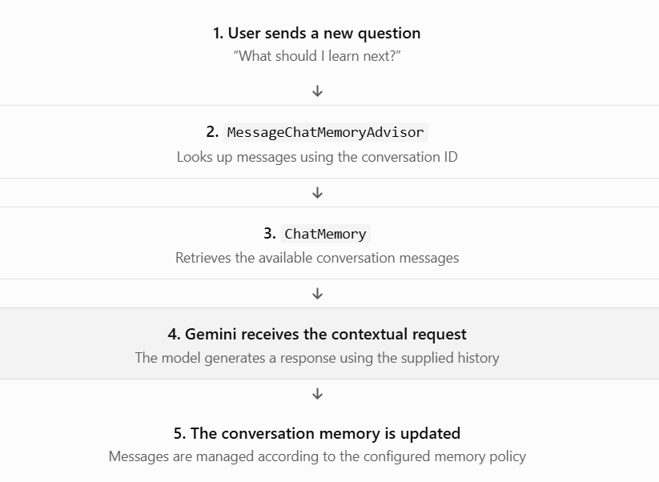

## 1. What problem does `MessageChatMemoryAdvisor` solve?

Imagine you're building your AI Skill and Career Management Platform.



The key component we'll use is `MessageChatMemoryAdvisor`.

Definition: `MessageChatMemoryAdvisor` is a Spring AI advisor that connects `ChatMemory` to `ChatClient`. It retrieves relevant conversation messages for a conversation ID and incorporates them into the request sent to the chat model. After the interaction, conversation messages are managed through the configured memory.

This means you don't have to manually fetch and attach the previous messages every time you call `ChatClient`.

## 2. How does it work?

Here is the flow you'll want to remember:



This is the conceptual flow; the advisor handles the memory integration for you.


## 3. Implement it in Spring Boot

We'll use the following components:

| Component                  | Responsibility                                  |
| -------------------------- | ----------------------------------------------- |
| `ChatClient`               | Sends requests to the AI model                  |
| `ChatMemory`               | Manages conversation messages                   |
| `MessageWindowChatMemory`  | Keeps a bounded window of messages              |
| `MessageChatMemoryAdvisor` | Connects memory to `ChatClient`                 |
| `conversationId`           | Identifies which conversation's messages to use |

### Step 1 — Configure `ChatClient` with memory

Spring AI can auto-configure a `ChatMemory` bean when the appropriate dependencies are present. We'll inject that bean instead of creating a new memory instance for every request.

```
package com.example.careerassistant.config;

import org.springframework.ai.chat.client.ChatClient;
import org.springframework.ai.chat.memory.ChatMemory;
import org.springframework.ai.chat.client.advisor.MessageChatMemoryAdvisor;
import org.springframework.context.annotation.Bean;
import org.springframework.context.annotation.Configuration;

@Configuration
public class AiConfig {

    @Bean
    public ChatClient chatClient(
            ChatClient.Builder builder,
            ChatMemory chatMemory) {

        return builder
                .defaultAdvisors(
                        MessageChatMemoryAdvisor.builder(chatMemory)
                                .build()
                )
                .build();
    }
}
```

Understand the important lines:

- `ChatMemory chatMemory`: receives the memory bean managed by Spring.
- `MessageChatMemoryAdvisor.builder(chatMemory).build()`: creates the advisor that integrates memory.
- `.defaultAdvisors(...)`: configures the advisor for calls made through this `ChatClient`.

Now the client has memory integration configured. But there's one more important thing: every memory-enabled request needs a conversation ID.


### Step 2 — Create a service that uses memory

```
package com.example.careerassistant.service;

import org.springframework.ai.chat.client.ChatClient;
import org.springframework.ai.chat.memory.ChatMemory;
import org.springframework.stereotype.Service;

@Service
public class CareerAssistantService {

    private final ChatClient chatClient;

    public CareerAssistantService(ChatClient chatClient) {
        this.chatClient = chatClient;
    }

    public String chat(String conversationId, String question) {

        return chatClient.prompt()
                .user(question)
                .advisors(advisor -> advisor.param(
                        ChatMemory.CONVERSATION_ID,
                        conversationId
                ))
                .call()
                .content();
    }
}
```

Let's break down the most important part:

```
.advisors(advisor -> advisor.param(
        ChatMemory.CONVERSATION_ID,
        conversationId
))
```

This tells the advisor which conversation's memory to retrieve and update.

For example, `"student-101-chat-1"` and `"student-101-chat-2"` represent two separate conversations, even if both belong to the same student.

Don't omit the conversation ID. Spring AI's documented memory advisors require it and throw an `IllegalArgumentException` when it's missing.


### Step 3 — Test two messages in the same conversation

Suppose your REST controller calls the service like this:

```
String conversationId = "student-101-chat-1";

String response1 = careerAssistantService.chat(
        conversationId,
        "I know Java and SQL."
);

String response2 = careerAssistantService.chat(
        conversationId,
        "What should I learn next?"
);
```

The second call uses the same conversation ID, so the advisor can retrieve the first exchange and provide it as context.

A possible response to the second question is:

> Since you know Java and SQL, learning Spring Boot, REST APIs, and database integration would be a good next step.

The exact answer depends on Gemini's response.

What if you use different IDs?

```
careerAssistantService.chat(
        "student-101-chat-1",
        "I know Java and SQL."
);

careerAssistantService.chat(
        "student-202-chat-1",
        "What programming languages do I know?"
);
```

The second conversation should not receive the first conversation's history. This is why conversation IDs must be managed carefully in applications with multiple users. In a real application, derive or validate the ID on the server against the authenticated user; don't trust an arbitrary client-supplied ID to authorize access to someone else's conversation.


## 4. Important things to remember

- Memory integration is not model training. Gemini isn't permanently learning your conversation.
- A conversation ID is essential. Reuse it to continue the same conversation; use a different one for a separate conversation.
- In-memory storage is temporary. With the default in-memory repository, messages generally disappear when the application restarts.
- Memory has limits. `MessageWindowChatMemory` keeps a bounded window; it does not guarantee that every message from the beginning of a long conversation will be retained.
- Version matters. The examples use the current `MessageChatMemoryAdvisor` API. Check your Spring AI version and dependencies if an import or method differs.

Official reference: [Spring AI — Chat Memory](https://docs.spring.io/spring-ai/reference/api/chat-memory.html).

