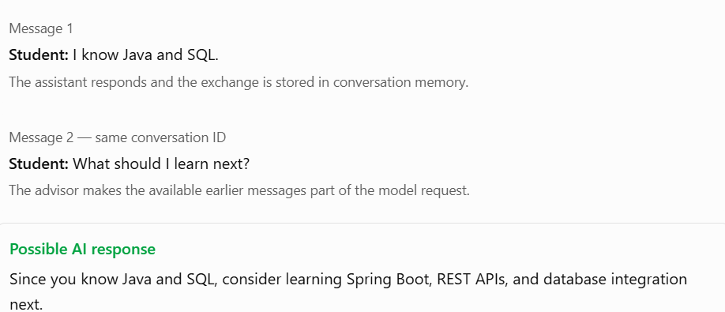

## 1. What are we learning in Topic 3.6?

Let's distinguish the three main components.

| Component                  | What it does                                              |
| -------------------------- | --------------------------------------------------------- |
| `ChatClient`               | Sends prompts to the AI model and receives responses      |
| `ChatMemory`               | Manages messages associated with a conversation           |
| `MessageChatMemoryAdvisor` | Integrates conversation memory into `ChatClient` requests |

Think of it this way: `ChatClient` is the communicator, `ChatMemory` manages the conversation history, and the advisor connects the two.

### Example: a career assistant



The important point is that the same `ChatClient` can handle multiple conversations, provided each request uses the correct conversation ID.

## 2. Configure the memory-enabled `ChatClient`

First, let's set up the client. We'll use Spring AI's `ChatMemory` bean and register `MessageChatMemoryAdvisor` as a default advisor. Spring AI's current documentation describes this as the standard way to integrate memory with `ChatClient`.


```
package com.example.careerassistant.config;

import org.springframework.ai.chat.client.ChatClient;
import org.springframework.ai.chat.memory.ChatMemory;
import org.springframework.ai.chat.client.advisor.MessageChatMemoryAdvisor;
import org.springframework.context.annotation.Bean;
import org.springframework.context.annotation.Configuration;

@Configuration
public class AiConfig {

    @Bean
    public ChatClient chatClient(
            ChatClient.Builder builder,
            ChatMemory chatMemory) {

        return builder
                .defaultAdvisors(
                        MessageChatMemoryAdvisor.builder(chatMemory)
                                .build()
                )
                .build();
    }
}
```

Let's understand the key lines:

- `ChatMemory chatMemory`: Spring injects the configured memory bean.
- `MessageChatMemoryAdvisor.builder(chatMemory).build()`: creates the memory advisor.
- `defaultAdvisors(...)`: enables that advisor for requests made through this client.

Important: Configuring the advisor does not choose a conversation for you. Each memory-enabled call must supply a conversation ID.

## 3. Use `ChatClient` in a service

Now we'll create a service that receives a conversation ID and the user's question.

```
package com.example.careerassistant.service;

import org.springframework.ai.chat.client.ChatClient;
import org.springframework.ai.chat.memory.ChatMemory;
import org.springframework.stereotype.Service;

@Service
public class CareerAssistantService {

    private final ChatClient chatClient;

    public CareerAssistantService(ChatClient chatClient) {
        this.chatClient = chatClient;
    }

    public String chat(String conversationId, String question) {

        return chatClient.prompt()
                .user(question)
                .advisors(advisor -> advisor.param(
                        ChatMemory.CONVERSATION_ID,
                        conversationId
                ))
                .call()
                .content();
    }
}
```

### Understand the request chain

The fluent API, step by step

1. `.prompt()` starts building the request.
2. `.user(question)` supplies the current question.
3. `.advisors(...)` supplies the conversation ID to the memory advisor.
4. `.call()` executes the request.
5. `.content()` extracts the response text.

The advisor retrieves the available history for that ID and includes it in the request. After the interaction, it manages the conversation memory. You don't need to manually add each user and assistant message when using this advisor.

## 4. Test the conversation

Imagine the service is called twice, using the same ID.

```
String conversationId = "student-101-chat-1";

String firstResponse = careerAssistantService.chat(
        conversationId,
        "I know Java and SQL."
);

String secondResponse = careerAssistantService.chat(
        conversationId,
        "What should I learn next?"
);

System.out.println(firstResponse);
System.out.println(secondResponse);
```

The second request can use the first exchange as context.

Here's a simple interactive simulation. Try changing the conversation ID or asking a follow-up question.

Illustration only — this simulates conversation context; it does not call Gemini.

Conversation ID

First message

I know Java and SQL.

Follow-up message

What should I learn next?

Request sequence

Request 1 · ID: career-1

I know Java and SQL.

Request 2 · ID: career-1

What should I learn next?

Both requests use the same ID, so the second can access the available memory from the first exchange.

If the second request uses a different conversation ID, it will retrieve history associated with that different ID instead. Conversation IDs should be assigned or validated securely by your backend so one user cannot access another user's conversation.


## 5. Common mistakes to avoid

- Forgetting the conversation ID: A memory advisor requires `ChatMemory.CONVERSATION_ID`; without it, the call fails.
- Using a fixed ID for every user: Different users could share conversation context accidentally. Generate or validate IDs per user and conversation.
- Assuming memory is permanent: The default in-memory repository generally loses its data on application restart.
- Assuming every historical message is retained: `MessageWindowChatMemory` limits the retained messages to a configured window.

One more distinction: `ChatMemory` manages contextual messages for the AI, while complete, permanent chat history may need separate database storage. We'll explore persistent storage in later topics.


