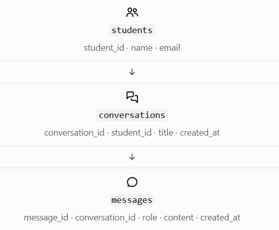

# 3.7 Managing Multiple Conversations and Conversation IDs

## 1. What is a conversation ID?

A conversation ID is an identifier that tells Spring AI which conversation's memory to retrieve and update.

For example:

| Student   | Purpose             | Conversation ID |
| --------- | ------------------- | --------------- |
| Student A | Career roadmap      | `conv-101`      |
| Student A | Java interview prep | `conv-102`      |
| Student B | Career roadmap      | `conv-201`      |

Notice that Student A has two conversations. A student ID and a conversation ID serve different purposes:

- Student ID identifies the person.
- Conversation ID identifies a particular chat belonging to that person.

This separation lets one student maintain multiple independent conversations.

## 2. How conversation IDs control memory

Let's walk through the behavior.

Conversation A — `conv-101`

User: I know Java and SQL.

User: What should I learn next?

Uses the available history from Conversation A.

Conversation B — `conv-102`

User: Help me prepare for a Java interview.

Has its own history, separate from Conversation A.

The rule is simple:

- Same conversation ID: retrieve and update the history associated with that conversation.
- Different conversation ID: work with a different conversation's history.
- Missing conversation ID: a memory advisor that requires one will reject the request.

The ID is a lookup key, not the conversation itself. The messages must actually be stored in the configured memory repository.

## 3. Implement multiple conversations

Let's reuse the `CareerAssistantService` from Topic 3.6.

```
public String chat(String conversationId, String question) {
    return chatClient.prompt()
            .user(question)
            .advisors(advisor -> advisor.param(
                    ChatMemory.CONVERSATION_ID,
                    conversationId
            ))
            .call()
            .content();
}
```

Notice that the service accepts a `conversationId` argument. It doesn't create a new ID for every message. The caller supplies the ID for the conversation that should continue.

For example:

```
// Start or continue the career-planning chat
careerAssistantService.chat(
        "conv-101",
        "I know Java and SQL."
);

careerAssistantService.chat(
        "conv-101",
        "What should I learn next?"
);

// A separate interview-preparation chat
careerAssistantService.chat(
        "conv-102",
        "Ask me a Java interview question."
);
```

The two `conv-101` requests belong to the same conversation. The `conv-102` request belongs to another one.

Important: These hard-coded IDs are for learning only. A real application should create and manage conversation records, rather than trusting arbitrary IDs from users.

## 4. How should a real application create conversation IDs?

For a new conversation, Java can generate a unique ID using `UUID`.

```
import java.util.UUID;

String conversationId = UUID.randomUUID().toString();

System.out.println(conversationId);
```

Example output:

```
8e4c02a9-7d8b-4f13-a42a-2b6d9a7c4e10
```

The output will vary each time.

The key is when you generate the ID:

- Generate an ID when the user creates a new conversation.
- Reuse that ID for every message in that conversation.
- Store the conversation ID so the user can reopen the chat later.
- Generate a different ID when the user starts another conversation.

Don't generate a fresh UUID for every message. Doing so would make every message look like a new conversation, preventing the advisor from finding the previous chat's history.

## 5. The production design: user, conversation, and messages

For your career platform, a sensible database design might look like this:



This is an illustrative application schema. Spring AI's `ChatMemoryRepository` storage is a separate implementation concern; you don't automatically get these exact tables by configuring an advisor.

Why use this design?

- One student can have many conversations.
- One conversation can have many messages.
- Each message belongs to a particular conversation.
- Your application can display a student's saved chats and check ownership before loading them.

You can use PostgreSQL to store conversation metadata and, depending on your architecture, persistent chat history as well.

## 6. Security: a conversation ID is not permission

Suppose Student A knows Student B's conversation ID. If your backend accepts the ID without checking ownership, Student A might be able to access Student B's chat.

A UUID makes IDs harder to guess, but it does not replace authorization.

A safe request flow is:

1. Authenticate the student.
2. Receive the requested conversation ID.
3. Look up the conversation and verify that it belongs to the authenticated student.
4. Only then pass the authorized ID to `ChatClient` and the memory advisor.

For example, the database lookup should conceptually check both values:

```
SELECT conversation_id
FROM conversations
WHERE conversation_id = ?
  AND student_id = ?;
```

The first parameter is the requested conversation ID; the second must come from the authenticated user's identity, not a student ID the client is free to claim.

If no matching row exists, reject the request instead of loading that conversation's memory.

## 7. Common mistakes to avoid

| Mistake                                    | Correct approach                                                    |
| ------------------------------------------ | ------------------------------------------------------------------- |
| Creating a new ID for every message        | Reuse the ID while continuing the same chat                         |
| Using one ID for every student             | Give each conversation its own ID                                   |
| Assuming a UUID guarantees security        | Check conversation ownership on the backend                         |
| Assuming the ID stores the messages        | The configured memory repository stores/retrieves messages          |
| Assuming old messages are always available | Memory policies and storage configuration determine what's retained |

## 8. Quick revision

Before the assessment, remember these four ideas:

1. A student can have multiple conversations.
2. Each conversation needs its own ID.
3. The same ID lets Spring AI retrieve the corresponding available history.
4. Your backend must verify ownership before using a conversation ID.
