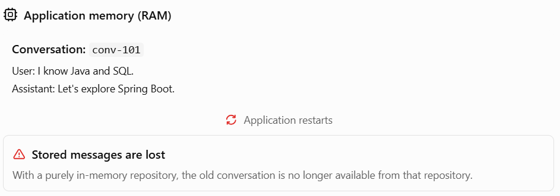
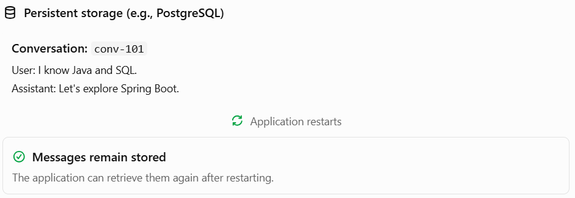

# Topic 3.8: In-Memory vs Persistent Chat Memory.

## 1. In-memory chat memory

In-memory chat memory stores conversation messages in application memory while the application is running.

Imagine your career assistant remembers:

> Student: I know Java and SQL.
>
> Assistant: Great! Let's explore Spring Boot.
>
> Student: What should I learn next?

If the application uses temporary in-memory storage, it can retrieve those messages during its lifetime. But if the application restarts, that stored conversation is generally lost.



### When is in-memory storage useful?

- Learning and testing Spring AI.
- Building a quick prototype.
- Running temporary conversations where losing history is acceptable.
- Demonstrating memory behavior without setting up a database.

Its big advantage is simplicity. Its main limitation is that the stored history is not durable.

## 2. Persistent chat memory

Persistent chat memory stores conversation messages in durable storage, such as a database. PostgreSQL is a practical option for your Spring Boot project.

For example, a student returns to your career platform the next day. Your application can retrieve their saved conversation and continue from where they left off—provided the history was persisted and the application loads it using the correct conversation ID.



### When is persistent storage useful?

- A student expects to reopen an old conversation.
- Your application needs saved chat history.
- You need to retain conversation records for an agreed period.
- You want to run multiple application instances that share conversation storage.

Persistent storage is more complex to configure and operate. You must also consider database availability, access control, retention, and privacy.

## 3. Compare the two approaches

| Feature                         | In-memory                           | Persistent                                      |
| ------------------------------- | ----------------------------------- | ----------------------------------------------- |
| Survives application restart    | Usually no                          | Yes, if saved successfully                      |
| Setup                           | Simple                              | Requires storage configuration                  |
| Retrieval after returning later | Generally unavailable after restart | Possible                                        |
| Multiple application instances  | Not automatically shared            | Can share a common store                        |
| Best fit                        | Learning and prototypes             | Production applications needing durable history |

One important nuance: persistent storage doesn't mean unlimited memory. You can persist messages in PostgreSQL while still using a limited message window for the context sent to the AI model.

## 4. How Spring AI supports persistent memory

Spring AI separates two responsibilities:

- `ChatMemory` decides which messages are kept for conversational context.
- `ChatMemoryRepository` stores and retrieves those messages.

For example, `MessageWindowChatMemory` can limit the conversation to a recent window while a JDBC-backed repository stores messages in PostgreSQL. That gives you persistent storage plus controlled context size.


### Example: PostgreSQL-backed memory

In current Spring AI 2.0.x documentation, JDBC chat memory is available through the `spring-ai-starter-model-chat-memory-repository-jdbc` starter. Your Spring AI dependencies should use compatible versions, typically managed through the Spring AI BOM.


Add this dependency to your Maven `pom.xml`:

```
<dependency>
    <groupId>org.springframework.ai</groupId>
    <artifactId>spring-ai-starter-model-chat-memory-repository-jdbc</artifactId>
</dependency>
```

Your application also needs its PostgreSQL driver and datasource configuration. For example, in `application.properties`:

```
spring.datasource.url=jdbc:postgresql://localhost:5432/careerdb
spring.datasource.username=${DB_USERNAME}
spring.datasource.password=${DB_PASSWORD}

# Create the Spring AI memory schema on startup.
# Use only when automatic schema initialization is appropriate.
spring.ai.chat.memory.repository.jdbc.initialize-schema=always
```

Here, `careerdb` is an example database name. Create the database first and configure your credentials securely.

Spring AI's JDBC repository can then be auto-configured and used to build `MessageWindowChatMemory`. Exact dependency availability and configuration can vary with your Spring AI version, so check your project's version before copying this setup.


One important production note: `ChatMemory` is designed to manage the messages needed for current conversational context, not necessarily to preserve a complete, permanent transcript of every exchange. If your platform needs a full chat-history page, you may want a separate application-level message history using Spring Data JPA or JDBC.

## 5. Quick revision

Remember these distinctions:

- In-memory repository: simple and temporary; stored messages generally disappear when the application stops.
- Persistent repository: stores messages in durable storage so they can be retrieved after a restart.
- `ChatMemory`: manages relevant messages for AI context.
- `ChatMemoryRepository`: provides the underlying storage and retrieval.
- `MessageWindowChatMemory`: limits the number of messages kept in the conversational context.

For your career platform, PostgreSQL-backed memory is worth considering if students need to return to previous chats. You can still use a message window to avoid sending an unnecessarily long conversation to Gemini.
