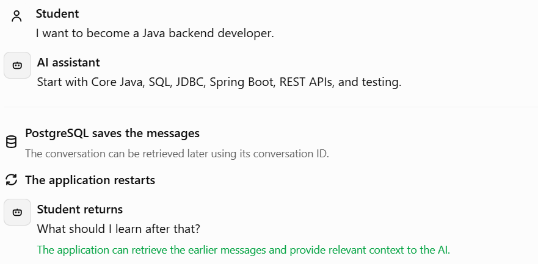
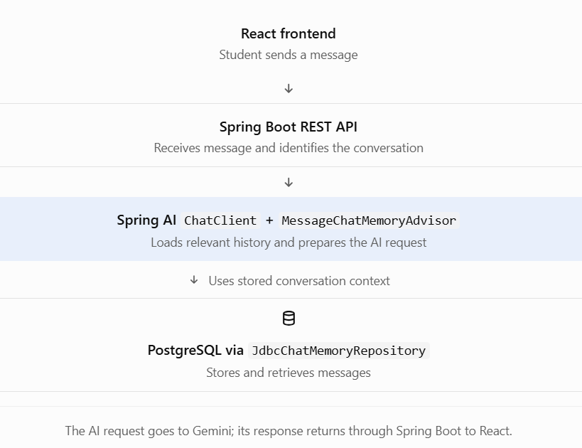

# Phase 3 — Topic 3.9: Database-Backed Conversation History

## 1. What is database-backed conversation history?

Database-backed conversation history means saving conversation messages in a database instead of keeping them only in application memory.

Imagine a student asks your career assistant:



The key idea is that PostgreSQL preserves the data, while Spring AI uses the retrieved messages to help the model continue the conversation. Saving messages alone doesn't automatically give Gemini access to them.

## 2. Why do we need a database?

| Without database-backed storage                       | With database-backed storage                                                      |
| ----------------------------------------------------- | --------------------------------------------------------------------------------- |
| Messages may disappear when the application restarts. | Saved messages can survive restarts.                                              |
| History may exist only in one application's memory.   | Multiple application instances can access shared history if configured correctly. |
| Long-term history is difficult to maintain.           | Messages can be queried and managed using database tools.                         |

For your career platform, this means a student could return days later and continue discussing the same career roadmap.

## 3. How Spring AI connects to PostgreSQL

Spring AI provides a built-in `JdbcChatMemoryRepository` that stores chat-memory messages in a relational database. It supports PostgreSQL, and Spring AI can auto-configure it when the appropriate dependency and datasource are configured.


The architecture looks like this:



## 4. Practical implementation

We'll configure the database repository first, then connect it to `ChatClient`.

### Step 1 — Add the dependency

In your Spring Boot project's `pom.xml`, add the JDBC chat-memory repository starter:

```

<dependency>
    <groupId>org.springframework.ai</groupId>
    <artifactId>spring-ai-starter-model-chat-memory-repository-jdbc</artifactId>
</dependency>

```

Keep the Spring AI dependencies aligned with the version/BOM used by your existing Gemini setup. You also need the PostgreSQL JDBC driver and a configured datasource.


### Step 2 — Configure PostgreSQL

In `application.properties`:

```

spring.datasource.url=jdbc:postgresql://localhost:5432/careerdb
spring.datasource.username=${DB_USERNAME}
spring.datasource.password=${DB_PASSWORD}

# For local development only, initialize the chat-memory schema
spring.ai.chat.memory.repository.jdbc.initialize-schema=always

```

Before running the application:

- Create the `careerdb` database in PostgreSQL.
- Set the `DB_USERNAME` and `DB_PASSWORD` environment variables.
- Make sure your PostgreSQL driver is included.
- For production, manage schema changes deliberately with a migration tool such as Flyway or Liquibase instead of blindly initializing the schema on every startup.

The JDBC repository uses a database table named `SPRING_AI_CHAT_MEMORY` by default.


### Step 3 — Connect persistent memory to `ChatClient`

Here is the central Spring AI configuration. It assumes your existing application already has a configured `ChatModel` bean for Gemini.

```

package com.example.careerassistant.config;

import org.springframework.context.annotation.Bean;
import org.springframework.context.annotation.Configuration;

import org.springframework.ai.chat.client.ChatClient;
import org.springframework.ai.chat.memory.ChatMemory;
import org.springframework.ai.chat.memory.MessageWindowChatMemory;
import org.springframework.ai.chat.memory.MessageChatMemoryAdvisor;
import org.springframework.ai.chat.memory.repository.jdbc.JdbcChatMemoryRepository;

@Configuration
public class ChatConfig {

    @Bean
    ChatMemory chatMemory(
            JdbcChatMemoryRepository repository) {

        return MessageWindowChatMemory.builder()
                .chatMemoryRepository(repository)
                .maxMessages(10)
                .build();
    }

    @Bean
    ChatClient chatClient(
            ChatClient.Builder builder,
            ChatMemory chatMemory) {

        return builder
                .defaultAdvisors(
                    MessageChatMemoryAdvisor.builder(chatMemory)
                        .build()
                )
                .build();
    }
}

```

What does each part do?

- `JdbcChatMemoryRepository`: stores and retrieves messages from PostgreSQL.
- `MessageWindowChatMemory`: manages the context window; here, we set a maximum of 10 messages.
- `MessageChatMemoryAdvisor`: retrieves messages for the current conversation and incorporates them into the AI request.
- `ChatClient`: sends the resulting request to the configured model.

The Spring AI JDBC repository and memory-window setup follow the official reference documentation.


### Step 4 — Send messages using a conversation ID

For example, a service method can look like this:

```

package com.example.careerassistant.service;

import org.springframework.ai.chat.client.ChatClient;
import org.springframework.ai.chat.memory.ChatMemory;
import org.springframework.stereotype.Service;

@Service
public class CareerChatService {

    private final ChatClient chatClient;

    public CareerChatService(ChatClient chatClient) {
        this.chatClient = chatClient;
    }

    public String chat(String conversationId, String message) {
        return chatClient.prompt()
                .user(message)
                .advisors(advisor -> advisor.param(
                        ChatMemory.CONVERSATION_ID,
                        conversationId
                ))
                .call()
                .content();
    }
}

```

The key line is:

```
advisor.param(ChatMemory.CONVERSATION_ID, conversationId)
```

Why is it important? Every request for the same conversation must use the same conversation ID so Spring AI can retrieve the matching messages. A different ID identifies a different conversation. Memory advisors require this ID explicitly.


For your actual application, the backend must also verify that the authenticated student owns the requested conversation. Never trust a conversation ID supplied by the frontend as proof of authorization.

## 5. An important distinction: memory versus full chat history

This is especially important for your project.

| Requirement                                             | Recommended approach                                          |
| ------------------------------------------------------- | ------------------------------------------------------------- |
| Keep relevant context for the next AI response          | Spring AI `ChatMemory`                                        |
| Preserve memory across application restarts             | JDBC repository backed by PostgreSQL                          |
| Display every historical message in a React chat window | A separate application-level history model may be appropriate |
| List a student's conversations by title and date        | An application-level conversation table                       |

Why separate them? `MessageWindowChatMemory` may remove older messages from the active memory window. The JDBC repository is a storage mechanism for chat memory; it should not automatically be treated as your complete, permanent user-facing transcript. Spring AI recommends a separate approach, such as Spring Data, when you need a complete chat history.


A useful design for your career platform is to store:

- Conversation metadata: conversation ID, student ID, title, creation date.
- Complete chat history: all user and assistant messages needed for the chat interface.
- AI context: a bounded set of messages used to answer the next request.

These can be designed together, but they serve different purposes.
