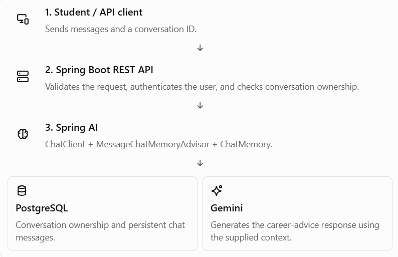

# Topic 3.12 — Mini Project: Memory-Enabled Career Assistant
- Step 1 — Project architecture and API design
- [**Step 2 — Configure Spring Boot, Spring AI, Gemini, and PostgreSQL**](Phase3_MP_2.md)
- [**Step 3 — Implement conversation memory**](Phase3_MP_3.md )
- [**Step 4 — Manage multiple conversations and IDs**](Phase3_MP_4.md)
- [**Step 5 — Add persistence and ownership checks**](Phase3_MP_5.md)
- [**Step 6 — Test memory across multiple messages and restarts**](Phase3_MP_6.md)
- Step 7 — Security review and final project assessment


## Step 1 — Project Architecture
### 1. What are we building?

We'll build a REST API for a career assistant that can remember earlier messages in a conversation.

Imagine a student asks:

- Message 1: “I'm learning Java and Spring Boot.”
- Message 2: “I want to become a backend developer.”
- Message 3: “Based on my skills, what should I learn next?”

The assistant should use the earlier messages to give relevant advice instead of treating Message 3 as an entirely new conversation.



One important distinction: Spring AI manages how conversation history is included in the model request; Gemini generates the response. PostgreSQL can retain the history between application restarts when configured with persistent storage.

## 2. Responsibilities of each component

| Component                  | Responsibility                                                            |
| -------------------------- | ------------------------------------------------------------------------- |
| `ChatController`           | Exposes REST endpoints and receives HTTP requests.                        |
| `ChatService`              | Coordinates the conversation workflow.                                    |
| `ChatClient`               | Builds and sends the AI request.                                          |
| `MessageChatMemoryAdvisor` | Retrieves relevant chat history and includes it in the model interaction. |
| `ChatMemory`               | Provides the interface for adding, retrieving, and clearing messages.     |
| `ChatMemoryRepository`     | Stores and retrieves the messages used by chat memory.                    |
| `ConversationRepository`   | Stores application-level conversation ownership and metadata.             |
| PostgreSQL                 | Persists conversations and chat messages.                                 |
| Gemini chat model          | Generates the assistant's reply.                                          |

Notice that `ConversationRepository` and `ChatMemoryRepository` have different jobs. The first helps your application decide who owns a conversation; the second handles chat-message storage. We must not confuse conversation IDs with authorization.

## 3. How one chat request flows

Suppose a student sends this request:

```
POST /api/conversations/abc-123/messages
Content-Type: application/json
```

```
{
  "message": "What should I learn next?"
}
```

The backend performs these steps:

1. Authenticate the student. Identify them from the authenticated security context, not from a user ID supplied by the frontend.
2. Check conversation ownership. Verify that conversation `abc-123` belongs to that student.
3. Send the message through Spring AI. The advisor obtains the conversation's available history and includes it in the request.
4. Call Gemini. The model uses the current message and supplied context to generate an answer.
5. Return the response. The API sends the answer back to the client, while the configured memory mechanism manages message storage.

Example response:

```
{
  "conversationId": "abc-123",
  "reply": "Since you're learning Java and Spring Boot, next focus on REST API design, testing, and database integration."
}
```

The response is illustrative; the actual answer will depend on the conversation history and model output.

## 4. Initial API design

We'll start with three endpoints:

| Method | Endpoint                           | Purpose                                                    |
| ------ | ---------------------------------- | ---------------------------------------------------------- |
| `POST` | `/api/conversations`               | Create a new conversation.                                 |
| `POST` | `/api/conversations/{id}/messages` | Send a message and receive an AI reply.                    |
| `GET`  | `/api/conversations/{id}/messages` | Retrieve the conversation transcript, after authorization. |

Later, we'll decide how to implement transcript retrieval. Chat memory isn't automatically the same as a complete, user-facing transcript, especially when the application uses a bounded message window.

## 5. What data will we store?

Our initial conversation record will contain metadata such as:

```
public class Conversation {
    private String id;
    private String ownerId;
    private String title;
}
```

This is a simplified illustration, not a complete JPA entity. We'll implement the entity, database mapping, and repository when we reach the coding steps.

Each message will belong to a conversation and have a role, content, and timestamp. The memory repository will handle message storage; the conversation table will help enforce ownership.

For the first version, we'll keep the scope focused:

- One student can have multiple conversations.
- Each conversation has its own history.
- History can persist across application restarts.
- Students cannot access another student's conversations.
- The AI provides career guidance using conversation context.


