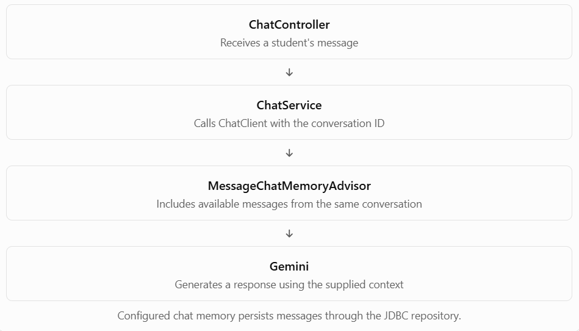

# Step 3 — Implement Conversation Memory

Now we'll connect the pieces so the assistant can remember previous messages. We'll use IntelliJ IDEA, your existing Maven project, and the Gemini configuration you already have.

## Step 3.1 — Understand the request flow



The key is the conversation ID. If two messages use the same ID, the advisor can retrieve that conversation's available history. If a new conversation uses a different ID, it gets separate memory.

## Step 3.2 — Prepare the memory-enabled `ChatClient`

Before we write the code, I want to match it to your actual Spring AI version. Spring AI APIs and auto-configuration can differ between releases, and your existing Gemini chat API already works—we don't want to break it.

In IntelliJ IDEA, please open these two files:

1. `pom.xml` — copy the Spring Boot version, Spring AI BOM version, Gemini starter dependency, and JDBC chat-memory dependency.
2. Your existing ChatClient configuration class — the class where you configure `ChatClient`, or the service where you first used it in Phase 1.

You can paste the relevant sections here. Remove any API keys, passwords, or secrets first.

We'll then implement the memory-enabled client using your existing configuration, followed by a REST endpoint and a test proving that the assistant remembers an earlier message.


//Part 2

## Step 3.3 — Create the memory-enabled career chat service

We'll use the Spring AI 2.0.1 APIs documented for your version: `MessageWindowChatMemory`, `MessageChatMemoryAdvisor`, and `ChatMemory.CONVERSATION_ID`. The JDBC starter supplies the persistent message repository, and the message window limits the history used for each conversation.


### A. Create `CareerChatService.java`

In IntelliJ IDEA, right-click `com.example.Phase2.service` → New → Java Class → `CareerChatService`.

Paste this complete class:

```
package com.example.Phase2.service;

import org.springframework.ai.chat.client.ChatClient;
import org.springframework.ai.chat.client.advisor.MessageChatMemoryAdvisor;
import org.springframework.ai.chat.memory.ChatMemory;
import org.springframework.ai.chat.memory.MessageWindowChatMemory;
import org.springframework.ai.chat.memory.repository.ChatMemoryRepository;
import org.springframework.stereotype.Service;

@Service
public class CareerChatService {

    private final ChatClient chatClient;

    public CareerChatService(
            ChatClient.Builder chatClientBuilder,
            ChatMemoryRepository chatMemoryRepository) {

        ChatMemory chatMemory = MessageWindowChatMemory.builder()
                .chatMemoryRepository(chatMemoryRepository)
                .maxMessages(20)
                .build();

        this.chatClient = chatClientBuilder.clone()
                .defaultSystem("""
                        You are a helpful career advisor for students.
                        Give practical, beginner-friendly advice about
                        Java, Spring Boot, backend development, and
                        career planning.
                        Use relevant conversation history when available.
                        Do not claim to know personal facts that the
                        student has not provided.
                        """)
                .defaultAdvisors(
                        MessageChatMemoryAdvisor.builder(chatMemory).build()
                )
                .build();
    }

    public String chat(String conversationId, String message) {

        return chatClient.prompt()
                .user(message)
                .advisors(advisors -> advisors.param(
                        ChatMemory.CONVERSATION_ID,
                        conversationId
                ))
                .call()
                .content();
    }
}
```

### Understand the important lines

- `ChatMemoryRepository` — the storage layer provided by the JDBC starter.
- `MessageWindowChatMemory` — chooses the recent messages to keep in the context window.
- `.clone()` — creates a separate builder configuration so our new memory advisor doesn't unintentionally change the existing student evaluation service.
- `.defaultAdvisors(...)` — attaches memory behavior to this career assistant's `ChatClient`.
- `ChatMemory.CONVERSATION_ID` — tells the advisor which conversation's history to retrieve and update.
- `.call().content()` — calls the model and returns the response text.

Important: A conversation ID separates memory histories, but it does not authenticate a student. We'll add ownership checks before exposing this endpoint beyond local development.

## Step 3.4 — Create request and response DTOs

Create two Java records in `com.example.Phase2.dto`.

`CareerChatRequest.java`

```
package com.example.Phase2.dto;

import jakarta.validation.constraints.NotBlank;
import jakarta.validation.constraints.Size;

public record CareerChatRequest(
        @NotBlank(message = "Message must not be blank")
        @Size(max = 4000, message = "Message must not exceed 4000 characters")
        String message
) {
}
```

`CareerChatResponse.java`

```
package com.example.Phase2.dto;

public record CareerChatResponse(
        String conversationId,
        String reply
) {
}
```

The request DTO validates the student's input. The response DTO defines the JSON returned by the API.

## Step 3.5 — Create the REST controller

Create `CareerChatController.java` in `com.example.Phase2.controller`. If the `controller` package doesn't exist, create it first.

```
package com.example.Phase2.controller;

import com.example.Phase2.dto.CareerChatRequest;
import com.example.Phase2.dto.CareerChatResponse;
import com.example.Phase2.service.CareerChatService;
import jakarta.validation.Valid;
import org.springframework.web.bind.annotation.*;

@RestController
@RequestMapping("/api/conversations")
public class CareerChatController {

    private final CareerChatService careerChatService;

    public CareerChatController(CareerChatService careerChatService) {
        this.careerChatService = careerChatService;
    }

    @PostMapping("/{conversationId}/messages")
    public CareerChatResponse sendMessage(
            @PathVariable String conversationId,
            @Valid @RequestBody CareerChatRequest request) {

        String reply = careerChatService.chat(
                conversationId,
                request.message()
        );

        return new CareerChatResponse(conversationId, reply);
    }
}
```

### How the endpoint works

POST

`http://localhost:8080/api/conversations/demo-001/messages`

Request body

```
{
  "message": "I'm learning Java and Spring Boot."
}
```

Illustrative response

```
{
  "conversationId": "demo-001",
  "reply": "Great! Java and Spring Boot are useful foundations for backend development..."
}
```

For now, `demo-001` is a test conversation ID. Reuse it to test memory; use a different ID to test isolation.

## Step 3.6 — Build and test in IntelliJ IDEA

1. Open the Maven tool window and run Lifecycle → compile.
2. Start the Spring Boot application.
3. Open IntelliJ's HTTP Client by creating a file named `career-chat.http` in the project root.
4. Add the following requests.

```
### First message
POST http://localhost:8080/api/conversations/demo-001/messages
Content-Type: application/json

{
  "message": "I'm learning Java and Spring Boot."
}

### Follow-up message using the same conversation ID
POST http://localhost:8080/api/conversations/demo-001/messages
Content-Type: application/json

{
  "message": "What technologies am I learning?"
}
```

Click the green run icon beside each request. The second response should recognize Java and Spring Boot from the conversation history. AI responses vary, so look for evidence of the earlier message rather than expecting exact wording.

Then run this third request using a different conversation ID:

```
### Separate conversation
POST http://localhost:8080/api/conversations/demo-002/messages
Content-Type: application/json

{
  "message": "What technologies am I learning?"
}
```

The assistant should not treat `demo-001`'s messages as part of `demo-002`'s history.

Security reminder: This temporary endpoint does not yet verify conversation ownership. Keep it local while testing; we'll address authorization in Step 5 before treating it as a multi-user application.


