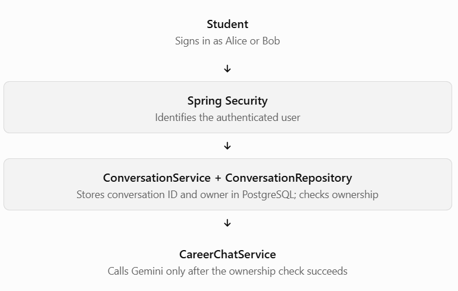
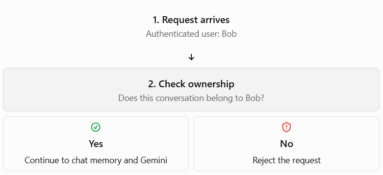

# Step 5: Add Persistence and Ownership Checks.

## Step 5.1 — Understand what we need to fix

Your current endpoint accepts a conversation ID from the URL:

```
POST /api/conversations/{conversationId}/messages
```

That works for learning, but there's an important security problem.

Imagine two students use your career assistant:

- Alice owns conversation `A`.
- Bob owns conversation `B`.
- Bob discovers Alice's conversation ID and sends a request using it.

If your backend only checks whether the ID exists—or doesn't check at all—Bob might access Alice's conversation history.

A UUID is difficult to guess, but it is not proof of ownership.

### Our target architecture



We will keep the existing `CareerChatService` and your student-evaluation functionality intact.

### What we will implement

| Component                | Responsibility                                                 |
| ------------------------ | -------------------------------------------------------------- |
| `Conversation` entity    | Store conversation ID, owner, and creation time                |
| `ConversationRepository` | Save and retrieve conversation metadata                        |
| `ConversationService`    | Create conversations and verify ownership                      |
| Spring Security          | Establish the authenticated user's identity                    |
| `CareerChatController`   | Pass that identity into the service before processing messages |

We'll use PostgreSQL for conversation metadata and keep Spring AI's existing JDBC chat-memory repository responsible for the messages. These are related but separate responsibilities.

### One important design decision

For this learning project, I recommend starting with Spring Security and two temporary in-memory users (Alice and Bob). This lets us test the ownership rules without building a complete registration and login system yet. Later, we can replace those users with database-backed accounts.

The authenticated username will come from Spring Security—not from a `userId` supplied in the request body.

For example:

- Alice creates a conversation → PostgreSQL stores Alice as its owner.
- Alice sends a message → the ownership check succeeds.
- Bob tries to send a message using Alice's conversation ID → the API rejects the request, typically with `403 Forbidden`.
- Alice restarts the application → the conversation metadata and JDBC-stored memory remain in PostgreSQL.

## Checkpoint before we code

One question to confirm you understand the security requirement:

Why is it unsafe to accept `userId` directly from the frontend and use it to decide whether someone owns a conversation?


//Part 2

## Step 5.2 — Add Spring Security

We'll first secure the API with two temporary development users, Alice and Bob. Then we'll persist conversation ownership in PostgreSQL and enforce it before any chat-memory access.

### 1. Add the Spring Security dependency

Open `pom.xml` in IntelliJ IDEA and add this inside `<dependencies>`:

```
<dependency>
    <groupId>org.springframework.boot</groupId>
    <artifactId>spring-boot-starter-security</artifactId>
</dependency>
```

Since you're using Spring Boot's parent version `4.1.1`, let Spring Boot manage the dependency version. Don't add a separate version.

Reload Maven in IntelliJ IDEA, then run:

```
mvn clean compile
```

### 2. Create `SecurityConfig.java`

Create a `config` package under `com.example.Phase2`, then create `SecurityConfig.java`.

Your file path should be:

`src/main/java/com/example/Phase2/config/SecurityConfig.java`

```

package com.example.Phase2.config;

import org.springframework.context.annotation.Bean;
import org.springframework.context.annotation.Configuration;
import org.springframework.security.config.Customizer;
import org.springframework.security.config.annotation.web.builders.HttpSecurity;
import org.springframework.security.core.userdetails.User;
import org.springframework.security.core.userdetails.UserDetails;
import org.springframework.security.core.userdetails.UserDetailsService;
import org.springframework.security.crypto.bcrypt.BCryptPasswordEncoder;
import org.springframework.security.crypto.password.PasswordEncoder;
import org.springframework.security.provisioning.InMemoryUserDetailsManager;
import org.springframework.security.web.SecurityFilterChain;

@Configuration
public class SecurityConfig {

    @Bean
    public PasswordEncoder passwordEncoder() {
        return new BCryptPasswordEncoder();
    }

    @Bean
    public UserDetailsService userDetailsService(
            PasswordEncoder passwordEncoder) {

        UserDetails alice = User.builder()
                .username("alice")
                .password(passwordEncoder.encode("alice-dev-123"))
                .roles("USER")
                .build();

        UserDetails bob = User.builder()
                .username("bob")
                .password(passwordEncoder.encode("bob-dev-123"))
                .roles("USER")
                .build();

        return new InMemoryUserDetailsManager(alice, bob);
    }

    @Bean
    public SecurityFilterChain securityFilterChain(
            HttpSecurity http) throws Exception {

        http
                // Temporary setup for testing this REST API in Postman.
                // Revisit CSRF protection before production deployment.
                .csrf(csrf -> csrf.disable())
                .authorizeHttpRequests(auth -> auth
                        .anyRequest().authenticated()
                )
                .httpBasic(Customizer.withDefaults());

        return http.build();
    }
}

```

What did we just configure?

- `PasswordEncoder` hashes the development passwords instead of storing them as plain text.
- `InMemoryUserDetailsManager` creates Alice and Bob as temporary users. Their accounts will disappear when the application restarts.
- `SecurityFilterChain` requires authentication for every endpoint.
- HTTP Basic authentication allows Postman to send credentials with each request.

The CSRF setting is a temporary learning configuration for this API. Disabling CSRF should not be copied blindly into a browser-based application or production system.

### 3. Run the application

Start your Spring Boot application as usual.

If the application starts successfully, test the security behavior using Postman.

### 4. Test with Postman

Test the existing conversation-creation endpoint first.

**Test A**

Request without credentials

Method: POST

```
http://localhost:8080/api/conversations
```

In Postman, select the Authorization tab and choose No Auth. Send the request.

Expected result: `401 Unauthorized`.

**Test B**

Authenticate as Alice

Select Basic Auth in the Authorization tab.

- Username: `alice`
- Password: `alice-dev-123`

Send the same POST request. Expected result: a successful response containing a newly generated conversation ID.

**Test C**

Authenticate as Bob

Change the Basic Auth credentials:

- Username: `bob`
- Password: `bob-dev-123`

Send the same request again. Expected result: another successful response with a new conversation ID.

//Part 3

## Step 5.3 — Store conversation ownership in PostgreSQL

We'll create a `Conversation` entity and a Spring Data JPA repository. Each conversation will have a unique ID, an owner, and a creation timestamp.

### 1. Create the `Conversation` entity

In IntelliJ IDEA, create this file:

`src/main/java/com/example/Phase2/entity/Conversation.java`

If the `entity` package doesn't exist, create it first.

```

package com.example.Phase2.entity;

import jakarta.persistence.Column;
import jakarta.persistence.Entity;
import jakarta.persistence.Id;
import jakarta.persistence.Table;

import java.time.Instant;

@Entity
@Table(name = "conversations")
public class Conversation {

    @Id
    @Column(nullable = false, updatable = false)
    private String id;

    @Column(name = "owner_username", nullable = false)
    private String ownerUsername;

    @Column(name = "created_at", nullable = false, updatable = false)
    private Instant createdAt;

    // Required by JPA
    protected Conversation() {
    }

    public Conversation(String id, String ownerUsername) {
        this.id = id;
        this.ownerUsername = ownerUsername;
        this.createdAt = Instant.now();
    }

    public String getId() {
        return id;
    }

    public String getOwnerUsername() {
        return ownerUsername;
    }

    public Instant getCreatedAt() {
        return createdAt;
    }
}

```

Understand the important fields:

| Field           | Purpose                              |
| --------------- | ------------------------------------ |
| `id`            | Unique identifier for a conversation |
| `ownerUsername` | Authenticated user who created it    |
| `createdAt`     | When the conversation was created    |

Notice that we do not accept `ownerUsername` from the frontend. The backend will obtain it from the authenticated principal.

### 2. Create `ConversationRepository`

Create:

`src/main/java/com/example/Phase2/repository/ConversationRepository.java`

```

package com.example.Phase2.repository;

import com.example.Phase2.entity.Conversation;
import org.springframework.data.jpa.repository.JpaRepository;

import java.util.Optional;

public interface ConversationRepository
        extends JpaRepository<Conversation, String> {

    Optional<Conversation> findByIdAndOwnerUsername(
            String id,
            String ownerUsername
    );
}

```

Spring Data JPA generates the query for `findByIdAndOwnerUsername()` from the method name. It lets us look up a conversation by both its ID and its owner.

Conceptually, the query is:

```
SELECT *
FROM conversations
WHERE id = ?
  AND owner_username = ?;
```

This is a useful authorization pattern: we don't need to trust a user ID sent by the client.

### 3. Create `ConversationService`

Create:

`src/main/java/com/example/Phase2/service/ConversationService.java`

```

package com.example.Phase2.service;

import com.example.Phase2.entity.Conversation;
import com.example.Phase2.repository.ConversationRepository;
import org.springframework.security.access.AccessDeniedException;
import org.springframework.stereotype.Service;
import org.springframework.transaction.annotation.Transactional;

import java.util.UUID;

@Service
public class ConversationService {

    private final ConversationRepository conversationRepository;

    public ConversationService(
            ConversationRepository conversationRepository) {
        this.conversationRepository = conversationRepository;
    }

    @Transactional
    public Conversation createConversation(String ownerUsername) {
        String conversationId = UUID.randomUUID().toString();

        Conversation conversation =
                new Conversation(conversationId, ownerUsername);

        return conversationRepository.save(conversation);
    }

    @Transactional(readOnly = true)
    public Conversation getOwnedConversation(
            String conversationId,
            String authenticatedUsername) {

        return conversationRepository
                .findByIdAndOwnerUsername(
                        conversationId,
                        authenticatedUsername
                )
                .orElseThrow(() ->
                        new AccessDeniedException(
                                "Conversation not found or access denied."
                        )
                );
    }
}

```

The two methods have different responsibilities:

- `createConversation()` generates an ID and persists the owner and creation time.
- `getOwnedConversation()` retrieves a conversation only if the authenticated user owns it.

We're preparing the ownership check now; in the next substep, we'll make sure every chat request actually uses it.

### 4. Update `CareerChatController`

Replace your existing controller with this version. It preserves your chat endpoint while making conversation creation persist the authenticated user's identity.

File: `src/main/java/com/example/Phase2/controller/CareerChatController.java`

```

package com.example.Phase2.controller;

import com.example.Phase2.dto.CareerChatRequest;
import com.example.Phase2.dto.CareerChatResponse;
import com.example.Phase2.dto.CreateConversationResponse;
import com.example.Phase2.entity.Conversation;
import com.example.Phase2.service.CareerChatService;
import com.example.Phase2.service.ConversationService;
import jakarta.validation.Valid;
import org.springframework.web.bind.annotation.*;

import java.security.Principal;

@RestController
@RequestMapping("/api/conversations")
public class CareerChatController {

    private final CareerChatService careerChatService;
    private final ConversationService conversationService;

    public CareerChatController(
            CareerChatService careerChatService,
            ConversationService conversationService) {
        this.careerChatService = careerChatService;
        this.conversationService = conversationService;
    }

    @PostMapping
    public CreateConversationResponse createConversation(
            Principal principal) {

        Conversation conversation =
                conversationService.createConversation(
                        principal.getName()
                );

        return new CreateConversationResponse(
                conversation.getId()
        );
    }

    @PostMapping("/{conversationId}/messages")
    public CareerChatResponse sendMessage(
            @PathVariable String conversationId,
            @Valid @RequestBody CareerChatRequest request) {

        // Ownership enforcement will be wired into this endpoint
        // in the next substep.
        String reply = careerChatService.chat(
                conversationId,
                request.message()
        );

        return new CareerChatResponse(conversationId, reply);
    }
}

```

Here, `Principal` represents the authenticated caller. With our current Spring Security configuration, `principal.getName()` returns `alice` or `bob`.

Security note: the message endpoint still does not enforce ownership yet. Until we wire in the ownership check, use it only for local development with test data. Do not deploy this intermediate version.

### 5. Compile and test

In IntelliJ IDEA's terminal, run:

```
mvn clean compile
```

Then restart your Spring Boot application.

In Postman, create a conversation using Alice's Basic Auth credentials:

```
POST http://localhost:8080/api/conversations
```

Repeat with Bob's credentials. Both requests should succeed and return different conversation IDs.

Finally, open PostgreSQL and run:

```
SELECT id, owner_username, created_at
FROM conversations
ORDER BY created_at DESC;
```

You should see rows similar to these (your actual IDs and timestamps will differ):

| id                              | owner_username |
| ------------------------------- | -------------- |
| `...alice-conversation-uuid...` | `alice`        |
| `...bob-conversation-uuid...`   | `bob`          |

The `conversations` table should be created automatically by your existing `spring.jpa.hibernate.ddl-auto=update` development configuration.

## Your checkpoint

Run the compile, restart, and database tests. Tell me:

1. Did `mvn clean compile` succeed?
2. Can Alice and Bob each create a conversation?
3. Does PostgreSQL show the correct `owner_username` for each conversation?

//Part 4
## Step 5.4 — Enforce conversation ownership

Our rule is simple:

> An authenticated user may send messages to a conversation only if that conversation belongs to them.

We'll update `CareerChatController` so every message request checks ownership before calling `CareerChatService`. We'll also add a small improvement to the service to avoid unnecessary database access patterns later.

### 1. Update `CareerChatController.java`

Open `src/main/java/com/example/Phase2/controller/CareerChatController.java` in IntelliJ IDEA.

Replace the entire class with the following version. The key change is inside `sendMessage()`.

```

package com.example.Phase2.controller;

import com.example.Phase2.dto.CareerChatRequest;
import com.example.Phase2.dto.CareerChatResponse;
import com.example.Phase2.dto.CreateConversationResponse;
import com.example.Phase2.entity.Conversation;
import com.example.Phase2.service.CareerChatService;
import com.example.Phase2.service.ConversationService;
import jakarta.validation.Valid;
import org.springframework.web.bind.annotation.*;

import java.security.Principal;

@RestController
@RequestMapping("/api/conversations")
public class CareerChatController {

    private final CareerChatService careerChatService;
    private final ConversationService conversationService;

    public CareerChatController(
            CareerChatService careerChatService,
            ConversationService conversationService) {
        this.careerChatService = careerChatService;
        this.conversationService = conversationService;
    }

    @PostMapping
    public CreateConversationResponse createConversation(
            Principal principal) {

        Conversation conversation =
                conversationService.createConversation(
                        principal.getName()
                );

        return new CreateConversationResponse(
                conversation.getId()
        );
    }

    @PostMapping("/{conversationId}/messages")
    public CareerChatResponse sendMessage(
            @PathVariable String conversationId,
            @Valid @RequestBody CareerChatRequest request,
            Principal principal) {

        // Step 1: Verify that the authenticated user owns this conversation.
        conversationService.getOwnedConversation(
                conversationId,
                principal.getName()
        );

        // Step 2: Only after authorization succeeds, access chat memory.
        String reply = careerChatService.chat(
                conversationId,
                request.message()
        );

        return new CareerChatResponse(
                conversationId,
                reply
        );
    }
}

```

### 2. Understand the security flow



The ownership check uses `principal.getName()`, which comes from Spring Security's authenticated identity. It does not trust a username supplied in the request body.

### 3. Test ownership using Postman

First, run:

```
mvn clean compile
```

Restart the application, then perform these tests.

**Test A — Alice accesses her own conversation**

Use Basic Auth: `alice` / `alice-dev-123`

```
POST http://localhost:8080/api/conversations/{aliceId}/messages
```

Body → raw → JSON:

```
{
  "message": "Help me plan my Java backend career."
}
```

Expected: `200 OK`, with a reply.

**Test B — Bob tries Alice's conversation**

Keep the same URL and body, but change Basic Auth to `bob` / `bob-dev-123`.

Expected: `403 Forbidden` because Bob does not own Alice's conversation. The request must not reach Gemini.

**Test C — Bob accesses his own conversation**

Use Bob's own conversation ID and Bob's credentials.

Expected: `200 OK`, with a reply.

If Test B returns a different status, tell me the exact status and response body rather than assuming the test passed.

### 4. Checkpoint — your turn!

Run the compile and all three Postman tests. Report the results:

1. Did compilation succeed?
2. Did Alice's own conversation return `200 OK`?
3. Did Bob receive `403 Forbidden` when using Alice's conversation ID?
4. Did Bob's own conversation return `200 OK`?


//Part 5
## Step 5.5 — Transcript retrieval and final ownership review

### 1. What are we adding?

Your mini-project has three planned APIs:

| Method | Endpoint                           | Purpose                       |
| ------ | ---------------------------------- | ----------------------------- |
| `POST` | `/api/conversations`               | Create a conversation         |
| `POST` | `/api/conversations/{id}/messages` | Send a message                |
| `GET`  | `/api/conversations/{id}/messages` | Retrieve conversation history |

The `GET` endpoint must use the same ownership rule as the `POST` message endpoint. Otherwise, Bob might be prevented from chatting in Alice's conversation but still be able to read her transcript.

We'll return a transcript from the existing JDBC chat-memory repository, rather than querying all rows in the database and assuming they belong to the requested conversation.

### 2. Expose the stored chat memory from `CareerChatService`

Open `CareerChatService.java`.

Currently, `chatMemory` is a local variable inside the constructor. We'll make it a field so the service can read the messages for a conversation as well as send new messages.

Replace your existing class with this version. It preserves the existing chat behavior and adds `getMessages()`.

```

package com.example.Phase2.service;

import org.springframework.ai.chat.client.ChatClient;
import org.springframework.ai.chat.client.advisor.MessageChatMemoryAdvisor;
import org.springframework.ai.chat.memory.ChatMemory;
import org.springframework.ai.chat.memory.MessageWindowChatMemory;
import org.springframework.ai.chat.memory.repository.ChatMemoryRepository;
import org.springframework.ai.chat.messages.Message;
import org.springframework.stereotype.Service;

import java.util.List;

@Service
public class CareerChatService {

    private final ChatClient chatClient;
    private final ChatMemory chatMemory;

    public CareerChatService(
            ChatClient.Builder chatClientBuilder,
            ChatMemoryRepository chatMemoryRepository) {

        this.chatMemory = MessageWindowChatMemory.builder()
                .chatMemoryRepository(chatMemoryRepository)
                .maxMessages(20)
                .build();

        this.chatClient = chatClientBuilder.clone()
                .defaultSystem("""
                        You are a helpful career advisor for students.
                        Give practical, beginner-friendly advice about
                        Java, Spring Boot, backend development, and
                        career planning.
                        Use relevant conversation history when available.
                        Do not claim to know personal facts that the
                        student has not provided.
                        """)
                .defaultAdvisors(
                        MessageChatMemoryAdvisor.builder(chatMemory).build()
                )
                .build();
    }

    public String chat(String conversationId, String message) {
        return chatClient.prompt()
                .user(message)
                .advisors(advisors -> advisors.param(
                        ChatMemory.CONVERSATION_ID,
                        conversationId
                ))
                .call()
                .content();
    }

    public List<Message> getMessages(String conversationId) {
        return chatMemory.get(conversationId);
    }
}

```

Why this matters: `ChatMemory` gives us access to the messages associated with a particular conversation ID. We'll only call it after verifying that the authenticated user owns that conversation.

### 3. Create transcript response DTOs

In `com.example.Phase2.dto`, create two files.

`ConversationMessageResponse.java`

```

package com.example.Phase2.dto;

public record ConversationMessageResponse(
        String role,
        String content
) {}

```

`ConversationTranscriptResponse.java`

```

package com.example.Phase2.dto;

import java.util.List;

public record ConversationTranscriptResponse(
        String conversationId,
        List<ConversationMessageResponse> messages
) {}

```

These DTOs define a clean API response rather than exposing Spring AI's internal message objects directly.

### 4. Add the authorized GET endpoint

Update `CareerChatController.java` by adding the imports and method shown below. Keep your existing constructor, conversation-creation endpoint, and protected message endpoint.

Add these imports:

```
import com.example.Phase2.dto.ConversationMessageResponse;
import com.example.Phase2.dto.ConversationTranscriptResponse;
import org.springframework.ai.chat.messages.Message;

import java.util.List;
```

Then add this method inside `CareerChatController`:

```

@GetMapping("/{conversationId}/messages")
public ConversationTranscriptResponse getTranscript(
        @PathVariable String conversationId,
        Principal principal) {

    // Verify ownership before accessing chat memory.
    conversationService.getOwnedConversation(
            conversationId,
            principal.getName()
    );

    // Read only this conversation's messages.
    List<ConversationMessageResponse> messages =
            careerChatService.getMessages(conversationId)
                    .stream()
                    .map(message -> new ConversationMessageResponse(
                            message.getMessageType().name(),
                            message.getText()
                    ))
                    .toList();

    return new ConversationTranscriptResponse(
            conversationId,
            messages
    );
}

```

The order is crucial:

1. Authenticate the caller through Spring Security.
2. Check conversation ownership in PostgreSQL.
3. Read that conversation's chat memory.
4. Return the transcript.

If the ownership check fails, the method stops before reading the transcript.

### 5. Compile and test the transcript endpoint

Run this in IntelliJ IDEA's terminal:

```
mvn clean compile
```

Restart the application, then use Postman.

Test A — Alice reads her own transcript

```
GET http://localhost:8080/api/conversations/{aliceId}/messages
```

Authorization → Basic Auth → Alice's credentials.

Expected: `200 OK`, with the messages from Alice's conversation.

Test B — Bob tries to read Alice's transcript

Use the same URL, but authenticate as Bob.

Expected: `403 Forbidden`.

Test C — Bob reads his own transcript

Use Bob's conversation ID and Bob's credentials.

Expected: `200 OK`, with only Bob's conversation messages.

A transcript can look like this:

```
{
  "conversationId": "your-conversation-id",
  "messages": [
    {
      "role": "USER",
      "content": "I want to become a backend developer."
    },
    {
      "role": "ASSISTANT",
      "content": "Let's create a backend development roadmap."
    }
  ]
}
```

The actual response will depend on your stored messages.

### 6. Verify persistence across a restart

Your application uses PostgreSQL for both conversation metadata and Spring AI's JDBC chat-memory repository. Let's verify that both survive a restart.

1. As Alice, create a conversation and send it a message.
2. Stop your Spring Boot application.
3. Start the application again.
4. As Alice, request the same transcript using the same conversation ID.
5. Check that the earlier messages are still present.

Also verify that Alice's conversation metadata remains in the `conversations` table.

Important: your `MessageWindowChatMemory` is configured with `maxMessages(20)`. The application is designed to work with a limited message window, so don't assume every historical message will always be sent to Gemini. Transcript behavior also depends on the memory implementation and its configured window.

