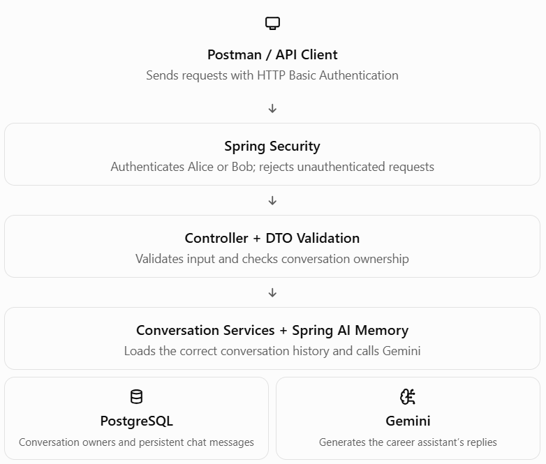
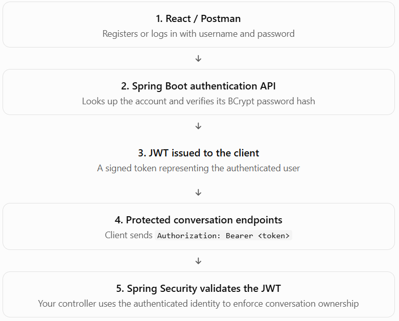
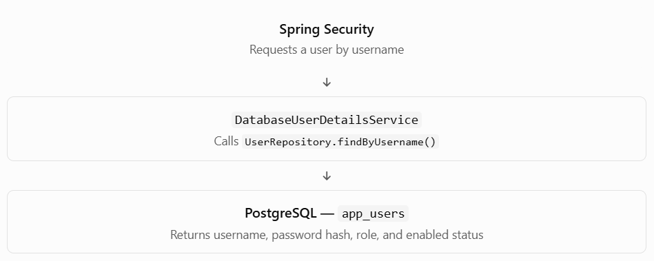

# Step 7 — Security Review and Final Project Assessment

## 7.1 Review the architecture you have built

Your application now has several layers working together:


The central security principle is this: the backend, not the AI model or the conversation ID, decides who can access a conversation.

## 7.2 Security review checklist

Review each item against your current implementation. These checks are designed to identify what you should improve before treating the mini-project as production-ready.

### Security audit checklist

1. Authentication
All conversation endpoints require authentication.
Review: Your current Basic Auth setup satisfies this for the learning project.

2. Authorization
Every read and write verifies conversation ownership.
Review: Keep the ownership check before accessing chat memory or calling Gemini.

3. Credentials and secrets
Passwords, Gemini API keys, and database credentials are not committed to source control.
Review: Use environment variables or a secret manager.

4. Transport security
Credentials and chat messages are protected in transit.
Review: Basic Auth must be used over HTTPS outside local development.

5. CSRF configuration
CSRF protection matches the authentication mechanism and client type.
Review: Your current configuration disables CSRF; review this before production. Do not blindly enable or disable it without considering the client and authentication design.

6. Persistent chat history
Conversation history has suitable access controls and retention rules.
Review: Users should not retain private conversation data indefinitely without a reason.

7. AI input and output
User messages are treated as untrusted input, and AI responses are not trusted automatically.
Review: Prompt instructions are not a substitute for backend authorization and validation.

8. Abuse protection
Requests have sensible size limits, rate limits, and safe error handling.
Review: Your 4,000-character limit is a good start; it does not prevent request flooding by itself.


## Step 7.2 — Database-backed users + JWT authentication

### What we're building



A key distinction: JWT authentication does not replace authorization. Even with a valid JWT, Bob must not be able to access Alice's conversation.

We'll work in this order:

1. Create the `User` entity and PostgreSQL table.
2. Create `UserRepository`.
3. Implement database-backed `UserDetailsService`.
4. Configure JWT issuance and JWT validation in Spring Security.
5. Test registration/login, invalid credentials, and conversation ownership in Postman.

- **Stage 1 — User entity and repository**
- **Stage 2 — Database-backed user loading**
- **Stage 3 — JWT login and token issuance**
- **Stage 4 — JWT validation and security configuration**
- **Stage 5 — Postman security tests**


## Stage 1 — Create the user entity and repository

### 1. Create `AppUser.java`

In IntelliJ IDEA, open `com.example.Phase2.entity`, create a new Java class named `AppUser`, and replace its contents with this complete code.

We use `AppUser` rather than `User` to avoid confusion with Spring Security's own `User` class.

```

package com.example.Phase2.entity;

import jakarta.persistence.Column;
import jakarta.persistence.Entity;
import jakarta.persistence.GeneratedValue;
import jakarta.persistence.GenerationType;
import jakarta.persistence.Id;
import jakarta.persistence.PrePersist;
import jakarta.persistence.Table;

import java.time.Instant;

@Entity
@Table(name = "app_users")
public class AppUser {

    @Id
    @GeneratedValue(strategy = GenerationType.IDENTITY)
    private Long id;

    @Column(nullable = false, unique = true, length = 50)
    private String username;

    @Column(name = "password_hash", nullable = false, length = 100)
    private String passwordHash;

    @Column(nullable = false, length = 20)
    private String role = "USER";

    @Column(nullable = false)
    private boolean enabled = true;

    @Column(name = "created_at", nullable = false, updatable = false)
    private Instant createdAt;

    protected AppUser() {
        // Required by JPA
    }

    public AppUser(String username, String passwordHash) {
        this.username = username;
        this.passwordHash = passwordHash;
    }

    @PrePersist
    protected void onCreate() {
        if (createdAt == null) {
            createdAt = Instant.now();
        }
    }

    public Long getId() {
        return id;
    }

    public String getUsername() {
        return username;
    }

    public String getPasswordHash() {
        return passwordHash;
    }

    public String getRole() {
        return role;
    }

    public boolean isEnabled() {
        return enabled;
    }

    public Instant getCreatedAt() {
        return createdAt;
    }
}

```

### Understand the important fields

| Field          | Purpose                                          |
| -------------- | ------------------------------------------------ |
| `id`           | Unique database identity for each user           |
| `username`     | Unique login name                                |
| `passwordHash` | Stores the BCrypt hash, never the plain password |
| `role`         | Defines the user's application role              |
| `enabled`      | Allows an account to be disabled                 |
| `createdAt`    | Records when the account was created             |

The `@PrePersist` method automatically sets the creation timestamp before a new entity is inserted.

### 2. Create `UserRepository.java`

Open `com.example.Phase2.repository` and create `UserRepository.java`.

```

package com.example.Phase2.repository;

import com.example.Phase2.entity.AppUser;
import org.springframework.data.jpa.repository.JpaRepository;

import java.util.Optional;

public interface UserRepository extends JpaRepository<AppUser, Long> {

    Optional<AppUser> findByUsername(String username);

    boolean existsByUsername(String username);
}

```

Spring Data JPA generates the queries for these methods automatically:

- `findByUsername("alice")` — finds Alice's account.
- `existsByUsername("alice")` — checks whether that username is already registered.
- `save(appUser)` — inserts a new account or updates an existing one.

We will use these methods when implementing registration and database-backed authentication.

//Stage 2

## Stage 2 — Implement database-backed `UserDetailsService`

### What are we changing?

Currently, your `SecurityConfig` contains hard-coded users:

- Alice
- Bob

Spring Security authenticates those users from memory. We want it to retrieve user accounts from PostgreSQL instead.

The flow will become:



`UserDetailsService` is a Spring Security interface for loading a user by username. It doesn't issue JWTs itself; we'll use it during login and later to validate credentials.

## 2.1 Create `DatabaseUserDetailsService.java`

In IntelliJ IDEA, open `com.example.Phase2.service`.

Create a new Java class named `DatabaseUserDetailsService` and use this complete code:

```

package com.example.Phase2.service;

import com.example.Phase2.entity.AppUser;
import com.example.Phase2.repository.UserRepository;
import org.springframework.security.core.userdetails.User;
import org.springframework.security.core.userdetails.UserDetails;
import org.springframework.security.core.userdetails.UserDetailsService;
import org.springframework.security.core.userdetails.UsernameNotFoundException;
import org.springframework.stereotype.Service;

@Service
public class DatabaseUserDetailsService implements UserDetailsService {

    private final UserRepository userRepository;

    public DatabaseUserDetailsService(UserRepository userRepository) {
        this.userRepository = userRepository;
    }

    @Override
    public UserDetails loadUserByUsername(String username)
            throws UsernameNotFoundException {

        AppUser appUser = userRepository.findByUsername(username)
                .orElseThrow(() ->
                        new UsernameNotFoundException(
                                "User not found: " + username
                        )
                );

        String authority = appUser.getRole().startsWith("ROLE_")
                ? appUser.getRole()
                : "ROLE_" + appUser.getRole();

        return User.withUsername(appUser.getUsername())
                .password(appUser.getPasswordHash())
                .authorities(authority)
                .disabled(!appUser.isEnabled())
                .build();
    }
}

```

### 2.2 Understand the code

1\. Inject `UserRepository`

```
private final UserRepository userRepository;
```

Spring injects the repository, allowing this service to query PostgreSQL.

2\. Find the account

```
AppUser appUser = userRepository.findByUsername(username)
        .orElseThrow(() ->
                new UsernameNotFoundException("User not found: " + username)
        );
```

If the username exists, we retrieve its account. Otherwise, Spring Security receives a `UsernameNotFoundException`.

3\. Return Spring Security's `UserDetails`

```
return User.withUsername(appUser.getUsername())
        .password(appUser.getPasswordHash())
        .authorities(authority)
        .disabled(!appUser.isEnabled())
        .build();
```

This maps your database entity into the format Spring Security understands.

Notice that `.password()` receives the stored BCrypt hash, not the user's original password. Spring Security's authentication provider will compare the submitted password against that hash when we connect the authentication flow.


//Stage 3
## Stage 3.1 — Add the JWT dependency

Open `pom.xml` and add this dependency inside `<dependencies>`:

```

<dependency>
    <groupId>org.springframework.boot</groupId>
    <artifactId>spring-boot-starter-oauth2-resource-server</artifactId>
</dependency>

```

This starter provides Spring Security's JWT resource-server support, including the JOSE functionality needed to sign and validate JWTs.

Then reload Maven in IntelliJ. Do not remove your existing Spring AI, PostgreSQL, JPA, validation, or security dependencies.

## Stage 3.2 — Configure a JWT signing secret

A JWT must be signed so the server can detect tampering. We'll use the `HS256` algorithm with a randomly generated secret of at least 256 bits.

In PowerShell, run:

```
[Convert]::ToBase64String(
    [Security.Cryptography.RandomNumberGenerator]::GetBytes(32)
)
```

Copy the generated value somewhere secure. Do not share it here or commit it to Git.

Add this property to `application.properties`:

```
app.jwt.secret=${JWT_SECRET}
```

In IntelliJ, open Run → Edit Configurations, select your Spring Boot run configuration, and add `JWT_SECRET` to its environment variables, using the generated Base64 value.

Keep your existing database properties unchanged. If the secret is missing, the application should fail to start rather than silently use an insecure default.

## Stage 3.3 — Create the authentication DTOs

Create these classes in `com.example.Phase2.dto`.

### `RegisterRequest.java`

```

package com.example.Phase2.dto;

import jakarta.validation.constraints.NotBlank;
import jakarta.validation.constraints.Size;

public record RegisterRequest(
        @NotBlank
        @Size(min = 3, max = 50)
        String username,

        @NotBlank
        @Size(min = 8, max = 72)
        String password
) {}

```

### `LoginRequest.java`

```

package com.example.Phase2.dto;

import jakarta.validation.constraints.NotBlank
;
public record LoginRequest(
        @NotBlank String username,
        @NotBlank String password
) {}

```

### `AuthResponse.java`

```

package com.example.Phase2.dto;

public record AuthResponse(
        String accessToken,
        String tokenType,
        long expiresIn
) {}

```

The response will contain the token, its type (`Bearer`), and its lifetime in seconds.

## Stage 3.4 — Create `JwtService.java`

Create this class in `com.example.Phase2.service`.

```

package com.example.Phase2.service;

import com.nimbusds.jose.jwk.source.ImmutableSecret;
import org.springframework.beans.factory.annotation.Value;
import org.springframework.security.oauth2.jose.jws.JwsHeader;
import org.springframework.security.oauth2.jose.jws.MacAlgorithm;
import org.springframework.security.oauth2.jwt.JwtClaimsSet;
import org.springframework.security.oauth2.jwt.JwtEncoder;
import org.springframework.security.oauth2.jwt.JwtEncoderParameters;
import org.springframework.security.oauth2.jwt.NimbusJwtEncoder;
import org.springframework.stereotype.Service;

import javax.crypto.SecretKey;
import javax.crypto.spec.SecretKeySpec;
import java.time.Instant;
import java.util.Base64;
import java.util.List;

@Service
public class JwtService {

    private static final long TOKEN_LIFETIME_SECONDS = 3600;

    private final JwtEncoder jwtEncoder;

    public JwtService(@Value("${app.jwt.secret}") String secret) {
        byte[] keyBytes = Base64.getDecoder().decode(secret);

        if (keyBytes.length < 32) {
            throw new IllegalArgumentException(
                    "JWT secret must decode to at least 32 bytes"
            );
        }

        SecretKey key = new SecretKeySpec(keyBytes, "HmacSHA256");
        this.jwtEncoder = new NimbusJwtEncoder(
                new ImmutableSecret<>(key)
        );
    }

    public String generateToken(
            String username,
            String role
    ) {
        Instant now = Instant.now();

        JwtClaimsSet claims = JwtClaimsSet.builder()
                .issuer("career-assistant")
                .subject(username)
                .issuedAt(now)
                .expiresAt(now.plusSeconds(TOKEN_LIFETIME_SECONDS))
                .claim("roles", List.of(
                        role.startsWith("ROLE_") ? role : "ROLE_" + role
                ))
                .build();

        JwsHeader header = JwsHeader
                .with(MacAlgorithm.HS256)
                .build();

        return jwtEncoder.encode(
                JwtEncoderParameters.from(header, claims)
        ).getTokenValue();
    }

    public long getTokenLifetimeSeconds() {
        return TOKEN_LIFETIME_SECONDS;
    }
}

```

This service signs a token with:

- `sub` — the authenticated username.
- `iat` — when the token was issued.
- `exp` — when it expires.
- `roles` — the user's role.
- `iss` — the issuer identifier.

The token lasts one hour. This is a simple learning implementation; we'll configure Spring Security to validate the signature and expiration in Stage 4.

## Stage 3.5 — Pause and compile

Before connecting registration and login, let's verify that the dependencies, DTOs, and JWT signing service are correct.

1. Reload Maven.
2. Confirm `JWT_SECRET` is configured in IntelliJ's run configuration.
3. Run Build → Build Project.


## Stage 3.6 — Registration and login services

We'll make registration save a BCrypt hash and make login authenticate through Spring Security's `AuthenticationManager`. This means login will use your database-backed `UserDetailsService` rather than trusting a username supplied by the client.

### 3.6.1 Create `AuthService.java`

In IntelliJ IDEA, create `com.example.Phase2.service.AuthService`.

This service handles registration and login. Use this complete class:

```

package com.example.Phase2.service;

import com.example.Phase2.dto.AuthResponse;
import com.example.Phase2.entity.AppUser;
import com.example.Phase2.repository.UserRepository;
import org.springframework.http.HttpStatus;
import org.springframework.security.authentication.AuthenticationManager;
import org.springframework.security.authentication.UsernamePasswordAuthenticationToken;
import org.springframework.security.core.Authentication;
import org.springframework.security.core.GrantedAuthority;
import org.springframework.security.crypto.password.PasswordEncoder;
import org.springframework.stereotype.Service;
import org.springframework.transaction.annotation.Transactional;
import org.springframework.web.server.ResponseStatusException;

@Service
public class AuthService {

    private final UserRepository userRepository;
    private final PasswordEncoder passwordEncoder;
    private final AuthenticationManager authenticationManager;
    private final JwtService jwtService;

    public AuthService(
            UserRepository userRepository,
            PasswordEncoder passwordEncoder,
            AuthenticationManager authenticationManager,
            JwtService jwtService) {
        this.userRepository = userRepository;
        this.passwordEncoder = passwordEncoder;
        this.authenticationManager = authenticationManager;
        this.jwtService = jwtService;
    }

    @Transactional
    public AuthResponse register(String username, String password) {
        String normalizedUsername = username.strip();

        if (userRepository.existsByUsername(normalizedUsername)) {
            throw new ResponseStatusException(
                    HttpStatus.CONFLICT,
                    "Username is already registered"
            );
        }

        AppUser appUser = new AppUser(
                normalizedUsername,
                passwordEncoder.encode(password)
        );

        AppUser savedUser = userRepository.save(appUser);

        String token = jwtService.generateToken(
                savedUser.getUsername(),
                savedUser.getRole()
        );

        return new AuthResponse(
                token,
                "Bearer",
                jwtService.getTokenLifetimeSeconds()
        );
    }

    public AuthResponse login(String username, String password) {
        Authentication authentication =
                authenticationManager.authenticate(
                        new UsernamePasswordAuthenticationToken(
                                username.strip(),
                                password
                        )
                );

        String role = authentication.getAuthorities()
                .stream()
                .map(GrantedAuthority::getAuthority)
                .findFirst()
                .orElseThrow(() -> new IllegalStateException(
                        "Authenticated user has no authority"
                ));

        String token = jwtService.generateToken(
                authentication.getName(),
                role
        );

        return new AuthResponse(
                token,
                "Bearer",
                jwtService.getTokenLifetimeSeconds()
        );
    }
}

```

Why this matters:

- `passwordEncoder.encode(password)` hashes the password before saving it.
- `authenticationManager.authenticate(...)` verifies login credentials through Spring Security.
- `jwtService.generateToken(...)` creates a signed token only after the relevant registration or authentication succeeds.

Registration returns a token immediately in this learning implementation, so the newly registered user can proceed to the protected API.

### 3.6.2 Create `AuthController.java`

Create `com.example.Phase2.controller.AuthController`.

```

package com.example.Phase2.controller;

import com.example.Phase2.dto.AuthResponse;
import com.example.Phase2.dto.LoginRequest;
import com.example.Phase2.dto.RegisterRequest;
import com.example.Phase2.service.AuthService;
import jakarta.validation.Valid;
import org.springframework.http.HttpStatus;
import org.springframework.web.bind.annotation.*;

@RestController
@RequestMapping("/api/auth")
public class AuthController {

    private final AuthService authService;

    public AuthController(AuthService authService) {
        this.authService = authService;
    }

    @PostMapping("/register")
    @ResponseStatus(HttpStatus.CREATED)
    public AuthResponse register(
            @Valid @RequestBody RegisterRequest request) {
        return authService.register(
                request.username(),
                request.password()
        );
    }

    @PostMapping("/login")
    public AuthResponse login(
            @Valid @RequestBody LoginRequest request) {
        return authService.login(
                request.username(),
                request.password()
        );
    }
}

```

Your new endpoints will be:

| Method | Endpoint             | Purpose                                |
| ------ | -------------------- | -------------------------------------- |
| POST   | `/api/auth/register` | Create an account and receive a token  |
| POST   | `/api/auth/login`    | Verify credentials and receive a token |

These endpoints will need to be public in the security configuration, while conversation endpoints remain protected. We'll configure that in Stage 4.

## Stage 3.7 — Compile checkpoint

In IntelliJ IDEA:

1. Save both classes.
2. Select Build → Build Project.
3. Check for compilation errors.

//Stage 4
## Stage 4 — Configure Spring Security for JWT

We'll update your existing `SecurityConfig.java` and add a JWT decoder. Your existing conversation ownership checks and Spring AI services will remain in place.

The resulting behavior will be:

- `POST /api/auth/register` — public.
- `POST /api/auth/login` — public.
- `/api/conversations/**` — requires a valid JWT.
- Missing or invalid JWT — `401 Unauthorized`.
- Valid JWT but another user's conversation — `403 Forbidden`.

## 4.1 Replace `SecurityConfig.java`

Open `com.example.Phase2.config.SecurityConfig.java` in IntelliJ IDEA.

Replace the entire existing class with this version. It removes the hard-coded Alice/Bob accounts, uses the database-backed user service, and configures stateless JWT authentication.

```

package com.example.Phase2.config;

import com.example.Phase2.service.DatabaseUserDetailsService;
import org.springframework.beans.factory.annotation.Value;
import org.springframework.context.annotation.Bean;
import org.springframework.context.annotation.Configuration;
import org.springframework.security.authentication.AuthenticationManager;
import org.springframework.security.authentication.ProviderManager;
import org.springframework.security.authentication.dao.DaoAuthenticationProvider;
import org.springframework.security.config.Customizer;
import org.springframework.security.config.annotation.web.builders.HttpSecurity;
import org.springframework.security.config.http.SessionCreationPolicy;
import org.springframework.security.core.userdetails.UserDetailsService;
import org.springframework.security.crypto.bcrypt.BCryptPasswordEncoder;
import org.springframework.security.crypto.password.PasswordEncoder;
import org.springframework.security.oauth2.jose.jws.MacAlgorithm;
import org.springframework.security.oauth2.jwt.JwtDecoder;
import org.springframework.security.oauth2.jwt.JwtValidators;
import org.springframework.security.oauth2.jwt.NimbusJwtDecoder;
import org.springframework.security.oauth2.server.resource.authentication.JwtAuthenticationConverter;
import org.springframework.security.oauth2.server.resource.authentication.JwtGrantedAuthoritiesConverter;
import org.springframework.security.web.SecurityFilterChain;

import javax.crypto.SecretKey;
import javax.crypto.spec.SecretKeySpec;
import java.util.Base64;

@Configuration
public class SecurityConfig {

    @Bean
    public PasswordEncoder passwordEncoder() {
        return new BCryptPasswordEncoder();
    }

    @Bean
    public AuthenticationManager authenticationManager(
            UserDetailsService userDetailsService,
            PasswordEncoder passwordEncoder) {

        DaoAuthenticationProvider provider =
                new DaoAuthenticationProvider(userDetailsService);

        provider.setPasswordEncoder(passwordEncoder);

        return new ProviderManager(provider);
    }

    @Bean
    public JwtDecoder jwtDecoder(
            @Value("${app.jwt.secret}") String secret) {

        byte[] keyBytes = Base64.getDecoder().decode(secret);

        if (keyBytes.length < 32) {
            throw new IllegalArgumentException(
                    "JWT secret must decode to at least 32 bytes"
            );
        }

        SecretKey key = new SecretKeySpec(
                keyBytes, "HmacSHA256"
        );

        NimbusJwtDecoder decoder = NimbusJwtDecoder
                .withSecretKey(key)
                .macAlgorithm(MacAlgorithm.HS256)
                .build();

        decoder.setJwtValidator(
                JwtValidators.createDefaultWithIssuer(
                        "career-assistant"
                )
        );

        return decoder;
    }

    @Bean
    public JwtAuthenticationConverter jwtAuthenticationConverter() {
        JwtGrantedAuthoritiesConverter authoritiesConverter =
                new JwtGrantedAuthoritiesConverter();

        authoritiesConverter.setAuthoritiesClaimName("roles");
        authoritiesConverter.setAuthorityPrefix("");

        JwtAuthenticationConverter converter =
                new JwtAuthenticationConverter();

        converter.setJwtGrantedAuthoritiesConverter(
                authoritiesConverter
        );

        return converter;
    }

    @Bean
    public SecurityFilterChain securityFilterChain(
            HttpSecurity http,
            JwtDecoder jwtDecoder,
            JwtAuthenticationConverter jwtAuthenticationConverter)
            throws Exception {

        http
            .csrf(csrf -> csrf.disable())
            .sessionManagement(session -> session
                .sessionCreationPolicy(SessionCreationPolicy.STATELESS))
            .authorizeHttpRequests(auth -> auth
                .requestMatchers(
                    "/api/auth/register",
                    "/api/auth/login"
                ).permitAll()
                .anyRequest().authenticated()
            )
            .oauth2ResourceServer(oauth2 -> oauth2
                .jwt(jwt -> jwt
                    .decoder(jwtDecoder)
                    .jwtAuthenticationConverter(
                        jwtAuthenticationConverter
                    )
                )
            );

        return http.build();
    }
}

```

### Understand the important parts

- `DaoAuthenticationProvider` loads users through `DatabaseUserDetailsService` and checks submitted passwords using BCrypt.
- `JwtDecoder` verifies the JWT signature, expiration, and expected issuer.
- `STATELESS` means Spring Security doesn't use an HTTP session to retain authentication between requests.
- `permitAll()` allows registration and login without an existing token.
- `anyRequest().authenticated()` protects the remaining endpoints.
- The JWT authority converter maps your `roles` claim into Spring Security authorities.

The JWT secret used by `JwtService` and `JwtDecoder` must be the same secret. Otherwise, the server won't accept tokens issued by your own login service.

## 4.2 Keep your existing conversation authorization

You should not need to rewrite `CareerChatController` or `ConversationService`. Their existing owner checks remain essential.

For example, the controller must still perform this check before accessing memory or calling Gemini:

```
conversationService.getOwnedConversation(
        conversationId,
        principal.getName()
);
```

With JWT authentication, `principal.getName()` should resolve to the JWT subject—the username in the `sub` claim. Your existing ownership lookup then compares that username against the conversation's owner.

## 4.3 Build and start the application

In IntelliJ IDEA:

1. Save `SecurityConfig.java`.
2. Select Build → Build Project.
3. If compilation succeeds, run your Spring Boot application.
4. Confirm the application starts and connects to PostgreSQL.


