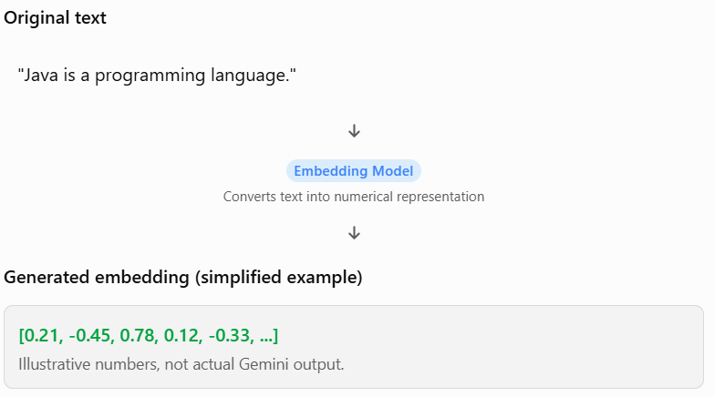
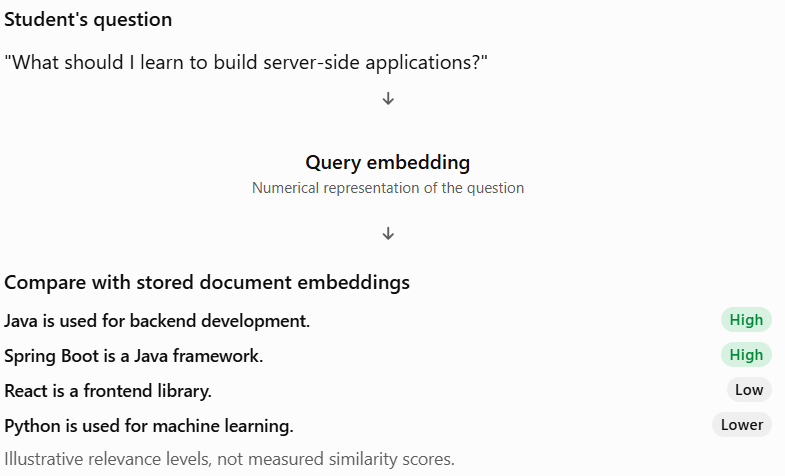
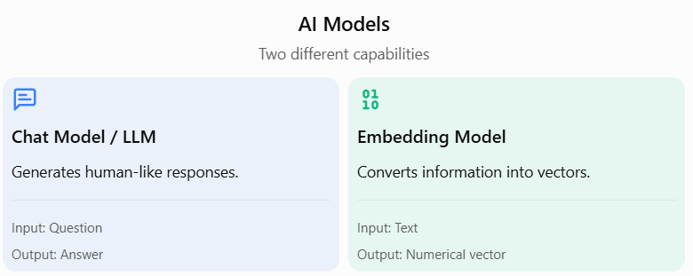

# Topic 4.1 — Introduction to Embeddings

## 1. What are embeddings?

Let's start with a simple problem.

Imagine you're developing your AI Skill and Career Management Platform.

Your application contains these three pieces of information:

1. "Java is a popular programming language used for backend development."
2. "Spring Boot simplifies Java application development."
3. "Python is widely used in machine learning and data science."

Now, a student asks your application:

"Which technology should I learn to become a backend developer?"

How can your application identify that the first two documents are relevant to the question?

Traditional database searches generally look for matching words or conditions.

But AI applications need something more powerful: understanding the meaning behind text.

This is where embeddings come into the picture.

Definition:

An embedding is a numerical representation of data, such as text, images, or audio, in the form of a vector.

In simple words:

> Embeddings convert human-readable information into numerical representations that machine learning systems can compare and process.

For example:



Notice something important:

The original sentence is text, but its embedding is a numerical vector.

An embedding model performs this conversion.

## 2. Why do AI applications need embeddings?

Let's understand this through a practical example.

Suppose your application stores these documents:

| ID | Stored document                       |
| -- | ------------------------------------- |
| 1  | Java is used for backend development. |
| 2  | Spring Boot is a Java framework.      |
| 3  | React is a frontend library.          |
| 4  | Python is used for machine learning.  |

A student searches:

"What should I learn to build server-side applications?"

### Problem with traditional keyword search

A traditional SQL query might look like:

```
SELECT *
FROM career_documents
WHERE content LIKE '%server-side%';
```

But none of our stored documents contains the exact phrase "server-side".

Consequently, this query might return zero results.

However, we know that Java and Spring Boot are highly relevant!

### Solution using embeddings

An embedding model converts the search query and stored documents into vectors.

The application compares their numerical representations to identify documents with similar meanings.


 
The application can now retrieve information based on meaning rather than requiring exact keyword matches.

This capability is called Semantic Search.

We'll study it properly in Topic 4.5.

### Main reasons embeddings are useful

1. Semantic search: Find information based on meaning.
2. Recommendation systems: Recommend similar courses, skills, or products.
3. Document retrieval: Find relevant information from large document collections.
4. Classification: Help identify categories based on learned representations.
5. Duplicate detection: Identify texts with similar meanings even when their wording differs.

## 3. How are embeddings different from ordinary text?

Let's compare them.

| Ordinary text                  | Embeddings                           |
| ------------------------------ | ------------------------------------ |
| Human-readable                 | Numerical representation             |
| Contains words and sentences   | Contains numerical values            |
| Easy for humans to understand  | Not directly interpretable by humans |
| Can be searched using keywords | Can be compared mathematically       |
| Stored as text                 | Stored as numerical vectors          |

Consider:

Text A:

"I want to become a Java developer."

Text B:

"My goal is to work as a Java programmer."

The wording is different, but the meanings are similar.

An embedding model can generate numerical vectors that are close to each other in the embedding space.

This is the fundamental idea behind semantic similarity.

One important clarification: embeddings don't translate text into a fixed dictionary of words or assign one number to each word. They represent the overall input in a learned numerical space.

We'll understand vectors and dimensions in Topic 4.2.

## 4. Real-world applications of embeddings

Let's look at applications you probably already use.


**Search engines**

Find relevant information even when the search query doesn't exactly match the webpage wording.


**Recommendation systems**

Identify content with similar characteristics and user interests.


**AI customer support**

Find relevant answers from company documentation based on customer questions.


**Developer documentation search**

Search technical documentation using natural language instead of exact technical terms.

### Application to your career platform

Imagine you have 10,000 career-related documents stored in your application.

A student asks:

"I know Java. What should I learn next to become a backend engineer?"

Your application can retrieve documents about:

- Spring Boot.
- REST API development.
- PostgreSQL.
- Microservices.
- Backend development roadmaps.

Even if the student's exact sentence doesn't appear in those documents.

That's the power of embeddings!

## 5. Relationship between embeddings and LLMs

This is an important concept. Don't confuse these two.

You already worked with Gemini chat models in Phase 1.

Now you're going to learn embedding models.

Both belong to the broader AI ecosystem, but they serve different purposes.



For example:

Chat Model

Input:

"Explain what Spring Boot is."

Output:

"Spring Boot is a Java framework that simplifies the development of standalone, production-ready Spring applications."

Embedding Model

Input:

"Spring Boot is a Java framework."

Output:

`[0.12, -0.34, 0.56, 0.89, ...]`

The embedding model does not generate an explanation. It generates a vector representing the input.

### How they work together

In a modern AI application, both models can work together:

1. Embedding model converts text into vectors.
2. Vector database stores those vectors.
3. A user asks a question.
4. The question is converted into a vector.
5. Relevant documents are retrieved using similarity search.
6. The chat model uses the retrieved information to generate an answer.

We'll study that complete workflow in Phase 5 — RAG.

For now, remember:

Embedding model = Numerical representation and comparison.

Chat model = Understanding the supplied context and generating responses.

# 6. Topic 4.1 — Quick Revision

Let's summarize what you've learned.

| Concept         | Meaning                              |
| --------------- | ------------------------------------ |
| Embedding       | Numerical representation of data     |
| Embedding model | Model that generates embeddings      |
| Vector          | Collection of numerical values       |
| Semantic search | Searching based on meaning           |
| Chat model      | Generates natural-language responses |
| Embedding model | Generates numerical vectors          |

The most important takeaway:

Embeddings allow computers to compare the meaning of information mathematically, rather than relying only on exact word matching.
